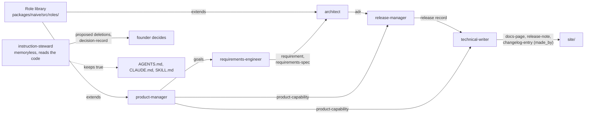

# agents

Up: [naive](../README.md)

## What this is

The agents that work on Naive itself, in this repository (EE-238), and the chief of staff agent that ships open source with it. A folder here is one of two things:

- **One of Naive's own roles**: a `role.json` that [`role.schema.json`](../packages/naive/src/records/role.schema.json) governs and a SKILL.md that says how an agent acts in the role, the same shape as a role module in the [role library](../packages/naive/src/roles/README.md). These roles are Naive's, never a venture's: a venture sees only the library and its own `governance/roles/`.
- **A shipped agent of a library role**: an AGENTS.md a harness loads as its instructions, with no `role.json`, because the role lives in the library. [`chief-of-staff/AGENTS.md`](./chief-of-staff/AGENTS.md) is the one today; its role is `packages/naive/src/roles/chief-of-staff/role.json`. A second `role.json` here would be a second source for the same role.

A role here may extend a library role (`extends`) and leave out what it inherits, every field but its aliases, so the library stays the one source of what the two share. The product manager extends the product and design lead, whose alias is product-manager, and the architect extends the library's architect by the same id. The other four have no library counterpart and stand alone.

## Where things are

| Path | Holds |
|---|---|
| [`product-manager/`](./product-manager/SKILL.md) | Naive's portfolio of capabilities and their life cycle. Extends `product-design-lead`. PCF 2.1.1 and 2.1.2, accountable. Makes capabilities and goal drafts. Verified by the founder |
| [`architect/`](./architect/SKILL.md) | Naive's structure. Extends `architect`. PCF 8.2.3 responsible, 2.3.1.6 consulted. Makes ADRs and design documents, to ISO/IEC/IEEE 42010. Verified by the founder and the requirements engineer |
| [`requirements-engineer/`](./requirements-engineer/SKILL.md) | Requirements and the requirements specification, to ISO/IEC/IEEE 29148. PCF 2.3.1.6 accountable, 2.3.1.3 responsible. O*NET 15-1211.00. Verified by the product manager |
| [`release-manager/`](./release-manager/SKILL.md) | The release record, the facts of a release, to ISO/IEC/IEEE 12207. PCF 8.6.3 accountable, 8.6.5 responsible. Verified by the product manager; production ship stays the founder's |
| [`technical-writer/`](./technical-writer/SKILL.md) | The docs site's pages: `docs-page`, `release-note` and `changelog-entry`, the only role that may name them, to ISO/IEC/IEEE 26514. PCF 13.6.5 accountable, 13.6.6 responsible. O*NET 27-3042.00. Verified by the product manager |
| [`instruction-steward/`](./instruction-steward/SKILL.md) | Keeps AGENTS.md, CLAUDE.md and every SKILL.md true against the code, memoryless and reading only the codebase. PCF 13.6.4 accountable, 8.1.5.3 responsible. Proposes deletions as decision records and never deletes. Verified by the founder |
| [`chief-of-staff/`](./chief-of-staff/AGENTS.md) | The chief of staff agent, for a venture's founder |

## Run and test

- `node packages/naive/src/checks/check-roles.ts` checks the library and, with no venture given, Naive's own roles here: each `role.json` validates, alone and with what it inherits; `extends` names a library role; a folder with no `role.json` holds an AGENTS.md for a library role; each artifact is a record type or a document kind; a document kind with `made_by` is named by that role alone; each standard is a reference id; and the library's PCF, O*NET, verifier and alias rules.
- `node packages/naive/src/checks/check-roles-test.ts` breaks each rule on a copy, and `node test.ts` runs it.

## How it connects

The release manager holds the facts of a release, and the technical writer reads them and writes the pages, so each page kind has one maker.

- Read through `naiveRoles` in [`roles.ts`](../packages/naive/src/engine/agents/roles.ts): the library overlaid by the roles here. `loadRoles` and `knownRoles`, which every venture check reads, never see them.
- `packages/naive/src/functions/pcf-roles.json` holds the library's links only. Naive's own roles are left out of it, because this folder is not shipped in the package and the file is the map a venture reads.

## Not built

- Running these roles as digital workers on Naive's own records, and a staffing gate for Naive (steps 7 and 8 of `docs/design/ROLES_AS_AGENTS_2026-11-28.md`).
- A record type for an instruction file. The instruction steward's artifact is the decision record that proposes a deletion; whether a stale instruction may be deleted, and by whom, is not decided.
- An O*NET occupation for the product manager, the release manager and the instruction steward: none in O*NET 31.0 fits closely enough.
