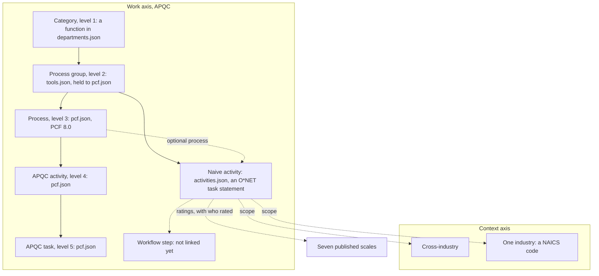
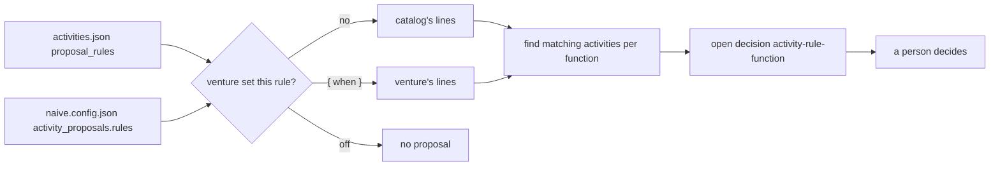
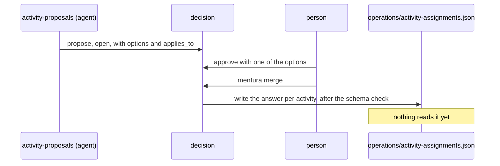

# The activity catalog

Date: 2026-11-25. Decisions: EE-164, EE-165, EE-166, EE-167, EE-168, EE-169, EE-170, EE-171, EE-172. Status: the record type, the scales, the check and the generator are built, and APQC's Process Classification Framework 8.0, levels 1 to 5, is built as `packages/naive/src/functions/pcf.json`; the catalog holds a first seed of 38 activities from SciNet, and the rest is listed under Not built.

## Domain

### What an activity is

An activity is a unit of work a business performs, such as interviewing prospective customers about a problem. It is the fourth level of APQC's Process Classification Framework, below the category, the process group and the process.

APQC already defines activities (level 4) and tasks (level 5): PCF 8.0 cross-industry has 1,352 activities and 215 tasks, and Naive carries them verbatim in `packages/naive/src/functions/pcf.json` (EE-165). So `activities.json` does not copy APQC's activities. It holds only the activities Naive adds, such as a research seed or activities for one industry, each filed under a process group and meant to point at the PCF process it belongs to. Naive writes each one as an O*NET task statement: one sentence that starts with a verb, names what the verb acts on and, where it helps, how or why, in at most 30 words. "Interview prospective customers to learn how they solve the problem today." is an activity. "Customer research" is not, because it names a topic and no work.

An activity says nothing about who performs it, a person or an agent, or with which tool. The tool catalog (EE-163) says which tools serve a process group; the activity catalog says what work is done in it.

The record type `activity` already exists and means something else: the time spent in a venture on one day, read from transcripts. The catalog's record type is `activity-catalog`, so the two do not collide in the data model. The word is used here in APQC's sense, and it is not registered as a noun in `packages/naive/src/terms/ontology.json` yet.

### Two axes

An activity sits on two axes at once.

The work axis is APQC's hierarchy: category (level 1, one of Naive's 13 functions), process group (level 2, the groups in `packages/naive/src/functions/tools.json`), process (level 3), activity (level 4) and task (level 5). Levels 1 to 5 of PCF 8.0 are in `pcf.json`. The tool catalog uses PCF 8.0's process group numbers, names and element ids (EE-166), and `check-pcf.ts` fails when they differ, so an activity's process group is looked up in `tools.json` and its process in `pcf.json`. Below APQC's levels, Naive's own unit is the workflow step: a step in a function's workflow is the work an agent does to perform an activity.

The context axis says where the activity applies. It is either cross-industry, true of any business, or one industry named by a NAICS code of two to six digits. The same statement can appear once in each scope, so an industry may keep its own reading of a cross-industry activity.

### Where the method comes from

SciNet (Alamos and Althoff 2026, release v1.10.0, CC BY 4.0) did this for scientific research. It holds 7,262 task statements in O*NET form. On its work axis they fall into 10 categories, group into 140 work activities and break into 90,583 steps. On its context axis each task applies to all research (the 30 universal tasks) or to one of 6 domains, 34 fields or 318 subfields. Each task is scored on importance, share of researchers and frequency in O*NET's way, and on descriptive dimensions that include the CDR taxonomy and the RL feasibility index.

Naive takes SciNet's method and its choice of scales, not its tasks. It keeps the task statement form, grows the catalog by adding one statement at a time and checking it, keeps work and context on separate axes, and scores activities on the same published scales. APQC replaces SciNet's categories and work activities on the work axis, and NAICS replaces its disciplines on the context axis.

### The scales

The catalog lists each scale with its source and its range, and a rating must sit inside that range. Fractional values are allowed.

| Scale | Range | Source |
|---|---|---|
| regulatory-restriction | 0 to 4 | CDR taxonomy, regulatory restrictions axis (Parshall and Lopez-Luzuriaga 2026) |
| physical-deployment | 0 to 4 | CDR taxonomy, deployment difficulty axis |
| cognitive-complexity | 0 to 4 | CDR taxonomy, cognitive complexity axis |
| verification | 1 to 10 | RL feasibility index, verification method dimension (Moreira Tomei and Klein Teeselink 2026) |
| importance | 1 to 5 | O*NET importance |
| share | 0 to 100 | O*NET relevance: the percent of practitioners who perform it |
| frequency | 1 to 7 | O*NET frequency categories |

A score is one rater's judgment. Every rated activity names who rated it, on what date and on what basis, and the catalog is version 0.x and unevaluated: no score has been compared with an outcome. A score never decides anything. The most a score may ever do is propose an open decision for a person.

## System

- `packages/naive/src/functions/pcf.json` is APQC's Process Classification Framework 8.0 (March 2026), cross-industry, levels 1 to 5: each element's hierarchy id, its name verbatim from APQC and its five-digit element id, with the attribution APQC's licence requires in every copy. It has no definitions or measures. `scripts/import-pcf.ts` writes it from a hierarchy extracted from APQC's 13 Definitions and Key Measures articles, and `packages/naive/src/checks/check-pcf.ts` checks it (EE-165). Element ids are stable across PCF versions and hierarchy ids are not; APQC files four element ids at two hierarchy ids each, and the file keeps them.
- `packages/naive/src/functions/activities.json` is the catalog: `version`, `note`, `scales` (the seven above) and `activities`.
- A workflow step may name the activity it performs (EE-168): `activity` on a step in `packages/naive/src/functions/<function>/workflows/<id>.json` is the hierarchy id of an APQC level 4 activity in `pcf.json`, such as 3.5.1.6 Manage opportunity pipeline, or the id of an activity in `activities.json`. `check-functions.ts` fails when it names neither or sits under another function's APQC category.
- Scores propose decisions (EE-169): the catalog's `proposal_rules` are data, each `{id, when, asks, basis}`. `when` lists lines on scales, and an activity matches when its scores meet every line; an activity with no score on a named scale does not match. The two rules are `agent-with-checked-result` (verification at least 7, physical deployment at most 1, regulatory restriction at most 1) and `person-approves-restricted` (regulatory restriction at least 2). Their lines are unvalidated priors. `naive activities list` prints, for each function the venture lists in venture.json departments, the rated cross-industry activities each rule finds, and writes nothing. `naive activities propose` files one open decision per rule and function, `activity-<rule>-<function>`, through the decision door as the agent `activity-proposals`, with each activity, the scores the rule read and who rated it in the note. A rerun leaves a decision already filed, open or decided, as it is. It edits no catalog, workflow or other record (`packages/naive/src/engine/activity-proposals.ts`).
- A venture's own lines (EE-170): `activity_proposals.rules` in `naive.config.json` maps a rule id to `off`, so the rule proposes nothing in that venture, or to `{ when }`, lines that replace all of the catalog's for that rule. A rule left out keeps the catalog's lines. The decision id is the same either way, and the note says the lines are the venture's and that the catalog's basis was written for the catalog's lines. `packages/naive/src/checks/check-config.ts` and `naive activities` refuse a rule id the catalog lacks, a scale it does not list, a line outside the scale's range and lines no score meets. A decision already filed is left as it is when the lines change.

- Industry activities (EE-171): an activity whose scope is a NAICS industry applies to a venture when the code in venture.json `industry` starts with the activity's code, because a NAICS code holds its parents as prefixes. NAICS numbers three sectors with a range (31-33 manufacturing, 44-45 retail trade, 48-49 transportation and warehousing), so a two-digit code in one of them names the whole sector. A venture with no industry gets the cross-industry activities only. An industry activity joins the same decision as the cross-industry ones of its rule and function, and the note names its NAICS code.
- Applying an answer (EE-172): a proposal rule may name what its answer sets. `sets` is a field of the venture's activity assignments, `operations/activity-assignments.json` (`packages/naive/src/records/activity-assignments.schema.json`): `performer`, agent or person, or `approval`, person or none. The decision a rule files then offers the field's values as its options and lists one `applies_to` entry per activity found. Approving and merging stay separate steps, as for every decision: a person decides, and `mentura merge <decision>` writes the answer for each activity, checked against the schema first, so an answer outside the options is refused and nothing is written. A second rule's answer joins the same file. `agent-with-checked-result` sets `performer` and `person-approves-restricted` sets `approval`. `naive activities` refuses assignments that name an activity the catalog lacks.

- The seed (EE-167): `node scripts/import-scinet.ts` wrote 38 activities under process group 3.1, process 3.1.1 Perform customer and market intelligence analysis. They are SciNet v1.10.0's Data Gathering and Data Analysis tasks for the subfields Entrepreneurship & Innovation and Marketing, and the universal task of obtaining ethical approval and informed consent. Each keeps SciNet's statement, names SciNet as its source, and carries SciNet's scores. Those scores rate the task as researchers perform it, and each activity's `rated.basis` says it is not rated for a business. A rerun on the same release writes the same bytes, and the script replaces only SciNet's activities under the process group it is given.
- `packages/naive/src/records/activity-catalog.schema.json` is its schema, with `additionalProperties: false` on every object. An activity is `{id, process_group, process?, statement, scope, source?, ratings?, rated?}`. `scope` is `{kind: "cross-industry"}` or `{kind: "industry", naics}`. `source` is `{ref, locator?, changed?}`, where `changed` says the statement was reworded from the source. `rated` (`{by, on, basis}`) is required when `ratings` is present.
- The record type `activity-catalog` is in `packages/naive/src/records/data-model.json` (operations layer, no function, method level) and in the operations layer manifest. Its type is `ActivityCatalog` in `packages/naive/src/records/types/records.d.ts`.
- `packages/naive/src/checks/check-activities.ts` checks the catalog across files. It fails on a schema error; a scale or activity id listed twice; a statement repeated within one process group and scope; a scale range that does not rise; a process group not in `tools.json`; a process whose id does not start with its process group's or that is not a level 3 element of `pcf.json`; a statement over 30 words, of more than one sentence, or starting with an article or pronoun; a rating on a scale the catalog does not list or outside its range; and a source that is not a reference id in any layer's `references/references.json`. It reads files through VentureFs, exits 1 on findings and 2 when a file cannot be read, and `--json` prints the number of activities per function and process group. `packages/naive/src/checks/check-activities-test.ts` adds one valid rated activity to a copy, shows it passes, and breaks each rule.
- `packages/naive/src/engine/generators/activity-catalog.ts` drafts the catalog with one more activity and refuses an id already in it. Adding an activity is a change to the framework, made in a pull request.
- The sources are references in `packages/naive/src/records/layers/operations/references/references.json`: SciNet, O*NET, the CDR taxonomy and the RL feasibility index. NAICS reuses `naics-2022` in the purpose layer's references, and the process groups cite `apqc-pcf-cross-industry`.
- The activity catalog and `pcf.json` left `tools.json` and `tool-catalog.schema.json` unchanged. A later change (EE-166) moved `tools.json` from PCF 7.4 to 8.0: 5.3 Deliver service to customer became 5.4, 13.6 to 13.9 became 13.7 to 13.10, the new 5.3 and 13.6 went to the Engagements and Knowledge base tools, two human capital groups took APQC's 8.0 wording, and every group has its element id. A console that copied `tools.json` copies it again.

## Not built

- Requiring an activity to name its PCF process. `process` is still optional.
- Naming an activity on every workflow step. The field is optional, and two steps of the marketing and sales workflows name one so far.
- Proposing a venture's lines from its market and industry, as gate calibration does for the phase gates. A person writes them by hand.
- An activity for one NAICS industry. The matching is built, and the catalog holds none yet.
- Acting on the assignments. Nothing reads `operations/activity-assignments.json` yet: no agent, workflow step, decision level or done-criterion changes with it.
- Rating the seeded activities for a business. The scores are SciNet's, for researchers.
- Activities outside process group 3.1.
- A list of valid NAICS codes. The check holds a code to two to six digits only.
