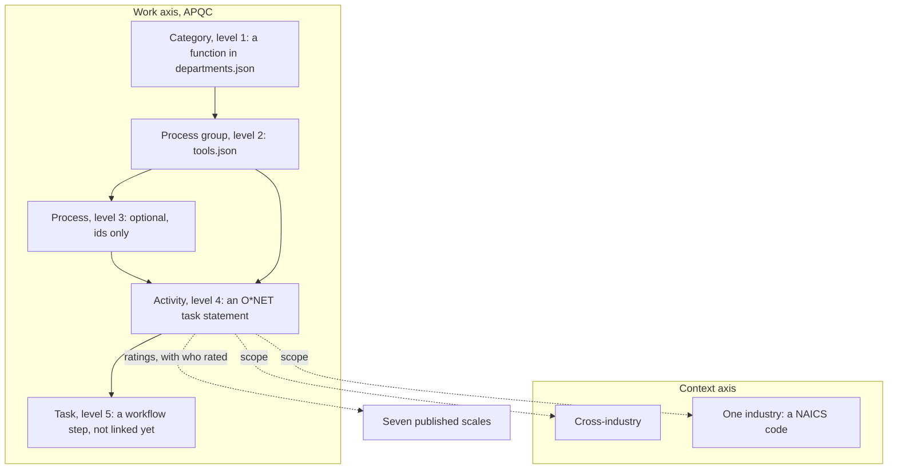

# The activity catalog

Date: 2026-11-25. Decision: EE-164. Status: the record type, the scales, the check and the generator are built; the catalog holds no activities yet, and the rest is listed under Not built.

## Domain

### What an activity is

An activity is a unit of work a business performs, such as interviewing prospective customers about a problem. It is the fourth level of APQC's Process Classification Framework, below the category, the process group and the process. Naive writes each one as an O*NET task statement: one sentence that starts with a verb, names what the verb acts on and, where it helps, how or why, in at most 30 words. "Interview prospective customers to learn how they solve the problem today." is an activity. "Customer research" is not, because it names a topic and no work.

An activity says nothing about who performs it, a person or an agent, or with which tool. The tool catalog (EE-163) says which tools serve a process group; the activity catalog says what work is done in it.

The record type `activity` already exists and means something else: the time spent in a venture on one day, read from transcripts. The catalog's record type is `activity-catalog`, so the two do not collide in the data model. The word is used here in APQC's sense, and it is not registered as a noun in `packages/naive/src/terms/ontology.json` yet.

### Two axes

An activity sits on two axes at once.

The work axis is APQC's hierarchy: category (level 1, one of Naive's 13 functions), process group (level 2, the groups in `packages/naive/src/functions/tools.json`), process (level 3), activity (level 4) and task (level 5). Naive's own task level is the workflow step: a step in a function's workflow is the work an agent does to perform an activity.

The context axis says where the activity applies. It is either cross-industry, true of any business, or one industry named by a NAICS code of two to six digits. The same statement can appear once in each scope, so an industry may keep its own reading of a cross-industry activity.

### Where the method comes from

SciNet (Alamos and Althoff 2026, release v1.10.0, CC BY 4.0) did this for scientific research. It holds 7,262 task statements in O*NET form. On its work axis they fall into 10 categories, group into 140 work activities and break into 90,583 steps. On its context axis each task applies to all research (the 30 universal tasks) or to one of 6 domains, 34 fields or 318 subfields. Each task is scored on importance, share of researchers and frequency in O*NET's way, and on descriptive dimensions that include the CDR taxonomy and the RL feasibility index.

Naive takes SciNet's method and its choice of scales, not its tasks. It keeps the task statement form, grows the catalog by adding one statement at a time and checking it, keeps work and context on separate axes, and scores activities on the same published scales. APQC replaces SciNet's categories and work activities on the work axis, and NAICS replaces its disciplines on the context axis.

### The scales

The catalog lists each scale with its source and its range, and a rating must sit inside that range. Fractional values are allowed.

| Scale | Range | Source |
|---|---|---|
| regulatory-restriction | 0 to 4 | CDR taxonomy, regulatory restrictions axis (Parshall and Lopez-Luzuriaga 2026) |
| physical-deployment | 0 to 4 | CDR taxonomy, deployment difficulty axis |
| cognitive-complexity | 0 to 4 | CDR taxonomy, cognitive complexity axis |
| verification | 1 to 10 | RL feasibility index, verification method dimension (Moreira Tomei and Klein Teeselink 2026) |
| importance | 1 to 5 | O*NET importance |
| share | 0 to 100 | O*NET relevance: the percent of practitioners who perform it |
| frequency | 1 to 7 | O*NET frequency categories |

A score is one rater's judgment. Every rated activity names who rated it, on what date and on what basis, and the catalog is version 0.x and unevaluated: no score has been compared with an outcome. A score never decides anything. The most a score may ever do is propose an open decision for a person.

## System

- `packages/naive/src/functions/activities.json` is the catalog: `version`, `note`, `scales` (the seven above) and `activities`, which is empty until it is seeded.
- `packages/naive/src/records/activity-catalog.schema.json` is its schema, with `additionalProperties: false` on every object. An activity is `{id, process_group, process?, statement, scope, source?, ratings?, rated?}`. `scope` is `{kind: "cross-industry"}` or `{kind: "industry", naics}`. `source` is `{ref, locator?, changed?}`, where `changed` says the statement was reworded from the source. `rated` (`{by, on, basis}`) is required when `ratings` is present.
- The record type `activity-catalog` is in `packages/naive/src/records/data-model.json` (operations layer, no function, method level) and in the operations layer manifest. Its type is `ActivityCatalog` in `packages/naive/src/records/types/records.d.ts`.
- `packages/naive/src/checks/check-activities.ts` checks the catalog across files. It fails on a schema error; a scale or activity id listed twice; a statement repeated within one process group and scope; a scale range that does not rise; a process group not in `tools.json`; a process whose id does not start with its process group's; a statement over 30 words, of more than one sentence, or starting with an article or pronoun; a rating on a scale the catalog does not list or outside its range; and a source that is not a reference id in any layer's `references/references.json`. It reads files through VentureFs, exits 1 on findings and 2 when a file cannot be read, and `--json` prints the number of activities per function and process group. `packages/naive/src/checks/check-activities-test.ts` adds one valid rated activity to a copy, shows it passes, and breaks each rule.
- `packages/naive/src/engine/generators/activity-catalog.ts` drafts the catalog with one more activity and refuses an id already in it. Adding an activity is a change to the framework, made in a pull request.
- The sources are references in `packages/naive/src/records/layers/operations/references/references.json`: SciNet, O*NET, the CDR taxonomy and the RL feasibility index. NAICS reuses `naics-2022` in the purpose layer's references, and the process groups cite `apqc-pcf-cross-industry`.
- `tools.json` and `tool-catalog.schema.json` are unchanged.

## Not built

- APQC level 3 processes as data. An activity may name a process id, and the check holds it under its process group, but no list of level 3 processes exists to check it against. Building one needs APQC's PCF file and a read of its terms.
- The link from a workflow step to the activity it performs.
- A command that reads rated activities and proposes open decisions, such as a decision level or a done-criterion kind for a function.
- The seed: no activities are in the catalog yet. The first ones are planned to come from SciNet by a script, with a person choosing which enter.
- A list of valid NAICS codes. The check holds a code to two to six digits only.
