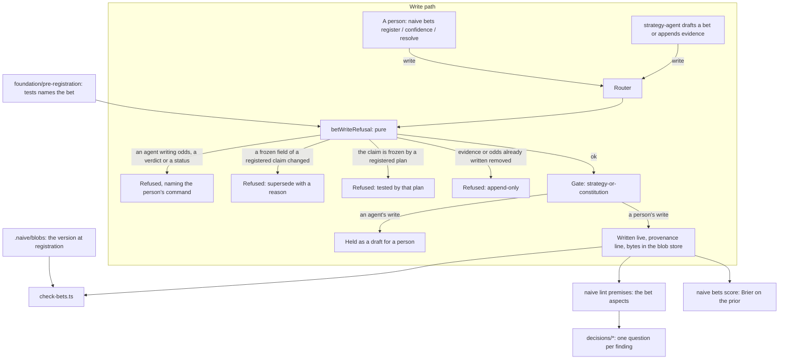
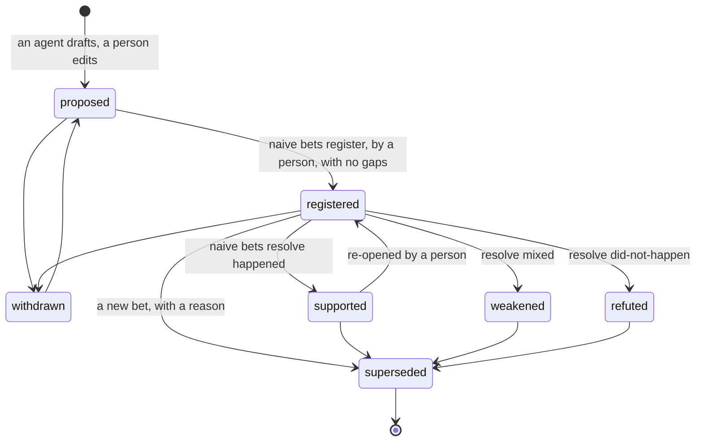

# Bets: strategy claims written the way requirements are written

Date: 2026-11-26. Decision: EE-221. Status: the record type, the two-level freeze, the write refusals, `naive bets`, `check-bets.ts`, the premise-lint aspect over bets, the `bet-review` workflow and the `bet-writing` skill are built. The Lean property, the prose-style runner and the mission-line rule are not built, and are listed under What is not built.

## The ask

Torian, 2026-11-26: "create a list of bets similar to how we would create system requirements. A bet would be a similar thing, but for strategy. Then we would need a research flow for testing our bets ... some sort of formal verification for our bets. We would have to try to disprove our bets, attack the premise of our bets ... I think all of this is the pre-registration's purpose. We actually need to codify pre-registration in our workflow and how it should be conducted ... skills for writing pre-research and skills for writing overall and linting flows for writing."

Build the mechanism, not the content. No bet is shipped, no example restates the founder's own thesis, and no threshold, date or probability is chosen by an agent.

## Domain

A requirement is one thing the system must do, written so that a reader can tell whether it holds: necessary, unambiguous, singular, feasible, verifiable, traceable (ISO/IEC/IEEE 29148:2018), in a fixed sentence template for its kind (EARS, Mavin et al. 2009). A strategy is a set of claims about the world, and written as prose those claims cannot be wrong, because nothing in them says what would count against them. A bet is one of those claims written the way a requirement is written.

| Field of the record | Where the practice comes from |
|---|---|
| `kind` and the fixed sentence per kind (`statementForm`) | EARS: a template per kind of requirement, so the parts are what is written and the sentence is rendered. |
| `claim` with population, measure, comparator, threshold, date and source | ISO/IEC/IEEE 29148's verifiable and unambiguous: a claim nobody can measure is not a requirement, and not a bet. |
| `falsified_by` | Popper, *The Logic of Scientific Discovery* (1959): a claim is testable when an observation could contradict it. Paired with a date, it is Duke's kill criterion (*Quit*, 2022). |
| `premises[]` | Dewar, *Assumption-Based Planning* (2002), and Toulmin's warrant (*The Uses of Argument*, 1958): a plan rests on claims it states and claims it does not. A reason given for a bet is a premise, not a second bet. |
| `rivals[]` with what separates them | Platt, "Strong inference", *Science* 146 (1964): name the competing hypothesis and the observation that rules one out. |
| `evidence[]` with `supports: false` | Heuer, *Psychology of Intelligence Analysis* (1999): in analysis of competing hypotheses it is the evidence against that decides. The grade is `check-validation.ts`'s, adapted from GRADE. |
| `confidence[]` with `p`, `set_by` and `data_seen` | Tetlock and Gardner, *Superforecasting* (2015), and Brier (1950): a probability, a date and a score afterwards. `data_seen` is the OSF Preregistration template's existing-data item with its five answers, so a bet drawn from evidence the founder had already read says so (Nosek et al., PNAS 2018). |
| `kind: "selection-rule"` | A rule that says whom the venture backs is a value, not a claim. What can be tested is whether its observable test works, so it is never scored and never reported as supported. |
| `intends_to_cause` | A founder building a product to make a forecast come true is not a neutral observer. Those are scored apart from foresight. |
| `supersedes` and `supersede_reason` | A registered claim is not edited. A narrowed claim is a new bet, and the old claim and its outcome stay readable. |

The pre-registration (EE-220) is the plan for one test; the bet is the claim, and it outlives the test. A plan names the bets it tests in `tests`, and registering the plan freezes the claim it was written against.

Naive ships no number. The line, the date and the odds are the founder's.

## System

The freeze has two layers, as the pre-registration's does, and the write-path refusal has two levels of its own.

1. **At the write.** `betWriteRefusal` in `packages/naive/src/engine/bets.ts` is pure: stored record, record being written, whether the writer is a person, and the ids of registered plans that test it. It returns a refusal or null, and the router calls it before the gate, so a refusal is a refusal and not a draft. Two levels: `CLAIM_FROZEN` (kind, statement, claim, rule, falsified_by, premises, intends_to_cause) is frozen by a registered plan that tests the bet, even while the bet is still proposed; `FROZEN` adds the bet's own registration fields and is frozen from `registered` on. Splitting them keeps a plan from freezing `registered_at` before it can be set.
2. **At rest.** `packages/naive/src/checks/check-bets.ts` reads the version live when the bet was registered out of the blob store and compares the frozen fields with the record as it stands, so a hand edit that never went through the router is caught. Blobs are not backfilled, so a bet registered before the blob store existed is reported as unverifiable, not failed.

An agent's write of `status`, `confidence`, `resolution` or the registration fields is refused outright rather than held as a draft, and the refusal names the person's command (`naive bets confidence`, `naive bets register`, `naive bets resolve`) or the `continue-or-stop` decision to raise. A draft an agent could propose would be a number an agent chose.

## The record

`foundation/bets/<id>.json`, route `foundation/bets/[id]`, owned by the strategy function, decision class `strategy-or-constitution`, suggested from Discovery (an unvalidated prior in `need-now.json`).

Five kinds: `empirical` (true or false today), `forecast` (resolves at a date), `causal` (a cause changes a measure against a comparison group), `premise` (a claim another bet rests on) and `selection-rule` (whom the venture backs). A selection rule carries `rule` and no `claim`; every other kind carries `claim` and no `rule`. `statementForm` renders the fixed sentence from the parts and returns null when a part is missing, so `naive bets show` prints the rendered sentence beside the founder's own wording and a person confirms the two say the same thing.

`registrationGaps` is the one list the command, the router and the check all read: every kind needs what would show it wrong and at least one probability with who set it and what they had seen; a claim needs its population, measure, comparator, threshold with `set_by`, source and, for a forecast, a date; a rule needs both sides and an observable test. Registration is refused while a gap stands, and the gaps are printed.

The one contradiction a machine settles: `claimKey` compares two claims only over the same population, measure, unit and date, and `bothCanHold` does interval arithmetic on the comparator and the threshold. Two registered bets whose lines cannot both hold is an error in `check-bets.ts`. Whether a claim is true is evidence and a person's judgment, and no program settles it.

## The attack flow

`naive lint premises` already generates questions by formula as `state(record, field, aspect)` over goals, requirements, exit criteria, constraints and decisions. Bets are a sixth kind there rather than a new linter: `canonical()` reads `foundation/bets`, and the bet cells are the existing aspects plus one new one.

| Aspect | What it asks of a bet |
|---|---|
| `undefined-term` | A graded word in the statement with no number or definition behind it. |
| `unmeasurable` | A claim gap, no `falsified_by`, or nobody's odds on it. |
| `no-owner` | No owner. |
| `unsupported-premise` | No evidence and no premises: nothing holds it up. |
| `no-counter-evidence` (new) | No evidence with `supports: false`, or no rival with what separates them. |
| `orphan` | Nothing rests on it (`used_by` empty and no bet names it as a premise). |
| `dependency` | A premise still unresolved, or a cycle in the premise graph. |
| `conflict` | A premise weakened or refuted while the bet is reported supported, or two bets restating each other. |

The rules are configured under `premise_lint.rules` in `naive.config.json`, off, warn or error, as the others are. The linter never edits a record; `--propose` files each finding as an open decision.

The workflow is `packages/naive/src/functions/strategy/workflows/bet-review.json`, triggered by an event on `foundation/bets` and requiring a `foundation/pre-registration` record (EE-217): read the register, write the claim (skill `bet-writing`), pre-register the test (skill `pre-registration`), search for and against by the registered method, attack the premises (and the step says plainly that the agent that ran the search does not run this step), bring the founder the resolution, and, once bets have resolved, score the odds. The last step is one to consider, with when and why (EE-181).

The score is `brierOf` and `calibration` in `engine/bets.ts`, pure: the prior is what is scored, because every later entry saw the evidence; a mixed or unresolvable outcome is not scored rather than guessed at; a selection rule is never scored; a bet the venture worked to make true is reported apart and never as foresight; and every bet left out of the mean says why.

## Writing

One skill, `packages/naive/src/functions/strategy/skills/bet-writing/SKILL.md`: split, classify, write the parts rather than the sentence, ask for the line and the date rather than offering either, say what would show it wrong, name the premises, name the rival, declare whether the venture is working to make it true, ask for the odds and what had already been seen, register, then pre-register the test. The pre-registration half of the goal is EE-220's skill, which this one hands off to, so there is one skill per durable object and not one skill with two subjects.

## What is not built

- **A Lean property.** The two properties the methods note asks for, no lookahead and an agent never resolves, are already proved generically in `packages/naive/lean/Naive/Recipes.lean` and carry over to bets: a researcher's reads are clamped by `reads-as-of.ts`, and the agent refusal here is the same shape. A new encoding of the bet lifecycle was not added, because no Lean toolchain is installed in this environment and a proof nobody can check is worse than none.
- **A prose-style runner.** A house style as rule files, a Vale style for instance, would add a binary dependency, and for a bet the two built lints cover it: premise-lint's vague-word list and `undefined-term`, and `publish-lint.ts`'s `claims` rule for anything public.
- **A `lint-foundation` rule that mission and vision lines cite only registered bets.** The skill says where it would sit.
- **Evidence found after the lock enforced as such.** `check-bets.ts` checks the freeze, not the order in which each evidence reference was found against the plan's registration time.
- **A bet derived retired or resolved by anything but a person.** Nothing reads an outcome off a system, and the router refuses an agent that tries.
