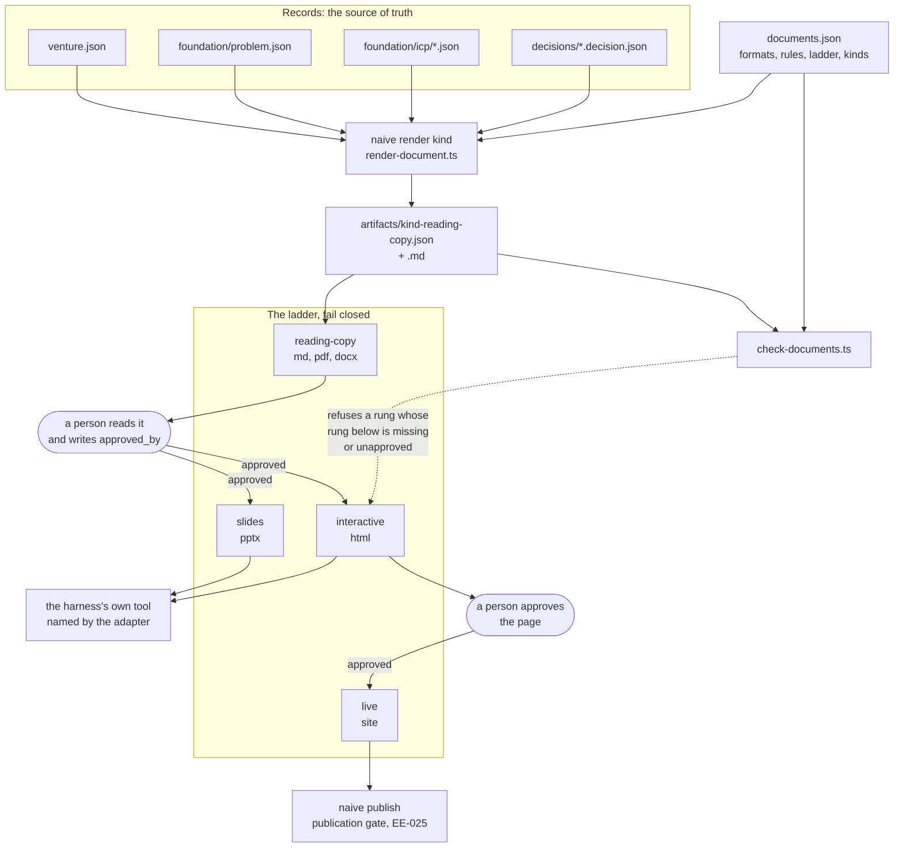

# Documents: what gets printed, presented and published, and in what order

2026-11-26. Decision EE-218.

## The goal

Torian, 2026-11-26: before the website is built, build HTML here where he can view and interact with it, and before
that, build an internal record a person would actually sit down and read, something that could be printed out for
meetings. Be opinionated about which documents can be printed and presented, which records become decks and PDFs,
when a deck beats a PDF, which tools make them, and which instructions go to which agent, with Claude Code
instructions specifically. Research the plugins that already exist rather than reinventing the wheel.

His standing rule holds throughout: a record is the source of truth and an artifact is a view rendered from records,
never the record.

The smallest change that meets it: the document catalog as data, with a check; the ladder as a fail-closed order over
it; one in-house renderer for the reading copy; and one skill that tells an agent which tool to use per format in the
harness it is in.

## What exists already, and what it does not cover

| Already in Naive | Covers |
|---|---|
| `artifact.schema.json` | A view built from records, naming each record and its hash at the moment it was read |
| `packages/naive/src/engine/check-artifacts.ts` | Says when an artifact has gone stale because a record it cites changed |
| `publication-policy.schema.json`, `publications.schema.json`, `packages/naive/src/engine/publish.ts` | Channels, approvers, the one-way-door gate, the live sha and rollback (EE-025) |
| `packages/naive/src/engine/publish-lint.ts` | Copy distance, leaks, uncited claims, marks, personal data, secrets |
| `packages/naive/src/interfaces/skills/choosing-artifacts/SKILL.md` | Whether to build an artifact at all, and which kind |

Nothing said which document kinds a venture makes, which format each one takes and why, which records a kind is
rendered from, or that a reading copy comes before a page and a page before the site. Publishing was gated; the
making of a document was not. That is the gap EE-218 fills.

## Research: what to copy, adapt or skip

Checked 2026-11-26 in this session, in the installed plugins and marketplaces, not from memory.

| Source | Licence | Choice |
|---|---|---|
| Anthropic's `pdf`, `docx`, `pptx`, `xlsx` skills (installed here, same as `anthropics/skills`) | Apache 2.0, one `LICENSE.txt` each, identical | **Adapt, do not copy.** Naive names them from the Claude Code adapter and the writing-documents skill, and carries none of their text or scripts. They are good and they are the harness's, not the framework's |
| Their load-bearing lesson: "if the session offers a dedicated document or deck type, use that instead; a file to send or print is no reason to make a Word file" | — | **Copy the idea, in our own words.** The catalog's rules say the same thing from the reader's side: format follows how a person takes it in, not how it will be delivered |
| Their other lesson: when a document runs over its page limit, cut words rather than shrink the type | — | **Copy the idea.** The catalog carries `words_per_page` and `pages` per kind as unvalidated priors a venture overrides |
| Claude Code marketplaces: `anthropic-plugin-directory` and `cursor-plugins` | — | Both listed; neither has a document ladder or a format catalog to reuse |
| PDFBolt (directory, community, remote MCP) | — | **Skip.** It renders HTML to PDF through an outside service. A venture's records would leave the tenant, and `NAIVE_RUNTIME=hosted` refuses to reach outside it |
| Ploxs Presentations (directory, community, remote MCP, Google Slides) | — | **Skip**, same reason, plus it names a vendor the catalog must not |
| `docs-canvas` (cursor-plugins, MIT) | MIT | **Skip.** It renders docs as an interactive Cursor canvas, which is the rung Torian wants deferred, not the reading copy |
| Deck, Make Documentation, Invoice Generator (directory) | — | **Skip.** Not about this problem |

The conclusion is narrow and worth stating: the heavy format renderers already exist and are better than anything
Naive would write. Naive's job is to be opinionated about **which** document, in **which** format, from **which**
records, in **which** order, and to render the one format that must stay in house, Markdown, so the reading copy
never depends on a harness being present.

## The design



### 1. The catalog is data

`packages/naive/src/functions/documents.json`, record type `document-catalog`, schema
`packages/naive/src/records/document-catalog.schema.json`, cross-function like `tools.json` and `activities.json`
because each kind names its own function. Four parts:

- **`formats`**: `md`, `pdf`, `docx`, `pptx`, `html`, `site`. Each says how a person takes it in, whether it prints,
  which rung it sits on, who renders it (`naive`, `harness`, `site-build`) and why it exists at all.
- **`rules`**: the opinionated part, seven of them. A person reading alone, in order, takes a document and not slides.
  A person speaking to a room takes slides, one point a slide. Word only when the reader must edit the words.
  HTML only once the words are settled. Public is a one-way door. Each rule names the formats it points to and the
  ones it rules out. A rule never decides alone, and a person's override is a decision.
- **`ladder`**: the rungs, each naming the rung it comes `after`, so the ladder is one chain the check can walk.
- **`kinds`**: eight to start. `one-pager`, `memo`, `brief`, `meeting-pack`, `board-update`, `pitch-deck`, `spec`,
  `site-copy`. Each names its function, purpose, audience, artifact kind, the highest rung it climbs, its formats
  with **why those and not the others**, and the sections it renders from, each section naming the record it reads
  and the field to quote.

A venture that wants a kind the catalog lacks proposes it here, through
`packages/naive/src/engine/generators/document-catalog.ts`, as a pull request. That is deliberate: a catalog every
venture can edit locally is not an opinion, it is a suggestion.

### 2. The ladder is a fail-closed order

```
reading-copy  (md, pdf, docx)  <- the first rung, and the only one Naive renders
├── slides        (pptx)
└── interactive   (html)
    └── live      (site)
```

A rung is built only once the rung it comes after exists as a live artifact a person approved. That is the ladder's
own requirement, which is why no rung repeats it under `requires`; a rung's `requires` holds only what it adds.
`live` adds `governance/publication-policy.json` and a decided `public-commitment` decision.

`requires` is written in the shape EE-217's `prerequisitesOf` reads, `{ records, meetings, decisions }`, so the
gating mechanism that worker is adding reads this data without a translation layer. This change adds the data and
the order, not the mechanism.

Approval is a person's, through the existing gate: a person writes `approved_by` on the artifact record. No new
decision class, and no new approval mechanism. `naive render --format html` is refused until that field is there,
and `check-documents.ts <venture>` fails on any document artifact sitting on a rung whose rung below is missing or
unapproved. An agent cannot work around either, because both read the record, not its own claim about the record.

The ordering also appears as step order in a workflow,
`packages/naive/src/functions/marketing-and-sales/workflows/site-documents.json`: render the reading copy, fill its
holes, hand it to a person, then (as steps to consider) the page and the publish. It is the rung above EE-216's
`site-copy` workflow, which settles the copy records element by element; those records are what this one reads, so the
two are one chain and not two names for the same step.

### 3. One renderer in house, the rest to the harness

`naive render <kind>` writes the Markdown reading copy and its artifact record. Every section cites the record it
came from, with the field named. A fact no record holds appears as a hole, `_Not recorded: ..._`, never as a
sentence; the agent's answer to a hole is to write the record, not the document.

Every other format prints instructions instead of rendering: read the approved reading copy, build this format from
it changing no fact, with the tool your adapter names, then give it to a person. Naive adds no PDF or OOXML
dependency, which keeps the install small and keeps the heavy renderers where they are already maintained.

### 4. The instructions an agent gets

- `packages/naive/src/interfaces/skills/writing-documents/SKILL.md`, one skill in the interface layer beside
  `choosing-artifacts`: the ladder, the two rules that get broken most, the per-format table, how to present a rung
  for approval, and a Claude Code section naming `pdf`, `docx`, `pptx`, `xlsx` and `artifact-design` with what to
  watch for in each.
- `packages/naive/src/interfaces/adapters/claude-code.json` gains a `documents` map, format to tool. The catalog
  names no vendor; the adapter does. A harness with no map leaves those formats to whatever the agent has.

## What this does not do

- No PDF, Word, PowerPoint or spreadsheet is rendered by Naive. By choice, and the skill says so plainly.
- The gating mechanism is EE-217's. This change ships the data in its shape and one workflow's step order; it does
  not read `requires` at a gate.
- `naive render` does not write through the router, so a rendered artifact is not held as a draft and does not pass
  the gate's rules. It writes two files in `artifacts/` and logs nothing in provenance. Routing artifact writes
  through the router is the obvious next step and is not built.
- `check-documents.ts` does not check that a section's `field` exists in that record type's schema, only that the
  record path is one the data model has. Not built.
- No `naive approve` command. A person writes `approved_by` on the artifact record, or an interface does it for
  them. A command for it is not built.
- The catalog has no kind for a contract, a filing or anything with legal effect. Those have their own gates
  (`legal-or-terms`) and are not documents a render should ever draft.

## Files

| File | What it holds |
|---|---|
| `packages/naive/src/records/document-catalog.schema.json` | The record type |
| `packages/naive/src/functions/documents.json` | The catalog: formats, rules, ladder, eight kinds |
| `packages/naive/src/engine/documents.ts` | Pure: the catalog, the ladder walk, `prerequisites`, the Markdown render |
| `packages/naive/src/engine/render-document.ts` | `naive render`: the I/O, the refusals, the artifact record |
| `packages/naive/src/engine/generators/document-catalog.ts` | Drafting a new kind as a pull request |
| `packages/naive/src/checks/check-documents.ts` | The catalog across files, and a venture's documents against the ladder |
| `packages/naive/src/checks/check-documents-test.ts` | Breaks each rule on copies; renders from a copy of the software example |
| `packages/naive/src/interfaces/skills/writing-documents/SKILL.md` | The instructions, with a Claude Code section |
| `packages/naive/src/interfaces/adapters/claude-code.json` | The format-to-tool map for Claude Code |
| `packages/naive/src/functions/marketing-and-sales/workflows/site-documents.json` | The ladder as step order, after EE-216's `site-copy` |
