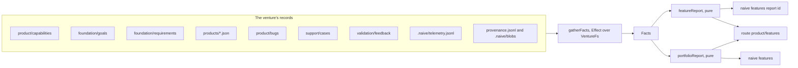

# Feature reports

Date: 2026-11-27. Decision: EE-228. Status: built, with the parts listed under "Not built" left out.

## The ask

Torian, 2026-11-27: "generate some sort of feature reports. research what a product manager does and how they keep track of features."

## What a product manager does

A product manager is responsible for a solution that is valuable, usable, feasible and viable, and spends most of the time on discovery (finding out what to build) as against delivery (building it) ([Marty Cagan, Inspired, via Mind the Product](https://www.mindtheproduct.com/the-role-of-a-product-manager-marty-cagan); [AltexSoft on the product manager role](https://www.altexsoft.com/blog/business/product-management-main-stages-and-product-manager-role/)). Naive's products function already checks the four risks on every build (`four-risks-review`). What it lacked was one place to read a feature as a whole.

## How product managers keep track of features

Roadmap tools keep each feature with three things: a lifecycle status, a link to the goal or initiative it serves, and progress reported against measurable goals ([Aha! on reporting progress](https://www.aha.io/roadmapping/guide/product-roadmap/report-on-progress); [Aha! on linking work to strategy](https://www.aha.io/support/roadmaps/strategic-roadmaps/best-practices/linking-work-to-strategy); [Productboard's feature status values](https://productboard.com/blog/feature-status-values)).

They rank features, often by RICE, Intercom's method: reach times impact times confidence over effort ([ProjectManager on RICE](https://www.projectmanager.com/blog/rice-framework)). Impact is on a fixed scale (3 massive, 2 high, 1 medium, 0.5 low, 0.25 minimal), confidence is a percentage, and effort is in person-months.

They measure adoption in four ways: breadth (the share of eligible users who used it at least once), depth, time to adopt, and duration or stickiness ([Pendo](https://www.pendo.io/glossary/feature-adoption/); [Contentsquare](https://contentsquare.com/guides/product-adoption/feature/); [Userpilot](https://userpilot.com/blog/feature-adoption-metrics/)). High adoption does not prove a feature delivers value ([Mind the Product on realized value](https://www.mindtheproduct.com/when-product-roadmaps-ignore-realized-value/)), so the report puts adoption beside the goals the feature serves and never alone.

The reports they keep are the roadmap, feature prioritisation, launch readiness and customer feedback ([Aha! report templates](https://www.aha.io/blog/report-templates-for-product-managers)).

## What Naive already held

A feature is a product capability (EE-224): `product/capabilities/<id>.json`, with its product, its parent category, its owner and its status. Around it were records that never named it: bugs (`product/bugs`), support cases (`support/cases`, which name a bug), goals and requirements (`foundation/goals`, `foundation/requirements`), and validation feedback and telemetry events, which carry a `capability` id. Provenance and the blob store keep every version of every record written through the router (EE-031), so a capability's status history and who wrote its fields can be read, not claimed.

## The design

Four optional fields close the gaps, so every existing record stays valid:

| Record | Field | What it says |
|---|---|---|
| `product-capability` | `goals` | the goals it serves, each a goal id or `goal/measure` |
| `product-capability` | `requirements` | the requirements it meets |
| `product-capability` | `rice` | a person's RICE inputs: `reach`, `reach_unit`, `impact`, `confidence`, `effort`, `set_by`, `at` |
| `bug` | `capability` | the capability it breaks |

The task suggested `serves` for the goals. The product card already uses `serves` for ICP profiles, so the capability uses `goals`, next to `requirements`, to keep one word one meaning.

`gatherFacts` reads the venture once. `featureReport` and `portfolioReport` are pure over what it read. A report has eight sections, and each lists the files its facts came from and a hole for each fact no record holds, naming the record that would fill it:

| Section | Facts | Source |
|---|---|---|
| place | the product and the categories above it, and what sits under it | the capability records and the product card |
| lifecycle | its status now, and each status it had with who changed it and when | provenance lines for its file and the bytes the blob store keeps |
| why | each goal it serves with the goal's status, each requirement, the job the product card names for it | `goals`, `requirements`, the goal and requirement records, `features[].job` on the product card |
| priority | RICE | `rice`, and provenance for who wrote it |
| quality | open bugs by severity, the support cases through those bugs | bugs whose `capability` names it, cases whose `bug` names one of them |
| feedback | validation feedback for its id | `validation/feedback` |
| adoption | events, sessions, outcomes, first and last seen | `.naive/telemetry.jsonl`, each line checked against the telemetry schema |
| proof | whether the record's bytes are the ones last recorded | the same rule as EE-227's `proofOfFile`: proven, adopted, changed or unrecorded |

A category's report covers itself and every capability under it, so a category agent reads the bugs, feedback and use of its whole group.

Fail closed, in three places:

- RICE is computed only from inputs on the record. It is `scored` when provenance shows a person wrote those inputs, `unconfirmed` when no line says who did (the record was written outside the router), and `not-scored` when an agent wrote them or there are none. `set_by` alone is a claim.
- Breadth needs the number of users eligible for the feature, and time to adopt and stickiness need a user id and a release date. Telemetry carries an anonymous session only, so all three are holes, never estimates.
- No bug records is not the same as no bugs: a venture that keeps none is told so beside the zero.

`check-ventures.ts` fails on a capability whose goals, measures or requirements the venture does not have, and on a bug naming a capability the venture does not have.

The products function reads the report in its weekly review (`read-feature-reports`), and its agent is told to read features from their reports and to name a hole as unknown.

## Not built

- Launch readiness, which needs a release record per feature with its readiness checklist.
- A roadmap view by date. A capability has `since`, not a planned date.
- Depth of use, which needs a definition of the feature's core actions.
- A person's name on a generic router write: `mentura <route> write --as person` names no one, so the report says "an unnamed person".
- A mapping from the beta's capability ids (`beta/capabilities.json`) to product capabilities. Feedback and telemetry count only when their `capability` is the product capability's own id.
- A refusal at the write for an agent that writes `rice`. The report refuses to score it, and the router does not stop it.
