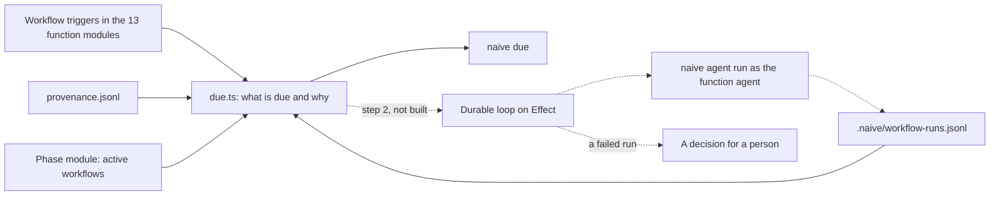
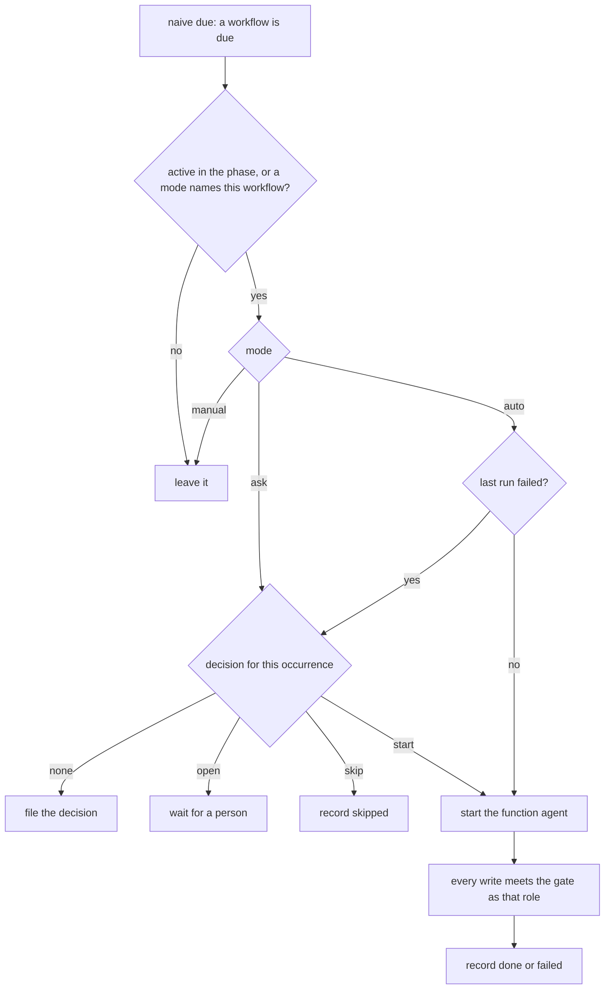
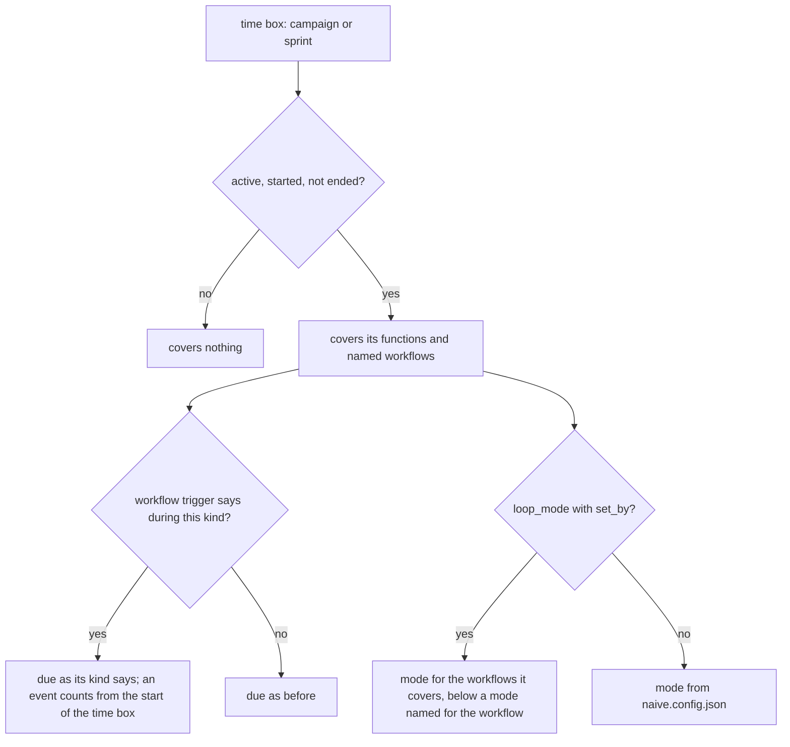
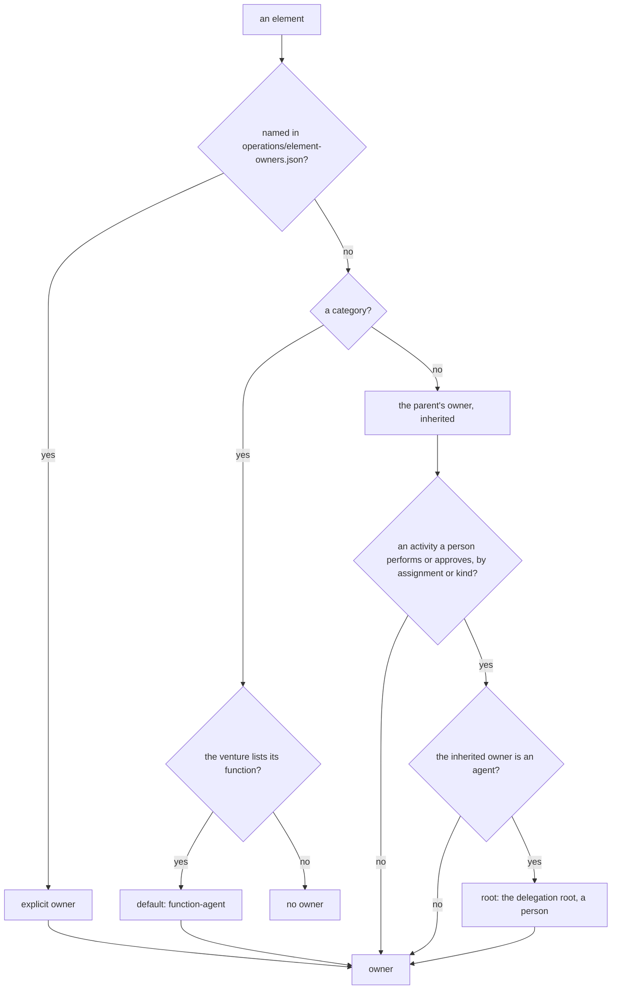
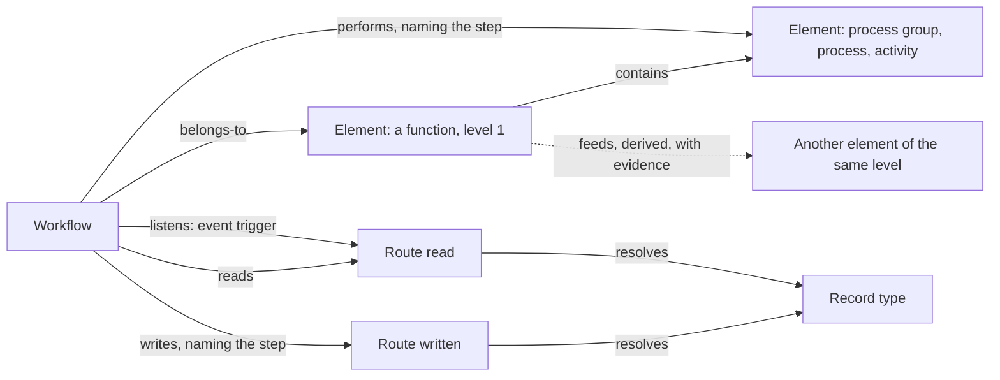
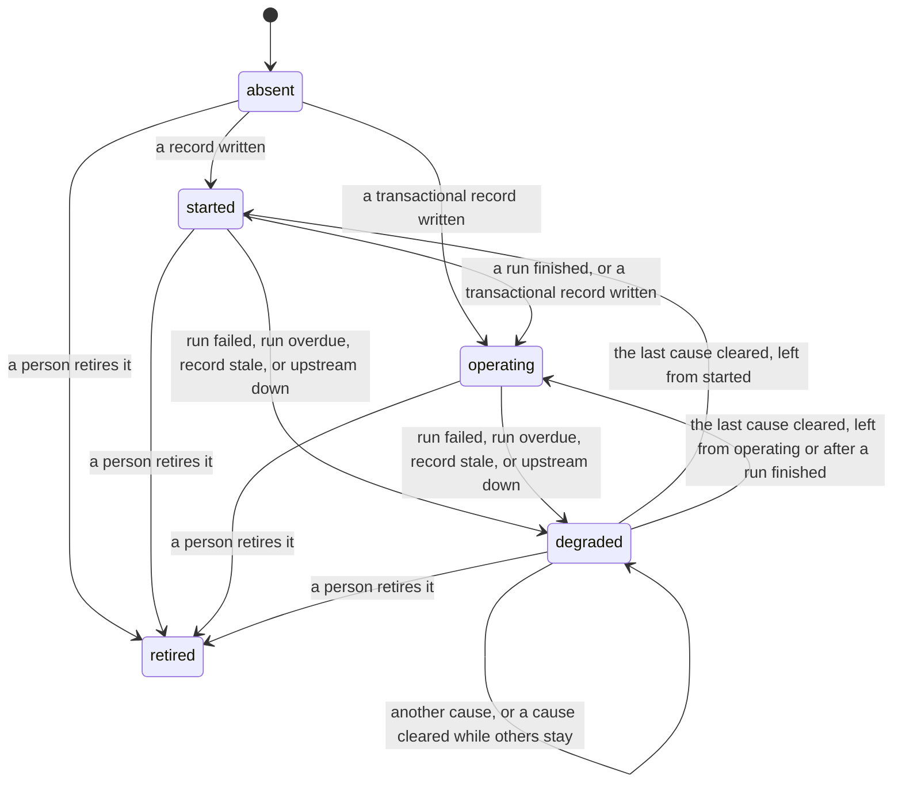
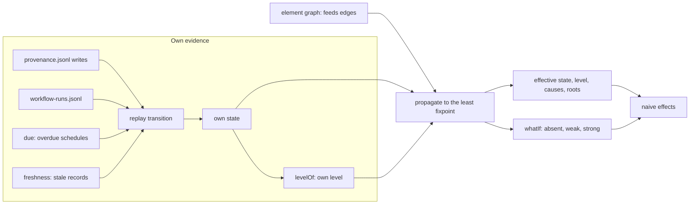

# Hooks and loops across the 13 functions

Date: 2026-11-26. Decisions: EE-182, EE-183, EE-184, EE-186, EE-187, EE-188, EE-190. Status: steps 1 to 7 are built: what is due (`packages/naive/src/engine/due.ts`, `naive due`), the loop (EE-183), record data categories (EE-184), time boxes (EE-186), owners (EE-187, `packages/naive/src/engine/element-owners.ts`, `naive owners`), the element graph (EE-188, `packages/naive/src/engine/element-graph.ts`, `naive graph`) and state, quality and effects (EE-190, `packages/naive/src/engine/element-state.ts`, `packages/naive/src/engine/element-effects.ts`, `naive effects`). Step 8 is not built.

## The ask

Torian, 2026-11-25: build the hooks and loops across all 13 functions and every level of the process framework. Be clear about what triggers each one, by event and by time. Build on Effect and in TypeScript. Assign each element to a person or an agent. For each element, know what it does, what state it is in, what its quality is, and what happens to other elements when it is absent or weak, and be able to test and formally verify that.

## Domain

An element is one node of APQC's Process Classification Framework as Naive carries it (`packages/naive/src/functions/pcf.json`): a category (level 1, which Naive calls a function), a process group, a process, an activity or a task. The words below are the standard ones.

| Aspect of an element | Standard | In Naive today |
|---|---|---|
| Inputs, outputs, owner, measures | ISO 9001 process approach | Workflow `reads` and step `writes`. One owner per element (EE-187). |
| Who is accountable | RACI | Accountable: one owner per element at every level (EE-187). Responsible: performer and approval per activity (EE-172, EE-179). |
| What starts it | Event, time or request | Workflow `trigger`, read by `naive due` (EE-182). Record triggers and signal listeners for events. |
| State | Statechart | Built (EE-190), below. |
| Quality | ISO/IEC 33020 process capability levels 0 to 5 | Built for levels 0 to 3 (EE-190). Levels 4 and 5 need element measures, not built. |
| Effect of absence or weakness on others | Failure mode and effects analysis (FMEA) | Propagation over the feeds edges and a what-if per element (EE-190). Severity, occurrence and detection ratings are not built. |

A hook is a reaction to one event: a record written, a signal heard. A loop is work that recurs: a workflow on a schedule. Both come down to one question, which workflow is due and why.

The state an element has (step 7, built; the rules are in the section State, quality and effects below).

## System

What is due, by trigger kind (`due()` in `packages/naive/src/engine/due.ts`, a pure function):

| Trigger | Due when |
|---|---|
| intake | It has not finished once. |
| schedule | It has never finished, or its cadence (daily, weekly, monthly, quarterly) has passed since it last finished. A month is a calendar month in UTC. |
| event | A record on its route went live after it last finished: a write, accept, merge or rollback. A draft held for a person does not count until the person accepts it. |
| request | Never on its own. A lead or a person hands it off. |

A failed run does not move a schedule. Each entry says whether the venture's phase module lists the workflow as active.

What Effect gives the later steps, from the vendored source in `repos/effect`: `Cron` and `Schedule` for times and retries, `workflow/DurableClock` for a loop that sleeps across a restart, `workflow/DurableDeferred` for waiting on a person, and `Graph` for the element graph. Effect has no statechart module, so an element's state is a tagged union with a pure transition function (EE-190).

## Implementation

One pull request each.

1. What is due. Built: `naive due [--at <iso>] [--function <id>] [--json]` and `naive due record <function>/<workflow> [--outcome done|failed|skipped] [--by <who>]`.
2. The loop with modes (EE-183). Built: `naive loop plan`, `naive loop tick`, `naive loop watch` and `naive loop mode`, described below.
3. Record data categories (EE-184). Built: every workspace and venture record type in the data model names `data`, master, reference, transactional or derived, and `check-data-model.ts` requires it. Nothing reads it yet: steps 6 and 7 do.
4. Time boxes (EE-186). Built: the time box record for a campaign or a sprint, the trigger `during`, and a loop mode per time box, described below.
5. Owners (EE-187). Built: one accountable owner per element, inherited from its parent, and a check that nothing is unowned, described below.
6. The element graph (EE-188). Built: `naive graph [--function <id>] [--element <id>] [--json] [--mermaid]`, described below.
7. State and quality (EE-190). Built: `naive effects [<element>] [--at <iso>] [--json]`, described below.
8. Proofs. Not built: Lean proofs of the transition function and of propagation, of the properties listed at the end of the next section.

## The loop and its modes

The loop reads what is due and acts as far as a mode allows. A person sets the mode in `naive.config.json` under `loops`, for the venture, per function and per workflow. The most specific one wins.

| Mode | What the loop does with a due workflow |
|---|---|
| manual | Nothing. A person starts it. This is the default. |
| ask | Files one open decision per due occurrence, with the options start and skip. On start it starts the workflow. On skip it records the occurrence as skipped. |
| auto | Starts the workflow as its function agent through `NAIVE_AGENT_CMD` and records the run as done or failed by the exit code. |

Rules that hold in every mode:

- No mode goes past the gate. A start only starts the function agent. A write the gate holds waits as a draft for a person, and a one-way door is a person's. There is no bypass mode.
- A draft does not make the next workflow due. An event workflow is due only when a record on its route went live, so a draft a person has not accepted starts nothing downstream.
- A workflow whose last run failed is not started again on the loop's own word. The loop asks first, in ask and in auto.
- An agent cannot set a mode. `naive loop mode` needs `--by <person>` and refuses an acting agent, and `check-config.ts` fails on ask or auto with no person named.
- One tick at a time per venture, held by the lock file `.naive/loop.lock`.

`naive loop watch` ticks on `Schedule.spaced` from Effect in one process. It does not survive a restart on its own: a host's scheduler or a person runs it again, and a tick is safe to rerun because the run log and the decisions hold its state.

## Time boxes

A campaign or a sprint is a time box: `operations/time-boxes/<id>.json`, route `operations/time-box/[id]`, transactional data that only a person writes. It names its kind, a goal, `starts`, `ends`, a status, and the functions or workflows it covers. It is open while its status is active, from `starts` until `ends`.

- A workflow whose trigger says `during: campaign` or `during: sprint` is not due outside such a time box, whatever its kind says. `marketing-and-sales/campaign-daily-review` is the shipped one: daily, during a campaign.
- Every due entry names the open time box that covers it. When two cover it, the later to start wins.
- The order of modes is: a mode named for the workflow, then the open time box's, then the function's, then the venture's, then manual. A time box's mode counts only with the person in `set_by`, and a workflow a time box covers by mode is started even when the phase does not list it.
- The gate, drafts and the rule about failed runs apply inside a time box as everywhere.

Not built: a time box's own measures and review, a check that a time box names workflows the venture has, and a command to open or close one (a person writes the record through its route).

## Owners

Every element has one accountable owner, the A of RACI: a role or a person. The owner answers for the element. It is not the performer: who performs an activity, and whether a person approves it, is the venture's `operations/activity-assignments.json` or the default for the activity's kind, and `naive owners` shows both beside each other.

`resolveOwners()` in `packages/naive/src/engine/element-owners.ts` is a pure function. It walks the framework in order, so a parent is resolved before its children, and gives each element the first rule that applies:

| Order | Source | Rule |
|---|---|---|
| 1 | explicit | The venture names the owner in `operations/element-owners.json`: `{ "role": "growth-lead" }` or `{ "person": "Ana Ruiz" }` per hierarchy id, at any level. |
| 2 | root | The element is an activity a person performs or approves, and the owner it would inherit is an agent. An agent does not answer for a person's work, so the delegation root owns it: `root` in the venture's `governance/delegation.json`, the founder by default. |
| 3 | inherited | The parent's owner. The entry names the element where it was set. |
| 4 | default | A category the venture lists in venture.json departments is owned by its function's agent, `<function>-agent`. A category it does not list has no owner, and neither do its elements. |

A role is a role template, Naive's (`packages/naive/template/governance/roles/`) or the venture's own (`governance/roles/`), or a function agent. A role whose template has `default_tier` person is a person, and the rest are agents. A role answers only within its reach: a lead within its portfolio, a role whose template names one function within that function, a function agent within its own function, and a role of function all anywhere.

`packages/naive/src/checks/check-owners.ts <venture dir>` fails on a record that does not match its schema, an element APQC lacks or one under a function the venture does not list, an owner that names no role, a role outside its reach, a delegation root that is not a role, and an element left unowned. A person named by name is not checked against a register, because Naive keeps none of people by name.

Not built for owners: a route that serves the list, the catalog's own activities (`activities.json`) as elements, the gate refusing a write by a role that does not own the element, a consulted and informed list for the C and I of RACI, and a person's name checked against the venture's people.

## The element graph

`buildGraph()` in `packages/naive/src/engine/element-graph.ts` reads the 13 function modules' workflows, APQC's PCF and the activity catalog, and resolves each route pattern a workflow names to record types through the route table (`packages/naive/src/records/routes/routes.ts`). It builds one directed Effect `Graph`. It is pure: the same workflows in any order give the same graph.

| Edge | From | To | Comes from |
|---|---|---|---|
| contains | element | element | The PCF hierarchy. A catalog activity sits under its process, else its process group. |
| belongs-to | workflow | element | The workflow's function, through its APQC category in departments.json. |
| performs | workflow | element | A step's `activity`, naming the step. |
| writes | workflow | route | A step's `writes`, naming the step. |
| reads | workflow | route | The workflow's `reads`. |
| listens | workflow | route | An event trigger's `route`. |
| resolves | route | record type | The route table. `*` and `[id]` stand for one segment. |
| feeds | element | element | Derived, below. |

A step is attached to its activity, every ancestor of that activity and its function's category. A workflow is attached to every element one of its steps is attached to. Element A feeds element B when both have the same level and a route a step attached to A writes resolves to a record type that a workflow attached to B reads or is triggered by. Each feed names its evidence: the writing workflow and step, the route written, the reading workflow, the route read, whether by read or trigger, and the record type. A workflow reading what it wrote itself is a loop, not a feed, so it is left out. A route that resolves to no record type matches only the same pattern.

The graph answers `upstream(element)` and `downstream(element)`, the routes some workflow reads that no workflow writes (`unfed`: inputs a person, an intake or an outside source must give, such as `venture`, which every intake reads) and the routes some workflow writes that none reads (`unread`). `naive graph` prints the feeds between functions and both lists, `--element` and `--function` print one element's neighbours with their evidence, and `--mermaid` prints the feeds between functions.

## State, quality and effects

`packages/naive/src/engine/element-state.ts` holds the rules. Each is a pure, total function with no I/O, written so step 8 can state it in Lean 4 without Mathlib. `packages/naive/src/engine/element-effects.ts` reads a venture into them, and `naive effects` prints the result.

### The statechart

`ElementState` is a tagged union. `degraded` carries its causes, never empty, sorted by key and unique, and `was`, the state it left. A cause is a failed run or an overdue run of a workflow, a stale record, or an upstream element that is absent, degraded or retired. `transition(state, event)` takes eight events:

| Event | Effect |
|---|---|
| record-written (record, data category) | absent to started, or to operating when the record is transactional. Clears that record's staleness. A transactional record is evidence it operates. |
| run-finished (workflow) | started to operating. Clears that workflow's failed and overdue causes. |
| run-failed, run-overdue (workflow), record-stale (record), upstream-down (element, as) | started, operating or degraded to degraded with that cause added. No effect on absent. |
| cleared (cause key) | Removes that cause. |
| retire (by) | Any state to retired. |

Retired is absorbing: every event leaves it retired. Absent leaves only on a record written or a retirement. When the last cause clears, degraded returns to `was`, which becomes operating once a run finished or a transactional record was written while degraded.

An element's own state replays, from absent and in time order, the live lines of `provenance.jsonl` (write, accept, merge or rollback, never a draft) whose route resolves to one of its record types, with that record type's data category (EE-184); the done, failed and skipped runs of its workflows in `.naive/workflow-runs.jsonl` (a skipped run is a person settling the occurrence, so it clears that workflow's failed and overdue causes); and then, at now, `run-overdue` for each of its scheduled workflows that finished before and whose cadence has passed (`due()`), and `record-stale` for each of its records that `freshness()` finds stale or expired. An element's workflows are those with a step attached to it, and its record types are those the routes such steps write resolve to. A run counts for every element its workflow is attached to. No element is derived retired: retirement has no record yet.

### Quality

`levelOf` gives a capability level after ISO/IEC 33020 from evidence only:

| Level | Name | Naive's evidence |
|---|---|---|
| 0 | incomplete | Absent, retired, or no finished run and no transactional record. |
| 1 | performed | A finished run of one of its workflows, or a transactional record. A degraded element stays here. |
| 2 | managed | Performed, not degraded by its own evidence (no failed or overdue run, no stale record), and 2 finished runs. Its workflows have triggers and write through the router, so its work products are logged. |
| 3 | established | Managed, 3 finished runs of its shipped workflow (the defined process), and none of its last three runs failed. |
| 4 | predictable | Capped. It needs a measure with a target bound to the element and run results against it. Naive keeps neither (not built). |
| 5 | innovating | Capped. It needs changes to the process made from those measures (not built). |

The run counts 2 and 3 are unvalidated priors (`PRIORS` in `element-state.ts`). Each level says why it holds and what evidence would raise it.

### Effects

`propagate(own, feeds)` treats every feeds edge as a need, because a workflow does not say which reads are optional (not built). Each round recomputes every element from its own state and level and the previous round's values:

- State: `transition` applied with `upstream-down` for each upstream that is absent, retired or degraded. So an absent, retired or degraded upstream makes a started, operating or degraded downstream degraded, with the upstream named. An absent or retired downstream stays as it is.
- Level: its own level, capped at the weakest upstream's level plus 1 (the slack, an unvalidated prior). A low upstream caps or lowers it. A high upstream never raises it past its own evidence.
- Roots: the elements whose own state started the harm that reaches a degraded element.

It stops when a round changes nothing. It starts from own states, so it finds the least fixpoint: a cycle of healthy elements stays healthy, and harm on a cycle is traced to the element that started it. Elements and edges are sorted first, and each round reads only the round before, so the result does not depend on input order.

`whatIf(own, feeds, element, scenario)` propagates once as things are and once with that element set to absent (level 0), weak (operating at level 1) or strong (operating at level 5), and lists every element downstream of it with both results and whether it changed.

### Properties for step 8

The Lean statements should take states, events and causes as inductive types, a cause set as a sorted list without duplicates, and elements as a finite type or `Fin n`.

1. Totality: `transition s e` is defined for every state and event, and the result is a well-formed state (a degraded state has a non-empty, sorted, duplicate-free cause list and `was` in started or operating).
2. Retired is absorbing: `transition retired e = retired` for every `e`, and `transition s (retire p) = retired` for every `s`.
3. Absent leaves only on a record written or a retirement: `transition absent e = absent` for every other event.
4. A cause-bringing event (run failed, run overdue, record stale, upstream down) on a started, operating or degraded state gives a degraded state whose causes contain that cause.
5. Upstream down is inflationary: the causes before are a subset of the causes after, and a degraded state stays degraded.
6. Clearing: degraded with causes `cs` and the event that clears the last of them returns `was`; clearing a key not in `cs` changes nothing.
7. Propagation terminates: with `n` elements, each element's causes and roots range over subsets of the elements and its level over 0 to 5, rounds only add causes and roots and lower levels, so the number of rounds is at most `n * (2n + 6) + 1`.
8. Propagation is monotone: if every own state in `a` is at least as harmed as in `b` (a harm order where absent and retired are fixed and degraded causes grow) and every own level is no higher, the result for `a` is at least as harmed and no higher, element by element.
9. Absent upstream implies degraded downstream: if `A` feeds `B`, the effective state of `A` is absent, retired or degraded, and the own state of `B` is started, operating or degraded, then the effective state of `B` is degraded with the cause `upstream:A`.
10. Level bounds: the effective level of `B` is at most its own level and at most the effective level of each upstream plus the slack, and equals the largest level with both properties.
11. Least fixpoint: the result is the least fixpoint of one round above the own states; in particular, with no element down in its own state, no element is degraded.
12. Determinism: the result is a function of the sets of elements and edges, not of their order.

## Not built

- Everything in step 8.
- In step 7: a record of retirement (no element is derived retired), optional reads (every feed counts as a need), element measures for capability levels 4 and 5, FMEA severity, occurrence and detection ratings, and an overdue event workflow (only schedules become overdue).
- The element graph covers the shipped function modules only. It does not narrow to the functions a venture lists, read a venture's own workflows, or count reads and writes by people and record triggers that no workflow declares.
- Retries with backoff inside one tick. A durable watch on `workflow/DurableClock`. Starting more than one workflow at once. A hosted starter: with `NAIVE_RUNTIME=hosted` there is no `NAIVE_AGENT_CMD`, so a start is blocked.
- The run log is not synced (`naive sync` skips `.naive/`), no route serves it, and it has no hash chain.
- A workflow step's `when` (EE-181) is still a sentence an agent reads.
- Language choice: Naive is TypeScript on Effect, with Lean for proofs. A rubric for choosing another language for a system is not written.
