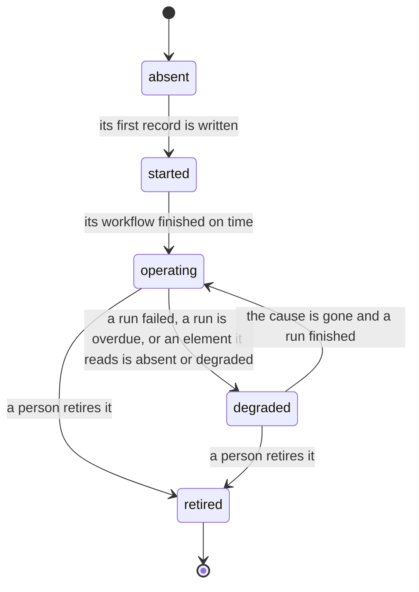
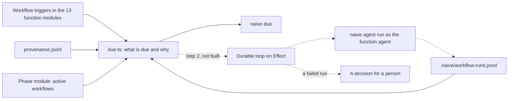
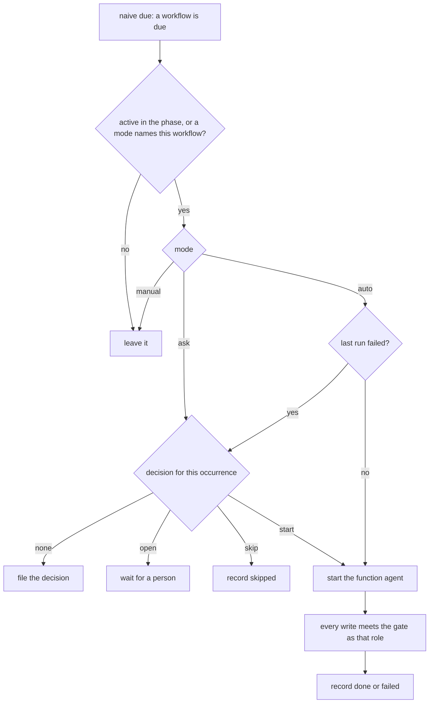
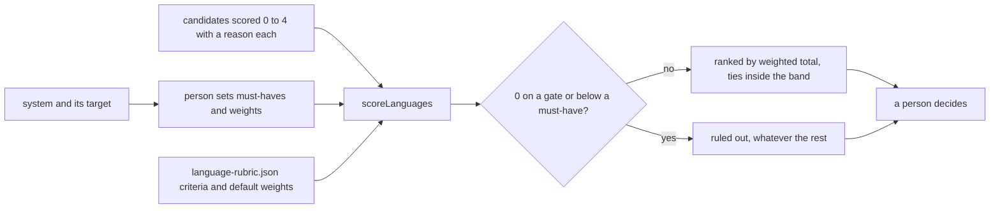

# Hooks and loops across the 13 functions

Date: 2026-11-26. Decision: EE-182. Status: step 1, what is due (`packages/naive/src/engine/due.ts`, `naive due`), is built. Steps 2 to 6 are not built.

## The ask

Torian, 2026-11-25: build the hooks and loops across all 13 functions and every level of the process framework. Be clear about what triggers each one, by event and by time. Build on Effect and in TypeScript. Assign each element to a person or an agent. For each element, know what it does, what state it is in, what its quality is, and what happens to other elements when it is absent or weak, and be able to test and formally verify that.

## Domain

An element is one node of APQC's Process Classification Framework as Naive carries it (`packages/naive/src/functions/pcf.json`): a category (level 1, which Naive calls a function), a process group, a process, an activity or a task. The words below are the standard ones.

| Aspect of an element | Standard | In Naive today |
|---|---|---|
| Inputs, outputs, owner, measures | ISO 9001 process approach | Workflow `reads` and step `writes`. No owner per element. |
| Who is accountable | RACI | Performer and approval per activity (EE-172, EE-179). Not built above an activity. |
| What starts it | Event, time or request | Workflow `trigger`, read by `naive due` (EE-182). Record triggers and signal listeners for events. |
| State | Statechart | Not built. |
| Quality | ISO/IEC 33020 process capability levels 0 to 5 | Not built. Evidence grades exist for validation records only. |
| Effect of absence or weakness on others | Failure mode and effects analysis (FMEA) | Decision impact for decisions only (`packages/naive/src/engine/impact.ts`). Not built for elements. |

A hook is a reaction to one event: a record written, a signal heard. A loop is work that recurs: a workflow on a schedule. Both come down to one question, which workflow is due and why.

The state an element will have, when step 5 is built:

## System

What is due, by trigger kind (`due()` in `packages/naive/src/engine/due.ts`, a pure function):

| Trigger | Due when |
|---|---|
| intake | It has not finished once. |
| schedule | It has never finished, or its cadence (daily, weekly, monthly, quarterly) has passed since it last finished. A month is a calendar month in UTC. |
| event | A record on its route went live after it last finished: a write, accept, merge or rollback. A draft held for a person does not count until the person accepts it. |
| request | Never on its own. A lead or a person hands it off. |

A failed run does not move a schedule. Each entry says whether the venture's phase module lists the workflow as active.

What Effect gives the later steps, from the vendored source in `repos/effect`: `Cron` and `Schedule` for times and retries, `workflow/DurableClock` for a loop that sleeps across a restart, `workflow/DurableDeferred` for waiting on a person, and `Graph` for the element graph. Effect has no statechart module, so an element's state will be a tagged union with a pure transition function.

## Implementation

One pull request each.

1. What is due. Built: `naive due [--at <iso>] [--function <id>] [--json]` and `naive due record <function>/<workflow> [--outcome done|failed|skipped] [--by <who>]`.
2. The loop with modes (EE-183). Built: `naive loop plan`, `naive loop tick`, `naive loop watch` and `naive loop mode`, described below.
3. Record data categories (EE-184). Built: every workspace and venture record type in the data model names `data`, master, reference, transactional or derived, and `check-data-model.ts` requires it. Nothing reads it yet: steps 6 and 7 do.
4. Time boxes. Not built: a time box record for a campaign or a sprint, and a trigger "while a time box is open".
5. Owners. Not built: one accountable owner per element, inherited from its parent, and a check that nothing is unowned.
6. The element graph. Not built: edges from workflow reads and writes.
7. State and quality. Not built: the statechart above, a capability level per element from evidence, and the effect of an absent or weak element on the elements it feeds.
8. Proofs. Not built: Lean proofs of the transition function and of propagation.

## The loop and its modes

The loop reads what is due and acts as far as a mode allows. A person sets the mode in `naive.config.json` under `loops`, for the venture, per function and per workflow. The most specific one wins.

| Mode | What the loop does with a due workflow |
|---|---|
| manual | Nothing. A person starts it. This is the default. |
| ask | Files one open decision per due occurrence, with the options start and skip. On start it starts the workflow. On skip it records the occurrence as skipped. |
| auto | Starts the workflow as its function agent through `NAIVE_AGENT_CMD` and records the run as done or failed by the exit code. |

Rules that hold in every mode:

- No mode goes past the gate. A start only starts the function agent. A write the gate holds waits as a draft for a person, and a one-way door is a person's. There is no bypass mode.
- A draft does not make the next workflow due. An event workflow is due only when a record on its route went live, so a draft a person has not accepted starts nothing downstream.
- A workflow whose last run failed is not started again on the loop's own word. The loop asks first, in ask and in auto.
- An agent cannot set a mode. `naive loop mode` needs `--by <person>` and refuses an acting agent, and `check-config.ts` fails on ask or auto with no person named.
- One tick at a time per venture, held by the lock file `.naive/loop.lock`.

`naive loop watch` ticks on `Schedule.spaced` from Effect in one process. It does not survive a restart on its own: a host's scheduler or a person runs it again, and a tick is safe to rerun because the run log and the decisions hold its state.

## Language choice

Naive is TypeScript on Effect for the framework and Lean 4 for proofs (EE-087, EE-125, EE-159, EE-095). The language rubric (`packages/naive/src/functions/it/language-rubric.json`, EE-189) is how a person judges which language fits another system. It holds eight criteria, each with a question, why, described levels on a 0 to 4 scale and a default weight that is an unvalidated prior, and Naive's own two choices as worked examples. `scoreLanguages` in `packages/naive/src/engine/language-rubric.ts` ranks candidates and never decides.

## Not built

- Everything in steps 4 to 8.
- A mode per time box (step 4 adds the time box). Retries with backoff inside one tick. A durable watch on `workflow/DurableClock`. Starting more than one workflow at once. A hosted starter: with `NAIVE_RUNTIME=hosted` there is no `NAIVE_AGENT_CMD`, so a start is blocked.
- The run log is not synced (`naive sync` skips `.naive/`), no route serves it, and it has no hash chain.
- A workflow step's `when` (EE-181) is still a sentence an agent reads.
- Language choice: Naive is TypeScript on Effect, with Lean for proofs. The rubric for choosing a language for a system is built (EE-189, see Language choice above); a command or route that serves it, and worked examples beyond Naive's own two, are not built.
