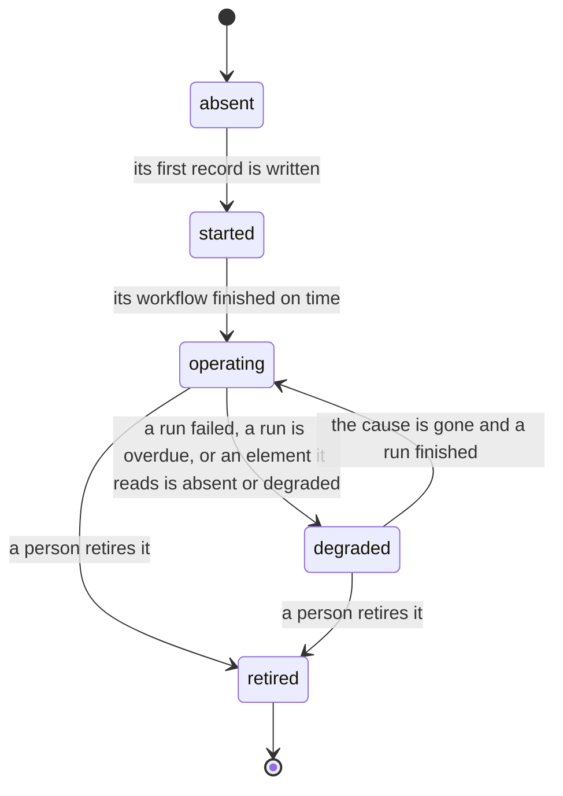
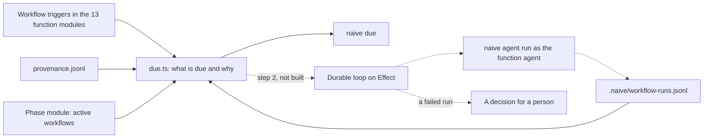

# Hooks and loops across the 13 functions

Date: 2026-11-26. Decision: EE-182. Status: step 1, what is due (`packages/naive/src/engine/due.ts`, `naive due`), is built. Steps 2 to 6 are not built.

## The ask

Torian, 2026-11-25: build the hooks and loops across all 13 functions and every level of the process framework. Be clear about what triggers each one, by event and by time. Build on Effect and in TypeScript. Assign each element to a person or an agent. For each element, know what it does, what state it is in, what its quality is, and what happens to other elements when it is absent or weak, and be able to test and formally verify that.

## Domain

An element is one node of APQC's Process Classification Framework as Naive carries it (`packages/naive/src/functions/pcf.json`): a category (level 1, which Naive calls a function), a process group, a process, an activity or a task. The words below are the standard ones.

| Aspect of an element | Standard | In Naive today |
|---|---|---|
| Inputs, outputs, owner, measures | ISO 9001 process approach | Workflow `reads` and step `writes`. No owner per element. |
| Who is accountable | RACI | Performer and approval per activity (EE-172, EE-179). Not built above an activity. |
| What starts it | Event, time or request | Workflow `trigger`, read by `naive due` (EE-182). Record triggers and signal listeners for events. |
| State | Statechart | Not built. |
| Quality | ISO/IEC 33020 process capability levels 0 to 5 | Not built. Evidence grades exist for validation records only. |
| Effect of absence or weakness on others | Failure mode and effects analysis (FMEA) | Decision impact for decisions only (`packages/naive/src/engine/impact.ts`). Not built for elements. |

A hook is a reaction to one event: a record written, a signal heard. A loop is work that recurs: a workflow on a schedule. Both come down to one question, which workflow is due and why.

The state an element will have, when step 5 is built:

## System

What is due, by trigger kind (`due()` in `packages/naive/src/engine/due.ts`, a pure function):

| Trigger | Due when |
|---|---|
| intake | It has not finished once. |
| schedule | It has never finished, or its cadence (daily, weekly, monthly, quarterly) has passed since it last finished. A month is a calendar month in UTC. |
| event | A record on its route was written after it last finished. |
| request | Never on its own. A lead or a person hands it off. |

A failed run does not move a schedule. Each entry says whether the venture's phase module lists the workflow as active.

What Effect gives the later steps, from the vendored source in `repos/effect`: `Cron` and `Schedule` for times and retries, `workflow/DurableClock` for a loop that sleeps across a restart, `workflow/DurableDeferred` for waiting on a person, and `Graph` for the element graph. Effect has no statechart module, so an element's state will be a tagged union with a pure transition function.

## Implementation

One pull request each.

1. What is due. Built: `naive due [--at <iso>] [--function <id>] [--json]` and `naive due record <function>/<workflow> [--outcome done|failed] [--by <who>]`.
2. The loop. Not built: a durable runner that starts due workflows as their function agent, retries, and raises a failure as a decision.
3. Owners. Not built: one accountable owner per element, inherited from its parent, and a check that nothing is unowned.
4. The element graph. Not built: edges from workflow reads and writes.
5. State and quality. Not built: the statechart above, a capability level per element from evidence, and the effect of an absent or weak element on the elements it feeds.
6. Proofs. Not built: Lean proofs of the transition function and of propagation.

## Not built

- Everything in steps 2 to 6.
- The run log is not synced (`naive sync` skips `.naive/`), no route serves it, and it has no hash chain.
- A workflow step's `when` (EE-181) is still a sentence an agent reads.
- Language choice: Naive is TypeScript on Effect, with Lean for proofs. A rubric for choosing another language for a system is not written.
