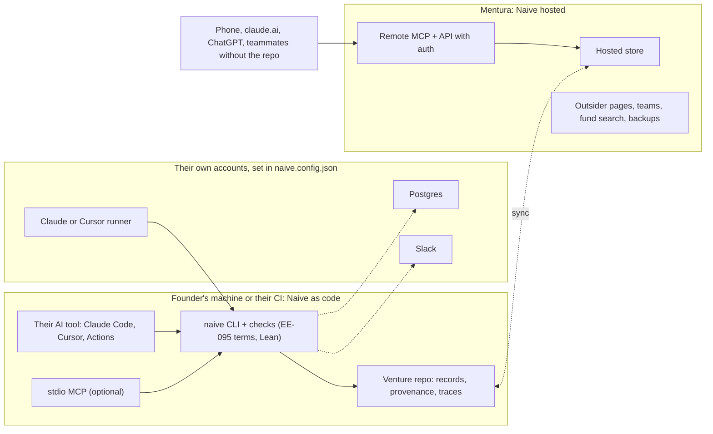
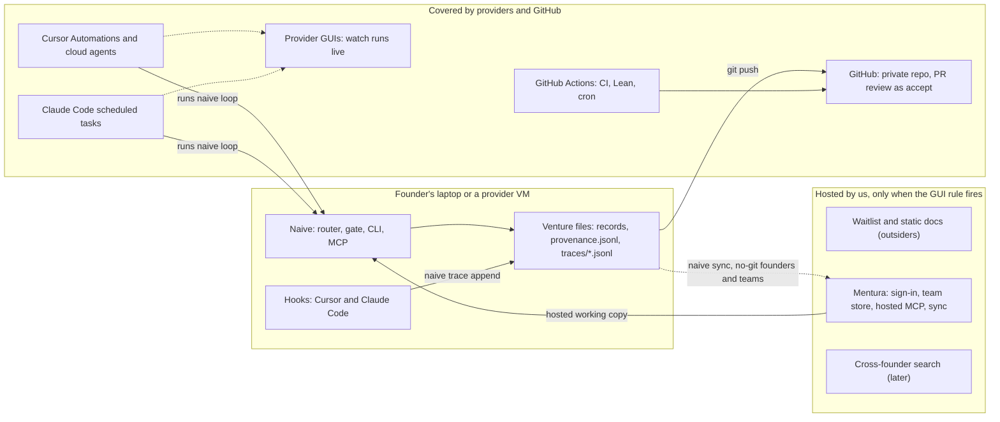
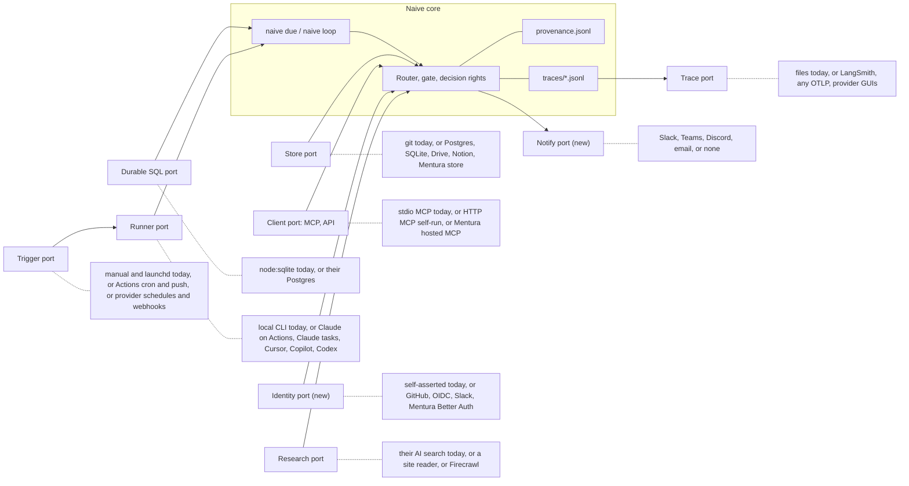
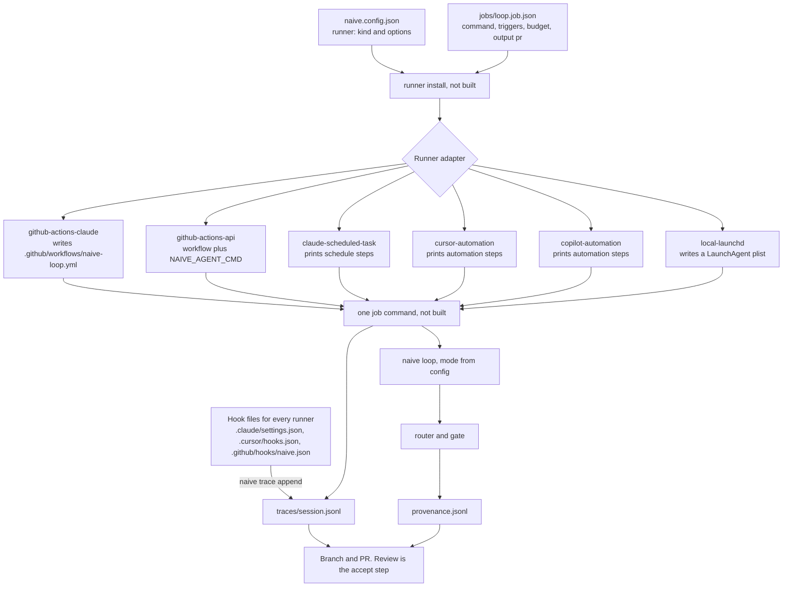

# What actually needs hosting

Status: exploring. Discovery and validation phase. Every recommendation here is a working hypothesis that Torian will test by running Naive on his own ventures before any GUI is built.

Date: 2026-11-26. Decision: [EE-194](../decisions/decisions.json), proposed, not in force. Paths below are repo-relative on Naive `main` unless the sentence names tchjhnsn/Mentura3 or tchjhnsn/Dogfood.

## Short answer

Very little has to be hosted by us. Four things do. Each one maps to the GUI rule Torian stated on 25 November 2026. Build a GUI only when the work needs one of these. (a) Agents run while the laptop is closed. (b) Outsiders get a share link or a hosted page. (c) A team shares one venture. (d) The work needs backups. (e) The work is fund data or cross-founder network data.

1. **Pages for outsiders.** The waitlist and the public docs. They already exist. The docs can be static.
2. **People with no laptop or no git, and teams who share one venture.** Sign-in, the hosted business store, the hosted MCP endpoint their own AI connects to, and sync. tchjhnsn/Mentura3 already builds these. Nobody needs them until the first such person shows up.
3. **Fund or cross-founder data.** Search across many founders' ventures. Not built, and not needed yet.
4. **Backups.** For a git venture, a private GitHub repo already covers this. Only the hosted store needs the database provider's own backups.

Frontier providers and GitHub cover the rest. That includes running agents while the laptop is closed, and watching what they did. Cursor Automations, Claude Code scheduled tasks, and GitHub Actions run agents on a schedule, on a GitHub event, or on a webhook, in their own cloud. Cursor, Claude, OpenAI, and GitHub each show their runs in their own GUI. Each has an API or an OpenTelemetry export. Naive does not need its own agent runtime, its own trace GUI, or LangSmith as a default.

The trace of record is already Naive's own. It is `provenance.jsonl` plus `traces/<session>.jsonl` (EE-121), in git. Provider GUIs are for watching a run live. Naive's files are for remembering it. The missing piece is small. Nothing yet writes a Cursor run or a Claude Code run into Naive's trace file automatically. Hooks can do that with no host.

## Naive as code, Mentura as hosted Naive

Torian, 26 November 2026.

Naive is code that runs next to the venture repo. It is a CLI plus a repo format. A founder who has the code needs no MCP to reach it. Their own AI tool reads the files and calls the CLI directly. That tool may be Claude Code, Cursor, Codex, or a GitHub Actions runner. Stdio MCP stays as an optional convenience for chat apps on the same machine.

Bring-your-own options are settings in `naive.config.json` that the code honours, not services we run. Examples are their Postgres, their Slack, and their Claude or Cursor account.

Mentura is Naive hosted for anyone who must reach it from where the code is not. That is a phone, claude.ai or ChatGPT, teammates without the repo, outsiders, fund or cross-founder search, and backups of the hosted store. Remote MCP and the HTTP API with auth move into Mentura. Identity and the hosted half of Store move into Mentura too. Runner, notify, trace, and store connectors stay in Naive as code.

The test is a week of running Naive on Torian's own venture. If that week never makes him want remote access, Mentura's hosted door can wait. If it does, that is Mentura's first job.



## Feature table

The section above is the working split. This table is the row-by-row reading. Where the split changes a row, the recommendation cell says so.

| Feature | Product | What it needs to run | Can a provider or GitHub cover it? | Truly hosted reason (GUI rule) | Recommendation |
|---|---|---|---|---|---|
| Router, schemas, gate, decision rights | Naive | Node on the founder's machine or any agent VM | Yes. It runs inside any provider VM that clones the repo | None | Keep local. No change |
| Provenance log (`provenance.jsonl`, hash-chained) | Naive | Files in the venture folder, git | Yes. GitHub stores it | None | Keep as the record |
| `naive` CLI | Naive | Node | Yes. Any agent shell runs it | None | Keep |
| MCP server (stdio), `packages/naive/src/interfaces/mcp/server.ts` | Naive | A local process the AI app starts | Yes. Claude Code, Cursor, and Codex can start it | None | Keep. Optional for chat apps on the same machine. A founder with the repo calls the CLI directly |
| Local HTTP API, `packages/naive/src/interfaces/api/server.ts` | Naive | A local process. It binds 127.0.0.1 and has no auth | Yes, locally | None | Keep the local API in Naive. Auth and a remote bind are Mentura, and they are not built here |
| Terms and Lean proofs | Naive | Lean toolchain, CI | Yes. GitHub Actions (`.github/workflows/lean.yml`) | None | Keep in CI |
| PR review agents | Naive | CI with a model key | Yes. GitHub Actions (`.github/workflows/claude.yml`, `.github/workflows/pr-review.yml`), Cursor Bugbot, Automations | None | Keep on GitHub |
| Trace files (`traces/<session>.jsonl`, EE-121) | Naive | Files, `naive trace append` | Yes. Hooks in Cursor and Claude Code can pipe spans in | None | Keep as the trace of record. Hook adapters are not built |
| Activity from transcripts, `packages/naive/src/engine/activity.ts` | Naive | Local Claude Code transcripts | Partly. Provider session lists show the same thing | None | Keep local. No hosted version |
| `naive agent` with `NAIVE_AGENT_CMD` | Naive | A command the founder already runs (`claude -p`, Cursor CLI, Codex). `packages/naive/src/engine/agents/run.ts` | Yes. That command is the provider | None | Keep. Naive names no vendor |
| `naive due` and `naive loop` (EE-182, EE-183) | Naive | A ticker that runs the command. `packages/naive/src/engine/due.ts`, `packages/naive/src/engine/loop.ts` | Yes. Cursor Automations, Claude Code scheduled tasks, GitHub Actions `schedule` | (a), and the provider's cloud meets it | Run manually first. Later, one provider trigger runs `naive loop` in the repo and opens a PR |
| Evals, `packages/naive/src/engine/docket-eval.ts` | Naive | Node, a model key | Yes. Locally or in GitHub Actions | None | Keep. Labels are the founder's PR accept and reject calls |
| Observed ventures, refresh on demand | Naive | An agent with web access | Yes. Any provider agent with web search | None | On demand only, run in a provider agent. `naive observe` is not built |
| Reference library | Dogfood | Git | Yes. GitHub | None | Keep in git, in tchjhnsn/Dogfood |
| `packages/create-venture` | Naive | npm registry | Yes. npm | None | Keep |
| Claude Code plugin, `.claude-plugin/plugin.json` | Naive | A GitHub repo | Yes. GitHub | None | Keep |
| Docs site | Naive | Static pages | Yes. Any static host, including GitHub Pages | (b) outsiders read it | Keep static. No server code needed |
| Waitlist form | Naive site and Mentura | One write endpoint and a table | No. A form needs somewhere to land | (b) outsiders | Keep as it is. Already live |
| Business console (`/studio`) | Mentura | Next.js app, sign-in, the store | Partly. For a solo founder with a laptop, chat plus the CLI plus provider GUIs cover it | (c) teams, and people with no laptop | Keep, and scope it to the GUI rule. Do not grow it for solo laptop founders |
| Sign-in and accounts (Better Auth) | Mentura | Hosted auth, a hosted Postgres | No | (b) and (c) | Keep only for the hosted parts. This code is in tchjhnsn/Mentura3 |
| Teams, members, invites | Mentura | Hosted auth and the store | Partly. GitHub collaborators cover technical teams on a git venture | (c) | Keep for non-git teams. Git teams use GitHub |
| Hosted business store | Mentura | Hosted Postgres | No, for people without git. Yes, for git ventures, because GitHub is the store | (c), (d), and people with no laptop | Keep. Default a new founder with a laptop to git. The connector is in tchjhnsn/Mentura3 |
| Offline sync, `naive sync` (EE-178) | Mentura, client in Naive | Hosted API and store. The client is `packages/naive/src/engine/sync.ts` | Yes for git ventures. Git push and pull is the sync | It exists because the hosted store does | Keep for hosted ventures. Git ventures skip it |
| Hosted working copy runner | Mentura | A server process per request | No | Same as the store | Keep, tied to the store. The runner file is `Mentura3/hosted/run.ts` in tchjhnsn/Mentura3 |
| Hosted MCP endpoint and OAuth for the person's own AI | Mentura | Hosted endpoint, sign-in | No. claude.ai on the web and phones cannot reach a local stdio server | (a), and people with no laptop | Keep. This is the one door a phone founder's AI needs. The route is `Mentura3/web/src/app/api/mcp/` in tchjhnsn/Mentura3 |
| Agent runtime | Mentura | A process that runs the model loop | Yes. Cursor cloud agents, Claude scheduled tasks, Claude Managed Agents, Codex cloud | (a), met by providers | Do not build a hosted runtime. The plan in `docs/design/AGENT_RUNTIME_2026-11-02.md` stays a design. Keep one `NAIVE_AGENT_CMD` option |
| Running-work feed | Mentura | Console and a table | Yes for runs a provider starts. Each provider lists its runs | Only inside the console | Keep only for work Mentura itself runs. Do not mirror provider runs |
| Webhooks server | Mentura | A public HTTPS endpoint | Yes. A Cursor Automations webhook trigger, or a Claude scheduled-task API trigger | (a), met by providers | Defer. Use a provider trigger when webhooks come. `Mentura3/webhooks/server.mjs` is the hosted option in tchjhnsn/Mentura3, and a Naive port is not built |
| Integrations (a connector to Stripe and others) | Mentura | Per-person OAuth tokens kept by us | Yes for one person. Claude, ChatGPT, and Cursor keep the person's own connectors | (c) shared connections for a team | Let the person's own AI hold the tokens. Keep ours only for team-shared connections |
| Outside tool host (approval-held outbound actions) | Mentura | Signed log, approval step | Yes for git ventures. A PR is the hold, and review is the approval | (c) approvers who are not on GitHub | Keep for hosted teams. Git ventures use PR review |
| Research MCP (Firecrawl) | Mentura | Paid API key | Yes. Provider web search and fetch | None | Drop as a default. It also breaks the "free data only" rule. The file is `Mentura3/mcp/research.mjs` in tchjhnsn/Mentura3 |
| LangSmith exporter | Mentura | Paid or free-tier SaaS | Not needed. Provider GUIs plus Naive's files cover it | None | Keep opt-in, off by default. The decision is `Dogfood/docs/decisions/STORAGE_AND_EVALS_2026-11-26.md` in tchjhnsn/Dogfood |
| Meetings with guest invites | Mentura | Hosted pages, sign-in for guests | No for guest links | (b) outsiders | Keep |
| Venture files | Mentura | Blob store | Yes for git ventures (git, or the person's Drive through their own connector) | (c) | Hosted storage is not built. Leave it unbuilt until a team needs it. `Mentura3/bridge/files.ts` is in tchjhnsn/Mentura3 |
| In-app chat model | Shared | Hosted model calls we pay for | Yes. The person's own Claude or ChatGPT through the hosted MCP | None for Mentura | For Mentura, the person's own AI is the chat. No Mentura-paid chat |
| Raw intake worker | Mentura | Hosted store, a worker | Yes for git ventures. A scheduled or push-triggered provider agent reads `raw/` | Only with the hosted store | Keep tied to the store. Not needed for git ventures. `Mentura3/intake/` is in tchjhnsn/Mentura3 |
| Cross-founder search, fund views | Mentura | A shared index across tenants | No | (e) | Not built. Build only when a fund or a network asks |

## Trace and agent observability

### What providers give

Checked from provider docs on 26 November 2026. Retention is whatever those pages stated. A blank cell in the audit is written here as "not stated".

| Provider | Watch a run in their GUI | Get it out for our own agents | Retention we could confirm |
|---|---|---|---|
| Cursor | Agents window and cursor.com/agents. Automations have their own page | Cloud Agents API v1 (beta). List agents and runs, stream a run's events (tool calls with args and results), artifacts, usage. Legacy v0 has a full conversation endpoint. Hooks (`sessionStart`, `postToolUse`, `subagentStart`, `stop`, and more) run a script with JSON on stdin | Run streams carry a retention header and later return `410 stream_expired`. The window was not stated. Analytics, Admin, and AI Code Tracking APIs are Enterprise only |
| Anthropic, Claude Code | claude.ai/code session history. Each scheduled task run opens as a full session | OpenTelemetry metrics, events (`tool_result`, `user_prompt`), and traces to any OTLP endpoint. Tool inputs and content only when turned on. Hooks (`PostToolUse`, `SessionEnd`) get `transcript_path` | Not stated in the pages read |
| Anthropic, Managed Agents | Claude Console session viewer. Timeline, transcript, tools, cost, and a JSON download | `GET /v1/sessions/{id}/events`. OTLP destinations set in the Console (beta), GenAI conventions | Not stated in the pages read |
| OpenAI | Logs and Agents. Sessions, turns, steps | Agents SDK custom trace processors (send to your own backend, or replace OpenAI's). `GET /v1/agents/sessions/{id}/traces` returns OTLP JSON | Not in the official pages read. A third-party page says about 30 days. That figure is unverified. Unavailable under Zero Data Retention |
| OpenAI, Codex cloud | Task list on web, desktop, and mobile | Results land as diffs and PRs | Saved VM state up to 7 days. No scheduled cloud tasks. ChatGPT scheduled tasks cannot target a Codex cloud environment |
| GitHub Copilot coding agent | Agents tab, session logs | Every agent commit carries an `Agent-Logs-Url` trailer linking to its session log | Not confirmed on an official page |
| Google Agent Engine | Traces tab in the Agent Platform | Cloud Trace with OpenTelemetry | From a search of Google's docs, not fetched |

Dedicated hosted tools, for comparison.

| Tool | Free tier | Retention | Note |
|---|---|---|---|
| LangSmith | Developer, $0, 1 seat, 5,000 base traces a month | Base 14 days. Extended 180 days on cloud | Feedback or an evaluator on a trace upgrades it to extended, which costs more |
| Braintrust | Starter, $0, 1 GB a month | 14 days on Starter | Pro is $249 a month |
| Langfuse | Self-host, MIT, free | Yours | Self-hosting means running a server. That is the hosting this note is trying to avoid |
| Vercel AI SDK telemetry | Free, in the SDK | Wherever you send it | Emits OpenTelemetry spans. It is a source, not a store |

### Gaps

- Each GUI shows only its own provider's runs. No provider shows a Cursor run next to a Claude run.
- Retention is short or not stated. Nothing a provider keeps should be the only copy.
- Getting traces out needs either a listener (an OTLP endpoint) or a poll of each provider's API. A listener is hosting.
- Cursor's cross-run analytics are Enterprise only.

### Does git already serve as the trace of record?

Mostly yes. `provenance.jsonl` records every write with its actor, activity, and hash chain. A line written inside a span names that span. `traces/<session>.jsonl` (EE-121) already uses the OpenTelemetry GenAI shape, is hash-chained, and `naive trace show` prints a run as a tree, offline. The shape is `packages/naive/src/records/trace-span.schema.json`. The commands are `packages/naive/src/engine/trace-cli.ts`. The Dogfood decision of 26 November 2026 already says git is the source of truth and LangSmith is an opt-in copy. That decision is in tchjhnsn/Dogfood, not in this repo.

What is missing:

1. Traces are off by default. A venture has to set `"traces": true`.
2. Nothing writes Cursor or Claude Code runs into the trace file yet. Mentura's `NaiveTracer` only covers its own model loop, and that code is in tchjhnsn/Mentura3.
3. Model token counts reach the file only when the command in `NAIVE_AGENT_CMD` reports them.

### Recommendation

- Watch live in the provider's own GUI. Build no trace GUI.
- Keep Naive's files as the record. Add two small hook adapters. A Cursor `hooks.json` and a Claude Code `settings.json` hook pipe `postToolUse`, `subagentStart`, and `stop` events into `naive trace append`. They run where the agent runs, so no host is needed. The spans land in the same PR as the records they explain. The adapters are not built.
- Link each run to its provider session. Store the Cursor agent id, the Claude session URL, or the `Agent-Logs-Url` as a span attribute. The provider GUI keeps the detail for as long as it keeps it. Our file keeps the pointer and the summary.
- Keep LangSmith opt-in and off. Use it only for a side-by-side eval comparison.
- Before building the adapters, answer one question. Do Cursor cloud agents and Claude Code scheduled tasks run the hooks committed in the repo? Not verified. Whether to run that canary is an open question on EE-194.

## Minimal hosted footprint



## Five-step pass

First pass, hosting.

1. **Question each requirement.** "Agents run while the laptop is closed" does not require our host. Cursor, Anthropic, and GitHub run agents in their cloud on a schedule or an event. "Observability needs a GUI" does not hold. Four providers already have one. What we need is a durable record, and Naive has it. "Teams need a hosted store" holds only for people who do not use git.
2. **Delete.** Do not build the hosted agent runtime from `docs/design/AGENT_RUNTIME_2026-11-02.md`. Do not make LangSmith a default exporter. Drop Firecrawl research as a default. Do not give Mentura its own paid chat model. Do not build a webhooks host or hosted file storage yet. These are proposals. No code was removed.
3. **Simplify.** One job definition lives in the repo. It is a prompt that runs `naive loop` and opens a PR. Any provider's trigger runs it, so switching providers means pointing a new trigger at the same file. One trace format (EE-121), fed by hooks.
4. **Accelerate.** Keep this order. Manual runs first, then a provider schedule, then a GitHub push trigger for record changes, then a provider webhook trigger. Each step reuses the same job file.
5. **Automate last.** Turn on a schedule only after manual runs show they are worth the tokens. Every scheduled run spends the founder's subscription usage. Claude scheduled tasks count against the account's limits. GitHub Free gives 2,000 Actions minutes a month for private repos. No crons now.

Second pass, runners.

1. **Question.** Does Naive need one blessed runner? No. The first user has a laptop and git, and the job is a command, so any runner that can clone and run it will do. What has to be fixed is the job file and the trace split, not the vendor.
2. **Delete.** No hosted runner of our own, no runner-specific job formats, and no Codex cloud adapter until Codex cloud gains schedules and repo hooks.
3. **Simplify.** One job file and one `runner` setting. Adapters only translate. The job command is not built.
4. **Accelerate.** Manual run first, then a default runner install, then record-change triggers, then webhooks. `naive runner` is not built.
5. **Automate last.** A runner check proves each install, with a canary span, before any schedule is turned on. That check is not built.

## Torian's answers

26 November 2026.

1. **First outside user.** A founder with a laptop and git. So the hosted store, sync, and hosted MCP wait. They stay in tchjhnsn/Mentura3 as built, with no new work until a no-git founder or a team arrives.
2. **Default unattended runner.** Not chosen yet. He asked for every option weighed against the others, and it may be a per-founder preference. See the runner comparison and the runner setting below.
3. **Traces.** The most advantageous option. The split is in the next section.
4. **Console at mentura.xyz.** Still open. He has heard the GUI rule and has not decided. Nothing here assumes an answer. EE-194 leaves this question open.

## Trace split

| What | Public venture repo | Private venture repo |
|---|---|---|
| Span names, kinds, start and end times, status | Always committed | Always committed |
| Sizes (input, output, tool result bytes) and token counts | Always committed | Always committed |
| `content_sha256` of each input and output | Always committed | Always committed |
| Provider session link (Cursor agent id, Claude session URL, `Agent-Logs-Url`, Actions run URL) | Always committed | Always committed |
| Full prompts, outputs, and tool results | Never | Committed, after secrets are redacted |

Rules.

- **Unknown counts as public.** Content is written only when the runner reports the repo is private (on GitHub Actions, `github.event.repository.private`), or `naive.config.json` declares it and the check agrees.
- **Redaction fails closed.** If redaction throws, or finds a secret it cannot mask, the content is dropped and the hash, size, and link stay. No failure text is written.
- **The hash makes the content checkable later.** A provider transcript can be matched to the committed span by hash without committing the transcript.

This would change EE-121's default, where traces are off and content is off. That change needs its own decision. It is not EE-194. EE-192 is the raw-source decision on open PR #166, and EE-199 is the citation decision on open PR #165. EE-193 stays with the observed-ventures stack. EE-194 was free in the decision log on main and in every open PR, so this record uses it. The trace-split change is not built. It would land in `packages/naive/src/core/instrumentation.ts`.

## Bring-your-own map

Status is one of three words. **Works today**, with the path that does it. **Needs adapter.** **Unknown.** "Hosted by us" is one option per row, never a requirement. A path that starts with `Mentura3/` lives in tchjhnsn/Mentura3, not in this repo.

| Capability | Option a user brings | Status | How it plugs in |
|---|---|---|---|
| Storage | Local folder or git repo | Works today | `packages/naive/src/store/connectors/filesystem.ts` |
| Storage | GitHub repo as a remote source (writes as draft PRs) | Works today, outside Naive | `Mentura3/packages/platform/connectors/github.mjs`, registered through `registerConnector` in `packages/naive/src/store/connectors/index.ts` |
| Storage | Their own Neon Postgres | Works today, outside Naive | `Mentura3/packages/platform/connectors/postgres.ts` (`pg` or `neon-ws`, URL from an env var). It assumes Mentura's table and roles (`Mentura3/hosted/setup-store.ts`) |
| Storage | Supabase, RDS, or other Postgres | Unknown | The same connector should speak plain Postgres. Untested. Row security setup is specific to Mentura |
| Storage | SQLite as the record store | Needs adapter | Only durable workflow storage uses SQLite today (`packages/naive/src/core/effect/node-sqlite.ts`, the `sql` hook in `packages/naive/src/core/runtime.ts`) |
| Durable work state | SQLite or their Postgres | Works today | `sql` hook in `packages/naive/src/core/runtime.ts`. The host passes an effect/sql client. `packages/naive/src/core/effect/node-sqlite.ts` is the default |
| Runner | Claude Code, Cursor CLI, or Codex CLI on the laptop | Works today | `NAIVE_AGENT_CMD` in `packages/naive/src/engine/agents/run.ts` and `packages/naive/src/engine/loop.ts` |
| Runner | Mentura's gated command | Works today, in an open Dogfood PR | Dogfood PR #5 points `NAIVE_AGENT_CMD` at `Mentura3/packages/platform/agents/bin.ts`. That PR is in tchjhnsn/Dogfood |
| Runner | Claude on Actions, Claude scheduled tasks, Cursor Automations, Copilot automations | Needs adapter | A job file plus a runner adapter. Each can already run `naive loop` from hand-written config. The adapter is not built |
| Runner | Codex cloud | Needs adapter, weak fit | No schedules, and no repo hooks under cloud orchestration |
| Setup files | Claude Code, Codex, and Cursor rules and skills | Works today | `packages/naive/src/interfaces/adapters/claude-code.json`, `packages/naive/src/interfaces/adapters/codex.json`, `packages/naive/src/interfaces/adapters/cursor.json`, and `.claude-plugin/` |
| Setup files | Copilot | Needs adapter | No Copilot adapter file. Whether Copilot reads the AGENTS.md chain was not checked |
| Chat client | Their own AI over local MCP (Claude Code, Claude Desktop, Cursor, Codex) | Works today | `packages/naive/src/interfaces/mcp/server.ts` (stdio only) |
| Chat client | Remote AI clients (claude.ai on the web, ChatGPT, phone apps) | Needs adapter, or hosted by us | Naive has no HTTP MCP transport. `packages/naive/src/interfaces/api/server.ts` binds 127.0.0.1 with no auth. `Mentura3/web/src/app/api/mcp/` is the hosted option in tchjhnsn/Mentura3 |
| Notifications | Slack, Teams, Discord, email | Needs adapter | Nothing in Naive. Today only the runner's own tools can post, and Naive does not know it happened |
| Identity | One person on a laptop | Works today, self-asserted | `--as person` is a `mentura` write flag. `MENTURA_ACTOR_ID` and team-plan reach are `packages/naive/src/engine/access.ts` and `packages/naive/src/engine/agents/reach.ts` |
| Identity | GitHub accounts (PR review as the accept step) | Works today as practice | The Dogfood decision in tchjhnsn/Dogfood. Naive does not read who approved the PR |
| Identity | Their SSO or OIDC, or a Slack user mapping | Needs adapter | No identity port. Better Auth in tchjhnsn/Mentura3 is the hosted option |
| Identity | Sync sign-in to a host | Works today, client half | `packages/naive/src/engine/sync-credentials.ts` (keychain, or a file with mode 0600). The host comes from config |
| Traces | Files in the repo | Works today | `packages/naive/src/core/instrumentation.ts`, `packages/naive/src/engine/trace-cli.ts`, `packages/naive/src/records/trace-span.schema.json` |
| Traces | LangSmith | Works today, outside Naive, opt-in | The `trace` hook or `NAIVE_TRACE_CMD` (`packages/naive/src/core/runtime.ts`) with `Mentura3/integrations/langsmith-otel.ts` |
| Traces | Any OTLP backend (Langfuse, Honeycomb, Grafana, Datadog) | Needs adapter | Generalize the LangSmith OTLP exporter to any endpoint. Not built |
| Traces | Provider hooks writing spans | Needs adapter | Hook scripts for `.claude/settings.json`, `.cursor/hooks.json`, and `.github/hooks/`. Not built |
| Traces | The public or private split | Needs adapter | A change in `packages/naive/src/core/instrumentation.ts`. Not built. It needs its own decision |
| Search | Search across the venture's sources | Works today | `packages/naive/src/store/connectors/catalog.ts`, routes `knowledge/catalog` and `knowledge/search` |
| Research | Their AI's own web search | Works today | On the agent side. The skill is `packages/naive/src/interfaces/skills/research/SKILL.md` |
| Research | Site reader | Works today | The `site` hook or `NAIVE_SITE_CMD`. `Mentura3/integrations/site.mjs` is plain fetch, and Firecrawl when keyed, in tchjhnsn/Mentura3 |
| Research | Firecrawl, Jev | Works today, outside Naive, paid | `Mentura3/mcp/research.mjs`, `Mentura3/integrations/jev.mjs`, and the `judge` hook, in tchjhnsn/Mentura3 |
| Scheduling | Manual, or `naive loop watch` while a terminal is open | Works today | `packages/naive/src/engine/due.ts`, `packages/naive/src/engine/loop.ts` |
| Scheduling | cron or launchd | Works today | Calls `naive loop`. No install helper |
| Scheduling | Cloud schedules, push triggers, webhooks | Needs adapter | A job file and runner adapters. Not built. `Mentura3/webhooks/server.mjs` is the hosted option in tchjhnsn/Mentura3 |
| Files and docs | Files in git | Works today | The filesystem connector |
| Files and docs | Google Drive, Notion | Needs adapter | No connector. `Mentura3/connectors/mcp.ts` reads a connected service through Mentura's hosted route, Stripe first. A local connector backed by the founder's own MCP would be the bring-your-own version. It is unknown whether an agent that reads Notion through its own MCP and writes through Naive is enough |
| Backups | Git remote | Works today | Any git host |
| Backups | Their Postgres provider's own backups | Works today, outside Naive | A provider feature, such as Neon branches and restore |
| Backups | Export a store to files | Works today, outside Naive | `Mentura3/connectors/store-export.ts` in tchjhnsn/Mentura3. A generic export over any connector is not built |

### Biggest gaps

1. **No notification port.** Naive cannot tell a person that a decision is waiting, through Slack, Teams, Discord, or email. The docket shows only when someone asks. `packages/naive/src/engine/decision-queue.ts` computes the queue and does not send it.
2. **No way in for remote AI clients without our host.** MCP is stdio only, and the HTTP API is localhost with no auth. A founder's claude.ai on the web, ChatGPT, or phone AI cannot reach their venture unless Mentura hosts the endpoint.
3. **Naive ships only the filesystem store.** The Postgres and GitHub connectors live in tchjhnsn/Mentura3 and assume Mentura's setup. There is no SQLite record store, and no Drive or Notion connector. A user's own database or doc store needs an adapter.

Runner-up. Identity is self-asserted (`MENTURA_ACTOR_ID`). Nothing maps a GitHub, Slack, or SSO user to a person in `people/`.

## Ports Naive's core exposes

Ports that exist are named by their path. Proposed ports sit beside the ones that exist, so the boundary check (`scripts/dependency-rules.json`) keeps Naive naming no vendor.

| Port | Status | Where | What a user's option implements |
|---|---|---|---|
| Store | Exists | `packages/naive/src/store/connectors/contract.ts`, `registerConnector` in `packages/naive/src/store/connectors/index.ts`, source map `packages/naive/template/knowledge/sources.json` | `list`, `read`, `version`, `search`, `write` with base-version checks |
| Durable SQL | Exists | `sql` hook, `packages/naive/src/core/runtime.ts`. Default `packages/naive/src/core/effect/node-sqlite.ts` | An effect/sql client |
| Sandbox and git | Exist | `sandbox` and `git` hooks, `packages/naive/src/core/runtime.ts` | Run a shell check, run git |
| Runner | Partly exists | `NAIVE_AGENT_CMD` in `packages/naive/src/engine/agents/run.ts`. A `packages/naive/src/engine/runners/` folder is not built | Install a job, report triggers, report the session link, report repo visibility |
| Client | Partly exists | `packages/naive/src/interfaces/mcp/server.ts`, `packages/naive/src/interfaces/api/server.ts`, `packages/naive/src/interfaces/adapters/claude-code.json` and the Codex and Cursor adapters beside it. An HTTP MCP transport is not built | Reach the router as an agent. A person's writes go through the gate |
| Notify | Proposed | A `notify` hook in `packages/naive/src/core/runtime.ts`, fired by `packages/naive/src/engine/decision-queue.ts` and `packages/naive/src/engine/loop.ts`. Not built | Deliver `decision.due`, `run.finished`, and `run.failed` to Slack, Teams, Discord, email, or nothing |
| Identity | Proposed | An `identify` hook in `packages/naive/src/core/runtime.ts`, read by `packages/naive/src/engine/access.ts`. Not built | Map a principal (git author, GitHub actor, Slack user, OIDC subject) to a person or role in `people/`. Unknown means agent |
| Trace | Partly exists | `packages/naive/src/core/instrumentation.ts`, `packages/naive/src/engine/trace-cli.ts`, the `trace` hook or `NAIVE_TRACE_CMD`. A redaction step and a general OTLP exporter are not built | Receive spans after the split is applied |
| Research | Exists | `site` and `judge` hooks. Catalog in `packages/naive/src/store/connectors/catalog.ts` | Read a site, judge, search |
| Trigger | Partly exists | `packages/naive/src/engine/due.ts`, `packages/naive/src/engine/loop.ts`. Job-file triggers are not built | Schedule, record change, webhook |



## Dogfood plan

Use Naive before any GUI. Torian runs these on his own ventures (Dogfood, Naive on Naive, and Mentura as a venture). Each step ends by filing what was missing as a record in that venture's `product/bugs/`. Bugs stay open in `beta/capabilities.json`, which is in this repo. One added field, `decides`, is one of `gui`, `adapter`, or `nothing`. A GUI gets built only when a finding says `gui` and names a GUI-rule trigger. The field is not built.

1. **Git, GitHub, and local Claude Code or Cursor.** Turn traces on in one Dogfood venture. For a week, work it only through chat. Run `naive due`. Run `naive agent` with `NAIVE_AGENT_CMD` set to `claude -p`. Review every write as a PR. Look for what you opened a browser for, and whether you missed a decision because nothing told you.
2. **Unattended on Claude Code in GitHub Actions.** The hooks canary comes first, and whether to run it is open on EE-194. Then add one workflow in Dogfood. A daily schedule at an off-peak minute, plus a push trigger on `raw/`, opening a PR. Look for whether traces reached the PR, how many tokens a run cost, and whether PR review alone kept up. The job file is not built.
3. **Notifications without a Naive port.** Let the runner post the open docket to a Slack channel you already use, through the runner's own tool. Look for whether a message plus a PR replaces a console, and what Naive should have said in that message. That decides the notify port's events.
4. **Your own Postgres.** Point the Mentura3 Postgres connector at a sealed scratch database on the existing Neon project, with no new spend, from a local script that calls `registerConnector`. Then run Naive against it. Try a free Supabase project only if you approve the account. Look for what Mentura-specific setup the connector needed.
5. **A doc store through the agent, not a connector.** In Claude Code, add your own Notion or Drive MCP beside Naive's. Ask an agent to turn a Notion page into a record through Naive. Look for whether that is enough, or whether a connector is needed so Naive knows the source and the version.
6. **Phone.** Try to reach a venture from the Claude phone app. Today that needs Mentura's hosted MCP, in tchjhnsn/Mentura3. Look for whether you actually wanted it. That decides when an HTTP transport for the client port is built.

## Unattended runners for `naive loop`

Each runner was checked on official docs on 26 November 2026. Scores are judgments from 0 to 5, not measurements. The weights favor token cost, traces that reach Naive, and no lock-in, which is what Torian has said matters. No scoring script is in this repo. The weighted column is the sum of each score times its weight, divided by 5. The weights sum to 100 and each score is at most 5, so a perfect row is 100. The seven rows match that formula. The top two differ by 2 points, which is inside the error of judgment scores. They differ in setup. The first uses a ready command. The second needs a small model loop we would build, because EE-121 says Naive imports no agent framework.

### Weights

| Criterion | Weight |
|---|---|
| Cost per run, and whose budget it spends | 20 |
| Hooks committed in the repo run, so traces reach Naive | 15 |
| Triggers. Schedule, record change, webhook | 10 |
| Opens PRs | 10 |
| Secrets handling | 10 |
| Lock-in | 10 |
| Setup effort for a laptop-and-git founder | 10 |
| Reliability and limits | 10 |
| Trace export and retention | 5 |

Trace export gets the lowest weight because Naive's own files are the record. A provider's export is a convenience.

### Scores

| Runner | Cost | Hooks | Triggers | PRs | Secrets | Export | Lock-in | Setup | Reliability | Weighted |
|---|---|---|---|---|---|---|---|---|---|---|
| Claude Code on GitHub Actions (`claude-code-action`, Agent SDK) | 4 | 5 | 5 | 5 | 4 | 4 | 5 | 3 | 3 | 85 |
| Plain GitHub Actions with an API key (our own loop) | 4 | 5 | 5 | 5 | 4 | 4 | 5 | 2 | 3 | 83 |
| Local launchd or cron (baseline) | 5 | 5 | 2 | 4 | 5 | 4 | 5 | 4 | 1 | 81 |
| Claude Code scheduled tasks or cloud sessions | 4 | 4 | 4 | 4 | 5 | 3 | 2 | 4 | 3 | 75 |
| Cursor Automations or scheduled cloud agents | 2 | 4 | 5 | 5 | 3 | 3 | 2 | 4 | 4 | 69 |
| GitHub Copilot automations (coding agent) | 3 | 3 | 4 | 5 | 4 | 4 | 2 | 3 | 3 | 67 |
| OpenAI Codex cloud tasks | 4 | 1 | 1 | 4 | 4 | 2 | 2 | 3 | 3 | 55 |

The ranking held under three other weightings, all still judgments. Equal weights give 84, 82, 78. Cost weight cut to 5 gives 86, 84, 78. Reliability raised to 25 gives 82, 80, 73. The same three runners stay on top.

### Evidence per runner

**Claude Code on GitHub Actions.** `anthropics/claude-code-action` runs Claude Code in a workflow. It takes `ANTHROPIC_API_KEY` or `CLAUDE_CODE_OAUTH_TOKEN` (from `claude setup-token`, on Pro, Max, Ultra, Team, or Enterprise), so it can spend the founder's subscription instead of API credit (https://code.claude.com/docs/en/github-actions). The Agent SDK loads project `.claude/settings.json`, including its hooks, by default (https://code.claude.com/docs/en/agent-sdk/claude-code-features). Triggers are GitHub's. `schedule` (cron, UTC by default), `push` with a `paths` filter for record changes, and `workflow_dispatch` or `repository_dispatch` for a webhook. `schedule` can be delayed under load, some queued jobs may be dropped, and in a public repo it is disabled after 60 days without activity (https://docs.github.com/en/actions/reference/workflows-and-actions/events-that-trigger-workflows). Private repos on GitHub Free get 2,000 Actions minutes a month (https://docs.github.com/en/billing/reference/product-usage-included). Secrets are GitHub encrypted secrets, visible to the job's processes. The workflow file lives in the repo, so a PR reviews it and a later PR can swap it. Actions log retention was not checked.

**Plain GitHub Actions with an API key.** Same triggers, secrets, and lock-in as above. Naive writes its own spans, so no hook is needed. Naive ships no model loop, so this needs a small command behind `NAIVE_AGENT_CMD`. It spends API credit, and the founder picks the model, so the bill shows the cost, and that cost can be the lowest.

**Local launchd or cron.** Uses whatever command the founder already pays for. Every hook runs, including user-level ones. Secrets stay in the keychain. It only runs while the laptop is on. With `StartCalendarInterval`, launchd runs a job missed during sleep when the Mac wakes, and merges several missed runs into one. A run missed while powered off is skipped (https://github.com/apple-oss-distributions/launchd/blob/main/man/launchd.plist.5). This fails the "laptop closed" need, so it is the baseline, not a candidate default.

**Claude Code scheduled tasks or cloud sessions.** Research preview. Runs on Anthropic's cloud and draws subscription usage, with no separate VM charge (https://code.claude.com/docs/en/claude-code-on-the-web). Triggers are a schedule (no more often than hourly), an API endpoint with a bearer token, and GitHub events (pull requests, releases). GitHub events have hourly caps, and events over the cap are dropped. Run starts are capped at 100 scheduled runs an hour per account, with no overage (https://code.claude.com/docs/en/routines). Repo `.claude/settings.json` hooks run in a single-repo session. They do not run in multi-repo sessions or in a project's threads (https://code.claude.com/docs/en/cloud-environments). Network secrets stay outside the sandbox and are attached to matching requests. That is the strictest secrets model in this list. Tasks belong to one claude.ai account and are not in git. Pushes go to `claude/` branches.

**Cursor Automations or scheduled cloud agents.** Triggers are cron, GitHub push and PR events, and a private webhook (https://cursor.com/docs/cloud-agent/automations). Billing is the plan's usage at the model's API rate. Automations always use the model's largest context window, which raises token use. Cloud agents need a Premium or higher plan (https://cursor.com/docs/cloud-agent). Project `.cursor/hooks.json` command hooks run in cloud agents once the VM is writable, including `postToolUse`, `subagentStart`, and `stop`, but not `sessionStart` or `sessionEnd`. For HTTP MCP tools, `postToolUse` gets a redacted output (https://cursor.com/docs/hooks). A Cursor forum bug from December 2025 reported project hooks not running in cloud agents. The docs now say they run, so this needs the canary. Automations are configured in Cursor, not in git. The run stream has a retention window, and cross-run analytics are Enterprise only.

**GitHub Copilot automations.** New on 28 October 2026. Triggers are a schedule (hourly, daily, weekly), issue created, PR opened or synchronized, issue status change, and an API trigger. Private or internal repos only. Each run uses AI credits plus Actions minutes, with a per-run floor of 30 credits, and daily, weekly, and monthly limits. Automations are stored outside git (https://docs.github.com/en/copilot/concepts/agent-capabilities/agent-powered-workflows-and-operations/about-automations). Repo hooks in `.github/hooks/*.json` run in the cloud sandbox, but the filesystem is ephemeral and the firewall allows only GitHub and Copilot hosts by default. Hook output must be sent over an `http` hook or end up in the agent's commit (https://docs.github.com/en/copilot/reference/hooks-reference). Every agent commit carries an `Agent-Logs-Url` trailer.

**OpenAI Codex cloud.** Runs in OpenAI's cloud while the computer sleeps and opens PRs (https://learn.chatgpt.com/docs/cloud). It has no scheduled cloud tasks. ChatGPT scheduled tasks cannot target a Codex cloud environment (https://help.openai.com/en/articles/20001545-using-codex-cloud, https://learn.chatgpt.com/docs/automations). Command hooks and repo hooks are not supported under cloud orchestration. Only admin-managed MCP hooks are (https://learn.chatgpt.com/docs/config-file/config-reference). It is the weakest fit for `naive loop`.

Not verified. Actions log retention. Whether a subscription OAuth token in CI has its own rate limits. Claude cloud session transcript retention. Whether provider cloud runs actually fire repo hooks. The canary below is the test, and running it is an open question.

### Recommended default

**Claude Code on GitHub Actions, with the founder's own Claude subscription token.** The job file, the workflow, and the hooks all live in the venture repo, so traces reach Naive and a PR can swap the runner. It spends a budget the founder already pays for, plus free Actions minutes.

Fallbacks, in order. Plain Actions with an API key, for a founder with no Claude plan or who wants a cheaper model. Claude scheduled tasks, for a founder who wants no workflow file. Cursor Automations, for a founder who lives in Cursor. Local launchd stays the zero-setup option for a founder whose laptop is usually open.

## Runner as a per-founder setting

One job file in the venture, one setting naming the runner, and one adapter per runner. Every runner calls the same command. That command is not built. This section is a design for a later decision. It is not EE-194.



### Data shapes

Not built. The types name the files a later decision would add.

```ts
type RunnerKind =
  | "github-actions-claude" | "github-actions-api" | "claude-scheduled-task"
  | "cursor-automation" | "copilot-automation" | "codex-cloud" | "local-launchd";

type Trigger =
  | { kind: "schedule"; cron: string }               // the runner's own minimum applies
  | { kind: "record-change"; routes: string[] }      // a push that touches these routes' files
  | { kind: "webhook" };                             // the runner's own endpoint

type Job = {                                          // jobs/<id>.job.json, committed
  id: string;
  run: string;                                        // "naive loop" once
  triggers: Trigger[];
  budget: { runs_per_day: number; max_minutes: number };
  output: "pr";                                       // never a direct push to the default branch
};

type RunnerSetting = { kind: RunnerKind; options?: Record<string, string> };  // naive.config.json "runner"

type InstallPlan =
  | { mode: "files"; files: { path: string; content: string }[] }   // runners configured by repo files
  | { mode: "steps"; steps: string[] };                              // runners configured in a GUI

interface RunnerAdapter {
  kind: RunnerKind;
  triggers: ReadonlySet<Trigger["kind"]>;             // what this runner can honor
  install(job: Job): InstallPlan;                     // refuses a trigger it cannot honor, with the reason
  sessionLink(env: Record<string, string | undefined>): string | null;  // for the top span
  repoPrivate(env: Record<string, string | undefined>): boolean | null; // null means unknown, read as public
}
```

### How it behaves

- **One source of truth.** The job file says what runs and when. The adapter only translates it. Switching runner means changing `runner.kind` and running install again.
- **Idempotent.** The job command reads the run log through `naive due`, so a duplicate or late trigger does no extra work.
- **Hook files are written for every runner at once.** They are small. A founder who switches runner keeps traces.
- **A runner check** starts one run and fails unless a canary span from the hook and the session link reach the PR. The check is not built.
- **Manual comes first.** Running the job from a terminal works before any runner is installed. A schedule is added only after manual runs earn their tokens.
- **Not built.** Naive would gain the job command, the runner install and check, the adapters, the hook scripts, and the trace split in `packages/naive/src/core/instrumentation.ts`. None of that is this record.

### Prototype to run first

The question is whether hooks committed in the repo fire in each cloud runner, and whether their output reaches the PR. Running this prototype is an open question on EE-194. It needs Torian's OK, because it creates a repo and spends a few runs.

**Setup.** One scratch private repo. Commit `.claude/settings.json`, `.cursor/hooks.json`, and `.github/hooks/canary.json`. Each runs a script that appends one JSON line (runner, event, time, and the session-id variables it can see) to `traces/canary.jsonl`.

**Run.** One manual run per runner with the same prompt. "Run `ls`, add a line to NOTES.md, commit everything including traces/, and open a PR." Runners are Claude Code on Actions, a Claude cloud session, a Cursor cloud agent, a Copilot automation (API trigger), and Codex cloud.

**Pass.** The PR diff holds canary lines for at least a tool event and the stop event, written by that runner. **Fail.** No canary lines, or lines that never reached the commit. That happens on Copilot if hook files are discarded. Then the adapter needs an `http` hook or a final agent step.

**Cost.** Five short runs. The answer decides the hooks scores above. It is the only score that could reorder the top three.

## Open questions

EE-194 does not decide these.

- How Naive ships to other founders (an npm package, a repo template, or a public repo to fork) and under what license. This is a one-way door for Torian.
- Whether mentura.xyz is held to the GUI rule.
- Whether to run a hooks canary to test if repo hooks fire in Cursor cloud agents.

## Sources

The audit read these on 26 November 2026. This note records that reading. It does not claim a later fetch.

Repos.

- tchjhnsn/Naive `main` at `0241cdb` when the audit was read. Current paths in this file are as of `main` when EE-194 was filed. Design notes named there and still present: `docs/design/HOSTED_WORKING_COPY_2026-11-07.md`, `docs/design/OFFLINE_SYNC_2026-11-25.md`, `docs/design/AGENT_RUNTIME_2026-11-02.md`, `docs/design/HOOKS_AND_LOOPS_2026-11-26.md`. Decisions EE-030, EE-121, EE-122, EE-162, EE-182, and EE-183 are in `docs/decisions/decisions.json`.
- tchjhnsn/everything-ecosystem was archived on 24 November 2026. Its README says the work moved to tchjhnsn/reflect, which now resolves to tchjhnsn/Mentura3. The audit read `Mentura3/README.md`, `Mentura3/packages/platform/README.md`, `Mentura3/packages/platform/outside/README.md`, and `Mentura3/web/README.md` in tchjhnsn/Mentura3.
- tchjhnsn/Dogfood. `Dogfood/docs/decisions/STORAGE_AND_EVALS_2026-11-26.md` on `main`. Open PR #5 points `NAIVE_AGENT_CMD` at Mentura's gated command. It is not an agent runtime design.

Provider docs, fetched or searched 26 November 2026.

- Cursor Automations: https://cursor.com/docs/cloud-agent/automations
- Cursor Cloud Agents API: https://cursor.com/docs/cloud-agent/api/endpoints
- Cursor APIs overview (Enterprise-only analytics): https://cursor.com/docs/api
- Cursor hooks: https://cursor.com/docs/hooks
- Cursor cloud agents and billing: https://cursor.com/docs/cloud-agent
- Claude Code scheduled tasks: https://code.claude.com/docs/en/routines
- Claude Code monitoring (OpenTelemetry): https://code.claude.com/docs/en/monitoring-usage
- Claude Code hooks: https://code.claude.com/docs/en/hooks
- Claude Code GitHub Actions: https://code.claude.com/docs/en/github-actions
- Agent SDK settings and hooks: https://code.claude.com/docs/en/agent-sdk/claude-code-features
- Claude Code cloud sessions: https://code.claude.com/docs/en/claude-code-on-the-web
- Claude cloud environments: https://code.claude.com/docs/en/cloud-environments
- Managed Agents session viewer: https://platform.claude.com/docs/en/managed-agents/session-observability
- Claude API OpenTelemetry: https://platform.claude.com/docs/en/manage-claude/opentelemetry
- OpenAI Agents SDK tracing: https://openai.github.io/openai-agents-python/tracing/
- OpenAI agent session trace export: https://developers.openai.com/api/docs/guides/agents-api/tracing
- Codex cloud: https://learn.chatgpt.com/docs/cloud and https://help.openai.com/en/articles/20001545-using-codex-cloud
- Codex hooks and the cloud orchestration limit: https://learn.chatgpt.com/docs/config-file/config-reference
- ChatGPT scheduled tasks: https://learn.chatgpt.com/docs/automations
- GitHub Copilot session log trailer: https://github.blog/changelog/2026-03-20-trace-any-copilot-coding-agent-commit-to-its-session-logs/
- GitHub Copilot automations: https://docs.github.com/en/copilot/concepts/agent-capabilities/agent-powered-workflows-and-operations/about-automations
- GitHub Copilot hooks: https://docs.github.com/en/copilot/reference/hooks-reference
- GitHub Actions events: https://docs.github.com/en/actions/reference/workflows-and-actions/events-that-trigger-workflows
- GitHub Actions included usage: https://docs.github.com/en/billing/reference/product-usage-included
- Google Agent Engine tracing: https://docs.cloud.google.com/gemini-enterprise-agent-platform/scale/runtime/tracing
- LangSmith retention: https://docs.langchain.com/langsmith/usage-and-billing
- LangSmith pricing: https://www.langchain.com/pricing
- Braintrust plans: https://docs.braintrust.dev/plans-and-limits
- Langfuse self-host: https://langfuse.com/self-hosting
- AI SDK telemetry: https://ai-sdk.dev/docs/ai-sdk-core/telemetry
- launchd.plist: https://github.com/apple-oss-distributions/launchd/blob/main/man/launchd.plist.5

Not verified by that reading. The OpenAI trace retention period. Copilot session log retention. GitHub Actions log retention. Whether provider cloud runs actually fire hooks committed in the repo. The docs for Cursor, Claude, and Copilot say they do. The canary settles it. Cursor cloud agent pricing was confirmed as plan usage at the model's API rate.
