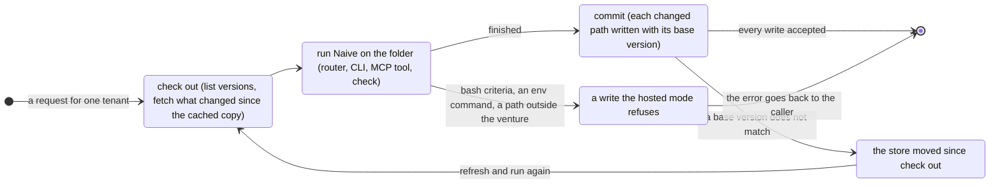

# Running Naive on a hosted store

Designed, not built.

## The ask

Torian, 2026-11-07, in the thread about founders who only have a phone and are not technical. At 04:16Z: "why aren't you suggesting we need to host a database that can do all of these things? The users app, whether it's Mentura or another platform, should need access to the database that we provision. I think I'm actually describing Mentura again." At 04:18Z he said yes to designing what Naive needs so that a host can run all of Naive over that database.

So the line is:
- **Naive** is the engine and the conventions. It runs anywhere there is a filesystem.
- **Mentura** is Naive for people who have no filesystem: a database we provision per tenant, Naive running on our servers, and an app that reaches it.

This design is Naive's half.

## What Naive does today

Counted in `packages/naive/src`, leaving out tests, evals and the contract suite:

| Unit | Source files | Use `node:fs` | Start a process |
|---|---|---|---|
| core | 6 | 4 | 2 |
| records | 9 | 5 | 0 |
| terms | 9 | 5 | 2 |
| store | 5 | 3 | 1 |
| engine | 79 | 72 | 18 |
| checks | 43 | 42 | 6 |
| router | 19 | 17 | 6 |
| interfaces | 14 | 9 | 8 |
| functions | 16 | 16 | 5 |
| total | 200 | 173 | 48 |

Four patterns make up nearly all of it:

1. **The venture's own folder is read and written with `fs`.** The router goes through a connector (`store/connectors/`) only when a record's source is not the venture itself (`remote` in `router/router.mjs`). Engine modules and checks read the folder directly, and their reads are synchronous.
2. **Checks and engine scripts run as child processes.** For example, the router runs `need-now.mjs`, each gate check and each route script with `spawnSync("node", ...)`.
3. **Every write is validated by Python.** The router and `router/boundaries.mjs` spawn `python3 packages/naive/src/records/validate.py` for each write.
4. **A few features reach outside the venture.** `engine/run-handoff.mjs` runs a handoff's done-criteria with `/bin/bash -c`. `NAIVE_JUDGE_CMD`, `NAIVE_SITE_CMD`, `NAIVE_TRACE_CMD` and `NAIVE_MONEY_CMD` run commands named in the environment. `engine/activity.mjs` reads `~/.claude/projects`. `router/boundaries.mjs` and the port and upgrade tools call `git`. Several modules make scratch folders under the OS temp dir.

None of this is wrong for a founder with a laptop. It only matters when the records live in a database.

## Two ways to run Naive on a database

**Candidate A: a store-native engine.** Every module reads and writes through the connector contract instead of `fs`. The contract is asynchronous (`list`, `read`, `version`, `search`, `write`), so 173 files and their callers would become async. Done well it is the cleanest, and it is the only way to run Naive where there is no filesystem at all, such as an edge worker or on the phone itself. It is also months of work touching almost every file, and every check would change at once.

**Candidate B: a hosted working copy.** The host checks out a tenant's records into a folder on its server, runs Naive on that folder exactly as a founder's laptop does, and commits whatever changed back to the store, refusing the commit if the store moved underneath it. Naive keeps its synchronous reads, its child processes and its checks. A server has Node, a filesystem and Python, so everything in the table above already works there.

**Chosen: B.** It is what the platform's tools already do by hand: `store-export.ts` writes a tenant's records to a folder, and `store-import.ts` appends only what changed. It is also the agreed agent stack: the filesystem is the working copy and Neon is the hosted store. Naive needs a small number of guarantees instead of a rewrite.

Kept from A as a later option: if a runtime with no filesystem is ever needed, a synchronous `venture fs` seam in `core/` (the subset of `fs` Naive uses, scoped to the venture root) lets modules switch from `node:fs` one unit at a time. Nothing needs it now.

## What Naive must guarantee

Five things. Each is small, and each is checkable.

### 1. Naive writes only inside the venture

A host commits the venture folder and throws away everything else. So any state Naive keeps outside it would be lost between requests, and any write outside it could reach another tenant. Naive guarantees that it writes only under the venture folder, plus scratch space under the OS temp dir that it removes itself.

`node packages/naive/src/checks/check-write-scope.ts` runs the test suite with a preload that wraps `node:fs` write calls and fails on any path outside the venture under test or the temp dir. Today's exceptions are named in the check, and the hosted mode (point 4) turns them off.

### 2. Each path says what kind of file it is

To commit correctly, a host has to know what each file in the folder is:

- **record**: a record in the data model. It is committed through the store.
- **log**: an append-only file, such as `provenance.jsonl`, `traces/<session>.jsonl`, and later the detection ledger (`governance/detectors/<id>.trials.jsonl`). A commit may only add lines at the end.
- **derived**: a cache Naive can rebuild, such as `.naive/decision-index.json`. A host may keep it to save time, or drop it.

The data model gains a `kind` per path pattern, defaulting to record. `node packages/naive/src/checks/check-data-model.mjs` already insists that every JSON file has a record type, and it extends to logs and derived files.

### 3. The connector contract compares versions on write

Two requests for one tenant can run at the same time. The contract's `write(path, content, opts)` gains an optional `opts.base`: the version the writer started from (`null` for a new file). A connector refuses the write when the current version differs, and returns the current version so the host can check out again. For a log, `opts.append` writes only the new lines, and is refused unless the stored log still ends where the writer's copy began. That keeps every hash chain intact.

The filesystem connector implements both. The contract suite (`store/connectors/suite.mjs`) gains cases for them, so a database connector proves the same behavior. That is how Mentura's Postgres connector shows it is safe.

### 4. A hosted mode that refuses instead of reaching out

Under `NAIVE_RUNTIME=hosted`, Naive refuses each feature that reaches outside the tenant, and says why:

| Feature | Hosted behavior |
|---|---|
| A handoff's bash done-criteria (`run-handoff.mjs`) | Refused, unless the host passes a sandbox runner in. Naive never runs a tenant's shell on the host |
| `NAIVE_*_CMD` from the environment | Ignored. The host registers its judge, site reader or trace exporter as a function at start, the way it registers connectors today |
| Reading `~/.claude/projects` (`activity.mjs`) | Refused. Transcripts reach a hosted venture as records |
| `git` calls (boundaries, port, upgrades) | Refused, except where the host provides a git working copy |

A founder's laptop never sets this, so nothing changes there.

### 5. Validation without a Python process per write

This one isn't required, because a server has Python. But spawning `python3` on every write costs tens of milliseconds, and the host pays that on every request. Naive validates in process with the record schemas it already ships. Naive has no runtime dependencies today, so the choice is between adding one (a JSON Schema validator) and writing a validator that covers only the keywords Naive's schemas use, checked against `validate.py` on every record in the examples. `validate.py` stays as the reference.

## What stays the host's

Listed so the line is clear. None of this is built in Naive.

- Provisioning a tenant's database and checking that its connector passes the contract suite, including the base-version cases.
- Keeping a warm working copy per tenant and refreshing it by version: `list()` returns versions, so only changed records are fetched.
- Running each request in a sandbox with its own working copy, so one tenant's run cannot see another's folder.
- Retrying on conflict, and capping the retries.
- The app, sign-in, the hosted MCP server that lets a founder's own model subscription reach Naive, notifications, and billing.

## How this carries the other designs

- **Signal detection** (Naive#10): detectors are records, the trial ledger is a log, and the cards for decisions and resolutions go to the app.
- **Autoresearch** (everything-ecosystem `docs/design/AUTORESEARCH_RECORDS_2026-11-06.md`): recipes run inside the host's per-request sandbox, and knob searches and backtests run as scheduled requests against the tenant's working copy.
- **The signal library**: a pull is a request like any other, and the projector's writes commit through the store.

## Build plan

All in Naive, one item per pull request.

| # | Item | Verifier |
|---|---|---|
| 1 | `check-write-scope.ts` with today's exceptions named | the suite runs under it; a write outside the venture in a broken copy fails it |
| 2 | `kind` (record, log, derived) in the data model; `check-data-model.mjs` covers it | every path under the example ventures has a kind |
| 3 | `base` and `append` in the connector contract, the filesystem connector and the suite | a stale base is refused; an append over a moved log is refused; the chain checks still pass |
| 4 | `NAIVE_RUNTIME=hosted` and host-registered hooks in place of `NAIVE_*_CMD` | each refused feature returns its message; the laptop path is unchanged |
| 5 | In-process validation on the write path | agrees with `validate.py` on every example record |

After these, Mentura can run any Naive command for a tenant by checking out, running and committing, and nothing in Naive has to know that a database is behind the folder.

## Open questions

- Whether a host keeps derived files between requests, or rebuilds them each time. Keeping them is faster; rebuilding is simpler and can't serve a stale cache.
- How many conflict retries before a request fails back to the founder.
- Whether to add a runtime dependency for validation, or write the subset validator.
