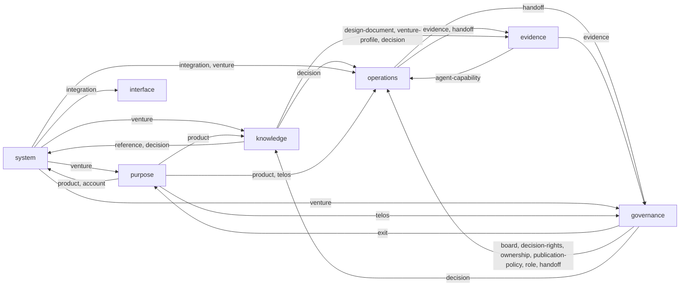

# Layers, kits and the master schema

## Short answers

**Is there a master schema?** No, and there should not be one. No single schema holds everything: a venture's records, the workspace above it, and the method's own records (the methodology catalog, the nouns, the decision log, eval suites) are different kinds of thing at different levels. One schema holding them all would tie every change to every other. The standard answer is a **data model**: one list of every record type, who owns it, where it lives and what it references. That is now `schema/data-model.json` (33 record types). It is the master map, and it is checked: any JSON file in the repo that no record type covers fails the build.

**Is it the venture profile?** No. The profile (`profile.md`) is one prose record inside one venture: its story and thesis. It holds none of the other records. The machine root of a venture is `venture.json`, which names the profile but does not contain it.

How records nest:

```
workspace.json                      one per builder
└── venture.json                    root of a venture (ventures can nest)
    ├── profile.md                  knowledge: the story, in prose
    ├── pillars/                    governance: product, brand, business
    ├── products/<id>.json          purpose
    ├── accounts/<id>/account.json  purpose (optional)
    ├── purpose/anatomy.answers.json
    ├── operations/systems/*.answers.json
    ├── execution/handoffs/<id>.json
    ├── evidence/results/<id>.json
    └── governance/decision-rights.json

method level (this repo, outside any venture)
    catalog (methodologies, questions, artifact types, assignments), ontology, decision log,
    eval suites, references and tooling per layer, data model, kit manifests
```

**How do the layers relate?** As a loop with two layers across it.

1. **Purpose** says why the venture exists and what it offers (core, ambition, products, clients).
2. **Knowledge** records what is known and intended about it (profile, specs, design documents, decisions).
3. **Operations** decides how each system gets built (methodology, artifacts, tools).
4. **Execution** does the work as handoffs.
5. **Evidence** proves what was done, and feeds back into Purpose (should the venture change phase?) and Knowledge (was the spec right?).
6. **Governance** sits across the loop. It says who may decide what at every step, and collects escalations.
7. **Interface** sits across everything. A person, with agents, works through it in four or more layers at once.

Shared records (workspace, venture, nouns, references, tooling) belong to the **system** kit, not to one layer.

## Kits

A kit is a layer's bundle: its skills, the record types it owns, the record types of other kits it reads and writes, and its checks. Each layer has a manifest at `<layer>/kit.json`, and the system kit is at `schema/kit.json`. Three rules, enforced by `node schema/check-data-model.mjs`:

- Every record type is owned by exactly one kit, and that kit is in the record's layer.
- Every skill (`SKILL.md`) belongs to exactly one kit.
- A kit lists what it reads and writes from other kits. **The relationships between layers are derived from these lists, never drawn by hand**, so the picture cannot drift from the files.

**Placement rule:** a skill lives in the layer whose records it writes. If it writes none, it lives in the layer whose records it reads most.

| Kit | Skills | Owns | Offered as |
| --- | --- | --- | --- |
| system | none (orchestrator to move here) | workspace, venture, ontology, reference, integration, business models, scaffold, data model, kit manifests | the kit (flagship) |
| purpose | 2: ambition-tier, telos | product, account, telos, Product Anatomy framework and answers | |
| knowledge | 20 (SAD) | venture profile, decision log, design documents | the knowledge kit |
| operations | 5 (MAD), each with its tier | methodology, question, artifact type, assignment, recommendation, MAD answers, publish rules | MAD |
| execution | none | handoff | |
| evidence | 5 audits | evidence, eval suite, design-documents registry, benchmark | |
| governance | 14 (pillars, roles, chief of staff, ownership and control) | decision rights, role, pillar, ownership, board, founder agreement, exit | |
| interface | none | harness hooks config | operator console |

## What the derived graph shows

The table at the end is generated from the kits as they stand today. It shows four gaps:

1. ~~Operations hands nothing to execution.~~ Fixed (EE-019): a handoff names its methodology `assignment`, and `check-ready.mjs` requires it to exist and be ratified before work starts.
2. **Evidence does not reach purpose yet.** Each phase now has exit criteria in the venture's telos (EE-023), traced to its measures, but nothing reads evidence to say a criterion is met.
3. **Audits leave no evidence.** design-coverage, fidelity, findability and metrics print reports but write no evidence records, so governance cannot see them.
4. **Execution and interface have no skills.** The handoff contract is prose (`execution/handoff-v2.md`), and the scripts that run it sit in `schema/`.

Four references are named but nothing resolves them yet. The check lists them as warnings: venture.profile, venture.governed_by, handoff.governed_by and evidence.suite.

## Misplacements, proposed (not moved)

These wait for your OK. Each one is recorded as `move_to` in the manifests.

| Item | Now | Proposed | Why |
| --- | --- | --- | --- |
| EE orchestrator (`knowledge/SKILL.md`) | knowledge | system | It routes work across every layer |
| `knowledge/method/reference-hooks-config.json` | knowledge | interface | Its hooks configure an agent harness. The data model already gives it to interface |
| ambition-tier skill | purpose | stays | Its tiers (hobby, side project, open-source tool, venture, enterprise) don't match `venture.json` (hobby, survival, lifestyle, managed growth, aggressive growth). Rewrite it to use the schema's values |
| a new run-handoff skill | | execution | Wrap handoff-v2 and the two scripts, so execution has a skill |

Done on 2026-10-27 (EE-020): contract-first moved to `operations/skills/contract-first/`, software engineering tier. Every operations skill now names its MAD tier in the kit manifest.

Fixed now: the schema index had pillars under Purpose, but the pillar files and skills are in governance. They are now under Governance.
### Layer relationships (generated by `node schema/check-data-model.mjs --md`)

Each arrow is a record type one layer owns and another reads, or one layer writes into another. A reader depends on the owner: change the owner's record and the reader's checks run.

| Layer | Skills | Owns | Takes from | Gives to |
| --- | --- | --- | --- | --- |
| purpose | 2 | product, account, anatomy-framework, anatomy-answers, telos, icp, guiding-statements | system (venture); governance (exit) | knowledge (product); operations (product, telos); governance (telos); system (product, account) |
| knowledge | 2 | venture-profile, decision, design-document, knowledge-sources, where-used | system (venture); purpose (product); governance (decision) | system (reference, decision); operations (decision); evidence (design-document, venture-profile, decision) |
| operations | 3 | team-plan, handoff, department-catalog, department | evidence (agent-capability); governance (board, decision-rights, ownership, publication-policy, role, handoff); knowledge (decision); system (integration, venture); purpose (product, telos) | evidence (evidence, handoff); governance (handoff) |
| evidence | 6 | evidence, eval-suite, design-documents-registry, benchmark, agent-capability | operations (evidence, handoff); knowledge (design-document, venture-profile, decision) | operations (agent-capability); governance (evidence) |
| governance | 15 | decision-rights, role, pillar, ownership, board, founder-agreement, exit, publication-policy | operations (handoff); evidence (evidence); system (venture); purpose (telos) | purpose (exit); operations (board, decision-rights, ownership, publication-policy, role, handoff); knowledge (decision) |
| interface | 1 | route-aliases | system (integration) | none |
| system | 0 | workspace, venture, ontology, reference, integration, business-models, scaffold, data-model, kit-manifest, need-now, provenance | knowledge (reference, decision); purpose (product, account) | purpose (venture); knowledge (venture); operations (integration, venture); governance (venture); interface (integration) |


