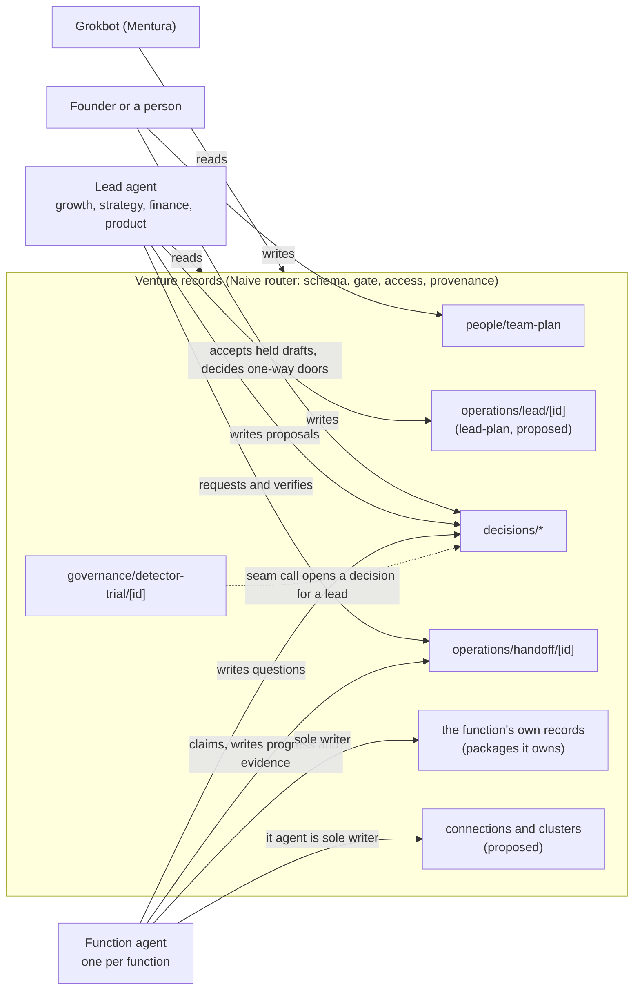
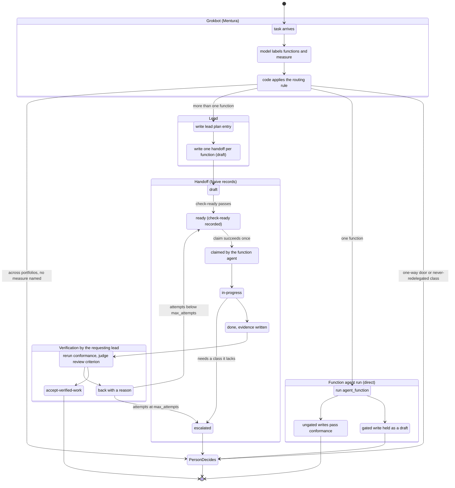

# Lead agents

Designed, not built. Nothing in this note exists in Naive or Mentura yet, unless a sentence names a file that is already there.

## The ask

Torian approved building lead agents on 2026-11-08, and asked that the capability gaps from the Grokbot whole-venture monorepo thesis be folded in. Those two things are decided. Everything else in this note is proposed: the lead ids, their portfolios, the write rules, the routing rule, the record types and the build order. Open questions are marked **Open** where they arise and collected at the end.

## The design in one paragraph

Naive has 13 functions (`packages/naive/src/functions/departments.json`), and Mentura builds one function agent per function (EE-123, everything-ecosystem `platform/agents/function-spec.ts`). A function agent has sole write reach over its function's records. That works for a task inside one function. It does not work for a task that crosses functions, such as "can we afford the second hire before launch", which touches human capital, finance, products and strategy. Today nobody owns that seam. This design adds four **lead roles** (growth-lead, strategy-lead, finance-lead, product-lead). Each is bound to one or more telos measures and has a portfolio of functions. A lead reads every record and writes only three things: its own plan, decisions under `decisions/*`, and handoffs. It never writes a function's records. Work on those records goes to the function agent through a handoff, and the lead that asked for the work verifies it, so the builder is never the verifier. Grokbot, Mentura's always-on top-level agent, routes each task: one function goes straight to that function's agent, more than one goes to a lead. Each lead also knows which outside systems its functions depend on, grouped by the thesis's six capability clusters, and every such connection is a Naive record that follows the thesis's connection contract. Naive stays tool-agnostic: the cluster and connection records are Naive record types, and the connectors that act on them are Mentura's.

## What exists today

| Piece | Where | What it gives this design |
|---|---|---|
| The 13 functions | `packages/naive/src/functions/departments.json` | The ids every role, record and lead portfolio must use |
| Package ownership | `PACKAGE_FUNCTION` in `packages/naive/src/core/venture-paths.mjs` | Which record packages each function owns. Only 8 of 13 functions own a package today (strategy, products, marketing-and-sales, service-delivery, human-capital, finance, risk-and-compliance, external-relationships; it, customer-service, supply-chain, assets and capabilities own none) |
| Role templates | `packages/naive/template/governance/roles/*.json` | `finance-lead`, `marketing-lead`, `product-design-lead` and others already exist as function-scoped roles. Their `function` field uses ids that `departments.json` does not list (`marketing`, `product`, `engineering`, `legal`, `people`, `validation`, `operations`) |
| Delegation | `packages/naive/template/governance/delegation.json`, `check-delegation.mjs` | Grants from the founder down, never-redelegated classes, one-way doors |
| Team plan and access | `people/team-plan` route, `packages/naive/src/engine/access.mjs`, `check-team.mjs` | Per-role read and write globs over routes; the router refuses a write outside them |
| Handoffs | `operations/handoff/[id]` route, `check-ready.mjs`, `check-execution.mjs` | Handoffs already carry `role`, `claimed_by`, `status`, `decision_classes`, `done_criteria` and `evidence` |
| Builder is not verifier | `packages/naive/src/checks/verify.mjs` | `independent(builder, verifier)` and `reviewIsIndependent` already enforce it for review criteria |
| Decision index | `packages/naive/src/engine/decision-index.mjs` | Ranks open decisions; a lead's proposals land here |
| Detectors | `governance/detector/[id]`, `governance/detector-trial/[id]` | The record shape for a yes or no call and its ledger (SIGNAL_DETECTION_2026-11-07.md) |
| Function agents | everything-ecosystem `platform/agents/` | `functionAgent(id)` derives the role `<function>-agent` and its write routes from Naive's data; the MCP shim gives Grokbot one `agent_<function>` tool per staffed function |
| Integrations and systems | `packages/naive/src/records/integration.schema.json`, `packages/naive/src/engine/systems-catalog.json` | Tools per layer and systems of record per function. The systems catalog also keys a function id `legal` that `departments.json` does not list |

The spend register is named by two decision classes (`spend-register-upkeep`, `cancel-or-downgrade`) and by the `finance-lead` role, but it has no record type.

## Shape

### Leads and their portfolios

A lead is a role, not a function. It owns no records of a function. It owns an outcome, stated as telos measures, and a portfolio of functions whose cross-function work it plans and verifies.

| Lead | Portfolio (proposed) | Telos measure kinds it is bound to by default | Typical seam it owns |
|---|---|---|---|
| growth-lead | marketing-and-sales, customer-service | `revenue`, `usage_or_adoption` | Promises made at sale against what products and service can deliver |
| product-lead | products, service-delivery, supply-chain, it | `flow_and_lead_time`, `usage_or_adoption` (shared) | Roadmap against deal asks, support themes and infrastructure cost |
| finance-lead | finance, assets, risk-and-compliance | `cost_or_time_saved`, `compliance_met` | Runway against hiring, tooling and spend; contracts against cost |
| strategy-lead | strategy, capabilities, human-capital, external-relationships | the primary measure, `learning`, `impact` | Telos and focus against everything else; org design; what investors hear |

The portfolios cover all 13 functions once each. The research behind them is the cross-functional tables in the function research (section 6 of each file): finance's largest handoffs are human capital and marketing and sales, strategy meets every function at quarterly planning, and products sits between sales, support and IT.

Measure kinds are only defaults. A venture binds a lead to concrete measure ids from `foundation/telos` (`measures[].id`) in the lead's plan. A lead bound to no measure is refused by `check-team.mjs` (proposed rule), because a lead with no outcome has no basis for choosing between tasks.

**Open:** whether a measure may be bound to more than one lead. The proposal is one accountable lead per measure, others contributing, so a regression in a measure has exactly one lead to raise it.

**Open:** human-capital sits in strategy-lead's portfolio for org design, but most of its handoffs go to finance (headcount is most of spend). It could instead sit with finance-lead.

### The name collision with the existing finance-lead

`packages/naive/template/governance/roles/finance-lead.json` already exists. It is a function-scoped role: `function: finance`, it holds `spend-register-upkeep` and `cancel-or-downgrade` over `finance/`, and it is verified by the founder. Under this design that work belongs to the finance function agent, and `finance-lead` becomes the cross-function lead.

The proposal: the existing template becomes the lead (its id is kept, so ventures that installed it keep their grant id), its `function` becomes `all`, and the founder's direct grant of `spend-register-upkeep` and `cancel-or-downgrade` moves to a new grant `founder-to-finance-agent` with scope `finance/`. Both classes are in `never_redelegated`, so they must come straight from the founder, which a direct grant satisfies. `marketing-lead` and `product-design-lead` stay as they are: they are seats inside one function, not leads, and item 1 only fixes their `function` ids.

**Open:** whether to keep the id `finance-lead` for the lead and accept a one-release meaning change, or name the leads with a distinct suffix (for example `finance-portfolio-lead`) and leave the old role alone.

### Who writes what

A lead reads every record. It writes:

- its own plan, a new record type `lead-plan` at `operations/leads/<id>.json`, route `operations/lead/[id]` (proposed). The plan names the lead, its portfolio, its bound measures, its current bets (each bet citing measure ids and handoff ids) and its review cadence. The file name avoids `*.plan.json`, which the `evidence/eval-plan` route already matches.
- `decisions/*`, to raise a question or propose an answer. A proposal is not a decision: classes a lead does not hold still go to whoever holds them.
- `operations/handoff/[id]`, to request work and, later, to verify it. The handoff claim (item 5) narrows this so a lead edits only the handoffs it requested.

A function agent keeps sole write reach over its function's records (EE-123): `decisions/*` plus the concrete write routes of the packages its function owns. It gains one thing, the right to claim a handoff addressed to its role and to write that handoff's progress and evidence.

A person accepts held drafts, writes the team plan, and holds every one-way door and never-redelegated class. No agent, lead or function, writes the team plan; `reachesTeamPlan` in `function-spec.ts` already refuses that for function agents, and `leadAgent` applies the same check.

### Decision rights for a lead

A lead gets grants from the chief of staff, which may re-delegate them: `accept-verified-work` (so it can accept a handoff it verified) and `defer-or-route` with scope `venture` (so it can decide which function agent takes which part). It holds no class in `never_redelegated` and no one-way door. `check-delegation.mjs` already refuses a grant that breaks either rule, so no new check is needed there.

This matches the function research. Strategy's note says almost all of its analysis is agent-fillable and almost none of its decisions are. Marketing and sales says every outbound act is a `public-commitment` or `legal-or-terms` decision unless a person delegated a bounded class of it. A lead prepares and verifies; a person decides.

**Open:** whether leads also get `set-priorities` within their portfolio. It would let a lead reorder its own bets without a person, but `set-priorities` is not granted to any agent today.

### Routing a task

Grokbot is Mentura's interface and stays Mentura's. The rule it applies is data in Naive, so any harness routes the same way. Code decides and a model only classifies: a model labels which functions a task touches, and a deterministic rule picks the target.

1. A model labels the task with the functions it touches and, if it can, the telos measure it serves.
2. If the task names a one-way door or a never-redelegated class, it goes to a person. No agent takes it.
3. One function: the task goes straight to that function's agent (`agent_<function>`), as it does today.
4. More than one function, all in one lead's portfolio: that lead.
5. Functions across portfolios: the lead accountable for the measure the task serves. With no measure named, the chief of staff role decides (`defer-or-route`), which today means a person or Grokbot acting as chief of staff.
6. The lead writes a plan entry and one handoff per function involved. Each handoff names the function agent's role, the decision classes it may use, done criteria, and a review criterion whose reviewer is the requesting lead.
7. `check-ready.mjs` passes and is recorded, so the handoff is `ready`.
8. The function agent claims it (item 5), works it, writes evidence and sets it `done`.
9. The requesting lead verifies: it reruns the conformance criteria and judges the review criterion. It accepts, or sends it back with a reason, up to the handoff's `max_attempts`. After that it escalates to a person.

A direct single-function run has no lead, so no lead verifies it. Its gated writes are held for a person as they are today, and its ungated writes pass on conformance alone.

**Open:** who verifies a direct single-function run that asked for review. The proposal is the person who asked, through Grokbot; the alternative is the lead whose portfolio holds the function.

**Open:** whether Grokbot acts in the chief-of-staff role when it routes, or is only a harness that hands the choice to a person when rule 5 has no measure.

### The handoff claim

Handoffs already have `claimed_by` and `check-execution.mjs` already refuses an `in-progress` handoff that is not claimed. Nothing makes a claim exclusive. The proposal is a `claim` action on `operations/handoff/[id]`:

- It succeeds only when the handoff is `ready`, unclaimed, and its `role` equals the acting role. It sets `claimed_by` to the run id and `status` to `in-progress` in one write.
- A second claim of the same handoff is refused, so two runs never work one handoff.
- A new field `requested_by` names the lead (or person) that wrote the handoff. After a claim, only the claimant writes progress and evidence, and only the requester writes the verification and the acceptance. The router refuses anything else.
- The review criterion's reviewer must be `requested_by`, and `reviewIsIndependent` already refuses a reviewer equal to the holder.

### The spend register and the access matrix

The spend register is the shared record between finance and IT that the finance research names, and the first place where "sole write reach" meets a record two functions care about. The proposal is a `spend-register` record type at `finance/spend-register.json` (route `finance/spend-register`), owned by finance. Each line names a vendor, what it is for, amount, currency, cadence, renewal date, the account it is paid from (by reference, never a card number), the function that uses it, the capability cluster and connection it belongs to, and its status (`active`, `cancel-requested`, `cancelled`).

Only the finance agent writes it. IT's approval of a tool is IT's own record, which the register cites by id. The **access matrix** is the source map's existing rules (EE-042, `packages/naive/src/store/connectors/resolve.mjs`) filled in for the register field by field: the bank statement sync is the system of record for amounts and dates, finance owns status, IT's tool record is the system of record for approval. That is rule 1 of the thesis's connection contract applied to the first shared record, and it reuses the matrix instead of adding a second one.

**Open:** whether the register is one file or one record per line (`finance/spend/[id]`). One file is simpler; one per line gives cleaner provenance and fewer write conflicts.

### Seam detectors

A seam is where two functions' records should agree and can drift. Each is a detector (SIGNAL_DETECTION_2026-11-07.md) with a check as its sensor. A yes call opens a decision assigned to the lead whose portfolio spans the seam, or to the measure's accountable lead when it spans two. The lead's outcome resolves the trial: acted on is a hit, dismissed is a false alarm. The ledger then tells Torian which seams are worth watching.

| Seam | Functions | Records compared (where they exist) | Lead |
|---|---|---|---|
| Discounts against the price | marketing-and-sales, finance | deal records against `validation-pricing` | finance-lead |
| Promised against planned | marketing-and-sales, products | deal promises against the product roadmap | growth-lead and product-lead (measure decides) |
| Headcount against runway | human-capital, finance | team plan open roles against `money/_summary` runway | finance-lead |
| Tools against spend | it, finance | IT's tool records against the spend register | finance-lead |
| Pipeline against focus | marketing-and-sales, strategy | deal segments against the ICP primary | strategy-lead |
| Claims against approved claims | marketing-and-sales, risk-and-compliance | publications against approved claims and consent rules | growth-lead |

`check-where-used.mjs` already finds a child record that drifted from its parent. Where a seam is a parent and child, the detector's sensor is that check; where it is not, the seam needs its own small check.

**Open:** several compared records do not exist yet (deal promises, approved claims, IT tool records). Item 6 builds detectors only for seams whose records exist, and lists the rest as not built.

### Capability clusters and connections (from the thesis)

The thesis asks, for each function, what an outside tool gives that GitHub plus Naive cannot, and groups the answers into six clusters with one tool per cluster, not one per function. This design makes that Naive data so each lead knows which outside systems its portfolio depends on.

| Cluster (thesis) | Functions that depend on it | Leads that see it |
|---|---|---|
| Identity and secrets | it, human-capital, every product | product-lead, strategy-lead |
| Messaging delivery | marketing-and-sales, customer-service, product email | growth-lead, product-lead |
| Money and books | finance, human-capital payroll, crowdfunding | finance-lead, strategy-lead |
| Runtime and data | products, platforms, private profile data | product-lead |
| Signatures and privileged records | risk-and-compliance, external-relationships, human-capital | finance-lead, strategy-lead |
| Private contact records | sales, support, investors, candidates | growth-lead, strategy-lead |

Two record types, both Naive's and both tool-agnostic:

- `capability-cluster`: a catalog Naive ships (like `departments.json`) listing the six clusters, the functions that depend on each, and the gap that justifies it (regulated authority, a network or money rail, a runtime, or a UI preference, which is the weakest reason). It names no vendor.
- `connection`: one per outside system a venture connects, at `it/connections/<id>.json`, owned by the it function. Its fields are the thesis's eight-point connection contract: the records and fields the tool is authoritative for (as source map rule ids, not a copy of them), sync direction (default tool to repo, references only), allowed reads and writes with least-privilege scopes, events and their signature checks, the stable external id with provenance and last-synced time, which actions need a person's approval, idempotency and reconciliation, and the deletion, export and disconnect plan. It also states what goes stale, what blocks and what degrades when the connection fails, which the lead reads.

The approval rule maps onto classes Naive already has: a send is `public-commitment`, a payment is `spend-money`, a signature is `legal-or-terms`. All three are one-way doors or never re-delegated, so "human approval before send, payment or signature" is already enforced by delegation once each connection names the class of each action.

The boundary is the thesis's refinement: Naive gets no second generic connector contract. Naive's store connectors (`packages/naive/src/store/connectors/`) keep reading and writing records. The outside host, catalog of drivers and the log of outside actions are the proposed `outside/` package in everything-ecosystem. A connection record says what is allowed and what is authoritative; Mentura's connectors do the acting, and a connector being present is not permission to act.

**Open:** whether `connection` is a new type or an extension of `integration.schema.json`, which already lists tools per layer with credentials by variable name.

**Open:** the it function owns no package today. `it/connections/` needs a new `it` entry in `PACKAGE_FUNCTION`, which also gives the it agent its first write routes.

**Open:** vendor research in the thesis is blocked (its research tool was not installed), so no cluster names a tool. That is intended: Naive's catalog never names a vendor, and a venture's connection record does.

## What it does not do

- It adds no new function. Leads are roles over the 13.
- No lead writes a function's records, the team plan, or a connection.
- No model output becomes a decision. A model labels the task; code routes it; a person decides one-way doors.
- Naive does not run agents, call outside tools or hold secrets. Mentura does, through `platform/agents/` and the proposed `outside/` package.
- Runs still take the venture lock one at a time (everything-ecosystem `platform/agents/README.md` lists shared appends as not built). A lead with four handoffs out runs them in sequence.

## Build plan

The plan, in order, one item per pull request. Items 1 to 3 and 5 to 7 are in Naive; item 4 is in Mentura and waits for a Naive pin bump after item 3.

| # | Item | Repo | What | Verifier |
|---|---|---|---|---|
| 1 | Function on record types; role ids match | Naive | A `function` field on each record entry in `packages/naive/src/records/data-model.json` (a `departments.json` id or `shared`); role template `function` values become `departments.json` ids or `all`; the systems catalog's `legal` key becomes `risk-and-compliance`; a check that every one resolves | the new check breaks on copies; `check-data-model.mjs`, `record-types.ts --check`, `check-delegation.mjs` pass |
| 2 | Spend register and access matrix | Naive | `spend-register.schema.json`, the data model entry, the `finance/spend-register` route, the template's source map rules per field, and the `founder-to-finance-agent` grant | a write by any role but `finance-agent` is refused; `check-sources.mjs` refuses a tie on a register field |
| 3 | Lead role templates and team-plan entries | Naive | Four lead templates with `portfolio` and default measure kinds, the `lead-plan` schema and `operations/lead/[id]` route, grants from the chief of staff, the routing rule as data, and `check-team.mjs` rules: a lead writes only its plan, `decisions/*` and handoffs, and is bound to a telos measure | `check-team.mjs` refuses a lead with a function's write route or no measure; `check-delegation.mjs` refuses a lead grant of a one-way door |
| 4 | `leadAgent(id)` | everything-ecosystem | `platform/agents/lead-spec.ts` derives a lead from Naive's templates (no list of leads in Mentura), its run reads every record and writes handoffs, and the MCP shim adds `lead_<id>` tools and applies the routing rule for Grokbot | an offline run with a scripted model writes a plan entry and handoffs and no function record; a single-function task routes to `agent_<function>` |
| 5 | Handoff claim | Naive | The `claim` action, `requested_by`, and the router rules for who writes progress, evidence and verification | two claims race and one wins; a lead cannot accept a handoff it did not request; a claimant cannot verify its own work |
| 6 | Seam detectors | Naive | Detector records for the seams whose records exist, their check sensors, and the decision a yes call opens for the right lead | each seam fires on a drifted copy and stays quiet on a clean one; a dismissed decision resolves a false alarm |
| 7 | Capability clusters and connections | Naive | The `capability-cluster` catalog from the thesis, the `connection` schema with the eight contract fields, the `it` package, and a check that every send, payment or signature action names its approval class | the check refuses a connection whose send action has no approval class, or that copies a field another source owns |

Each item also proposes its new nouns (lead, portfolio, lead plan, seam, capability cluster, connection, claim) through the term engine in `packages/naive/src/terms/` with status `proposed`, and updates the README nearest its code.

## Open questions

1. Whether a telos measure may be bound to more than one lead, or has exactly one accountable lead.
2. Whether human-capital belongs in strategy-lead's portfolio (org design) or finance-lead's (headcount is most of spend).
3. Whether the lead keeps the existing id `finance-lead` (and that role's spend work moves to the finance agent) or the leads take distinct ids.
4. Whether leads also get `set-priorities` within their portfolio.
5. Who verifies a direct single-function run that asked for review: the person who asked, or the lead whose portfolio holds the function.
6. Whether Grokbot acts in the chief-of-staff role when it routes, or hands a cross-portfolio task with no measure to a person.
7. Whether the spend register is one file or one record per line.
8. Which seams item 6 builds first, given that deal promises, approved claims and IT tool records have no record type yet.
9. Whether `connection` is a new record type or an extension of `integration.schema.json`.
10. Whether the it function gets an `it` package for connections and tool records, and what else it should own.
11. Whether the routing rule's code (not only its data) moves into Naive, so every harness and not only Grokbot routes the same way.
12. How a lead runs several handoffs while the venture lock allows one run at a time, until shared appends are built.
