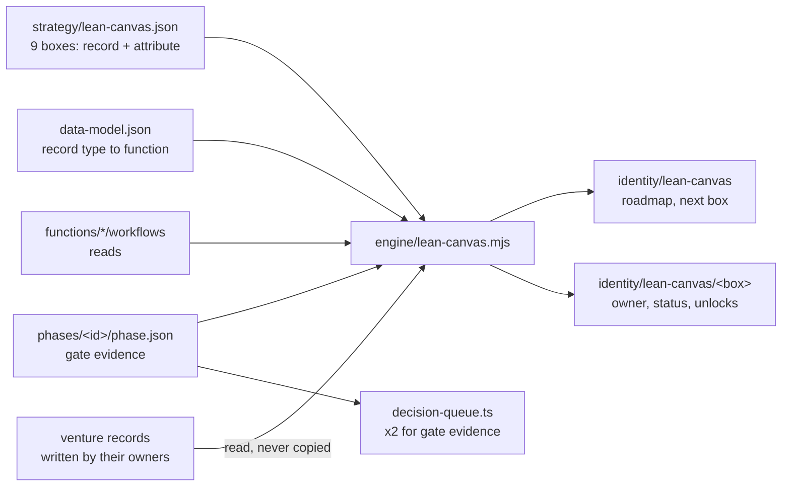

# The Lean Canvas as the venture's shared kernel

Date: 2026-11-22. Decision: EE-155. Status: built.

## Domain

A founder starting a venture should see one standard page and the order to fill it, not a list of one-off questions. The standard page for an early venture is the Lean Canvas (Ash Maurya, *Running Lean*, 2012), adapted from the Business Model Canvas (Osterwalder and Pigneur, 2010). It has nine boxes: problem, customer segments, unique value proposition, solution, channels, revenue streams, cost structure, key metrics and unfair advantage.

The canvas spans functions. In Domain-Driven Design (Evans) terms, each function is a bounded context, and the canvas is their shared kernel: a small model every function reads, which changes rarely and only with its owners' agreement.

## System

- `packages/naive/src/functions/strategy/lean-canvas.json` defines the boxes. Each box names a record type and an attribute. It holds no venture data.
- A box's owner is the function the data model gives its record type. The strategy function owns the canvas itself, which only assembles and orders the boxes.
- `packages/naive/src/engine/lean-canvas.ts` resolves the canvas for a venture. It reads each box through the same `statement` reader as the identity statements, so a box shows confirmed, agent, draft or missing, and copies nothing.
- What a box unlocks comes from data: the phase gate whose exit evidence names its record type, the function workflows that read its route, and the record types whose refs point at it.
- The roadmap orders the boxes: the current phase's gate evidence first, in the gate's order, then the next gate's, then the rest in canvas order.
- Each box is its own route, `identity/lean-canvas/<box>`, beside `identity/lean-canvas`.
- The decision queue raises a decision that settles a record the gate asks for by 2 and breaks equal scores in the gate's order, so the queue and the roadmap agree.

## What the data model says about owners

Today the data model gives the validation records (problem, solution, go-to-market, pricing), the customer profiles and the goals to strategy, budgets to finance, and venture.json to no function. So seven boxes are strategy's, cost structure is finance's and unfair advantage is the venture's. Moving channels to marketing and sales, or revenue to finance, would be a change to those record types' `function`, decided on its own.

## Not built

- A view that draws the canvas.
- Writing a box from the canvas. A box is written at its record's own route, by its owner.
- The rename of the `foundation/` folders and `foundation-*` decision ids to identity (EE-091). The canvas uses `identity/` routes, and the old folders remain a defect.
