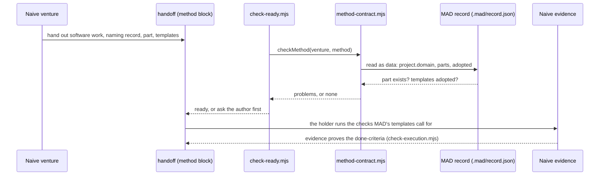

# The venture-to-software contract (Naive to MAD)

## Goal

The Everything Ecosystem joins its member frameworks by contracts. The first is venture to software: when a venture hands software work out, the handoff should say which method governs it, and that method is MAD's to choose. Today a handoff can cite a MAD assignment (A-NNN, from before MAD's restart) that nothing checks, so the link between the two frameworks is a string.

## How each side works today

- Naive: a handoff (`operations/handoffs/<id>.json`) carries its role, decision classes, done-criteria and evidence; `check-ready.mjs` decides it is ready; evidence records prove its done-criteria.
- MAD: a project record (`.mad/record.json`) holds the project's parts, every answer, and the templates adopted per layer and part (several may apply at once).

## Two shapes

1. A contract record type in the shared kernel: one record per pair of frameworks declaring what crosses in each direction, with a generic checker that reads the declaration. It suits three contracts; with one, the declaration and the checker say the same thing twice.
2. A method block on the handoff, checked against MAD's record by one small module. The handoff owns which method it runs under; MAD's record owns which methods are adopted; the readiness check is the one place that joins them.

The second shape is chosen now. Each fact has one owner, there is one way to name a method, and a caller needs to know three fields. The block names its framework, so the design and institution contracts add a value and a checker, not a new field. A shared contract record waits until a second contract shows what the three have in common.

## What crosses, and who keeps it

| Direction | What | Kept by |
|---|---|---|
| Naive to MAD | the part of the project and the templates the work follows | the handoff's `method` |
| MAD to Naive | which templates are adopted for each part | MAD's record (`adopted`) |
| back to Naive | the results of the checks the method calls for | Naive evidence on the handoff |

The fields Naive reads from MAD's record (`project.domain`, `parts[].id`, `adopted[].part` and `adopted[].templates`, templates as `<id>@<semver>`) are the contract. MAD keeps a test that its record schema still has them, after the consumer-driven contract pattern: the consumer states what it relies on, and the provider's own tests keep it.

## Principles and the choice each changed

- Model the domain: the method is named where it is decided (MAD) and referred to where it is used (the handoff); Naive stores no copy of MAD's choice.
- Boundary discipline: Naive reads MAD's record as JSON and imports no MAD code, so either can change inside its boundary.
- Laziness protocol: no generic contract record until a second contract exists.
- Prove it works: the checker tests break the method on copies of the example venture (a missing part, a template not adopted, a part with no method chosen, a record outside the venture, a missing record) and pass one that resolves.

## Not built

- The design and institution contracts (Virtu, SPCT).
- Evidence naming the MAD template whose check it ran.
- Writing the method into a handoff from MAD (`mad` choosing for a part and Naive filling the block).
