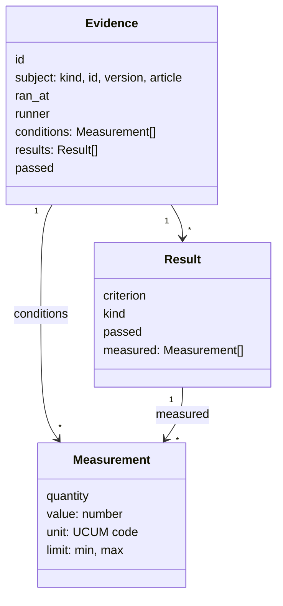

# Measured evidence

## Goal

The SpaceX study asks what counts as evidence: a test flight, a static fire, a simulation. Naive's evidence could say a product passed a criterion, but not which unit was tested, under what conditions, or what was measured. A physical test needs all three.

## Two shapes

1. A separate record type for physical tests, beside evidence. Handoffs and checks would read two kinds of proof, and every rule about evidence (append-only, passed matches results, the builder is not the verifier) would be written twice.
2. Measurements on evidence itself: an article on the subject, conditions on the run, measured values on each result. One record proves done-criteria whether the run was a suite or a static fire.

The second shape is chosen: one record type owns proof, and the checks that already guard it guard physical tests too.

## Principles and the choice each changed

- Model the domain: a measurement carries its unit, so 3.5 is never a bare number; a limit is in the same unit, both ends included.
- Standards first (EE-014): units are UCUM codes, the code system HL7 and many engineering tools use, rather than a unit list of our own.
- Prove it works: `check-execution.mjs` refuses a result that passes outside its limit and a limit whose min is above its max; the checker tests break both on copies of the example venture and pass one inside its limit.

## Not built

- Unit conversion, and checking a unit against UCUM.
- A simulation as evidence that names its model and inputs.
- UCUM in the standards catalog (`packages/naive/src/terms/standards/`, on its own branch).
