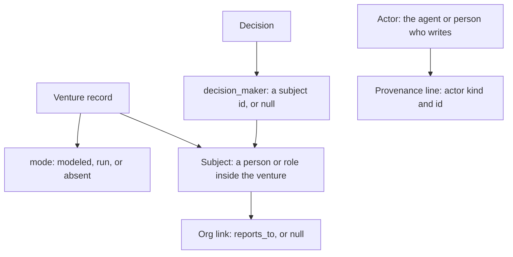

# Modeled ventures (EE-189)

A venture record says whether agents are modeling it or a person is running it. The actor who writes a record is the process that wrote it. The people and roles inside the venture are subjects. A decision names the in-venture decision-maker when that is known, and leaves it null when it is not.

There is no edge from a subject to the provenance line. The check refuses a write that records a subject as the actor.

## What is recorded

`venture.json` `mode` is `modeled` or `run`. Absent means the record was written before this decision, and it is not read as `run`. Nothing rewrites an old venture. A later write sets the field. That write is an amend: a new provenance line, not an edit of the old one.

`modeled` means agents are modeling the venture. The people, roles and org links in it are subjects. A watched company is a modeled venture. `run` means the venture is being run on Naive. `naive new` writes `run`. `naive new --modeled` writes `modeled`.

The provenance agent is the process. An agent process is `kind: agent` with its id, model, session and harness. A person process is `kind: person` with `MENTURA_ACTOR_ID` when that is set. `--name` on `naive new` is the subject written into `people/`. It is not copied into the provenance agent. `phase --override` does not record an agent as a person. An agent process is refused, and no line is written. A person process is recorded as that person.

`decision_maker` on a decision is a person id or a role id, or null. Absent and null both mean unknown. Nothing fills it with the founder or the acting agent. A modeled venture's scaffolded decisions write null. The founding question on a modeled venture does not say "you" or "I".

`people/people.json` `mode` stays `solo` or `team` when that ownership is known. It is null when it is not. A modeled venture does not use `solo` to hand every function to the named person. `functions.*.owner` may be null. `reports_to` on a person is another person's id, or null. A string that names nobody, or a cycle, fails the check.

## Terms

The checks are terms in the EE-095 engine, with Lean proofs. They read facts, not labels.

| Term | Level | Passes when |
|---|---|---|
| Faithful author | authorship | The written kind is the process kind, one of person, agent or unverified, and the subject was not copied in as the author |
| Modeled venture | conduct | `modeled` and not `run` |
| Run venture | conduct | `run` and not `modeled` |
| Open maker | maker | The in-venture maker is unknown, and it was not guessed |
| Named maker | maker | The maker names a person or a role in the venture, is not the acting agent, and was not guessed |
| Org link | org | `reports_to` is null, or both ends exist, and the link is not a cycle |

An old record is not failed for a field it does not have. A new write that would guess is failed.

## Five steps

1. Question the requirements. The record has to say who wrote it, whether the venture is modeled or run, who inside it decides when that is known, and nothing when it is not.
2. Delete. Do not add a second log. Do not rename `decided_by` or `approved_by`. Do not rewrite provenance. Do not default a maker to the founder or the agent. Do not invent a second org chart beside `people/` and `functions`.
3. Simplify. One resolver reads the process. One optional field on the venture. One optional field on the decision. One optional link on a person. Null means unknown.
4. Accelerate. The same terms judge a write, a scaffold and a check. A wrong author, a guessed maker and a broken org link fail the same way.
5. Automate. Admission, the Lean proofs and the bypass guard. `naive new` writes the mode. A modeled venture writes null makers and null owners. An old record changes by a later write.

## Not decided

These are one-way doors if a name or a shape is renamed after records exist. The code takes the reversible option.

- The field is `mode`, which is also the word for the loop mode and the people roster mode. Those sit on other records. Renaming this field is not decided.
- `decision_maker` is a string or null, the same shape as a function owner. A `{ kind, id }` object is not decided.
- An agent is refused at `phase --override`, which is the rule already in `lifecycle.ts`. Letting an agent override and recording the agent is not decided.
- Absence of `mode` is not read as `run`.
- `people.mode` `solo` still means one person owns every function. A modeled venture writes null instead of changing what `solo` means.
