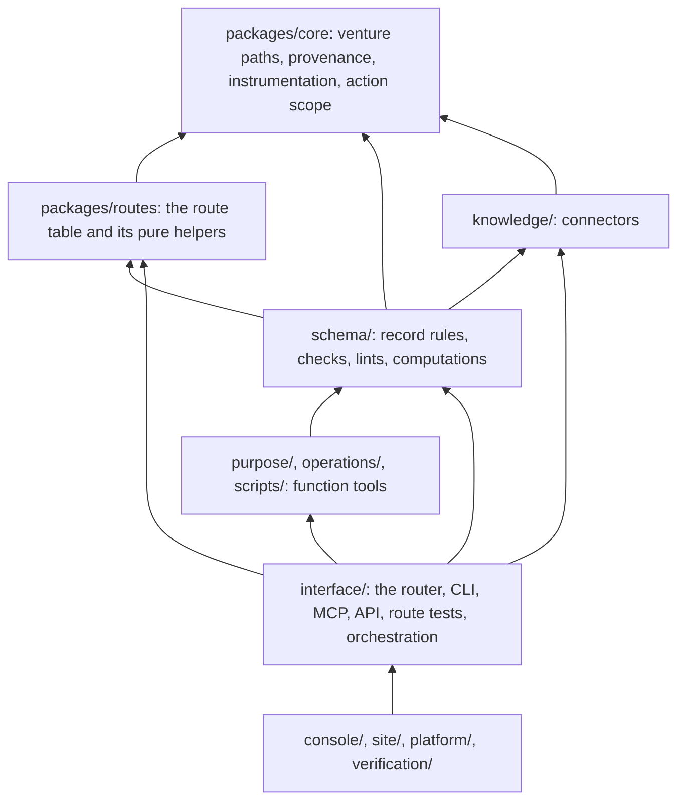

> Copied from everything-ecosystem (docs/design/, main at 2026-11-05) when Naive moved to its own repository (EE-118). This copy is Naive's from now on. Paths it names under site/, platform/, console/ or instance/ stay in everything-ecosystem.

# Breaking the import cycle: the router inversion

Monorepo rebuild, stage 2 (PR 3c onward). Plan: https://claude.ai/artifact/KRc8UgzycnhQBY6dj4YpAX. Written 2026-11-05.

## Goal

The monorepo standard needs units that import each other without cycles. The rule is checked by `scripts/dependency-rules.ts`, which lists today's cycle as known and lets the list only shrink. After PR 3b (#227) one cycle remains: interface, knowledge, operations, purpose, schema and scripts.

The target layering, from the bottom up:

An arrow points from the importer to what it imports. Nothing points down to up.

## Why the cycle exists

The router imports about 25 modules from `schema/` (the gate, the decision files, caching, freshness, staleness, the lint suites and the brand). Before this PR, 34 modules in `schema/` imported the router back. There are two kinds of import:

1. **Reading the route table.** 11 of the 34 used only `routes`, `resolve`, `glob`, `files` or `gateOf`. These are pure functions over `schema/data-model.json` and the manifests, and nothing in them needs the router.
2. **Running a route.** The rest call the router's `call` (or `judge`). These are route tests and five orchestration modules: `triggers`, `setup`, `migrate-venture`, `releases` and `model-steps`.

The route table itself imported `schema/` for its command lists (the brand, the ten lint suites and the cache) and for the per-action memo. So it could not move until those moved too.

## The steps

Each step is one pull request, and each one ends with the dependency check green.

| Step | What moves | Edges it removes | Status |
|---|---|---|---|
| 1 (PR 3c) | Route table to `packages/routes/routes.mjs`; command lists to `packages/routes/commands.mjs`; memo to `packages/core/action-scope.mjs`. The router and the schema modules re-export, so no importer breaks. | schema to interface 42 to 32 (11 schema modules, plus 5 in knowledge, platform and site); the route table no longer imports schema | merged (#235) |
| 2 | Route tests: the `schema/*-test` files that drive routes through `call`, the MCP server or the HTTP API move to `interface/tests/`, under the same names. | 24 of the remaining 32 (schema to interface 32 to 8) | merged (#236) |
| 3 | Orchestration: `triggers`, `setup`, `migrate-venture`, `releases` and `model-steps` compose routes, so they move to `interface/orchestration/` with their callers updated. `build-release` goes with `releases`, because it is that module's command line, and `delegation-test` goes to `interface/tests/`, because it imports `setup`. Shims at the old paths would import interface again, so there are none. `packages/core/provenance.mjs` spawns the triggers module by path, and that path changes with it. | 6 of the remaining 8 (schema to interface 8 to 2) | merged (#238) |
| 4a | Interface helpers go down or split. `release-card.mjs` draws an SVG from `card.json` and imports no route, so it moves to `schema/release-card.mjs` beside `release-read.mjs`. The adapter files part of `interface/adapters.mjs` (`adapters`, `skillsFor`, `adapt`, `refresh`) writes files and runs no route, so it moves to `schema/adapters.mjs`; `interface/adapters.mjs` keeps `verify`, which runs routes, and the command line, and re-exports the rest. `knowledge/connectors/eval.mjs` keeps the contract suite, and its router, catalog, matrix and attribute evals move to `interface/tests/connectors-router-test.mjs`. `interface/kit-boundary.mjs` needs nothing, since its only schema importer moved up in step 3. | the last 2 schema to interface edges and the 1 knowledge to interface edge; interface and knowledge leave the cycle, which becomes operations, purpose, schema and scripts | #239 |
| 4b | Function tool back-edges from `schema/` to `scripts/` and `operations/`. The transcript readers (`walk`, `transcriptFiles`, `humanText`) move from `scripts/diagnose-transcripts.mjs` to `schema/transcripts.mjs`, which the script imports and re-exports, so `schema/activity.mjs` no longer imports `scripts/`. The public gate `operations/marketing/check-public.mjs` imports only `packages/core` and is a check over records, so it moves to `schema/check-public.mjs`; `schema/publish-lint.mjs` runs it without importing `operations/`, and the `operations/marketing/public` route names the new path. | scripts and operations leave the cycle, which becomes purpose and schema | #240 |
| 4c | `schema/packages.mjs` imported `route` from the idea map for each record's title and where the founder's ideas for it stand, and the idea map reads `schema/` itself. The route is now passed in: `packages(dir, { routes })`. `interface/orchestration/venture-package.mjs` composes the two (`venturePackage(dir)`) and holds the command line, so the `system/package` route names it. The package view (`interface/package-routes.mjs`), the router's write snapshot (`interface/writes.mjs`, whose next step names a record by its routed title) and the demo board call it. Modules that read no routed field (the adapters, triggers, structure, upgrades, releases and model steps, which read package ids, completion, fit and record status) call `packages(dir)` and no longer compute the routing. | the last edge | #242 |
| 5 | `scripts/dependency-rules.json` lists no known cycle, so any cycle between units fails the check. | | #242 |

## Choices and why

- **Move rather than inject in step 1.** The route table needs no runtime state from the router. Moving it is a cut along a seam that already exists, and the router's re-export keeps every importer working. Injection would add a registration step for no gain.
- **Command lists are data.** Each lint suite's commands are fixed route, script and note triples. As data under `packages/routes` they can be listed without loading the lint code. Each module re-exports its own list, so its importers do not change.
- **Tests move to the router in step 2.** A test that runs a route through `call` tests the router and the module together. It belongs above both, as a dependency of the interface.
- **Orchestration moves up in step 3.** These modules compose routes. That is the interface's job, and moving them is honest about where they sit. Passing `call` in would still leave their command-line entry points importing the router.

## What this PR proves

- The route table is identical: `routes()` from the router at this head is byte for byte the same JSON as on main.
- `node scripts/dependency-rules.ts --graph` shows schema to interface at 32 (was 42) and knowledge to interface at 1 (was 2). The cycle has the same members, so the known list is unchanged.
- The full suite passes.
