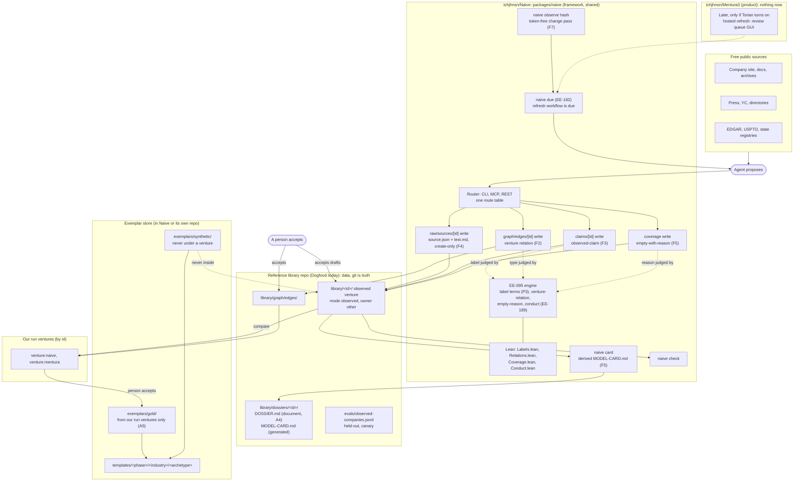
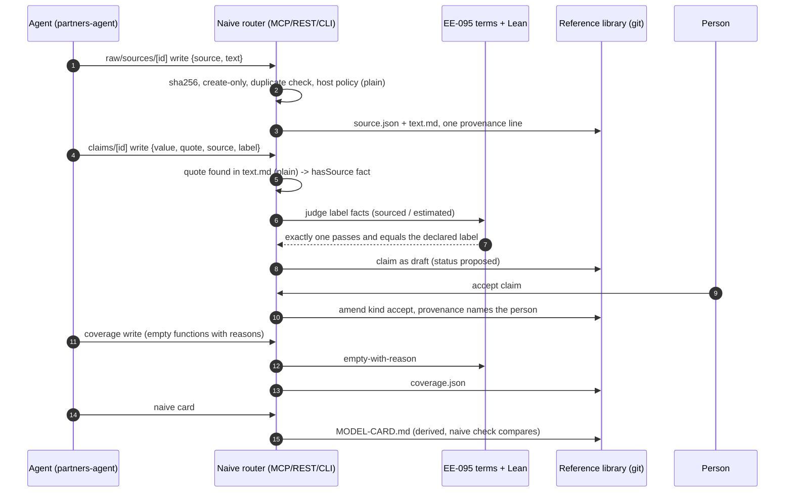
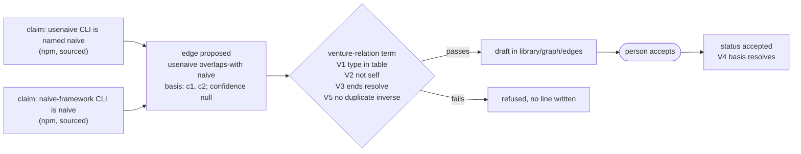
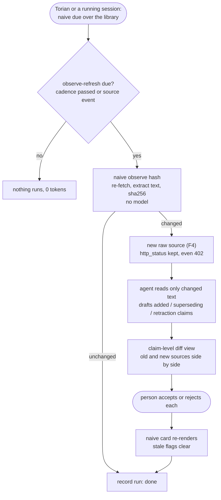
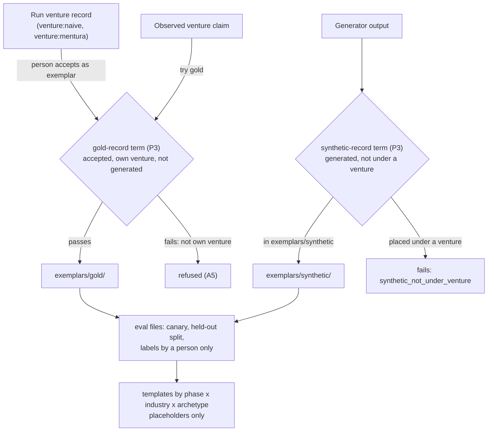

# Observed ventures in Naive: claims, relations, sources, cards, refresh and evals

Design only. Nothing in this document is built, pushed or opened as a pull request. Every part marked **proposal** is a proposal for Torian. Written 2026-11-26, about 6:40 AM CST, by Grok Bot (executor), from the Partners agent's research and the usenaive dry run.

**Repos read**
- **tchjhnsn/Naive:** `main` at `08a54666e4f3af15cfabb08a635bd90c3d1c36d1` (Nov 26, 6:11 AM CST). The open stack: #152 `31ee887`, #153 `34e4a71`, #155 `6a761ec`, #156 `29af715`. They're linear on base `e8568e15`, four commits behind main. #154 doesn't exist. The stack now cites **EE-189** (renumbered off EE-188).
- **tchjhnsn/Mentura3:** `main` at `216a9ca85cf863db0bf93dca9ba3c57d59d8cb3a` (Nov 26, 6:12 AM CST). I read only README.md, AGENTS.md, `packages/platform/README.md` and `naive.data-model.json`.

## 1. Summary

The usenaive dry run showed that an observed venture is missing **one record type, the sourced claim.** Funding, traction, headcount, a former name, a founder's title, a refresh diff and a dossier line all come down to the same thing: a dated quote from a fetched source, labelled `sourced` or `estimated`, proposed by an agent and accepted by a person. Naive has no claim record today. The claims live in `runs/<id>/claims-verified.json`, outside every check.

So this design builds the claim first, and the other features shrink onto it:

- **Feature 3, outside funding, traction and headcount:** one `observed-claim` record whose value is a typed measure. No separate funding, traction or headcount records.
- **Feature 4, the text.md write route:** the source half of a claim. `raw/sources/[id] write` takes the text as well, create-only.
- **Feature 2, venture relations:** a workspace-level edge between two ventures. Its type is checked by an EE-095 term with a Lean theorem, on the existing `typed-link` pattern in `relations.ts`. Person and investor "edges" go back into claims and records.
- **Feature 5, the model card:** generated, not hand-written. A command derives coverage, label counts, freshness and provenance from the records into `MODEL-CARD.md`. The only new record is a small per-venture `coverage.json` that holds the empty-with-reason entries.
- **Feature 6, the dossier record type:** deferred, as Torian decided. I name the condition that would justify it.
- **Feature 7, refresh:** no scheduler by default. Naive's existing `naive due` (EE-182) already reports `schedule` and `event` workflows as due without running anything. A token-free hash pass narrows a refresh to the sources that changed.
- **Feature 8, templates and evals:** the Partners P3 label term does the separating. One added check gives held-out items and a canary string.
- **Feature 9, APQC:** almost done already. Naive carries PCF 8.0 (`packages/naive/src/functions/pcf.json`, EE-165, EE-166). What remains is Partners P6, a data fix.
- **Feature 1, observed mode:** most of it is in the #152–#156 stack. Five leftovers remain: phase, scaffold code, scaffolded framework decisions, the people gate's owner, and the router's `next` hint.

Mentura gets nothing now under Torian's GUI rule. Two later candidates are named in section 8.

## 2. Approved decisions (fixed requirements)

Torian approved these on Nov 26, 2026:

| # | Decision |
|---|---|
| A1 | Terms: **observed venture** (an outside-in model), not "modeled" or digital twin; **reference library** for the watched companies, not Dogfood; **company dossier**; **founder templates** by phase and industry, built on business-model archetypes; **agent exemplars**, split into **gold** (real data a person accepted) and **synthetic** (labelled). |
| A2 | Free data only. No paid data. |
| A3 | Person data: public-role facts only, each one sourced, reviewed every 12 months, and no LinkedIn scraping. |
| A4 | The dossier is a document beside the observed venture, not a record type yet. |
| A5 | Gold records come only from our own ventures. |
| A6 | The label vocabulary (`sourced`, `estimated`, `synthetic`, `gold`) becomes an EE-095 term with a Lean theorem. |

Standing Naive rules this design keeps:
- Agents only propose. A gate or a person accepts.
- History is append-only.
- Git is the source of truth. Neon and LangSmith hold derived copies.
- Unknown values are null, never invented.
- Changes use the verbs create, amend and delete, with kinds and tiers `low`, `costly` and `one_way_door` (`packages/naive/src/records/ontology-metamodel.schema.json` `$defs.tier`). The schema cites EE-107 for these, but no EE-107 entry exists in `docs/decisions/decisions.json` on main.
- MCP is the main interface, with REST beside it.
- Every symbolic check goes through the EE-095 engine (`packages/naive/src/terms/engine.ts`) and Lean (`packages/naive/lean/Naive/`). `bypass-guard-test.ts` enforces this.

Already decided by others, and only referenced here:
- **Partners NAIVE-PROPOSAL.md P1:** `modeled` becomes `observed`, with no alias. That rename is going into #152–#156. This document says "observed" throughout. Where it cites stack code, the code still says `modeled` at the SHAs above.
- **P3:** the label term family, sketched in `proposal-lean/Naive/Labels.lean`: 8 theorems, compiled on Lean 4.35 with no `sorry`.
- **P6:** the APQC 8.0 data fix.
- Also going into the stack: `naive new` stops ignoring unknown flags.

## 3. What the repo has today (read at the SHAs above)

| Need | What exists | Where |
|---|---|---|
| Observed or run mode | `venture.json` `mode` is `modeled` or `run`, checked by the conduct terms, with Lean `modeled_disjoint_run`. Owner, function owners, workspace owner and `joined` are null for an observed venture. | Stack: `terms/conduct.ts`, `lean/Naive/Conduct.lean`, `docs/design/MODELED_VENTURES_2026-11-26.md` |
| Known join and workspace owner terms | `knownJoin` and `workspaceOwner` are in `TERMS` | Stack: `terms/terms.ts` line 608, `terms/makers.ts` |
| A closed relation table checked by a term | `typed-link` over `relationTable()`, with Lean `idea_inverse_involutive`, `idea_inverse_same_order` and `idea_order_canonical` | `terms/relations.ts`, `terms/terms.ts` line 291, `lean/Naive/Terms.lean` lines 172–181 |
| Venture-to-venture data | `venture.json` `links`: `access` `reads` or `shares-with`. This is data flow between our own ventures, not a relation between companies. | `records/venture.schema.json` line 337 |
| A raw source | `raw/sources/<id>/source.json` holds `id`, `origin`, `title` and `fetched` (a date). `text.md` is required by `check-data-packages.ts` line 65, but the routes `purpose/raw/text` have only read, view and layout. | `records/raw-source.schema.json`, `docs/reference/ROUTES.md` lines 204–210 |
| A precedent for writing text.md beside a write | `router/brand.ts` lines 127–145 writes `raw/sources/<rid>/text.md` with one provenance line | `router/brand.ts` |
| A competitor of our own venture | The `competitor` master, owned by a person, with `basis` and a dated price, plus the projector-written `competitors/<id>/signals.json` (funding, launches, prices, job postings) | `records/competitor.schema.json`, `records/competitor-signals.schema.json` |
| Our own raise | `raise`, written by the external-relationships function only | `records/raise.schema.json` |
| What is due, by event or time | `naive due` reads each workflow's `trigger` (`intake`, `schedule` daily to quarterly, `event` on a route, `request`). It starts nothing. | `engine/due.ts`, `records/function-workflow.schema.json` |
| Freshness | Profiles with `stale`, `revalidate`, `expire`, `per_phase` and `live` | `records/freshness-profiles.schema.json`, `engine/freshness.ts` |
| Gold rulings | `golden-ruling`: only Torian's rulings are golden | `records/golden-ruling.schema.json` |
| Eval suites | `eval-suite` for skills and products | `records/eval-suite.schema.json` |
| APQC PCF | 8.0 cross-industry, levels 1–5, 2,017 elements (13, 74, 363, 1,352, 215), published 2026-03, with APQC's attribution | `functions/pcf.json`, `checks/check-pcf.ts`, EE-165 and EE-166 |
| The 13 functions mapped to APQC | `departments.json`: every department has `apqc.id` 1.0 to 13.0. One name is out of date: 7.0 still says "Human Capital", and PCF 8.0 says "Human Resources". | `functions/departments.json` |
| Claim, model card, dossier, synthetic, held-out | **None.** A search for `canary` finds only marketing leak tests. | (absent) |
| Mentura's research engine | `research-cell`, `research-source`, `research-claim` and `research-citation`. The claim's confidence and verdict are **computed** by `research/credibility.mjs`. JSONL under `RESEARCH_STORE`, confidential to Mentura. | Mentura3 `naive.data-model.json`, `packages/platform/README.md` |
| Mentura's staleness webhooks | Signed webhooks mark the summaries that read a source stale | Mentura3 `packages/platform/webhooks/server.mjs` (from the README) |

## 4. System diagram



## 5. Features

Each subsection gives the owner, the record shape, where EE-095 and Lean apply, the verbs and tiers, and the null rules. Types are TypeScript-ish, and nothing here is built.

Shared shapes:

```ts
type IsoDate = `${number}-${number}-${number}`;             // a date
type IsoTime = string;                                       // with an offset, e.g. 2026-11-26T05:45:41-06:00
type VentureId = string; type SourceId = string; type ClaimId = string; type PersonId = string;
type FunctionId = "strategy" | "products" | "marketing-and-sales" | "supply-chain" | "service-delivery"
  | "customer-service" | "human-capital" | "it" | "finance" | "assets" | "risk-and-compliance"
  | "external-relationships" | "capabilities";               // departments.json ids
type Money = { amount: number; currency: string };           // ISO 4217
type Author = { kind: "agent" | "person" | "unverified"; id: string; model?: string; session?: string; harness?: string }; // EE-189 faithful author
```

### F1. Observed mode: what's left after #152–#156

**Owner:** Naive, `packages/naive` (engine `init-venture.ts`, `create-venture/index.mjs`, router).

**Already in the stack** (stack `docs/design/MODELED_VENTURES_2026-11-26.md`):
- no placeholder Founder;
- `joined` is a date or null;
- `owner` is null;
- 13 function keys, each with owner null;
- the workspace and calendar owners are null;
- `decision_maker` is null;
- `--help` writes nothing;
- the faithful author on every line, including workspace init.

That closes FLAWS 2, N1, N3, N5 and N8, and the stack's tests cover it.

**Left (proposal):**

| Flaw | Change | Null rule |
|---|---|---|
| N7: phase `discovery` written on an observed venture | `init-venture.ts` line 45 defaults `phase` to `discovery`. For an observed venture, write `phase: null` and let `venture.schema.json` `phase` accept null **only when `mode` is `observed`**. A phase is our framework's judgment, and nobody made it. | null = not judged |
| N2: owner | Write `owner: "other"`, not null. "Not ours" is known by construction: we chose to observe it. **Open question Q1**, because the stack chose null. | n/a |
| N9: app scaffold code | `naive new --observed` writes no `src/`, `package.json` or `.vscode` and prints no `npm run dev` hint. An observed venture is records only. | n/a |
| 9 and 11: framework decisions owed; product locked by `product-exists` | An observed venture scaffolds **no** framework decisions, and the `product-exists` lock doesn't apply to it. Product facts about an outside company are claims (F3), not our product cards. This is reversible (`low` tier), and the lock stays for run ventures. | n/a |
| N4: people gate says "escalate, owner founder" | Drafts in an observed venture route to the reference library's reviewer role (Q4), never to a person who doesn't exist. Until Q4 is answered, the route is "a person". | reviewer null = any person |
| 17 and N10: `next` points at the non-existent `knowledge/venture-profile` write and prints `mentura` | **Subtract first:** delete the suggestion. Print `naive`. Fail on non-JSON input with a parse error at the boundary, not a raw `SyntaxError`. This doesn't depend on the stack. | n/a |
| N6: no title on a person | Titles are claims (F3 `title` measure), not a new people field. `people.schema.json` stays as it is. | n/a |
| N12: no former name | Former names and aliases are claims (F3 `alias` measure). | n/a |

**EE-095 and Lean:** none new. The stack's conduct terms cover mode. "Phase null only when observed" is a schema condition on two fields, not a vocabulary.

**Verbs and tiers:** amend schema (`low`); amend scaffold (`low`).

### F2. Venture relation

**Owner:**
- Naive, `packages/naive`: the term, the table, Lean and the route.
- Reference library repo: the edge data.

**Question (step 1):** the dry run wrote 18 edges: 2 founded-by, 15 invested-in and 1 overlaps-with. Only overlaps-with is venture to venture.
- founded-by is the people roster plus a title claim.
- invested-in is the investor master plus a funding-round claim (F3).

Keeping those as edges would store the same fact twice. **Delete them as edges.** That leaves the one approved thing, a relation between two ventures.

```ts
type VentureRelationName =
  | "overlaps-with"   // same name, market or product; symmetric
  | "competes-with"   // symmetric
  | "partners-with"   // symmetric
  | "acquired" | "acquired-by"           // inverses
  | "spun-out-of" | "spun-out";          // inverses
type VentureRelationRow = { name: VentureRelationName; symmetric: boolean; inverse: VentureRelationName | null;
  provo: string | null; dcmi: string | null };           // relationTable() shape, frozen by the term hash (R1)

type VentureEdge = {                                      // library/graph/edges/<id>.json
  id: string;
  from: VentureId; to: VentureId;                          // either may be observed or run; ours by id only
  type: VentureRelationName;
  status: "proposed" | "accepted" | "retracted";
  asserted_by: Author;                                     // the proposing process
  accepted_by: PersonId | null;                            // null until a person accepts
  basis: ClaimId[];                                        // claims that support it; may be empty only while proposed
  note: string | null;
  confidence: null;                                        // no invented numbers; a field only if a source gives one
};
```

**EE-095 term (proposal) `venture-relation`, level `link`:**
- V1: the type is in the closed venture table.
- V2: `from` ≠ `to`.
- V3: both ends resolve to a `venture.json` in the workspace.
- V4: an accepted edge has at least one basis claim that resolves.
- V5: no edge and its inverse are both accepted with different bases. One fact, one edge.

**Lean (proposal)** `lean/Naive/Relations.lean`:
- `venture_inverse_involutive`;
- `venture_symmetric_self_inverse` (a symmetric relation is its own inverse);
- `venture_no_self_edge` (the term never passes with `from = to`).

These follow `idea_inverse_involutive` in `Terms.lean`. This closes FLAWS 8 and N11.

**Verbs and tiers:**
- create (proposed, `low`);
- amend kind accept, by a person only (`low`);
- amend kind retract (`low`);
- no delete. History is append-only.

**Null rules:**
- `accepted_by` is null until accepted.
- `confidence` is always null.
- `note` is null when there's nothing to say.

**Not reused:** `venture.json` `links`. It describes data access between our own ventures, and overloading it would mix "reads from" with "competes with".

### F3. Observed claim (funding, traction, headcount, alias, title)

**Owner:**
- Naive, `packages/naive`: the record type, schema, route and terms.
- The reference library repo: the data.

**Question:** do funding, traction and headcount each need a record? No.
- In the dry run, all three were quotes with a date and a source (`c-tc-total`, `c-tc-arr`, `c-tc-headcount` against `c-yc-team-size`).
- The dossier needs the same thing, and so does a refresh diff.

So a single claim record, with a typed value, covers flaws 14, N6 and N12. It also avoids extending `raise`, which is shaped for our own raise and written by the external-relationships agent only (FLAWS 6).

```ts
type Measure =
  | { kind: "funding-round"; round: string | null;          // "seed", "series-a", as the source names it
      amount: Money | null; announced: IsoDate | null;
      instrument: "safe" | "convertible-note" | "priced-equity" | "grant" | "debt" | "revenue-based" | "other" | null; // null = not stated, not "other"
      lead: string[] | null; participants: string[] | null } // investor master ids
  | { kind: "funding-total"; amount: Money; as_of: IsoDate | null }
  | { kind: "traction"; metric: string; value: number | null; unit: string; period: string | null } // e.g. "signups", 30000, "people"
  | { kind: "headcount"; value: number; as_of: IsoDate | null }
  | { kind: "alias"; name: string; former: boolean }          // "Relixir", former: true
  | { kind: "title"; person: PersonId; title: string }        // public-role fact only (A3)
  | { kind: "text"; says: string };                           // anything else the source states

type Origin = "self_reported" | "third_party" | "official_record" | "derived"; // no "licensed" while A2 holds

type ObservedClaim = {                                      // <observed venture>/claims/<id>.json
  id: ClaimId;
  function: FunctionId;                                      // which of the 13 it informs
  value: Measure;
  quote: string;                                             // exact text, must be found in the source's text.md
  source: SourceId;                                          // raw/sources/<id>
  origin: Origin;
  label: "sourced" | "estimated";                            // declared; must equal the P3 term the facts pass
  method: string | null;                                     // required for estimated; null for sourced
  valid_from: IsoDate | null;                                // when the fact held, if the source says
  observed_on: IsoDate;                                      // when we read it
  supersedes: ClaimId | null;                                // a refresh links the claim it replaces
  status: "proposed" | "accepted" | "retracted";
  asserted_by: Author;
  accepted_by: PersonId | null;
  review_by: IsoDate | null;                                 // set for title claims and any person-level fact: observed_on + 12 months (A3)
};
```

**EE-095 and Lean:**
- The declared `label` is checked by the Partners P3 term family (`sourced-record`, `estimated-record`). It reads the facts `hasSource` (the source resolves and the quote is found), `hasMethod`, `generated`, `accepted`, `ownVenture` and `underVenture`, and never the label string. The check passes only when exactly one term passes and it matches the declared label.
- `synthetic` and `gold` can't be declared on a claim. `synthetic_not_under_venture` and `gold_needs_accepted_own` (P3) already prove that neither can pass under an observed venture.
- "Quote found in text.md" is a plain string-containment check, registered as plain in `bypass-guard-test.ts`. It decides no term, the same way `check-traces.ts` is registered. It feeds the `hasSource` fact.

**Conflicts:** two accepted claims may disagree (headcount 10 against 12). Nothing picks a side automatically. The dossier states the conflict. A person may retract one claim.

**Verbs and tiers:**
- create (proposed, `low`);
- amend kinds accept (person), retract, and supersede (a new claim with `supersedes`), all `low`;
- no edit in place. A refresh never rewrites a claim.

**Null rules:**
- Any measure field the source doesn't state is null.
- An instrument the source doesn't state is null, never `other`. That fixes the FLAWS 6 mislabel without adding `unknown`.
- `method` is null exactly when the label is `sourced`.

**Person data (A3):**
- `title` and any claim naming a person must cite a public source, set `review_by`, and use `origin` other than `derived`.
- No contact details are allowed, and the schema has no field for them.
- The router refuses a source whose origin host is linkedin.com. That's a plain host check, on the `public-assets` host-list precedent.

### F4. Write route for a source's text.md

**Owner:** Naive, `packages/naive` (router `writes.ts`, `raw-source.schema.json`).

```ts
type RawSource = {                                          // raw/sources/<id>/source.json (EE-070), extended
  id: SourceId; origin: string; title?: string;
  fetched: IsoDate;                                          // kept for old records
  fetched_at: IsoTime | null;                                // new: time with offset
  url: string | null; archive_of: string | null;            // the live URL when this is an archive capture
  http_status: number | null;
  sha256: string;                                            // of text.md as written
  self_reported: boolean | null;                             // null = not judged
};
type SourceWrite = { source: Omit<RawSource, "sha256">; text: string };  // route raw/sources/[id] write
```

**Route:** `raw/sources/[id] write` takes `{source, text}`. It writes `source.json` and `text.md` in one write with one provenance line, as `router/brand.ts` already does for remote images. The router computes `sha256`.

**Create-only:** raw is immutable (EE-070).
- A second write to an existing id is refused. A refresh writes a new source id.
- A write whose `sha256` equals an existing source in the same venture is refused, naming that source. That closes the duplicate in FLAWS 4.
- Both are plain checks.

**EE-095 and Lean:** none. These are hashes and paths.

**Verbs and tiers:** create (`low`) only.

**Null rules:** `fetched_at`, `url`, `archive_of`, `http_status` and `self_reported` are null when not known.

`original.*` stays out of git, unchanged.

### F5. Model card: generated, plus a coverage record

**Owner:**
- Naive, `packages/naive`: `naive card`, the coverage schema and the empty-reason term.
- The reference library repo: the generated `MODEL-CARD.md` and `coverage.json`.

**Question:** the usenaive MODEL-CARD.md has 14 parts.
- Parts 1, 7, 9, 10, 11 and 13 are counts and dates that the records already hold.
- Parts 2–6 and 8 are the same text for every observed venture: what an outside-in model can and can't do, what it's meant for, and the usual biases.

A hand-written card per venture would drift from the records. **Delete the hand-written card.** Generate it instead.

```ts
type CoverageEntry =
  | { function: FunctionId; state: "covered" }                                          // has ≥1 accepted claim or record
  | { function: FunctionId; state: "empty"; reason: EmptyReason; searched: string[]; flaw: string | null };
type EmptyReason = "no-public-source" | "not-knowable-from-outside" | "blocked-by-naive" | "licensed-not-purchased" | "out-of-policy";
type Coverage = { venture: VentureId; as_of: IsoDate; entries: CoverageEntry[] };     // <observed venture>/coverage.json
```

**`naive card <venture>`** writes `MODEL-CARD.md` deterministically, so the same records give the same bytes:
- **Fixed text** from one file in Naive, `packages/naive/src/terms/model-card-observed.md` (proposal), for the can, can't, meant-for, not-meant-for and bias parts.
- **Derived tables** from claims, sources, edges, `coverage.json` and provenance.
- **A free-text caveats part**, read from `coverage.json` flaw links.

`naive check` fails when the committed card differs from a fresh render, the same way the generated `ROUTES.md` is checked.

The model card for a **template** uses a second fixed file. Its derived part lists derivations (`prov:wasDerivedFrom`) and the label counts.

**EE-095 term (proposal) `empty-with-reason`, level `coverage`:**
- E1: a function is empty exactly when it has no accepted claim or record. That fact is computed, not declared.
- E2: an empty function has exactly one reason from the closed list.
- E3: `blocked-by-naive` names a flaw.
- E4: `licensed-not-purchased` is legal while A2 holds. It's the honest reason, and it records no data.

**Lean (proposal)** `lean/Naive/Coverage.lean`:
- `empty_has_one_reason`;
- `covered_has_no_reason`;
- a disjointness theorem for covered against empty.

**Verbs and tiers:**
- `coverage.json`: create or amend (`low`).
- `MODEL-CARD.md` isn't a record. It's a derived artifact.

**Null rules:** `flaw` is null unless the reason is `blocked-by-naive`.

**The `model-card` record that Partners P4 calls "later":** not needed, because the card is derived. Revisit only if another tool must read card fields that the records don't already hold.

### F6. Dossier: a document now, a record type only on evidence

**Owner:** the reference library repo (`library/dossiers/<id>/DOSSIER.md`). No Naive change now (A4).

The dossier keeps its 15 sections and its labels: coverage, confidence `known | estimated | unknown`, origin, and empty-with-reason (Partners DOSSIER.md).

Once F3 lands, the dossier's labelled facts **cite claim ids** instead of carrying their own quotes. That makes the dossier the readable view of the claims, plus narrative, conflicts and open questions.

**When it should become a record (proposal):** only if, after three observed ventures, some dossier section holds checkable facts that no claim, edge or coverage entry can hold. Until then, the section labels stay unchecked prose, so no EE-095 vocabulary is admitted for them. An admitted term with no reader would be dead weight.

**Person sections (A3):** public-role facts only. Each one cites a claim with `review_by`.

### F7. Refresh monitoring

**Owner:**
- Naive, `packages/naive`: one function workflow, the `naive observe hash` command, and the diff renderer.
- The reference library repo: the workflow-runs log.
- Mentura: nothing, unless Q2 picks the hosted option.

**Question:** Torian dislikes crons that burn tokens. What's actually needed is to know which observed ventures are stale, and to read only what changed.

Naive already has both halves:
- `naive due` reports a `schedule` workflow as due when its cadence has passed, and an `event` workflow as due when its route was written. It starts nothing (`engine/due.ts` lines 2–11).
- Freshness profiles mark records stale (`freshness-profiles.schema.json`).

**Design (proposal):**
1. **A workflow `strategy/observe-refresh`** for each observed venture, with trigger `{kind: "schedule", cadence: "monthly"}` for the active watchlist and `"quarterly"` for the rest. A second `event` workflow is triggered by a write to `raw/sources/*`, which happens when the hash pass records a change.
2. **`naive observe hash <venture>`:**
   - re-fetches each source URL (logged off, robots respected, EDGAR fair-access with a declared User-Agent);
   - extracts the text and compares its sha256 with `source.json`;
   - hashes the extracted text, not the HTML, so ads and timestamps don't count as changes;
   - for a changed source, writes a new raw source (F4). That fires the event workflow.

   It uses **no model and no tokens**.
3. **The agent step** (only when due, and only on changed sources) reads the new text and drafts claim-level changes:
   - **added:** a new claim;
   - **changed:** a new claim with `supersedes`;
   - **retracted:** an amend that proposes retraction.

   All of these land as drafts. A person accepts them.
4. **The diff** renders old and new claims side by side, from the drafts. It's a view, not a record.
5. **Staleness:** a claim past its freshness profile (proposal: 90 days for traction and pricing, as the usenaive card used, set by Q3) shows "stale since <date>" in the card and the dossier.

**Cost (estimates, not measured on a refresh):**
- **Text size:** the usenaive run's 12 extracted texts total **59,004 bytes** (measured: `wc -c` on `work-usenaive-dry-20261126-4/sources/*/*.txt`). At about 4 bytes per token, that's ~15k tokens (estimate).
- **One full re-read with drafting:** ~25–35k tokens per venture (guess: text, plus about 10k of instructions and schema, plus about 3–5k of output).

| Option | Runs | Tokens per venture per year | Default? |
|---|---|---|---|
| **R0 On demand.** A person or an already-running session asks `naive due` over the library, then runs the hash pass and the agent step for the due ventures. | When asked | 0 until asked. Then ~3–10k per refresh (guess: 1–3 changed sources) | **Yes** |
| R1 Scheduled hash pass only (a GitHub Actions schedule or the laptop), writing changed sources. The agent step stays on demand. | Monthly | 0 tokens. Free Actions minutes, about a minute per venture (guess). | Q2 |
| R2 Scheduled hash pass plus a scheduled agent step on changed sources | Monthly | ~36–120k (guess: 3–10k × 12) | Q2 |
| R3 Scheduled full re-read, no hashing | Monthly | ~300–420k (25–35k × 12) | No |

For ten observed ventures, R3 costs about 3–4M tokens a year (guess), and R0 or R1 cost nothing until someone asks. **The default is R0.**

**EE-095 and Lean:** none new. Due-ness is time and route arithmetic (EE-182, registered plain). The claim labels in the drafts go through F3's terms.

**Verbs and tiers:**
- the hash pass creates sources (`low`);
- the agent creates draft claims (`low`);
- a person accepts them (`low`).

**Null rules:** a source that now answers an error (usenaive's 402) writes a new source with `http_status: 402` and empty text. It retracts nothing by itself.

### F8. Templates, exemplars and eval sets

**Owner:**
- Naive, `packages/naive`: the label terms (Partners P3) and the eval check.
- An exemplar store for `exemplars/` and `templates/`: Naive itself or its own repo (Q5).
- The reference library repo: `evals/observed-companies.jsonl`.

The P3 terms do the separating:
- `synthetic_not_under_venture` proves that a synthetic record can't sit in an observed or run venture.
- `gold_needs_accepted_own` proves that gold needs a person and one of our own ventures (A5).
- The existing `golden-ruling` stays as Torian's rulings on idea fields. A gold exemplar is a different thing: an accepted record copied, with its provenance, from a run venture. The two keep separate names.

**Layout (proposal):**
- `exemplars/gold/<venture>/<record path>.json`
- `exemplars/synthetic/<template id>/...`
- `templates/<phase>/<industry>/<archetype>/`
  - The phase values are `venture.schema.json`'s.
  - The industry values are APQC industry PCFs.
  - The archetype values are business-model patterns. Their vocabulary is admitted as a term only when a check reads it.

```ts
type EvalItem = {                                           // one line of an eval file
  id: string;
  split: "exemplar" | "held-out";                            // held-out items are never shown to an agent as examples
  record: string;                                            // path of the drafted record or edge being judged
  label: "accept" | "reject" | null;                         // set by a person only; null until then
  labelled_by: PersonId | null;
};
type EvalFile = { canary: string; items: EvalItem[] };      // canary: one fixed GUID per eval file, BIG-bench style
```

**Plain checks (proposal), registered in `bypass-guard-test.ts`:**
- every eval file carries its canary;
- no held-out item's record id appears in any exemplar file or prompt fixture;
- `label` is null unless `labelled_by` names a person (EE-189 faithful author).

These are string, set and authorship checks. They decide no term.

**Verbs and tiers:**
- create eval items (`low`);
- amend kind label, by a person (`low`);
- promote a record to gold: amend kind accept, by a person (`costly`, because gold shapes agent behavior).

**Null rules:**
- `label` and `labelled_by` are null until a person acts.
- Templates hold placeholders, ranges or labelled examples, never a real company's values.

### F9. APQC PCF 8.0

**Owner:** Naive, `packages/naive/src/functions`, `src/terms/ontology.json` and generated Lean.

**Verified:**
- APQC lists PCF Cross-Industry 8.0, published Feb 27, 2026. Its FAQ calls 8.0 the latest version.
- Naive's EE-165 records APQC's licence from the 8.0 articles: perpetual, worldwide and royalty-free, with attribution required.
- `pcf.json` is version 8.0, published 2026-03, with 13 level-1 categories.
- In the repo, at Naive main `08a5466`:
  - `departments.json` 7.0 says "Develop and Manage Human Capital", and `pcf.json` 7.0 says "Develop and Manage Human Resources".
  - `ontology.json` cites "PCF 7.4" 6 times.
  - `pcf.json` 3.2.2 is "Develop and manage brands" (element 11445), and pricing is 3.2.3 "Define pricing strategy" (10123), with 3.2.3.4 "Approve pricing strategies/policies and targets" (10125).

These match Partners P6. The remaining work is P6's data fix, plus a check that `departments.json` and ontology citations match `pcf.json` by element id.

Partners P6 says that check belongs in the term engine. The repo's precedent registers the same kind of id-and-name comparison as plain (`check-pcf.ts` and `check-tools.ts`, EE-165 and EE-166). **Q6.**

## 6. Flows

### 6.1 Observe one company (source to claim to record)



### 6.2 Relate two ventures



### 6.3 Refresh (default R0, on demand)



### 6.4 Keep synthetic out, and gold only from our own ventures



## 7. Five-step algorithm

### Step 1. Question every requirement and name its owner

| Requirement | Owner | Verdict |
|---|---|---|
| F1 Observed mode with no invented people | Torian (EE-189, A1) | Keep. Mostly done in the stack. Five leftovers. |
| F2 Venture-to-venture relation | Torian (feature list); Partners (FLAWS 8) | Keep, narrowed to venture↔venture. founded-by and invested-in aren't venture relations. |
| F3 Funding, traction and headcount records | Partners (FLAWS 14) | Keep the need, drop the three record types. It's one claim record with a typed value. |
| F4 text.md write route | Partners (FLAWS 4); EE-070 already requires text.md | Keep. It's the smallest unblocker. |
| F5 Model-card record | Partners (P4); research (Mitchell 2019) | Keep the card, drop the record. Generate the card. Add coverage.json. |
| F6 Dossier record type later | Torian (A4) | Defer, with an explicit trigger condition. |
| F7 Refresh with crons | Partners (research §6.4) | Keep the need, reject the cron default. Torian owns any schedule (Q2). |
| F8 Templates and evals kept apart | Torian (A1, A5, A6) | Keep. The P3 terms do most of it. |
| F9 Map the 13 functions to APQC 8.0 | Torian | Already done in EE-165 and EE-166. What's left is a data fix (P6). |
| Licence tags for vendor data | Research §3.2 | Drop for now. A2 means no licensed data, so no `licensed` origin. It comes back only with a decision to buy data. |
| A confidence number per claim | Research | Drop. Naive's rule: a number only if a source gives one. Mentura's computed credibility stays in Mentura. |

### Step 2. Delete parts and steps

- 17 of the 18 dry-run edges become claims and records. Only venture↔venture edges remain.
- No funding, traction or headcount record types. No people `title` field. No venture `aliases` field. Claims hold them.
- No hand-written model card, and no `model-card` record.
- No dossier vocabulary terms until a check reads them.
- No scheduler by default. No `licensed` origin. No `unknown` instrument value (null does that job).
- The router's suggestion of a non-existent `knowledge/venture-profile` write is deleted.
- Scaffolded framework decisions and app scaffold code on observed ventures are deleted.

### Step 3. Simplify and optimize

- One record type, the claim, serves records, dossier citations, refresh diffs and the card.
- Relations reuse the `typed-link` and `relationTable()` pattern, and its Lean shape.
- Refresh reuses `naive due` (EE-182) and freshness profiles. It adds one workflow and one command, with no new runtime.
- The card is a pure function from records to bytes, so `naive check` can verify it.
- Labels reuse Partners' P3 terms unchanged.

### Step 4. Accelerate cycle time

- **Unblock first.** F4 (the text route) and the F1 router subtraction don't depend on the stack, so they can land while #152–#156 finish.
- The hash pass narrows a refresh from all sources to the changed ones (estimate: 12 sources down to 1–3).
- Each PR in section 9 ends in one command a reviewer reruns: `naive check`, `lake build`, `node packages/naive/src/terms/admit.ts`, or a named test.
- Rerunning usenaive at the merged SHA is the end-to-end check. `run-usenaive.sh` already exists.

### Step 5. Automate

Only after steps 1–4:
- the derived card, with drift caught by `naive check`;
- label, relation and coverage terms judged at write time;
- the token-free hash pass, scheduled only if Torian picks R1 (Q2);
- the agent step stays on demand.

No automation accepts anything. A person accepts.

## 8. What Mentura gets (Torian's GUI rule)

Torian's rule: build a GUI only for agents running while the laptop is closed, share links or hosted pages for outsiders, teams on one venture, or backups and fund or cross-founder network data.

| Candidate | Rule it meets | Verdict |
|---|---|---|
| A review queue for refresh drafts | Agents running while the laptop is closed, **only if** Q2 picks a hosted agent step (R2 hosted) | **Not now.** R0 runs where Torian is. Build only if R2 runs hosted. |
| A share page for one dossier or model card | Outsiders | **Not now.** Company sections only, never person sections. It's publication, so it needs Torian's word and the Q7 answer. |
| The reference library as cross-founder benchmark data | Cross-founder network data | **Later.** That's when founders other than Torian use Mentura. It's also the point where the data-broker risk (section 10) starts to matter. |
| Observed ventures in the business console | none (it's Torian's own working view) | No. The CLI and MCP serve it. |

Mentura's research engine already has claims with **computed** confidence (`research/credibility.mjs`). Observed claims in Naive carry no invented numbers, so the two stay separate:
- Mentura may read accepted observed claims as `research-source` inputs.
- Mentura never writes its computed confidence back into an observed venture.

That's a design boundary, with nothing to build now.

Numbering note: Mentura3's decision log also uses `EE-NNN` (Mentura3 AGENTS.md). The decisions below are Naive's.

## 9. Sequenced pull requests (proposal)

Each PR ends in a state a reviewer can rerun. The Naive decision numbers are placeholders. Main's last decision is EE-188, and EE-189 is taken by the stack, so these start at EE-190 if nothing lands first.

| # | Repo and package | PR | Ends verifiable by | Depends on |
|---|---|---|---|---|
| 0 | Naive `packages/naive/src/router` | **Subtract:** delete the `knowledge/venture-profile` `next` hint, print `naive`, and turn a non-JSON write into a boundary parse error (FLAWS 17, N10) | A router test: no `next` names a route without that action; bad JSON exits 2 with a message | none (main) |
| 1 | Naive `src/terms`, `lean/Naive` | **Labels term (Partners P3), EE-190:** `Labels.lean` from the sketch, level `data` in `levels.ts`, 4 terms in `TERMS` | `lake build`; `admit.ts` admits 4 terms; `lean-agreement-test.ts` and `bypass-guard-test.ts` pass | none (main) |
| 2 | Naive `src/router`, `src/records` | **Source write route, EE-191:** `raw/sources/[id] write {source, text}`, create-only, sha256, duplicate refusal, host policy | Writing then running `naive check` on a fresh venture passes (the FLAWS 4 probe flips from FAIL to PASS); a second write is refused | none (main) |
| 3 | Naive `src/engine`, `create-venture` | **Observed leftovers:** phase null when observed, no app scaffold, no scaffolded decisions, no product-exists lock, people drafts to a person; plus `owner` per Q1 | `venture-mode-test.ts` extended; the usenaive assertions for N7 and N9 pass | **#152, #153, #155, #156 merged with the observed rename** |
| 4 | Naive `src/records`, `src/router`, `src/terms` | **Observed claim, EE-192:** schema, `claims/[id]` route, quote-found plain check, label judged by the PR 1 terms, accept, retract and supersede | Claim tests: a quote not in text.md is refused; `label: sourced` with a method is refused; a synthetic claim under a venture fails | 1, 2, 3 |
| 5 | Naive `src/terms`, `lean/Naive`, `src/router` | **Venture relation, EE-193:** table, `venture-relation` term, `Relations.lean`, `graph/edges/[id]` route | `lake build`; admit; tests for a self edge, an unknown type, and an accepted edge without basis | 4 (basis claims) |
| 6 | Naive `src/terms`, `lean/Naive`, `src/interfaces/cli` | **Coverage and card, EE-194:** `coverage.json`, the `empty-with-reason` term with `Coverage.lean`, `naive card`, and a drift check in `naive check` | Rendering twice gives identical bytes; editing the card by hand fails `naive check` | 4, 5 |
| 7 | Naive `src/functions/strategy`, `src/interfaces/cli` | **Refresh, EE-195:** the `observe-refresh` workflow (schedule plus event) and `naive observe hash`. No scheduler. | `due-test.ts` case: due after the cadence; the hash pass on an unchanged fixture writes nothing, and on a changed one writes one new source | 2, 4 |
| 8 | Naive `src/checks` (+ exemplar store per Q5) | **Evals:** canary, held-out split and person-only labels, as plain checks; the exemplar and template layout | Check tests: a missing canary fails; a held-out id in an exemplar fails | 1 |
| 9 | Naive `src/functions`, `src/terms` | **APQC data fix (Partners P6):** the 7.0 name, six re-citations with element ids, pricing 3.2.3 (10123, 10125), and the citation check (plain or term per Q6) | `check-pcf.ts` reports 0 department and citation mismatches | none (main) |
| 10 | Reference library repo (Dogfood today) | **Rerun usenaive at the merged Naive SHA:** sources and claims in the venture, 1 venture edge, coverage, generated card, dossier citing claim ids | `run-usenaive.sh <merged SHA>`: `naive check` passes, all 11 assertions pass, and the FLAWS table is re-scored | 0–9; Torian's review of the patch |

Mentura3 has no PR in this plan.

## 10. Risks

- **Data-broker registration (verified Nov 26, 2026):**
  - **California:** the annual data broker registration fee for 2026 is **$6,000**, plus up to 2.99% card processing (11 CCR §7600, CalPrivacy). Brokers must process DROP deletion requests from Aug 1, 2026.
  - **Texas:** Bus. & Com. Code §510.005 sets a **$300** registration fee, with $300 renewal each year. Chapter 510 applies only to a broker that, in 12 months, gets more than 50% of its revenue from personal data it didn't collect directly, **or** gets revenue from processing or transferring such data on more than 50,000 people (§510.003).
  - **The design keeps Naive clear:** people data is public-role facts only. No contact fields exist, every person claim has a 12-month review, and nothing is sold or shared. Selling or sharing person-level dossiers is a **one-way door** (Q7) and needs a lawyer first.
  - This is not legal advice.
- **Licensed vendor data:** none is allowed under A2, so the `licensed` origin is absent. If Torian ever buys data, adding `licensed` is a `costly` amend. It must come with an export guard: licensed claims never leave internal use, and never go into the card, the dossier share page, exemplars or Mentura.
- **Logged-in or ToS-barred collection:** no LinkedIn (A3), and no G2 scraping (its terms bar it). EDGAR only with a declared User-Agent. The hash pass fetches logged off and respects robots.
- **Self-report bias:** 54% of usenaive claims are self-reported (Partners MODEL-CARD.md). `origin` makes that visible in the card, and nothing turns self-report into `known`.

## 11. Open questions only Torian can answer

- **Q1.** Observed venture `owner`: `other` (we know it isn't ours) or null (the stack's current choice)?
- **Q2.** Refresh default: R0 on demand only, R1 a scheduled token-free hash pass on GitHub Actions, or R2 hash pass plus scheduled agent drafting?
- **Q3.** The staleness window for traction and pricing claims: 90 days, or another number?
- **Q4.** Who accepts claims and edges in the reference library: you only, or a named reviewer role?
- **Q5.** Exemplars and templates: inside Naive (`packages/naive/exemplars`, `templates`) or in their own repo?
- **Q6.** The APQC citation check: a plain check (the EE-165 and EE-166 precedent) or an EE-095 term (Partners P6)?
- **Q7.** Selling or sharing person-level dossiers outside: never, or only after a lawyer's review?
- **Q8.** The Dogfood repo: rename it to "reference library", or keep the repo name and use the term for its `library/` folder?

## 12. Sources

**Naive** (main `08a54666e4f3af15cfabb08a635bd90c3d1c36d1`; stack head #156 `29af715a8f6a3be268f76bb3661801086696f37b`). Read through an anonymous clone of the public repo, and checked out only to read.
- `packages/naive/src/terms/`: `engine.ts`, `terms.ts` (lines 291, 582–608), `conduct.ts`, `makers.ts`, `relations.ts`, `levels.ts`, `README.md`, `ontology.json`
- `packages/naive/lean/Naive/`: `Conduct.lean`, `Terms.lean`, `Generated/Ontology.lean`
- `packages/naive/src/records/`: `venture.schema.json`, `raw-source.schema.json`, `competitor.schema.json`, `competitor-signals.schema.json`, `raise.schema.json`, `golden-ruling.schema.json`, `eval-suite.schema.json`, `freshness-profiles.schema.json`, `function-workflow.schema.json`, `ontology-metamodel.schema.json`, `pcf.schema.json`, `data-model.json`
- `packages/naive/src/checks/`: `check-modeled.ts`, `check-data-packages.ts`, `check-pcf.ts`
- `packages/naive/src/engine/`: `due.ts`, `init-venture.ts`
- `packages/naive/src/router/brand.ts`
- `packages/naive/src/functions/`: `departments.json`, `pcf.json`
- `docs/reference/ROUTES.md`; `docs/decisions/decisions.json` (EE-165, EE-166; EE-189 on the stack; no EE-107)
- `docs/design/`: `MODELED_VENTURES_2026-11-26.md` (stack), `HOOKS_AND_LOOPS_2026-11-26.md`, `ACTIVITY_CATALOG_2026-11-25.md`

**Mentura3** (main `216a9ca85cf863db0bf93dca9ba3c57d59d8cb3a`, read through cursor-github): `README.md`, `AGENTS.md`, `packages/platform/README.md`, `naive.data-model.json`.

**Inputs on the box:**
- Partners' venture-modeling research notes (`FINDINGS.md`). 86 sources, 6 read in full by Partners. Used here: S1, S7, S12–S14, S19–S22, S36, S40, S53, S71, S79, S80.
- Partners' usenaive dry-run notes: `FLAWS.md`, `PR-BODY.md`, `DOSSIER.md`, `MODEL-CARD.md`, `NAIVE-PROPOSAL.md` (P1, P3, P6), `NAIVE-PROPOSAL.full-original.md` (P2, P4, P5, P7), `proposal-lean/Naive/Labels.lean`, `proposal-lean/lean-check.txt` ("lean exit 0"), and `work-usenaive-dry-20261126-4/sources/` (text sizes).

**Verified on the web on Nov 26, 2026:**
- APQC PCF Cross-Industry PDF 8.0, Feb 27, 2026: https://www.apqc.org/resource-library/resource-listing/apqc-process-classification-framework-pcf-cross-industry-pdf-13
- APQC PCF FAQ ("latest version … 8.0"): https://www.apqc.org/process-frameworks/pcf-faqs
- CalPrivacy, fees and annual registration ($6,000 for 2026): https://privacy.ca.gov/drop-for-data-brokers/account-creation-fees-and-annual-registration/
- CPPA DROP regulations, 11 CCR §7600: https://cppa.ca.gov/regulations/pdf/data_broker_drop_reg.pdf
- Texas Bus. & Com. Code ch. 510 (§510.003, §510.005): https://statutes.capitol.texas.gov/docs/BC/htm/BC.510.htm
- Texas SOS, data brokers ($300): https://www.sos.texas.gov/statdoc/data-brokers.shtml

**Unverified, used as labelled:**
- The token figures in F7, labelled estimate or guess.
- FINDINGS figures not listed above weren't spot-checked and aren't relied on.
