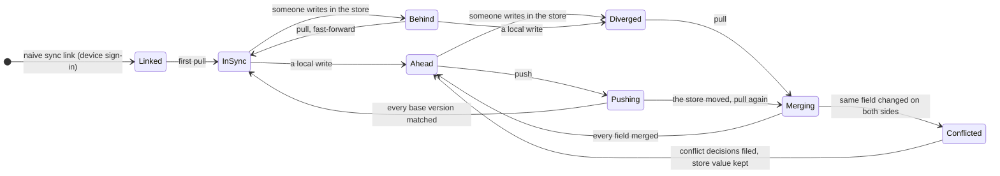

# Offline sync between a working copy and a business store

Date: 2026-11-25. Decision: EE-174. Status: the field merge (`packages/naive/src/engine/merge.ts`), conflict decisions (`packages/naive/src/engine/sync-conflicts.ts`, EE-175) and the client, `naive sync link|pull|push|status` (`packages/naive/src/engine/sync.ts`, EE-178), are built; the rest is listed under Not built. Torian's review copy of this design is the Claude Doc "Syncing an offline business with Mentura".

## The ask

Torian, 2026-11-25 06:16Z to 06:26Z: a business can live as files alone, and a founder who works offline must be able to sync what they changed with the business's database when they are back. On a decision card at 06:26Z he chose how conflicts resolve: field by field, with the same field changed on both sides kept as a decision for a person. Last writer wins and CRDTs were rejected.

## Domain

Files alone are a whole Naive. A business store (Mentura keeps records in Neon Postgres and files in Neon's object storage) is for people with no filesystem, several writers at once, connectors that run while a laptop is closed and sign-in tokens that must stay out of git.

| Term | Meaning |
|---|---|
| Business store | The business's records and files in the host. Hosted, it is the copy everyone else sees. |
| Working copy | A folder holding the business's records as files. A host makes one per request (docs/design/HOSTED_WORKING_COPY_2026-11-07.md); a founder's laptop holds one that may be away for days. |
| Version | Every record in the store has one, moving forward on each write. The store is append-only. |
| Base version | The version a working copy last saw for a record. A write names it (`base` in `packages/naive/src/store/connectors/contract.ts`). |
| Sync point | The newest store position a working copy has pulled. |
| Conflict | The same field of the same record changed on both sides since the base version. |
| Conflict decision | An open decision holding both values, who wrote each and when, for a person to pick one or write a third. |

Rules:

1. A working copy is a full business. Every write offline passes the gate and goes into the local provenance log.
2. Nothing in the store is overwritten blind: a push names the base version of every record it changes.
3. A field changed on one side only merges without asking.
4. The same field changed on both sides keeps both values, and a person decides: never the sync and never an agent.
5. Until then the record keeps the store's value; the decision holds the local value, so nothing is lost.
6. Files are named by their sha256, so a file never conflicts. A record field that points at one can.
7. Sync never sends git internals, `.env` files, derived files, anything `check-private.ts` refuses, or a path no record route takes writes for, because the host writes every accepted change through its own router.

## System

- **Pull** (built, `packages/naive/src/engine/sync.ts`). Fetch every record newer than the sync point. For each, compare the base (from the blob store, `packages/naive/src/core/blobs.ts`, by the hash the last pull recorded), the local copy and the store copy, and merge with `mergeRecord`. Copy down missing file hashes. Move the sync point only after every record is written, so a stopped pull can run again.
- **Conflict decisions** (built, `packages/naive/src/engine/sync-conflicts.ts`). Each conflict is filed once as an open decision proposed by the agent `sync`, holding `sync_conflict` in the decision record: the file, the path, the three values and who wrote each. A person approves `store`, `local` or a value of their own written as JSON, and merging the decision writes it at the path (`applySyncConflict` in `packages/naive/src/engine/sync-apply.ts`), checked against the record's schema and logged in provenance like any merge.
- **Field merge** (built, `packages/naive/src/engine/merge.ts`). Objects merge key by key; arrays whose items are objects with unique string ids merge item by item; any other array is one value. A merged record must still pass its schema and the gate, or it becomes a conflict decision.
- **Push** (built, same module). Upload missing file hashes, then send every change with its base version. The store accepts the batch only if every base still matches, and writes it through its router, so the gate, decision rights and provenance apply as for any write. A refused push pulls, merges and tries again, at most twice.
- **Provenance** (built, `packages/naive/src/core/rechain.ts`, EE-177). On push each local provenance line is written again on top of the store's chain, as a rebase writes a commit again on top of another branch. `rechain(storeTip, localLines, workingCopy)` is pure: it returns the lines chained onto the store tip, oldest first, each keeping its time, entity, activity, agent and sha256, with only `prev` and `hash` from the store's chain and one block added, `rechained_from: { hash, prev, working_copy }`, naming the hash and prev it had in the working copy's log and the working copy it came from. Keeping the original prev makes the original hash checkable from the line alone, so `check-provenance.ts` accepts a re-chained line only when the block names an original hash, an original prev and a working copy and the original hash is that line as the working copy wrote it; a re-chained line's older time is not read as time going backwards. The lines a push sends are a subsequence of the working copy's log, because a push leaves out the lines about records it does not sync (a line's entity is a path, so a line about a private record would name it to the host even though its content never travels, EE-178), so each line is checked by its own hash over its own prev and never against the line sent before it. `rechain` refuses a line whose own hash does not hold and a line that was already re-chained.
- **Sign-in** (the client half is built, `packages/naive/src/engine/sync-credentials.ts`). A device sign-in gives the CLI a token scoped to one business, kept in the operating system's keychain, never in the business folder. Naive names no vendor: the host's address comes from configuration.

## Not built

In the order of the design's pull requests: resolving a conflict over a whole record (a record removed on one side and edited on the other) from a decision; calling `rechain` inside the host's push; files to the host's object storage; a production check. Re-chaining a line that was already re-chained, so a working copy cloned from another working copy can push, is refused rather than built. A store proves each re-chained line's original hash, not the order the working copy wrote its lines in: that chain stays in the working copy. In the client: syncing a record that is not JSON (a README, a handoff brief), the append-only logs, a file a record does not name by its sha256, and the gate on a merged record, which the record's schema stands in for because both sides were gated when they were written. Out of scope for now: live sync on every write, merging inside one text field, syncing a code repository, and two-way sync with outside tools (a connector job under the source-of-truth matrix, EE-042).
