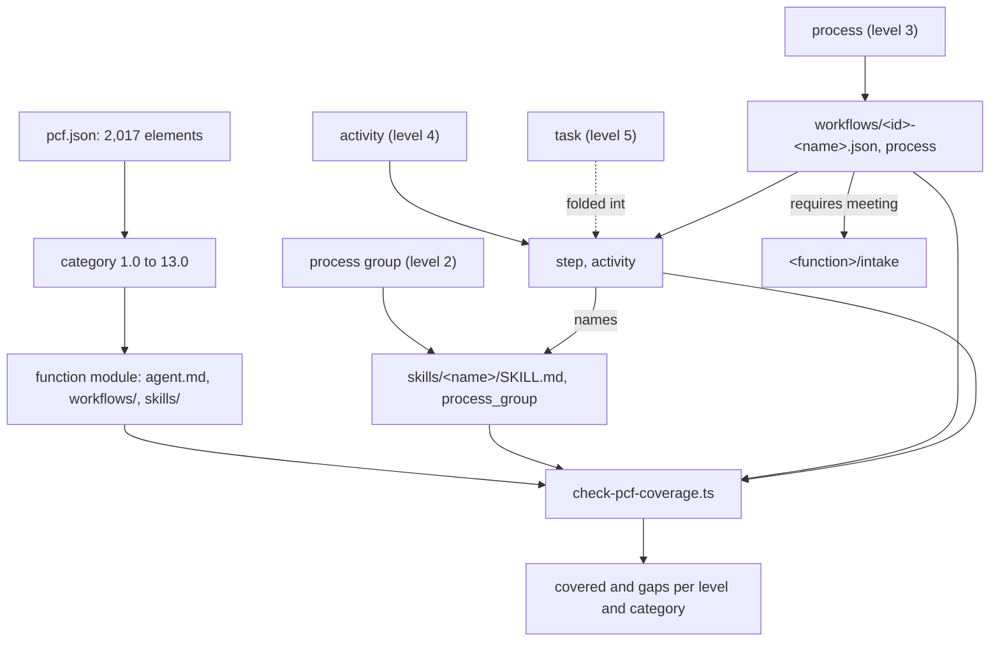

# A workflow for every APQC process, a skill for every process group

Date: 2026-11-27. Decision: EE-226. Status: the coverage check is built (`packages/naive/src/checks/check-pcf-coverage.ts`). The process workflows and process group skills follow in their own pull request; until it merges, the check reports the gap.

## The ask

Torian asked for every element of APQC's Process Classification Framework to be audited and given detailed skills and workflows in Naive. On 2026-11-27 Naive carried all 2,017 elements (13 categories, 74 process groups, 363 processes, 1,352 activities, 215 tasks) in `packages/naive/src/functions/pcf.json`, but its 35 workflows named 6 of the 1,352 activities and no process, its 47 skills named no process group, and nothing reported the gap.

## Domain

The words are APQC's (EE-165) and Naive's own (EE-168, EE-179, EE-180):

- A function is APQC's category (level 1). Its module is `packages/naive/src/functions/<id>/`.
- A process (level 3) is one piece of work a function does end to end. One workflow performs it.
- An activity (level 4) is one step of that work. A step names it in `activity`.
- A task (level 5) is detail inside an activity. It is folded into the step that performs its activity and is never a step of its own.
- A process group (level 2) is the briefing level a person reads (EE-180). One skill carries the method for every process in the group.
- Who does a step follows the kind of work, not the level (EE-179): a person decides, sets values, makes commitments and keeps relationships; the function's agent researches, analyses, drafts, monitors and keeps records.

## System

- A workflow's optional `process` field names the level 3 process it performs (`packages/naive/src/records/function-workflow.schema.json`). A skill's frontmatter names its level 2 process group as `process_group`.
- A process workflow is triggered on request and requires its function's intake meeting (EE-217), so process work stays locked until a person has walked the intake.
- `check-pcf-coverage.ts` reads the modules and reports, per level and per category, what is covered. It fails on a claim with the wrong structure: a process or process group outside the function's category, two workflows of one module on one process, a step whose activity sits under another process than its workflow's. With `--complete` it also fails on every gap. Without it a gap is reported and never fails, so the gap is visible while the work is under way.

## What this does not do

It does not judge whether a step's text is good. A review done criterion on every process workflow asks the function's lead. It compares ids with pcf.json directly, the debt EE-199 records for check-pcf.ts. Catalog activities in `activities.json` are left to check-functions.
