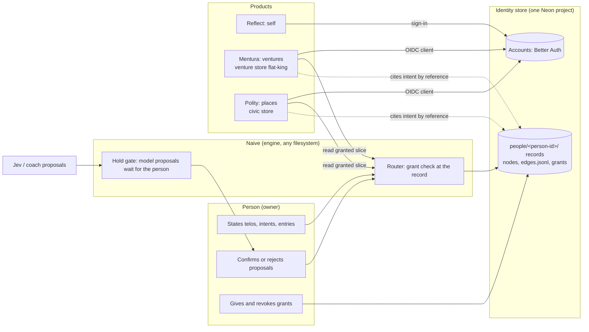

# The person graph

Designed, not built, unless a sentence names a file that is already there.

## The ask

Torian, 2026-11-10, in the Reflect thread:

- 04:08Z: each person states their own telos, and its political nature is discovered, not assumed. Reflect, Mentura and Polity will eventually gravitate into one product. Entries can exist elsewhere and be imported.
- 04:12Z: Reflect is the identity package, the shared identity layer, a knowledge graph of the person.

The Reflect thread asked this thread, which owns the workspace layout, where the graph lives, how it relates to `people/<person-id>/` (EE-114) and the shared people folder (G6), and whether the stores merge. The model itself (intent as the primitive, projects, entries, shared intents) is in the Reflect design doc, "Reflect: intent, projects and shared ends".

Taken as given from that thread, not yet confirmed by Torian: one stated graph per person; nothing inferred into it without the person's confirmation; Mentura and Polity read it only through grants; the journal is never shared; Reflect's sign-in becomes the account for all three.

## Summary

The graph is not a new place. A person already has a folder above every venture, `people/<person-id>/`, named by an opaque id and shared across ventures (EE-114, G6), holding ideas, references, inspirations and `_private/`. The person graph is that folder grown into the full model: the person, their telos, intents, projects, choices, entries, reflections, facts, beliefs, values, places and the people they name, with typed and dated edges between them and grants that say who may read what.

Where it is stored is a source-of-truth rule, not a code fork. Naive keeps the folder as files in a local workspace. A host maps `people/**` to an identity store through the source map's rules (EE-042), so the same records live in one Neon project that holds every account and every person graph, apart from Mentura's venture store and Polity's civic store. Products never connect to that database. They get a person's granted slice through the identity service, and a venture or civic concern cites the person's intent by reference instead of copying it.

## The flow



## The layout

```
people/<person-id>/
  person.json            opaque id, handle, account id; no real name (EE-114)
  telos/<version>.json   the person's stated telos, each revision dated, never edited in place
  intents/<id>.json      an end in the person's words, why it is held, serves: one or more parents
  projects/<id>.json     an intent pursued over time, with the person's own appraisal
  choices/<id>.json      a means committed to, checkable later
  entries/<id>.json      the journal; an imported entry keeps source and date; never grantable
  reflections/<id>.json  an entry read against an intent, closed by an insight; never grantable
  facts/ beliefs/ values/ places/ named/   the rest of the stated graph
  edges.jsonl            typed, dated, append-only: serves, shared-with, attached-to, about
  grants/<id>.json       grantee, scope, purpose, expires, set_by the person
  ideas/ references/ inspirations/         as today (EE-114); already filled by raw triage
  _private/              as today: real name, secrets; never reaches a route or a model (EE-094, EE-073)
```

Every node keeps `source` (stated, imported, or proposed with the proposer named) and `confirmed_by`. A model never writes a node or an edge directly: it proposes through the same hold gate raw triage uses (RAW_TRIAGE_2026-11-09.md), and the person's answer is a resolved detector trial, so "stated, never inferred" is measured, not hoped for.

A shared intent is not a group object. It is two or more people's own intents joined by a `shared-with` edge that exists only when each person has stated their side, so the political is found in the edges, never assumed.

## Grants and linking

- A grant names a grantee (a product, a venture by id, a place by id), a scope (node types, or node ids), a purpose and an expiry, and is set by the person. The router checks it at the record, where access is already checked for acting roles (`packages/naive/src/router/acting.mjs`).
- `entries/`, `reflections/` and `_private/` are outside every scope by schema, so no grant can name them.
- A venture's telos (`check-telos`) and a Polity civic concern cite `people/<person-id>/intents/<id>` by reference. Reading it needs a live grant. When a grant is revoked or expires the reference reads as a live hole, as freshness already does for records it cannot serve (`packages/naive/src/engine/freshness.mjs`), and nothing was ever copied that would need to be deleted.

## The stores

| Store | Holds | Today |
|---|---|---|
| Identity store | accounts (Better Auth), every person graph | Reflect's Neon project autumn-math-63075732 |
| Venture store | each tenant's venture records (`naive_records`) | Mentura's Neon project flat-king-46456222 |
| Civic store | Polity's public record and civic data | Polity's own database |

Recommended: keep three stores and make Reflect's project the identity store, rather than merging everything into flat-king. The graph and the journal are the most sensitive data the company will hold. In a separate database, with credentials only the identity service has, a Mentura service or agent cannot read a journal even by mistake, and "never shared" is a property of the deployment, not only of the code. Reflect's project already runs Better Auth with its users. Mentura and Polity become sign-in clients of it (an OIDC provider on Better Auth), and whatever accounts Mentura holds in flat-king move once. The cost is a second database to run and a service hop for granted reads.

The other option is one Neon project with a schema per product. It is simpler to run and to query across, but every credential that reaches the venture store reaches the journals too, and separating them later means moving the most sensitive data under load.

Either way the records keep one shape, the router keeps one grant check, and Naive imports nothing from any host.

## How it relates to what exists

- EE-114 and G6: unchanged and extended. `people/<person-id>/` stays the folder, shared across ventures; the graph's new folders sit beside `ideas/`, `references/`, `inspirations/` and `_private/`.
- Raw triage: triage already files ideas and references under `people/<person-id>/`, so they are graph nodes from day one. A person's own captures can later have a personal `raw/` under their folder; not designed here.
- One product later: Reflect is the self scope, Mentura the venture scope, Polity the place scope, over one account and one graph. Nothing here merges the apps; it only stops their data from forking now.

## Build plan

One item per pull request, none built:

1. Run the new nouns through the EE-095 term engine and the ontology gate: telos, intent, choice, entry, reflection, insight, grant, named person, shared intent. Project already exists as a word and needs a scoped meaning.
2. Naive record types and data-model paths for each node folder, `edges.jsonl` and grants, with a `check-person-graph` checker: every edge names nodes that exist, is typed and dated, a shared intent has every side stated, and no grant scope reaches `entries/`, `reflections/` or `_private/`.
3. The grant check in the router for reads of `people/**` by anyone but the person, with route tests.
4. Mentura's identity connector and the source map rule `people/** -> identity`.
5. The identity store: an OIDC provider on Reflect's Better Auth, Mentura and Polity as clients, Mentura's accounts moved.
6. Reflect writes its graph through the router so every write meets the gate and provenance.

## Open questions

- May Reflect's own coach (a model working for the person, on the person's request) read entries, or does the journal never reach any model? `_private/` never does; entries are a new case.
- Can a grant name a person who is not on Reflect yet (a named person), or only accounts?
- Polity's guest rules (no persisted address for anonymous users) stay as they are; does a signed-in person's place in the graph replace Polity's saved address, or sit beside it?
