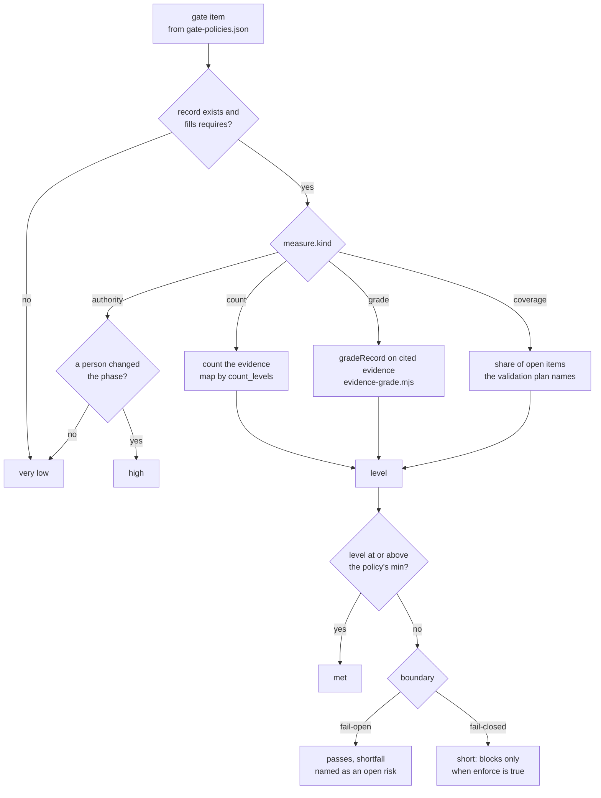
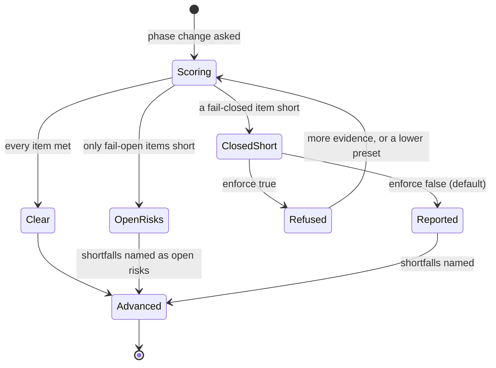

# Phase gate strength

Date: 2026-11-22. Decision: EE-156. Status: policies, records and generators built; the scorer is in progress.

## Problem

A phase gate that only asks whether records exist lets a venture leave discovery on a guess. A gate that asks for ten interviews behind every item stops a founder whose best proof is what customers did, or careful desk research. Neither tells the founder how strong the case is.

A password meter solves the same problem for passwords: it rates strength on a short ladder, says what is missing, and leaves the site to decide how strict to be. EE-156 does that for each gate item. Each item has an evidence ladder from very low to high, adapted from GRADE (the GRADE Working Group's method for rating certainty of evidence). A policy gives each item a minimum level and a boundary. Fail-closed refuses the phase change when the item falls short. Fail-open lets it pass and names the shortfall as an open risk.

Interviews are the strongest common proof, but not the only one. Under the grading rules in `packages/naive/src/engine/evidence-grade.mjs`, behavior evidence from the target audience with five or more cases starts and stays high, and desk research from three distinct sources reaches moderate, because three consistent sources raise a record one level.

## The ladder

There are four levels: very low, low, moderate and high. An item is measured in one of four ways, set by its `measure.kind` in `packages/naive/src/phases/gate-policies.json`.

- **count**: a counted kind of evidence, such as interviews with the primary customer. One reaches low, five moderate and ten high (`count_levels`). Ten is about Blank's customer discovery guidance; five is the grader's minimum sample.
- **grade**: the GRADE level of the record's cited evidence, from `gradeRecord`. An item starts by kind (behavior high, commitment moderate, stated and desk research low, opinion very low) and drops a level for an adjacent or unknown audience, a sample under five, general answers or evidence older than 18 months. Three supporting sources at low or better raise the record one level.
- **coverage**: the share of open items a plan names (the validation plan).
- **authority**: a person's act. The decision item is high only when a person changes the phase, and never when an agent does.

Before any evidence counts, the record must fill the fields the item `requires`.

## The eight discovery items

| Item | Asks | Proved by | Very low | Low | Moderate | High |
|---|---|---|---|---|---|---|
| customer | Who has the problem, specifically enough to find more of them? | `icp`, counted interviews with the primary customer | A guess at the segment | One interview with someone in it | Five interviews | Ten interviews |
| problem | Is it frequent or painful enough that people already try to solve it? | `validation-problem`, graded | A statement with no evidence | One desk source, or specific interview answers from five in the target | Three distinct sources at low or better that agree (desk research, interviews or both) | Behavior: five or more people in the target seen working around it |
| alternatives | How do they cope today, and why does that fall short? | `validation-solution` alternatives, counted interviews that name current solutions | Alternatives listed from memory | One interview naming one | Five interviews | Ten interviews |
| solution-fit | Does a solution fit well enough to test it with those people? | `validation-solution`, graded | A sketch | A desk comparison, or specific reactions from five | Commitments from five or more in the target (a pilot, a letter of intent) | Behavior: five or more use a prototype or concierge version |
| channel | Has at least one channel produced conversations with them? | `validation-go-to-market` channels, graded | A list of channels | One desk source on where they gather | Three agreeing sources on where they gather, or sign-ups from five in the target | Behavior: five or more conversations produced by one channel |
| economic-signal | Who would pay, and is there a sign that a budget exists? | `validation-pricing` buyer, graded | A price picked | Desk pricing of alternatives, or stated willingness to pay from five | Commitments such as signed letters of intent from five, or three agreeing price sources | Behavior: deposits, preorders or paid pilots from five or more buyers |
| validation-plan | Which assumptions are still open, and how will each be tested? | `validation-plan`, coverage | No plan | Some open items named | Most open items named, each with a test and a date | Every item below high named, each with a test, a passing result decided before the test, and a date |
| decision | Has a person weighed the evidence and chosen to go on? | a person's phase change, authority | None | None | None | A person changed the phase |

The rungs named for each item are examples of what typically reaches that level. The grader decides the level from the cited evidence, not from these words.

## Presets

A venture picks a preset and may tune single items under `phase_gates` in `naive.config.json`. Each cell is the minimum level and the boundary (closed or open).

| Item | lenient | standard | strict |
|---|---|---|---|
| customer | low, closed | moderate, closed | high, closed |
| problem | low, closed | moderate, closed | high, closed |
| alternatives | very low, open | low, closed | moderate, closed |
| solution-fit | very low, open | low, open | moderate, closed |
| channel | very low, open | low, open | moderate, closed |
| economic-signal | very low, open | low, open | moderate, closed |
| validation-plan | very low, open | low, closed | high, closed |
| decision | high, closed | high, closed | high, closed |
| strictness | 21 | 41 | 83 |

## Strictness score

A policy's strictness is a number from 0 to 100. For each item, take its minimum level's index (very low 0, low 1, moderate 2, high 3) over 3, weight it 1 when the item fails closed and 0.25 when it fails open, and average over the items. A tuned policy is labelled with the nearest preset by score. `strictness` in `packages/naive/src/engine/generators/phase-gate-policies.ts` computes it, and the generator test checks that lenient is below standard and standard below strict.

## Report-only and enforced

The gate is report-only by default. It scores every item and names what is short, and the phase change goes ahead. A venture opts in to enforcement with `phase_gates.enforce` set to true. Then a phase change is refused while any fail-closed item is short; fail-open items still pass and are named as open risks. The decision item is the person's phase change itself, so it is never what blocks a person.

Every threshold here, the count levels, the presets and the weights in the strictness score, is an unvalidated prior, ours.

## System

- `packages/naive/src/phases/gate-policies.json` holds the items and presets. Its record type is `phase-gate-policies` (operations layer, strategy function, method level), its schema `packages/naive/src/records/phase-gate-policies.schema.json` and its generator `packages/naive/src/engine/generators/phase-gate-policies.ts`, which also checks that every item names a known record type and that every preset covers every item of its phase.
- A venture's validation plan is `validation/plan.json`, record type `validation-plan` (purpose layer, strategy function, venture level, owned by the validation package), schema `packages/naive/src/records/validation-plan.schema.json` and generator `packages/naive/src/engine/generators/validation-plan.ts`. Its `uncovered` lists the scored discovery items the plan does not name.
- The scorer (an engine module with a CLI and the route `system/phase-gate`), the `phase_gates` key in `naive.config.json` and the lifecycle's enforcement are being built separately.

## Not built

- Research agents that gather desk evidence for the lower rungs, so a founder reaches low or moderate before the first interview.
- Links from each item to the market and industry anatomy matrices.
- Gates for the later phases (validation, beachhead, scale, platform). Only discovery has items.
- `--propose` for fail-open shortfalls: filing each named open risk as an open decision.
- The short route `validation/plan` that the other validation records have. The plan is reached today at the derived route `purpose/validation/plan`.
