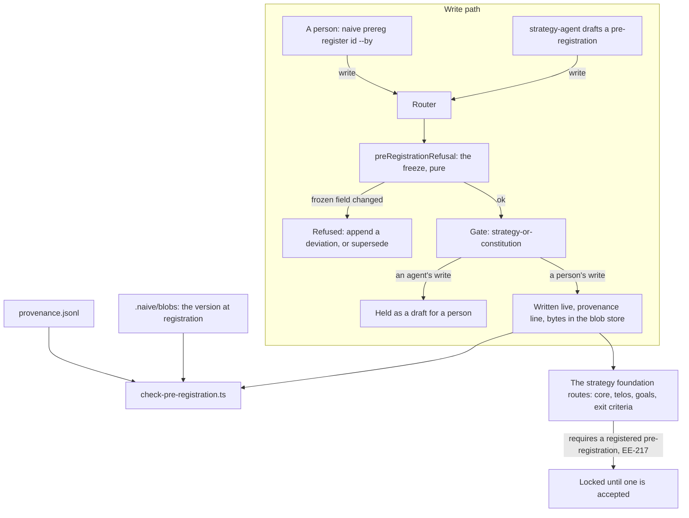
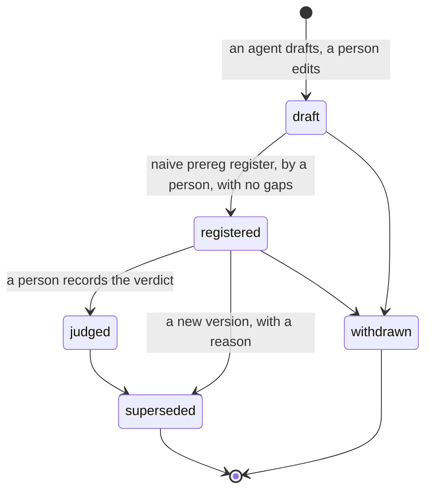

# Pre-registration: the durable object that comes before the strategy documents

Date: 2026-11-26. Decision: EE-220. Status: the record type, its freeze, the check, `naive prereg` and the strategy skill and intake step are built. The gate that holds the strategy foundation routes until a pre-registration record is live is wired through the generic `requires` field of EE-217, as listed under Gate below.

## The ask

Torian, 2026-11-26: add pre-registration into the workflow "as one of the durable objects that comes before another set of durable objects such as mission statement, vision, and other strategy docs." Build the record type and its place in the workflow, not any one venture's content. The record is frozen once a person approves it: claim, assumptions, measures, thresholds, dates and decision rules. Deviations are appended beside it, never edited into it. A full supersede to a new version is allowed, with a reason. Keep the field set general, so the record assumes no particular thesis.

## Domain

A pre-registration is a plan for a test, written down and fixed before the test runs. It says what would have to be true, how that will be looked for, what counts and what does not, and what the venture does on each answer. It is the first durable object of the strategy function: a mission and a vision written before one exists are claims nobody can lose an argument with, because the standard of proof is set after the evidence arrives.

The practice is not new, and Naive uses the standard words.

| Field of the record | Where the practice comes from |
|---|---|
| A thesis written so it can fail (`thesis.falsified_if`) | Preregistration in science: the hypothesis and the analysis are registered before the data (Nosek et al., "The preregistration revolution", PNAS 2018). |
| Assumptions, each with how critical and how uncertain it is | Discovery-driven planning's assumption checklist, ranked by what the plan rests on most and knows least (McGrath and MacMillan, HBR 1995). |
| Method: who, how many, how recruited, what is asked or observed | The registered method of a preregistration, and the Test Card's "to verify that, we will" (Bland and Osterwalder, *Testing Business Ideas*, 2019). |
| Measures, each with a threshold and the date it is judged by | The Test Card's metric and success criterion, and discovery-driven planning's milestone, which is a date at which an assumption is checked. |
| What does not count as evidence (`exclusions`) | HARKing, hypothesizing after the results are known (Kerr, *Psychological Review* 1998), and researcher degrees of freedom (Simmons, Nelson and Simonsohn, *Psychological Science* 2011): a standard of proof decided after the fact admits whatever arrived. Compliments, friends' opinions and unpaid sign-ups are the venture forms, which Croll and Yoskovitz call vanity metrics (*Lean Analytics*, 2013). |
| The action on a pass and on a fail | Persevere or pivot, decided against a criterion set in advance (Ries, *The Lean Startup*, 2011). Naive adds stop, because a venture may end a bet. |
| Deviations appended beside the record | A preregistration is not a cage: a registry records the deviation and keeps it visible rather than hiding it. |

Naive ships no thresholds. A threshold is the venture's own: an agent proposes one as a decision a person settles, and the shipped template labels every number in it an example. A number nobody chose is a number nobody is bound by.

## System

The freeze has two layers, because each closes a hole the other leaves open.

1. **At the write.** `preRegistrationRefusal` in `packages/naive/src/engine/pre-registration.ts` is pure: it takes the stored record and the record being written and returns a refusal or null. The router calls it on every write of the type, before the gate, so a refusal is a refusal and not a draft. It refuses a person too. That is the point: a person is free to change the plan, and the two ways to do it both leave a trace, a deviation appended or a new version that supersedes this one.
2. **At rest.** `packages/naive/src/checks/check-pre-registration.ts` reads the version that was live when the record was registered out of the venture's blob store and compares its frozen fields with the record as it stands. A hand edit that never went through the router is caught there. Blobs are not backfilled, so a record registered before the blob store existed is reported as unverifiable rather than failed.

## The record

`foundation/pre-registration/<id>.json`, route `foundation/pre-registration/[id]`, owned by the strategy function, decision class `strategy-or-constitution`, suggested from Discovery.

Frozen from `registered` on: `id`, `venture`, `thesis`, `assumptions`, `method`, `measures` (so every threshold and every judged-by date), `exclusions`, `on_pass`, `on_fail`, `registered_at`, `registered_by`, `supersedes` and `supersede_reason`. Append-only from then on: `deviations` and `results`, where an entry already written may not change or be removed. Write-once: `verdict`. Still open: `status`, along the states above, `superseded_by`, `decision` and `note`.

Registration is refused while the record has a gap, and the same pure function answers for the command, the router and the check: every measure needs a threshold and a date it is judged by, there must be at least one assumption, at least one exclusion, both actions, and a thesis that says what would falsify it.

## Gate

The strategy foundation records are locked until a pre-registration record is live. The mechanism is the generic `requires: { records, meetings, decisions }` field on a workflow with `prerequisitesOf` (EE-217). These entries are written in the shipped workflows:

| Workflow | Entry |
|---|---|
| `strategy/intake`, on the steps `ask-telos`, `ask-problem-and-customer`, `ask-limits` and `ask-goals-and-kill-criteria` | `"requires": { "records": ["foundation/pre-registration"] }` |
| `strategy/strategy-review`, on the whole workflow | `"requires": { "records": ["foundation/pre-registration", ...] }` |

The intake step `pre-register-the-first-test` writes the pre-registration itself and waits on nothing, so the chain always has a first step. `check-functions.ts` fails any workflow that writes a foundation record without such an entry, so a new workflow cannot skip it. The lock asks for a live record, not a registered one; registering is the person's next step and the lock does not wait on it (not built).

## What is not built

- A lock that waits on a registered pre-registration rather than a live one.
- A result that lands by itself. A result is written by a person or drafted by the agent and accepted; nothing reads a measure off a system and files it.
- An overall verdict derived from the per-measure results. Per-measure pass and fail is arithmetic against the registered threshold, so the command computes it; the verdict is a person's and is written by a person.
- Receptions, scoring and any learning over past pre-registrations.
