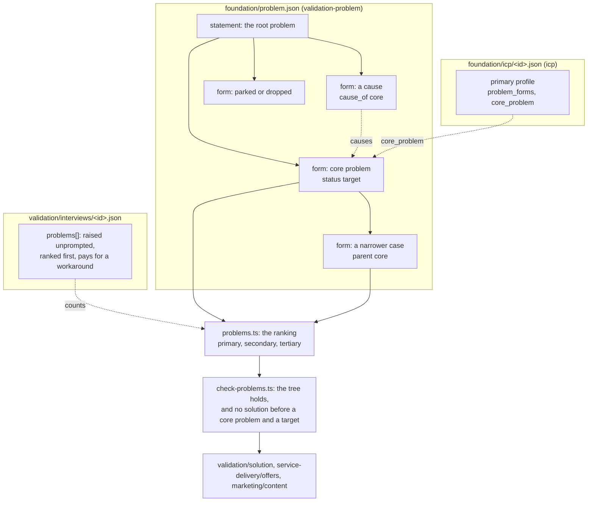

# The customer problem hierarchy

Date: 2026-11-26. Decision: EE-219. Status: built, with the fail-closed rule enforced by a check and not yet at the write (below).

## The ask

Torian, 2026-11-26: "Let's add all of these problems, and let's add a hierarchy of problems. So a primary problem, a secondary problem, and tertiary problems, or some other method. Find the best practices and the standards, and how to add it to Naive properly. Cover my blind spots."

The record he accepted the same day: a core problem, "doesn't know what to do next", with one problem that causes it and one narrower case under it. That record is the worked example here (`packages/naive/src/engine/problems-test.ts`, and `packages/naive/src/checks/check-problems-test.ts` breaks copies of it).

## What was there before

`packages/naive/src/records/validation-problem.schema.json` held one root problem in `statement` and a flat `forms[]`, each form a narrower problem with a status of open or dropped (EE-050). Nothing said which problem mattered most, nothing said why one problem produced another, and nothing stopped a solution being written before the problem was named.

## Standards

Naive uses an established term with its standard meaning and coins one only when none exists (EE-014). Three standards divide the work, and keeping them apart is the point:

| Standard | Source | What it governs here |
|---|---|---|
| Opportunity solution tree | Teresa Torres, *Continuous Discovery Habits*, 2021 | `parent`: a child problem is a narrower case of its parent, the same problem for fewer people or in one situation. Torres's tree hangs opportunities under one desired outcome and works one branch at a time, which is why there is one target. |
| Problem tree analysis, in the Logical Framework Approach | Norad, *The Logical Framework Approach*, 4th edition, 1999 | `cause_of`: a different problem that produces another, drawn below it. One **core problem** per tree, which Naive scopes per ICP profile. |
| Jobs to be done | Ulwick, *Jobs to be Done*, 2016 | Stays where it is: a profile's `jobs` on `icp-profile.schema.json`. A problem here is a job going badly, so the two are not merged. |

Qualitative coding (a codebook applied to transcripts) is why the evidence counts live on the interview and not in the ranking: the interview says what the person said, the tree is the codebook, and the ranking only counts.

## Domain

Each piece, and who may write it:

- **A problem** is a form of the record. `parent` is a narrower case, `cause_of` is a cause, and they are different claims: the check refuses a form that is both to the same problem. A form with no parent sits directly under the record's statement, so every record written before this change is a tree one level deep and stays valid with no migration.
- **The core problem** is one field on the ICP profile, `core_problem`. One per profile, because the field is single: the illegal state of two core problems for one profile cannot be written. The profile is gated like the telos, so an agent's write is a draft a person accepts.
- **The target** is the one form with `status: "target"`. The problem record is gated `strategy-or-constitution`, so only a person settles it; the check refuses a second target.
- **The evidence** is on the interview, coded per problem: `raised` (unprompted or prompted), `ranked_first`, `pays_for_workaround`. Counts, never scores.
- **The ranking** is computed on every read and stored nowhere. Primary, secondary and tertiary are the labels of ranks 1, 2 and 3-and-below (`packages/naive/src/functions/strategy/problem-priority.json` `labels`).
- **The business's own problems** are not here. A problem that the venture has, rather than its customers, is a decision, a seam or a handoff. The schema and the check say so, and the check reads none of those records.

## The ranking

`score = w_unprompted x raised_unprompted + w_first x ranked_first + w_pays x pays_for_workaround`, over the problems whose status the definition ranks (open and target; parked and dropped keep their place with no rank). Ties fall back to the order the founder listed the forms in. The weights are unvalidated priors in `problem-priority.json` (1, 2, 3: behaviour outranks a stated ranking, which outranks a word, as the evidence grades do in EE-026), and a venture replaces them under `problems` in `naive.config.json` with the person who set them.

Before any interview has coded a problem, every score is 0, the order is the founder's own order, and the output labels the basis `hypothesis` and says so in words. With codings it is `evidence`. Nothing in the ranking ever chooses the target: a person does.

## The fail-closed rule

`requires_target` in the definition names the record types that wait: `validation-solution`, `service-offer`, `marketing-content`. `packages/naive/src/checks/check-problems.ts` fails when one of those is already written while the venture has no forms, no form is the target, or the primary profile names no core problem. A venture that has written none of them is told the same gaps as next steps and passes, so adopting the tree is never a wall.

A venture with no ICP profile at all is advised rather than failed: the profiles themselves are what the foundation lint and the phase gate ask for, and this rule holds the venture to the problem it says it is solving.

The rule is a check today, not a refusal at the write. EE-217 is adding a general `requires` mechanism (`prerequisitesOf` in `packages/naive/src/engine/prerequisites.ts`), and this rule belongs there rather than in a second bespoke gate hook: the route patterns it would cover are `validation/solution`, `purpose/validation/solution`, `service-delivery/offers/**`, `marketing/content/**` and `operations/marketing/content/**`, and the prerequisite to express is `prerequisite()` in `packages/naive/src/engine/problems.ts`, which already answers what is missing and why.

## Blind spots this closes

| Blind spot | What catches it |
|---|---|
| Two problems both called the one being worked on | One target, and the check refuses a second. |
| A narrower case and a cause confused, so the tree says nothing | Two fields, and a form that is both to the same problem fails. |
| A tree that quietly loops | Loops through `parent` and through `cause_of` both fail. |
| Priority that drifts from the evidence | The order is computed from counts on each read, and nothing stores it. |
| A founder's hunch read as evidence | With no coded interview the basis is labelled `hypothesis` in the output. |
| Weights chosen in code | They are data, priors, and a venture overrides them with `set_by`. |
| A solution for a problem the venture dropped | A solution names its problem (`validation-solution.problem`), and a dropped one fails. |
| Dropping a problem that others still hang under | A live narrower case under a dropped form fails. |
| An interview that invents a problem | A coding that names no form fails, and two problems ranked first in one interview fail. |
| The customer's problems and the business's own mixed in one tree | Stated in the schema, the check and here; the check reads no decision, seam or handoff. |

## What is not built

- The refusal at the write: it waits for EE-217's `requires` (above).
- No interview example ships with a coding; the coded path is covered by the tests and by the worked example.
- Nothing proposes a target or a core problem. An agent may draft the record, and the gate holds that draft for a person.
- Effects on the ranking from a problem's own evidence items (EE-026 grades) are not mixed in: the counts come from interviews only.

## Files

| Path | What it holds |
|---|---|
| `packages/naive/src/records/validation-problem.schema.json` | `forms[]` with `parent`, `cause_of` and `status` open, target, parked or dropped |
| `packages/naive/src/records/icp-profile.schema.json` | `core_problem`, one per profile |
| `packages/naive/src/records/validation-interview.schema.json` | `problems[]`, the coding that feeds the counts |
| `packages/naive/src/records/validation-solution.schema.json` | `problem`, the form the solution solves |
| `packages/naive/src/functions/strategy/problem-priority.json` | The weights, the ranked statuses, the labels and `requires_target` |
| `packages/naive/src/engine/problems.ts` | The tree, the counts, the ranking, the findings and the verdict; `naive problems [tree\|rank]` |
| `packages/naive/src/checks/check-problems.ts` | The check over a venture or a workspace |
| `packages/naive/src/records/examples/workspace/ventures/tandem`, `.../examples/software/ventures/relay` | Example trees: a target, a cause, a narrower case, a parked problem, and a core problem per profile |
