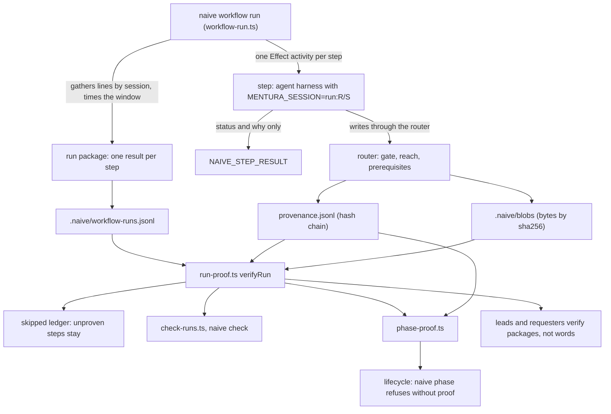

# Proving work was done, not taking an agent's word for it

Date: 2026-11-27. Decision: EE-227. Status: built (`packages/naive/src/engine/run-proof.ts`, `workflow-run.ts`, `phase-proof.ts`, `packages/naive/src/checks/check-runs.ts`).

## The ask

Torian, 2026-11-27: "We don't want to take agents at their word for having completed a step. We want to be able to verify and for them to be able to prove that their work was completed." And: "we need to be able to verify and prove that someone has exited discovery and is in validation or in some other phase. We do that by being able to prove that the certain prerequisite records and information exist." And: agents that check other agents "are no longer looking for taking another agent's word that they completed the work. They're looking for that agent to deliver some sort of package that they are able to check."

## The problem

Every element of APQC's PCF has a workflow or a skill (EE-226), but before this change a run was one line in `.naive/workflow-runs.jsonl` that said `outcome: done` and, at best, listed the step ids the agent said it finished (`naive due record --steps`). Nothing tied a step to anything that happened. The skipped ledger, the element states (EE-190) and the loop all read that line as true. A phase gate counted a record as present if a file sat at its path, whoever wrote it and however.

That is self-report, and self-report fails in known ways. The failure modes this design closes, each with the rule that closes it:

| Failure | What it looks like | The rule |
|---|---|---|
| Claimed, not done | "Step 3 done" with nothing written | A done step needs evidence: provenance lines it wrote. None is unproven |
| Stale evidence | Pointing at a record written last month | Each line must fall inside the step's time window |
| Borrowed evidence | Pointing at another agent's or another run's write | Each line must carry the step's own session and the runner's role (or a specialist of its function) |
| Edited after | A record changed by hand after its recorded write | A record counts only when its bytes match its last recorded write; the blob store must hold those bytes |
| Wrong output | Writing somewhere the step does not touch | Each line's route must be one the step may write (its `writes`, else its function's reach) |
| Off the books | Writing a file directly, outside the router | Each line must name a route, that is, it went through the router, the gate and provenance |
| Silent skip | Leaving a step out of the report | A step with no result is missing, and the run does not verify |
| Convenient "not needed" | Calling a required step optional | Only a step with `consider` may be judged not needed, and only with a reason |
| Nothing to show | A decision step with nothing to decide | Allowed only for a step whose writes are all `decisions/*`, with a reason, and reported as reasoned, never proven |
| Crash mid-run | Steps run twice or lost | Each step is a durable Effect activity: a finished step is not run again after a crash |
| Hand-made phase exit | Gate records written by hand, or a run that lied | The phase's gate records must be proven, its latest runs must verify, and its intakes must be walked |

## What other systems do

- **Task and project tools** (issue trackers, checklists, stage-gate reviews): a person or an agent ticks a box. The tick is the claim, and a reviewer reads the deliverable if they read anything. Nothing binds the tick to the work.
- **CI and job schedulers**: a step succeeds when its process exits 0. That proves the process ended, not that it produced what it should; a script can exit 0 having done nothing.
- **Durable execution engines** (Effect's workflow module among them, which Naive uses): the engine records that an activity completed and replays it after a crash. That makes a run resumable and exactly-once at the activity level. It still records what the activity returned, so an activity that returns "done" is believed.
- **Agent frameworks**: an agent's final message that the task is complete ends the task. Evaluations of coding agents moved to running the tests themselves because the agent's own report was not reliable.
- **Supply chain attestation** (in-toto, SLSA provenance): each step of a build records the hashes of what it consumed and produced, and a verifier checks the chain of those records against a layout of who may perform each step. This is the closest prior art: evidence is hashes of artifacts, bound to who produced them, checked by someone else.
- **Financial audit** (ISA 500, Audit Evidence): an auditor does not accept management's statement that a control ran; they inspect evidence that it ran, and judge whether it is sufficient and appropriate.

Naive takes the attestation and audit stance and applies it to business work: the evidence is the venture's own hash-chained provenance log and blob store, which every router write already feeds, and the verifier is code anyone can run.

## The design

- **The run package.** A run line gains `run`, `started`, `observed` and `results`: one result per step, `done`, `not-needed`, `nothing-to-record` or `skipped`, with a reason where it is not done. A done result carries the hashes of the provenance lines the step wrote, gathered from the log by the step's session `run:<run id>/<step id>`. The agent never lists its own evidence.
- **The verifier.** `verifyRun` in `run-proof.ts` is pure. For each evidence line it checks: the line is in the log, the chain holds up to it, the session is the step's, the role is the runner's or a specialist of its function, the time is in the step's window, it went through the router to a route the step may write, it put work down (a write, a draft, an accept, a merge, a rollback or a confirm), and the blob store holds its bytes. A held draft is evidence of work, marked held, since the person has not accepted it yet. Each step's verdict is proven, considered, reasoned, unproven, skipped, missing or not allowed, and a run verifies when every step is proven, considered or reasoned. `naive runs` lists every run and `naive runs verify <run>` checks one.
- **The observed runner.** `naive workflow run <function>/<workflow>` runs each step as one activity of an Effect workflow (`effect/workflow`): it sets the session, starts the agent harness (`NAIVE_AGENT_CMD`) on that one step, times the window itself and reads the evidence from the log when the harness returns. With `durable.engine` sqlite or postgres a killed run resumes without running finished steps again. A run recorded by hand (`naive due record --run --started --results`) is reported, not observed: its evidence is still gathered from the log by session, but its window is the one it states.
- **What reads it.** The skipped ledger leaves every step a run's proof does not accept on the ledger, so a claimed step that is not borne out is still owed. `check-runs.ts` fails when a workflow's latest run does not verify, and `naive check` runs it. The function agent's prompt and the lead skill say to check another agent's package with `naive runs verify`, never its say-so.
- **Phase exit.** `phase-proof.ts` is added to the lifecycle gate's blocking list, always. A venture leaves a phase only when each record type the phase's gate names, and its exit criteria, has a file whose bytes match its last recorded write (proven, or adopted by a person's baseline); when the latest finished run of each workflow the phase lists verifies; and when each intake the phase lists has a verified run or a meeting closed with its goal reached. A person may still pass `--override` with a reason, which the phase change keeps.

## What this does not prove

- **That the work is good.** Proof of execution is not proof of quality. A proven step wrote the right kind of record at the right time; whether the record is right is the review criterion each workflow carries for its lead, and the evidence grade for validation records.
- **Who someone is.** A role and a session are declared through environment variables, so a process that sets another role's id can write as that role. The router's reach rules limit what any role writes, and the provenance chain catches an edit after the fact, but signed identity is not built (the code audit of 2026-11-27 names it).
- **A meeting record's own provenance.** An intake settled by a meeting is read from the meeting record as it stands, as EE-217's prerequisites read it.
- **Older runs.** A run that only names step ids proves nothing and is reported that way; it is not rewritten.

