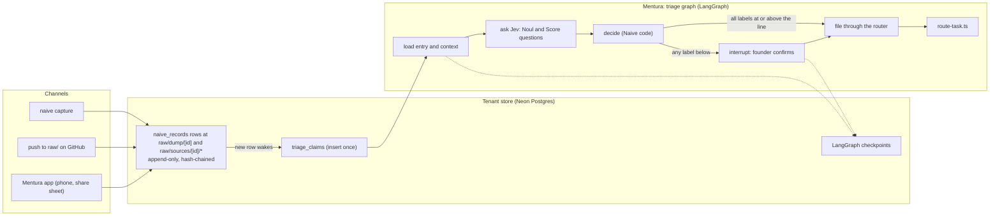
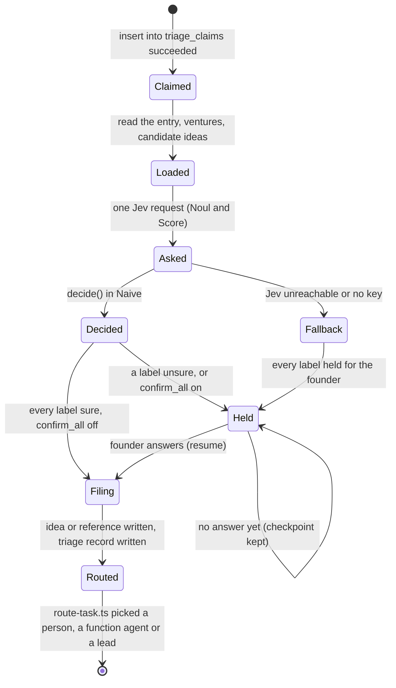

# Raw capture and triage

Designed, not built, unless a sentence names a file that is already there.

## The ask

Torian, 2026-11-09:

- 00:16Z: the labelling model is not any model. It is a System 1 model, Jev from TypeSafe. It is connected to the monorepo and watches one folder (`raw/`) where his raw ideas and references land, and it triages them.
- 00:24Z: consider whether a Postgres database, Neon in particular, serves this better than a git folder, and build the agents with LangChain.
- 00:30Z: "Go".

Decided by those messages: Jev labels, LangChain builds the flow, and capture lands in Neon. Agreed earlier and kept: a venture-wide `raw/` that is immutable, with `raw/dump/` for the founder's own words and `raw/sources/<id>/` for references (2026-10-28); the pipeline Capture, Understand, Route, Decide, Write, Confirm, Package, where Understand is a confirm gate (2026-10-28); System 1 primitives Noul and Score for the steps that only classify (2026-10-28). Harnesses stay any (Claude Code, Cursor, Codex, Mentura's interface, a trigger); only the labeller is fixed.

## Summary

A capture from any channel becomes one record under `raw/` in the tenant's Neon store. The store is already append-only and hash-chained (everything-ecosystem `platform/connectors/postgres.ts`, table `naive_records`), so raw is immutable without new machinery. A new raw row wakes a triage run. The run is a LangGraph graph whose steps are fixed: load the entry, ask Jev its questions in one request, decide in code, pause for the founder on anything below the line, file, then route. Jev answers only Noul (yes or no, with a probability) and Score questions; every decision is code reading those answers. What triage files is an idea (`people/<person-id>/ideas/<id>.json`) or a reference (`founder-reference`), each citing the raw id, plus one triage record that keeps every label, its confidence and the model. A founder's correction of a label is a resolved detector trial, so the line can move on evidence (SIGNAL_DETECTION_2026-11-07.md).

## Why Neon, not a git folder

| Need | Git folder `raw/` | Neon (`naive_records`) |
|---|---|---|
| Capture without git (phone, email, a non-technical founder) | Needs a commit per capture | One insert, from any channel |
| Raw stays immutable | Convention only; history can be rewritten | A trigger refuses UPDATE and DELETE, and the hash chain catches a changed row (built) |
| Where the founder's records already are | No: records left git in EE-118 step 9c | Yes |
| Wake on a new entry without polling | A push webhook, per repository | A database trigger, `LISTEN/NOTIFY`, or a Neon Function on insert |
| Exactly one triage run per entry | Needs a lock elsewhere | `insert ... on conflict do nothing` on a claims table |
| Full copies of copyrighted sources kept private | Must stay out of git by hand | Object storage beside the database, branched with it |
| Readable as files | Yes | Yes: `store-export.ts` writes the tenant to a folder (built) |

GitHub stays a channel: a push that adds files under `raw/` in a connected repository is turned into raw rows by a signed webhook, the same pattern as `platform/webhooks/server.mjs`. The repository is not where raw lives.

## Raw entries

A raw entry is a record, so it has a route, a schema and provenance like every other record.

| Path | Holds | Record type |
|---|---|---|
| `raw/dump/[id].md` | One capture in the founder's own words, verbatim, with frontmatter `id`, `captured`, `channel`, `person` | `raw-dump` (new) |
| `raw/sources/[id]/source.json` | Where a reference came from | `raw-source` (exists) |
| `raw/sources/[id]/text.md` | The reference's text or transcript, or the founder's note when there is no text | `raw-source-text` (new) |
| `raw/triage/[id].json` | One triage run over one entry: every question, its answer and probability, the model, the line used, what was filed and what was held | `triage` (new) |

The id is the capture time plus a short random suffix, as `naive capture` makes it today (`packages/naive/src/engine/workspace.mjs`). `naive capture` keeps working on a filesystem workspace; on a tenant store, the same command writes the row through the router.

**Open:** whether `raw-dump` replaces the single `raw/dump.md` the data model lists today (`instance/**/raw/dump.md`). The proposal is yes: one file per capture, and the old single dump is read as one capture during an upgrade.

## Waking a run

A new row whose path starts with `raw/dump/` or `raw/sources/` and ends in `.md` wakes triage. Three ways, in order of preference:

1. A Neon Function triggered on insert (Neon Functions are wired on the unmerged branch `claude/neon-app-setup`, not on main).
2. A worker holding `LISTEN naive_raw`, with a trigger on `naive_records` that sends `NOTIFY naive_raw, '<tenant>:<path>'` for those paths. This is the first one built, because it needs nothing that is not merged.
3. A sweep at start-up that triages every raw entry with no claim, so a missed notification is never lost.

A run starts by inserting `(tenant, raw_path)` into `triage_claims` with `on conflict do nothing`. The run that inserted the row proceeds; any other stops. The claims table is append-only too, so a claim is never released. A run that crashes resumes from its checkpoint instead of being re-claimed.

## The questions

Naive holds the questions as data in `packages/naive/src/engine/triage.ts` and builds one Jev request per entry in the shape `platform/integrations/jev.mjs` already sends (`state`, `model`, `questions`). Jev's request takes Noul and Score questions today (`ideamap.mjs`, `anatomy.mjs`); a choice among options is one Noul per option, and code takes the strongest, as the idea map does.

| Step | Question | Primitive | Decides |
|---|---|---|---|
| Kind | Is this the founder's own idea? Is it a reference to someone else's work? | Noul, Noul | idea, reference, or idea citing a reference (both yes) |
| Split | none: code splits paragraphs (`split` in `workspace.mjs`) | code | fragments |
| Venture | For each fragment and each venture: is this fragment mainly about that venture? | Noul per venture | the venture, or none (a new idea) |
| Functions | For each fragment and each of the 13 functions: does it touch this function? | Noul per function | the functions, for the routing rule |
| Duplicate | For each fragment and each candidate idea (the closest existing ideas by shared terms, at most five): does it say the same thing? | Noul per candidate | new idea, or a builds-on relation to the existing one |
| One-way door | Does acting on it commit the venture in a way that cannot be undone? | Noul | sends it to a person, whatever the other labels say |
| Urgency | How urgent is acting on it, 0 to 1? | Score | docket rank only; never a filing decision |

The venture list, the 13 functions (`departments.json`) and the candidate ideas go in `state`. A source's full text is sent only when the venture's configuration allows it (`triage.send` in `naive.config.json`, off by default, as `beta.jev.send` is for feedback); without it, only the title, the origin and the founder's note go.

## Deciding

`decide(entry, answers, line)` in `triage.ts` is pure: no I/O and no model. For each label it takes Jev's probability; a label is **sure** when the probability is at or above the line, or at or below one minus the line (a sure no). The line comes from the detector `governance/detectors/triage-accept.json`, shipped at 0.95 with `set_by: "default"`, the same as `feedback-accept`.

- Every label sure: file now.
- Any label not sure: hold. The run pauses with the unsure labels as questions for the founder, each with Jev's best answer filled in.
- The one-way-door Noul at or above one minus the line (not sure it is two-way): the routed task goes to a person, whatever else holds.

**Open:** whether the founder confirms everything for a first period (Torian's call; the proposal is a `triage.confirm_all` switch in `naive.config.json`, on for the first weeks, then off so only held labels wait).

## The graph

The flow is fixed, so it is a LangGraph `StateGraph`, not a deepagents agent (the agent stack decision of 2026-11-06). It lives in everything-ecosystem `platform/agents/triage-graph.ts`.

- **Checkpoints.** The graph is compiled with a checkpointer. Production uses LangGraph's Postgres checkpointer on the same Neon database, keyed by thread id `<tenant>:<raw path>`; tests use the in-memory one. A held run survives restarts.
- **Holding.** The held node calls LangGraph's `interrupt()` with the questions. The founder's answer resumes the run with `Command({ resume })`. The questions also go to the founder's inbox as a decision, so any harness can show them.
- **Jev.** Jev is wrapped as a LangChain runnable (`platform/agents/jev.ts`) that takes the request `triage.ts` built and returns the answers; it reads `TYPESAFE_API_KEY` from the environment and nothing else. With no key, or Jev unreachable, the run holds every label for the founder; it never falls back to a different model.
- **Writing.** Every write goes through Naive's router (agent files, EE-122) as the role `triage-agent`, so the gate, access and provenance hold. The role writes only `raw/triage/*`, `people/*/ideas/*`, `people/*/references/*` and `decisions/*`. It never writes raw.
- **Traces.** The run is traced with `NaiveTracer`, so its spans sit beside provenance.

## Corrections

A filed label the founder changes, or a held label the founder answers, resolves a trial of `triage-accept` through the detection ledger (`governance/detector-trial/<id>`, built):

- A held label the founder answers the way Jev guessed is a false alarm: it did not need a person.
- A filed label the founder changes is a miss: it needed one.

After 30 resolved trials, `check-detectors.ts --propose` can propose a new line (built), and a person accepts it. The line never moves on its own.

## Who holds what

| Piece | Where | Why |
|---|---|---|
| Record types `raw-dump`, `raw-source-text`, `triage` | Naive | Records are Naive's |
| Questions, `decide()`, the detector `triage-accept` | Naive `engine/triage.ts`, template detectors | Questions and lines are data and code that never call a model |
| Routing after filing | Naive `engine/route-task.ts` (built) | One rule for every harness |
| Jev client | everything-ecosystem `platform/integrations/jev.mjs` (built) and `platform/agents/jev.ts` | Names the vendor and the credential |
| Graph, checkpoints, claims table, `LISTEN` worker, GitHub channel | everything-ecosystem `platform/agents/`, `platform/intake/` | Reaches Neon and the network |

## Build order

One pull request each, merged on green.

| # | What | Repo | Done when |
|---|---|---|---|
| 1 | Record types `raw-dump`, `raw-source-text`, `triage`, their routes, and the `triage-accept` detector | Naive | the data model checks pass and an example venture holds one of each |
| 2 | `engine/triage.ts`: `request(entry, context)` and `decide(entry, answers, line)` | Naive | tests with fixed answers file sure labels, hold unsure ones, send a possible one-way door to a person, and never call a model |
| 3 | Pin everything-ecosystem to that Naive | everything-ecosystem | CI green |
| 4 | `platform/agents/jev.ts` and `platform/agents/triage-graph.ts` with an injected checkpointer | everything-ecosystem | an offline run with a scripted Jev files a sure entry, holds an unsure one and resumes it on an answer, and writes no raw |
| 5 | `platform/intake/`: claims table, `NOTIFY` trigger, `LISTEN` worker, start-up sweep, `bin.ts triage` | everything-ecosystem | against an in-memory or local Postgres, two workers on one entry triage it once |
| 6 | GitHub channel: a signed push webhook that turns new files under `raw/` into raw rows | everything-ecosystem | a signed push writes rows; an unsigned one writes nothing |
| 7 | Corrections into the detection ledger | everything-ecosystem | a changed filed label appends a miss; an answered held label appends a false alarm |

Not built by this plan: the Neon Function on insert (waits for the Neon services branch), the phone share sheet and email channels, object storage for originals, transcription, and a Jev key in any environment (none is set in the cloud environment today).

## Open questions

1. Whether `raw-dump` (one file per capture) replaces the single `raw/dump.md`.
2. Whether the founder confirms every triage for a first period (`triage.confirm_all`).
3. Whether a source's full text may be sent to Jev by default, or only its title, origin and note (proposal: only those, until the founder turns `triage.send` on).
4. Whether a fragment Jev puts in no venture becomes a new idea at once, or waits in the founder's inbox (proposal: a new idea at once; ideas belong to the person, not a venture).
