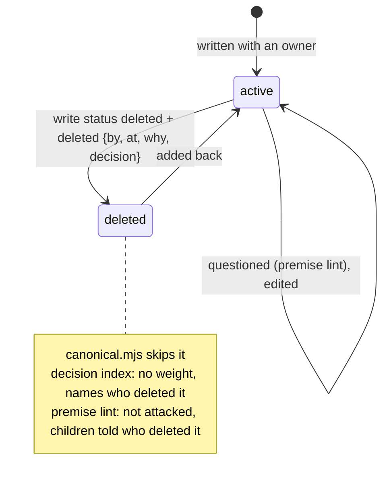

# Requirement owners and deletion records

## Goal

The SpaceX study's first question is how a requirement is created, who owns it and how it is deleted. Naive's requirement had no owner (only its goal did), no status, and the router has no delete action, so a deleted requirement left no trace. Musk's first two steps, question every requirement with a named person behind it and delete what you can, need both.

## Two shapes

1. A router delete action. Removing the file writes a provenance line with a reason. Readers stay unchanged, but the reason lives only in the log, a reader cannot tell a deleted requirement from one that never existed, and adding it back means digging the bytes out of the blob store.
2. A tombstone on the record. `status: "deleted"` with `deleted` (by, at, why, decision). The record itself owns its state, readers filter on one field, and adding it back is setting the status to active.

The second shape is chosen: one owner for the state (the record), one way to delete (a write), and readers need to know one field.

## Principles and the choice each changed

- Model the domain: the schema makes illegal states unrepresentable. A live requirement cannot carry `deleted`, and a deleted one must.
- Subtract before you add: no new router action; deletion is an ordinary write through the gate and provenance.
- Prove it works: premise lint tests a requirement with no owner, a deleted one left alone and a child told who deleted its parent; the decision index tests that a deleted requirement's check no longer runs and the decision is told why.

## Not built

- A command to delete or add back a requirement in one step; today it is a write of the record.
- An owner is a name in free text, not the id of a person record.
