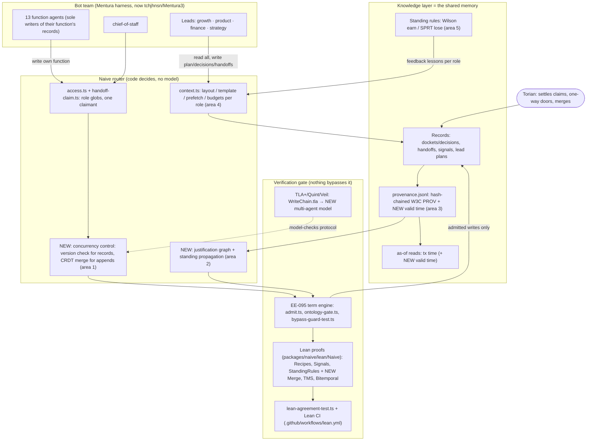

<!-- Placement: proposed for tchjhnsn/Naive docs/design/RESEARCH_PRIORITIES_2026-11-24.md. Prepared 24 November 2026. A 26 November 2026 note: the harness repository is tchjhnsn/Mentura3. tchjhnsn/everything-ecosystem redirects to the archived tchjhnsn/Mentura. No secrets were added or removed. -->

# What research Naive needs, ranked

Prepared November 24, 2026 (America/Chicago). It's based on a read-only pass over **tchjhnsn/Naive** at HEAD, the repository Naive actually lives in. tchjhnsn/everything-ecosystem now redirects to **tchjhnsn/Mentura**, and its README says that as of 2026-11-24 it is **archived**, with the work moved to tchjhnsn/Mentura3. Every path below is in tchjhnsn/Naive unless it says otherwise. Every citation was checked against arXiv, Crossref, or the live page.

## Where Naive already is

Naive already has most of a verified shared-memory layer, under different names:

- **Knowledge is the memory layer.** The `README.md` layer table describes it as "Memory: where every record is stored" (EE-036).
- **The provenance log is a hash-chained, append-only W3C PROV log.** It lives in `packages/naive/src/core/provenance.ts` (EE-031).
- **As-of reads use transaction time.** They live in `packages/naive/src/store/as-of.ts`, and Lean proves `as_of_no_lookahead` in `packages/naive/lean/Naive/Recipes.lean`.
- **An agent statement leaves `settled` unchanged.** `agent_never_resolves` proves that adding agent statements does not change `settled`, and `agent_alone_settles_nothing` proves that agent statements alone leave `settled` false. Both are in `packages/naive/lean/Naive/Recipes.lean`.
- **Signal withdrawal and reconcile are proved monotone and idempotent.** The theorems are `withdraw_monotone`, `reconcile_idempotent` and `commit_idempotent` in `packages/naive/lean/Naive/Signals.lean`.
- **Context assembly per agent exists.** `packages/naive/src/router/context.ts` sends a layout, a template, prefetch, and token budgets.
- **Earning and losing a standing rule is proved.** `packages/naive/lean/Naive/StandingRules.lean` proves the Wilson-bound earn bars (`unanimous_reaches_low_iff` at 0.8, `unanimous_reaches_costly_iff` at 0.9) and the floored-SPRT loss bars (`sprtCusum_nonneg` keeps the statistic at least 0, and `pure_failures_reach_iff` says when failures reach the suspend line). Wald's type I and type II error rates are not theorems in that file.
- **The single-writer write path is model-checked.** The model is `packages/naive/test/verification/write-chain/WriteChain.tla`.
- **Everything symbolic goes through the EE-095 term engine and the Lean agreement test.** The files are `packages/naive/src/terms/engine.ts`, `bypass-guard-test.ts` and `lean-agreement-test.ts`.

So you don't need to adopt a memory product. You need research on the problems Naive has **not** solved yet. The lead-agents design still states one open question this way:

> "Runs still take the venture lock one at a time (… shared appends as not built). A lead with four handoffs out runs them in sequence."
> (`docs/design/LEAD_AGENTS_2026-11-08.md`, "What it does not do" and open question 12)

## (a) The five research areas, ranked

### 1. Multi-agent memory consistency and concurrency control (most urgent)

**Why it matters for Naive:**
- The lead-agents design has four leads (growth, product, finance and strategy) and 13 function agents.
- There is no single lock around the venture. `packages/naive/src/store/connectors/filesystem.ts` holds a per-file lock, `.<name>.lock` beside the file, for a write that passes `base` or `append`. `packages/naive/src/core/provenance.ts` holds a separate lock on `provenance.jsonl` while it extends the hash chain. `packages/naive/src/engine/loop.ts` holds `.naive/loop.lock` so one loop tick runs at a time. `packages/naive/src/router/handoff-claim.ts` sends the version it read as the write's `base`, and the connector's version check lets one claim win and refuses the other.
- Shared appends are still listed as not built in `docs/design/LEAD_AGENTS_2026-11-08.md` (open question 12). The running code does not take one venture lock that runs every agent in sequence.
- `WriteChain.tla` models only **one** actor's write chain (steps 1 to 13). Nothing model-checks two agents writing at once.

**Sources:**
- *Multi-Agent Memory from a Computer Architecture Perspective*, arXiv:2603.10062, https://arxiv.org/abs/2603.10062. It argues that "the most pressing open challenge is multi-agent memory consistency."
- Shapiro et al., *Conflict-Free Replicated Data Types*, SSS 2011, https://doi.org/10.1007/978-3-642-24550-3_29.
- Gomes, Kleppmann et al., *Verifying Strong Eventual Consistency in Distributed Systems*, arXiv:1707.01747, https://arxiv.org/abs/1707.01747. This is the template for proving that merges converge in a proof assistant.

**What to apply:**
1. **Model concurrency before building it.** Extend `WriteChain.tla` (or port it to Quint, https://github.com/informalsystems/quint) to N agents with interleaved writes, claims, and appends. Model-check that safety holds: no lost update, one claimant per handoff, and an unbroken provenance chain.
2. **Pick a consistency model for each route.** Append-only routes (provenance lines, signals, detector ledgers) can merge like a CRDT. Records keyed by version keep the version check.
3. **Prove the merge in Lean.** Prove commutativity, associativity and idempotence next to the existing `reconcile_idempotent` and `commit_idempotent`, and admit the new terms (`shared-append`, `merge`) through EE-095.
4. **Consider Veil 2.0.** It's the Lean 4 tool you bookmarked (https://github.com/verse-lab/veil; Ilya Sergey's post 2118797820698521933). The protocol proof and the term proofs would then live in one Lean project.

### 2. Truth maintenance and belief revision over claims and sources

**Why it matters for Naive:**
- A venture lists its sources in `knowledge/sources.json` (EE-037). This repository has that file at `packages/naive/template/knowledge/sources.json`, `packages/naive/src/records/examples/signals/knowledge/sources.json`, `packages/naive/src/records/examples/workspace/ventures/acme-labs/knowledge/sources.json` and `packages/naive/src/records/examples/workspace/ventures/tandem/knowledge/sources.json`. The source-of-truth matrix is in `packages/naive/src/store/` (EE-042). `packages/naive/src/checks/check-sources.ts` refuses two rules that can both hold and tie.
- Typed relations such as `derives-from` and `builds-on` are in `packages/naive/src/terms/relations.ts`. `check-where-used.ts` finds a child record that drifted from its parent.
- Seam detectors compare records across functions (`LEAD_AGENTS…`, build item 6).
- What's missing is a principled rule for what happens **downstream** when a source record or signal changes or is withdrawn. Today drift is detected, but the standing of derived records isn't revised.

**Sources:**
- Andrew Miracle, Phyl Georgiou, Christine Okoth and Ese Monday, *Toward a Compositional Knowledge Architecture for a Shared Organizational Cortex*, arXiv:2611.05753, https://arxiv.org/abs/2611.05753. This is the closest match to Naive in the literature. Its layers are Signals, Domains, Claims and Dimensions, and a **truth-maintenance network** revises a claim's standing as evidence changes. The X post that pointed here is 2118726674690789501.
- Doyle, *A Truth Maintenance System*, Artificial Intelligence 12(3), 1979, https://doi.org/10.1016/0004-3702(79)90008-0. Also de Kleer, *An Assumption-based TMS*, Artificial Intelligence 28(2), 1986, https://doi.org/10.1016/0004-3702(86)90080-9.
- Alchourrón, Gärdenfors and Makinson (the "AGM" postulates), *On the Logic of Theory Change*, Journal of Symbolic Logic 1985, https://doi.org/10.2307/2274239.

**What to apply:**
- **Build a justification graph over Naive's existing relations.** Each derived record records which records and signals support it. When one is withdrawn, propagate a new standing to everything that depends on it. This would be a router action that calls no model.
- **Prove the propagation in Lean.** State it as theorems: it terminates on the acyclic `derives-from` graph (reuse the no-cycle results in `Layer.lean` and `Upper.lean`), it's sound, and it's minimal in the AGM sense.
- **Admit new terms through EE-095.** Candidates are `justification`, `standing`, and `in` and `out`.
- **Keep the settled guarantee.** `agent_never_resolves` proves that adding agent statements leaves `settled` unchanged, and `agent_alone_settles_nothing` proves that agent statements alone leave `settled` false. A truth-maintenance step has to keep both true. Standing-rule earning is a separate proof, the Wilson bars in `packages/naive/lean/Naive/StandingRules.lean`.

### 3. Temporal (bitemporal) memory and provenance

**Why it matters for Naive:**
- As-of reads are by **transaction time** only (`packages/naive/src/store/as-of.ts`).
- `packages/naive/src/engine/venture-anatomy.ts` and `packages/naive/src/engine/gate-calibration.ts` both take `--valid-at`. `statusAt` in venture-anatomy and `cellAt` in gate-calibration apply that date through `valid_from` and `valid_to`.
- `packages/naive/src/store/README.md` says that reading a log as of a time by its lines' own times is "not built", and that lines from before the blob store read back as null.
- Facts about a venture (runway, a founder's status, a price) have a time when they were true that differs from the time they were written.

**Sources:**
- *Zep: A Temporal Knowledge Graph Architecture for Agent Memory*, arXiv:2501.13956, https://arxiv.org/abs/2501.13956. Its bitemporal edges have validity intervals and are invalidated, not deleted, when they're superseded. The open-source engine is Graphiti, https://github.com/getzep/graphiti.
- W3C PROV-DM, https://www.w3.org/TR/prov-dm/. You already use it. Its `generatedAtTime` and `invalidatedAtTime` are the hooks for this.

**What to apply:**
1. Add optional `valid_from` and `valid_to` to provenance lines and facts.
2. Generalize `readAsOf` to take both times, `(tx_time, valid_time)`.
3. Restate `as_of_no_lookahead` in Lean for two axes.
4. Adopt the pattern, not the product. Naive names no vendor, and a Graphiti store outside the router would bypass provenance and EE-095.

### 4. Context engineering for each role (what each bot is sent)

**Why it matters for Naive:**
- `packages/naive/src/router/context.ts` already does a lot: layout once per session, template recomputed, prefetch, per-route token budgets, and scoped AGENTS.md lines.
- Access is per-role read and write globs (`packages/naive/src/engine/access.ts`).
- Leads "read every record", which is the case most likely to blow the budget.

**Sources:**
- Anthropic, *Effective context engineering for AI agents*, https://www.anthropic.com/engineering/effective-context-engineering-for-ai-agents.
- *A Survey of Context Engineering for Large Language Models*, arXiv:2507.13334, https://arxiv.org/abs/2507.13334.
- *MemGPT: Towards LLMs as Operating Systems*, arXiv:2310.08560, https://arxiv.org/abs/2310.08560. Its tiers map onto Naive's: main context is the layout and template, and external context is router reads and prefetch.
- *Collaborative Memory: Multi-User Memory Sharing in LLM Agents with Dynamic Access Control*, arXiv:2505.18279, https://arxiv.org/abs/2505.18279. This maps onto `access.ts` plus the lead and function split.

**What to apply:**
- **Give each lead a context profile.** Use the lead's portfolio and measures to set prefetch priority, so a lead reads summaries and drills into detail. Report what each lead uses with the existing `budget` command.
- **Measure before adding memory machinery.** Run the plain baseline first: *Is Complex Agentic Memory Always Needed? Naive RAG Is Stronger Than We Thought*, arXiv:2610.30755, https://arxiv.org/abs/2610.30755. Benchmark against it before you build anything fancier.
- **Know which checks need the term engine.** Budget and prefetch decisions are plain checks. Register them in `bypass-guard-test.ts` with a reason. Anything that decides what a term means goes through EE-095.

### 5. Procedural memory: learning from feedback without poisoning

**Why it matters for Naive:**
- Standing-rule earning and loss are proved in `packages/naive/lean/Naive/StandingRules.lean`. The Wilson lower bound earns a rule at the 0.8 and 0.9 bars (`unanimous_reaches_low_iff`, `unanimous_reaches_costly_iff`). The floored SPRT loses one (`sprtCusum_nonneg`, `pure_failures_reach_iff`).
- Feedback is routed by `packages/naive/src/engine/feedback-route.ts`.
- Lauren Tan's "Automate Anything" says bots should improve from feedback signals. That essay is not a file in this repository.
- The open question is how lessons from each bot's runs become reusable rules, and stay specific to that bot.

**Sources:**
- *Reflexion*, arXiv:2303.11366, https://arxiv.org/abs/2303.11366. It turns verbal feedback into episodic memory.
- Meta FAIR, *Routed Continual Learning*, arXiv:2610.38796, https://arxiv.org/abs/2610.38796. It's in your bookmarks: one global history barely helps on interleaved tasks, so memory should be routed per task.
- *AgentPoison*, arXiv:2407.12784, https://arxiv.org/abs/2407.12784. This is the threat model for a shared memory that agents can write.

**What to apply:**
- **Store lessons per role, not globally.** Keep them by function agent and lead.
- **Promote lessons only through the standing-rule gate.** A lesson becomes a rule only by passing a Wilson earn bar, and the floored SPRT demotes it. Those bars are proved in `packages/naive/lean/Naive/StandingRules.lean`.
- **Never let an agent's write alone promote a rule.** That gate is separate from `agent_alone_settles_nothing`, which proves that agent statements alone leave `settled` false.

## (b) Skip or deprioritize

- **Adopting Mem0, Letta, Zep or supermemory as Naive's store.** It would put records outside the router, provenance, and EE-095, and Naive names no vendor (`README.md`, "Framework and platform"). Borrow their ideas (tiers, temporal edges), not their stores.
- **Embedding or vector memory as a source of truth.** Similarity isn't a decidable property, so it can't be proved in Lean. Use it only as a retrieval hint under prefetch, never to decide a term.
- **Re-taxonomizing memory into MIRIX's types** (MIRIX arXiv:2507.07957, MIRIX-2.0 arXiv:2611.12068). Naive's layers, record types, and ontology already do this job.
- **Generic long-memory benchmarks** (LoCoMo, LongMemEval). They measure chat recall, not venture records. Build an eval on your own ventures instead.
- **Classical distributed shared memory and new blackboard frameworks** (for example arXiv:2507.01701). The repo is already your blackboard. Treat these as background reading only.

## (c) Where a verified shared-memory layer sits in Naive

## (d) Reading order

1. **arXiv:2603.10062, multi-agent memory as computer architecture.** It frames area 1 and tells you which questions to ask.
2. **Kleppmann et al., arXiv:1707.01747.** It shows how to prove a merge converges, the template for your Lean proofs. Then skim Shapiro 2011 for the CRDT catalog.
3. **Your own bookmarks.** Read poteto's model-checking overview (2118416074601545968) and Shaw's TLA+ → Quint post (2118852400379273373). Then the Veil 2.0 posts (2118797820698521933 and 2118894026858566070) to choose your tool for the multi-agent `WriteChain`.
4. **Miracle, Georgiou, Okoth and Monday, arXiv:2611.05753.** Then Doyle 1979, and AGM 1985 only for the postulates. This is area 2.
5. **Zep, arXiv:2501.13956,** for its bitemporal model, read against `packages/naive/src/store/as-of.ts`. This is area 3.
6. **The Anthropic context engineering post, then MemGPT, arXiv:2310.08560.** Read `packages/naive/src/router/context.ts` alongside. Then Naive RAG, arXiv:2610.30755, before building any new memory machinery. This is area 4.
7. **Routed Continual Learning (arXiv:2610.38796), Reflexion and AgentPoison,** read against `StandingRules.lean`. This is area 5.
8. **For reference: the two surveys.** These are arXiv:2404.13501 and arXiv:2512.13564. The second names shared memory for multi-agent systems as an open frontier.

The boundary between MAD and Naive is your call. This report stays inside Naive (the Knowledge, Operations and Governance layers) and doesn't place anything on either side of that line.

---

## Handoff notes for Claude Code (added Nov 24, 2026)

1. **Use the right repo.** Naive's code is in `tchjhnsn/Naive`. `tchjhnsn/everything-ecosystem` now redirects to `tchjhnsn/Mentura`, which was archived on Nov 24, 2026; the agent work moved to `tchjhnsn/Mentura3`. Read `tchjhnsn/Mentura3` and PR #60 ("Design the person graph: Reflect as the shared identity layer", https://github.com/tchjhnsn/Naive/pull/60) first. This report did not cover either, and both could change how shared appends get designed.
2. **Nothing bypasses the gate.** Every new piece (the merge, truth maintenance, valid time) goes through the EE-095 term engine and comes with a Lean proof in `packages/naive/lean/Naive` that passes Lean CI (`.github/workflows/lean.yml`). Don't use a third-party memory store (Mem0, Letta, Zep, supermemory), and don't treat vector memory as a source of truth.
3. **Model before building.** Area 1 starts by extending `WriteChain.tla` from one writer to N and model-checking it with TLC or Quint. Then write the Lean proof, and only then the code. Shared appends are still an open design question (#12 in `docs/design/LEAD_AGENTS_2026-11-08.md`), so propose the design for Torian's sign-off instead of shipping it.
4. **The standing-rule bars and `agent_never_resolves` are in the Lean files.** `packages/naive/lean/Naive/StandingRules.lean` proves the Wilson earn bars and the floored SPRT. Wald's type I and type II error rates are not theorems there. `agent_never_resolves` leaves `settled` unchanged when the added statements are from agents. EE-095 is an entry in `docs/decisions/decisions.json`. Open PRs #60–#66 and #121 and issues #67 and #69 went unread when this note was first written.
5. **Beat the baseline first.** For context engineering (area 4), measure plain retrieval (the Naive-RAG result, arXiv:2610.30755) against the current per-role budgets in `packages/naive/src/router/context.ts` before adding anything more complex.
6. **The MAD/Naive boundary belongs to Torian.** Don't decide where MAD (Method-Anchored Development) ends and Naive begins. Include a Mermaid diagram with every design.
