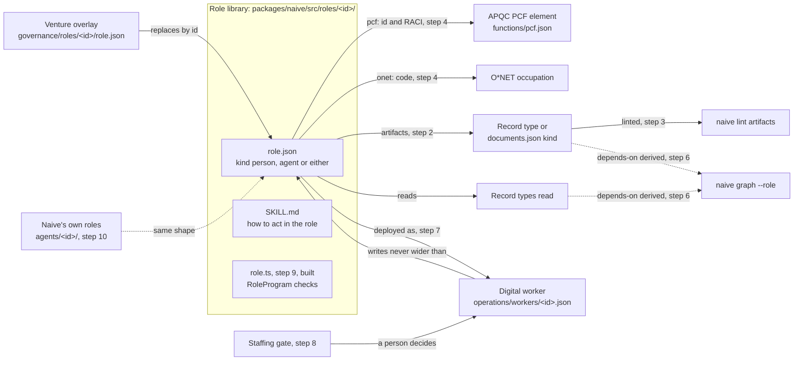
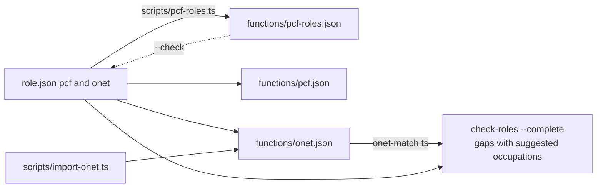
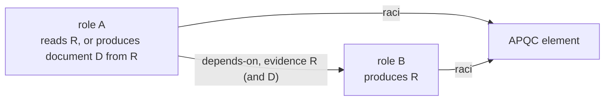

# Roles as agents, linked to the PCF

Date: 2026-11-28. Decisions: EE-229 (step 1), EE-230 (step 2), EE-231 (step 3), EE-232 (step 4), EE-233 (step 5), EE-234 (step 6), EE-235 (step 7), EE-237 (step 9) and EE-238 (step 10) are built; EE-236 and EE-239 (steps 8 and 11) are decided and not built.

## The ask

Torian decided on 2026-11-28 that every role in Naive and in a business becomes one role module in one role library, callable at any time by a lead agent or a person, and that roles link to the elements of APQC's Process Classification Framework, to the artifacts they produce and to the agents deployed as them. Every decision below is settled. This document describes the whole plan and what step 1 built.

## What Naive held before

Roles lived in three shapes, and no one check read them together.

- Fourteen role templates at `packages/naive/template/governance/roles/<id>.json`, governed by `role-template.schema.json`. Delegation, team plans, lead plans and the routing rule read them.
- An agent capability register (`agent-roles.json`) and a venture role register (`venture-roles.json`), with no schema checking their own fields. Decision rights named owners that only the register held (`domain-lead`, `operations-finance-lead`), so no check knew whether those owners were roles.
- Vault-era Markdown role files (`ceo.md`, `cto.md` and others) that no code read.

About ten modules scanned those folders separately, each with its own rules for what a role was.

## Decisions

- **One role library.** Every role is a role module. Person roles (founder, co-founder, board member, advisor, investor kinds, operator) are modules too, with `kind: "person"`, and are never deployed as agents.
- **Merged roles.** A lead agent or a person may merge roles and deploy one agent as the merged role. A merged role carries the union of its parents' PCF elements and artifacts, and its reach is never wider than the lead's portfolio.
- **Temporary roles.** Lead agents may write venture-local temporary roles and spawn agents as them. A temporary role that keeps being used is proposed as an open decision to become durable and enter the library. Only a person accepts that decision; a lead proposes and never accepts.
- **O*NET finds missing roles.** PCF elements a business runs with no responsible role are matched to O*NET occupations to suggest a role.
- **Digital workers.** A running agent is a digital worker, recorded as a deployment at `operations/workers/<id>.json` (route `operations/workers/[id]`) and listed by `naive workers` (`list`, `count`, `history`). They are never called employees.
- **Naive's own roles.** Product manager, architect, requirements engineer, release manager, technical writer and instruction steward live at `agents/<role>/` in this repository, beside `agents/chief-of-staff/`, in the same shape. Naive's rows are built before business rows.
- **SAD's gates become checks.** SAD's gate questions (0A, 0B, 0C, 1A, 1B) become Naive checks over Naive's own records, ending at a new staffing gate. SAD's documents stay out, and EE-036 stands.
- **Artifact lint.** Protocol rules are always errors. Design rules default to warn, every finding is logged, and each design rule is off, warn or error under `artifact_lint.rules` in `naive.config.json`.

## The shape

A role module is a folder. Its `role.json` is a record that `packages/naive/src/records/role.schema.json` governs:

- Required for every role: `id`, `name`, `kind` (`person`, `agent` or `either`) and `description`.
- Required for an agent or either role: `function` (a departments.json id, or `all`), `grantable_classes`, `default_tier`, `lint_suites`, `verified_by` and `skill`.
- For a person role: `person_kind` (builder, investor, operator, advisor or governor), `founder` and `owns_when_solo`.
- Kept from the templates: `aliases`, `portfolio` with `default_measure_kinds` (a lead), `chief_delegator` and `also_verified_by`.
- Optional, for later steps: `status` (`durable` or `temporary`), `merged_from`, `proposed_by` and `created_at`; `onet` (`code`, `title`, `basis`, `by`); `pcf` (`id`, a hierarchy id in `functions/pcf.json`, and `raci`, one of responsible, accountable, consulted or informed); `reads`; `artifacts` (each a `record_type` or a `document_kind`); `standards` (reference ids); `research` (an ordered list of methods from standards, scientific, organizational, practitioner and stakeholder, with `questions`); and `level` (SFIA level 1 to 7).

Depends-on is never typed. Step 6 derives it from one role's `reads` against other roles' `artifacts`.

A deployment (step 7) at `operations/workers/<id>.json` carries `role`, `mode` (temporary or durable), `level`, `sponsor` (a person), `writes` (never wider than the role's or the deployer's reach), `started_at`, `expires`, `status` (proposed, active, suspended or ended, a statechart in pure TypeScript with a Lean model), `deployed_by` and `ended_at`. Specialists (EE-213) migrate into temporary deployments.

## Step 1: one role record (EE-229, built)

- `role.schema.json` replaces `role-template.schema.json` and `venture-role.schema.json`, and both old schemas are deleted. `packages/naive/src/records/types/records.d.ts` has `Role`.
- The library is `packages/naive/src/roles/<id>/`, a `role.json` and a `SKILL.md` per role. It holds 21 roles:
  - Agent roles: architect, builder, chief-of-staff, domain-lead, finance-agent, finance-lead, growth-lead, marketing-lead, people-lead, product-design-lead, product-lead, strategy-lead and validation-lead.
  - Either: counsel.
  - Person roles: founder, co-founder, general-partner, limited-partner, operator, advisor and board-member.
- From the agent capability register, `domain-lead` joined the library, because decision rights name it as the owner of `domain-fact`. `business-lead` was archived, superseded by the four leads (strategy-lead, product-lead, growth-lead and finance-lead), whose portfolios cover the 13 functions. `operations-finance-lead` was archived, superseded by `finance-agent` (EE-123), and decision rights now name `finance-agent` as the owner of `spend-register-upkeep`, `cancel-or-downgrade` and `move-payment-method`.
- The registers' model chains, tiers and conformance notes were read by no code and are archived with them. The tier descriptions moved into the schema's `default_tier` description.
- A venture's own roles live at `<venture>/governance/roles/<id>/role.json` and overlay the library by id. No test or example needed the old flat form, so it is gone.
- The registers, `AGENT_ROLES_AND_DECISION_RIGHTS.md`, `render-roles.py` and the vault-era Markdown role files are archived in `docs/archive/roles-2026-11/`.
- `loadRoles(dir)` in `packages/naive/src/engine/agents/roles.ts` is the one loader. It reads the library and overlays the venture. `knownRoles(dir)` adds `<function>-agent` and `<function>-researcher`, and `isPersonRole` says whether a role is held only by a person. Delegation, team plans, lead plans, lead specs, the routing rule, element owners, the decision queue, detectors, publication, people, the SDLC catalog, the roadmap and venture types all read through it.
- `packages/naive/src/checks/check-roles.ts` checks every role file in the library and a venture's overlay:
  - it is JSON and validates;
  - its id matches its folder;
  - `verified_by` and each `also_verified_by` name a known role and never the role itself;
  - ids and aliases are unique;
  - a person role grants no agent tier.
- `check-roles-test.ts` breaks each rule on a copy. `node test.ts` runs both, and `naive check` runs the check on a venture.

## Step 4: PCF links both ways (EE-232, built)

- `check-roles.ts` checks each role's `pcf` against `functions/pcf.json`: every id a hierarchy id named once per role, at most one accountable role per element across the library and a venture's overlay, and an accountable role in the element's function or a lead whose portfolio covers it. The schema holds the RACI values and the O*NET-SOC code format; the check also looks each `onet[].code` up in the O*NET reference and compares its title.
- `scripts/import-onet.ts <onet db dir> --release <tag>` writes `functions/onet.json` (record type `onet`) from one O*NET text release: occupations by code and title, the detailed work activities, and each occupation's activity links, sorted, with O*NET's CC BY 4.0 attribution. The committed reference is release 31.0: 1,016 occupations, 2,087 activities and 18,583 links. Its test runs on a tiny release written in the test.
- `scripts/pcf-roles.ts` writes `functions/pcf-roles.json` (record type `pcf-roles`) through the pcf-roles generator: each element some role links to, with its roles and their RACI part. The role side is the source; `--check` fails when the element side is stale, and `node test.ts` runs it.
- `check-roles.ts --complete [--level <n>]` fails on each element of levels 1 to 2 (or n) under a function the business runs with no responsible or accountable role, and suggests three O*NET occupations by word overlap between the element's names and each occupation's title and activities (`engine/onet-match.ts`). A suggestion is a lead for a person, never a match.
- The library's links: the four leads are accountable for their portfolio categories; validation-lead, architect, builder, product-design-lead, marketing-lead, people-lead, counsel, finance-agent, chief-of-staff and domain-lead are responsible for their function's category, and for process groups their description plainly covers (2.2, 2.3, 3.2, 7.1, 7.2, 12.4 and 13.5). Six roles name an O*NET occupation their title matches (counsel, finance-lead, marketing-lead, people-lead, builder, architect), each with its basis and who matched it. `--complete` reports 67 of the 74 process groups; every category has an accountable role.

## Step 6: roles in the graph (EE-234, built)

- `packages/naive/src/engine/element-graph.ts` reads the role library and the document catalog. Each role is a node, and so is each document kind a role produces.
- A role's `pcf` links are `raci` edges to elements, naming the RACI part; an element only a role names joins the graph with its ancestors.
- Artifacts resolve through `artifactKind`: a `record_type` is a `produces` edge to a record type, a `document_kind` a `produces` edge to the document kind, and an unknown one is left out. A role's `reads` and a document kind's sources (the record types its sections' `from` paths match) are `reads` edges.
- `depends-on` is derived: role A depends on role B when A reads a record type B produces, or produces a document kind rendered from one. Each edge names the record type and, when there is one, the document kind. A role reading what it produces itself is no dependency, and a cycle is reported, never refused.
- `naive graph --role <id> [--json] [--mermaid]` gives what the role depends on, what depends on it, its elements by RACI part, its artifacts and the library's cycles. Without `--role` the text output is unchanged.
- `naive effects` builds the graph without roles (`effectsGraph`), so no role takes a state.
- In the library only the architect (reads decision-record, produces adr) and the product and design lead (reads goal, produces product-capability) fill `reads` and `artifacts`, and no library role produces what they read, so the shipped graph has 21 role nodes and no `depends-on` edge until step 11 writes the business rows. The graph reads the library only, not Naive's own roles under `agents/`.

## Step 10: rows for Naive (EE-238, built)

- Naive's own roles live at `agents/<id>/`, beside `agents/chief-of-staff/`: a `role.json` against `role.schema.json` and a SKILL.md, the shape of a role module. The chief of staff's folder holds an AGENTS.md and no `role.json`, because its role is in the library; a folder like it is a shipped agent of a library role, and `check-roles.ts` holds its name to one.
- They are a scope of their own. `naiveRoles()` in `packages/naive/src/engine/agents/roles.ts` overlays the library with them for Naive; `loadRoles` and `knownRoles`, which venture checks read, never see them. `check-roles.ts` checks them when no venture is given, and checks a venture with the library alone, since each is its own business.
- One source of truth: a role may name a library role in `extends` and leave out every field it inherits but its aliases. Product-manager extends `product-design-lead` (whose alias product-manager is allowed beside it, since the role with that id extends the alias's owner), and architect extends the library's architect by the same id. Requirements-engineer, release-manager, technical-writer and instruction-steward have no library counterpart and stand alone. The schema asks an agent role with `extends` only for its id, name, kind and description, and `check-roles.ts` validates the merged role.
- Each role is an agent role with PCF links, artifacts, standards (reference ids), research methods and an SFIA level, and is verified by another role:

| Role | PCF | Artifacts | Standards | Verified by |
|---|---|---|---|---|
| product-manager | 2.1.1, 2.1.2 accountable | product-capability, goal | APQC PCF | founder |
| architect | 8.2.3 responsible, 2.3.1.6 consulted | adr, design-document | ISO/IEC/IEEE 42010 | founder, also requirements-engineer |
| requirements-engineer | 2.3.1.6 accountable, 2.3.1.3 responsible | requirement, requirements-spec | ISO/IEC/IEEE 29148 | product-manager, also architect |
| release-manager | 8.6.3 accountable, 8.6.5 responsible | release | ISO/IEC/IEEE 12207 | product-manager, also founder |
| technical-writer | 13.6.5 accountable, 13.6.6 responsible | docs-page, release-note, changelog-entry | ISO/IEC/IEEE 26514 | product-manager, also release-manager |
| instruction-steward | 13.6.4 accountable, 8.1.5.3 responsible | decision-record | ISO/IEC/IEEE 26514 | founder |

- O*NET: requirements-engineer is 15-1211.00 Computer Systems Analysts and technical-writer 27-3042.00 Technical Writers; architect inherits 15-1299.08 from the library. No occupation in O*NET 31.0 fits the product manager, the release manager or the instruction steward closely enough, so they name none.
- The release manager holds the release's facts (the `release` record type) and the technical writer writes the pages. `documents.json` gains `docs-page`, a page of the docs site that reads a capability's summary, status and requirements and the decisions behind it, with holes for how to use it and what changed when, styled by the brand's name, voice, fonts, typefaces, colors and marks and the design system's components, and climbing to the live site. A kind's new `made_by` names the one role that may list it: `docs-page`, `release-note` and `changelog-entry` name technical-writer, and `check-roles.ts` fails when another role names one, or when technical-writer is in scope and leaves one out.
- The instruction steward is memoryless and reads only the codebase. It may propose deleting a stale instruction as a decision record and never deletes one without a person. Whether stale instructions may be deleted, and by whom, is not decided.
- `check-roles.ts` also checks, for every scope, that each artifact is a record type or a document kind (EE-230) and each standard is a reference id. The references for ISO/IEC/IEEE 29148, 26514 and 12207 were added with method `standards`.
- `functions/pcf-roles.json` keeps the library's links only: `agents/` is not in the package's `files`, and the file is the map a venture reads.

## Steps 2 to 11 (steps 2 to 7, 9 and 10 built, the rest not built)

Each step is one pull request with its decision id assigned.

2. **EE-230 Artifact types.** Every role artifact is a record type or a documents.json kind, and new kinds join documents.json. Each kind names the brand fields it uses (`marketing/brand`, `marketing/design-system`). Harness adapters gain an `artifacts` list: what the harness can produce, its format and its skill.
3. **EE-231 Artifact lint.** `naive lint artifacts`: protocol rules are errors, and design rules warn unless configured. Findings are logged to `.naive/lint-findings.jsonl`, and `naive lint report` groups them by rule, role and harness.
4. **EE-232 PCF links both ways.** The `pcf` and `onet` fields are filled. `scripts/import-onet.ts` imports O*NET, a generated `functions/pcf-roles.json` maps each element to its roles with `--check`, and `check-roles --complete` fails on a gap.
5. **EE-233 Research methods.** The method enum: references record their method, and the find-reference and research skills take a method.
6. **EE-234 Roles in the graph.** `naive graph` gains role nodes and the derived depends-on edges, and `naive graph --role`.
7. **EE-235 Digital workers (built).** The deployment record, its statechart with a Lean model, and `naive workers`. Specialists are migrated, leads write temporary roles and merges, and promotion is proposed as a decision only a person accepts. Built in `packages/naive/src/engine/agents/workers.ts`, `packages/naive/src/engine/agents/worker-state.ts` and `packages/naive/lean/Naive/Workers.lean`; see `packages/naive/src/engine/agents/README.md` for the statechart. A worker goes active only when a person activates it, which is the hook step 8 uses.
8. **EE-236 Staffing gate.** SAD's gate questions run as checks. After 1B a lead drafts a staffing plan from the specs as one decision with EE-211 candidates. Deployments go active only once a person decides, and the gate fails closed (EE-217).
9. **EE-237 Role programs on Effect (built).** The `RoleProgram` interface and `naive role check <role>`, which run deterministic checks of a role's artifacts. See the step 9 section below.
10. **EE-238 Rows for Naive (built, above).** `agents/<role>/` for the six Naive roles.
11. **EE-239 and after: rows for businesses.** One function per pull request. The first cut is one role per PCF level 2 process group (74), named after its best O*NET match.

## Step 9: role programs (EE-237, built)

- `packages/naive/src/checks/role-program.ts` defines `RoleProgram` (`id`, `checks`), `RoleCheck` (`id`, `description`, `run(ctx)`, an Effect over `VentureFs` that fails only with the tagged errors in `packages/naive/src/core/effect/errors.ts`) and `RoleFinding` (rule, family protocol or design, severity, message, artifact, kind).
- Every role has the default program derived from its `role.json`: `artifact-types` (artifactKind on each artifact, and `lintArtifact` on each venture artifact record of a kind the role names), `reads` and `lint-suites`.
- A library role adds checks in `role.ts` beside `role.json`. They run after the default checks and may not reuse a default id. The architect's requires every `adr` artifact to be built from a decision record the venture has, and the product and design lead's requires each live or building capability to name goals the venture holds.
- A venture's `role.ts` is never loaded: the venture folder is data agents write and sync copies. `check-roles.ts` fails on one, and holds each library `role.ts` to a valid program for its role.
- `naive role check <role> | --all [--venture <dir>] [--json]` runs the programs, appends every finding to `.naive/lint-findings.jsonl` with lint `role`, and exits 1 on any error.
- The module sits in `packages/naive/src/checks/`, not `engine/agents/`, because it builds on the artifact lint and the engine never imports a check.

## Not built

- Everything in steps 8 and 11. The step 1 schema holds their optional fields, which every library role leaves empty except `pcf` and `onet` (step 4) and the `reads` and `artifacts` of the architect and the product and design lead (step 9); Naive's own roles under `agents/` fill them (step 10).
- Vault wikilinks to the archived `roles/ceo` and `roles/cto` remain in a few skills and the venture template's `index.md` and `pillars/product.md`. They pointed at vault paths that were already broken, and are left for the step that writes those rows.
