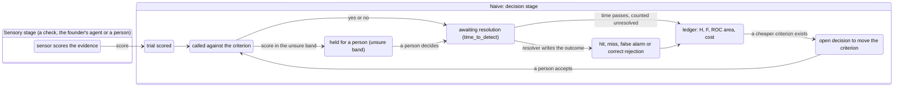

# Signal detection in Naive

Designed, not built.

## The ask

Torian, 2026-11-07 at 03:20Z: "I want to research and design signal detection theory more deeply into naive. I think we're still developing deeper distinction between naive and Mentura." Then, at 03:31Z: "Let's actually just ignore Mentura and focus on naive. ... If someone installed naive and created a venture they should have these capabilities. They would just need a file system." So everything here works with Naive and a folder, and nothing depends on another product or a database.

## The design in one paragraph

Naive already makes many yes or no calls on uncertain evidence: the gate holds a write whose confidence is below 0.7, feedback routing accepts a model's answer at 0.95, a model step answers or goes to a person, a standing rule is earned by a Wilson bound and lost by an SPRT. Each threshold was picked by hand, none of them comes from what a mistake costs or how often the thing is true, and none of them records whether the call turned out right. Signal detection theory (Green and Swets 1966) says every such call has two separate parts: how well the evidence separates true from false (sensitivity), and where the line is drawn (the criterion). The criterion should come from the costs of the four outcomes and the base rate. Sensitivity can only be measured from resolved outcomes. This design gives each call a **detector** record that names its evidence, its criterion and who resolves it; derives the criterion from the impact tier's costs and a stated base rate; and keeps a **detection ledger** of each call and its later resolution, from which Naive computes hit rate, false alarm rate, sensitivity and ROC area with no model. A person sets the costs and accepts any criterion change. All of it is files in the venture.

## Signal detection theory, briefly

An observer sees evidence and must say yes (the thing is there) or no. The world then shows whether it was there. That gives four outcomes:

| | It was there (signal) | It was not (noise) |
|---|---|---|
| Said yes | hit | false alarm |
| Said no | miss | correct rejection |

- **Sensitivity** is how far apart the evidence lies under signal and under noise. Under the equal-variance Gaussian model it is `d' = z(H) - z(F)`, from the hit rate H and false alarm rate F. Without a distributional assumption it is the area under the ROC curve, which equals the proportion correct an unbiased observer would get choosing between one signal and one noise trial (Green and Swets 1966; Macmillan and Creelman 2004). The common shortcut A' is not actually assumption-free (Macmillan and Creelman 1996), so this design uses the full ROC area from rating data.
- **The criterion** is where the observer draws the line. Moving it trades hits for false alarms along the ROC curve and changes nothing about sensitivity. It can be stated as `c = -(z(H) + z(F)) / 2` or as `beta`, the likelihood ratio at the line.
- **The optimal criterion** maximizes expected value. Say yes when the likelihood ratio of the evidence is at least

  `beta* = (P(noise) / P(signal)) * (V(correct rejection) + C(false alarm)) / (V(hit) + C(miss))`

  So a rare signal moves the line up, and a costly miss moves it down. The two effects add in log terms. People's criteria are pulled toward the neutral point and stay there, less so when payoffs differ than when base rates differ (Green and Swets 1966; Landy, MODVIS 2025). That is the case for writing the criterion down instead of leaving it to judgment.
- **Rating scales.** An observer who gives a graded answer instead of yes or no holds several criteria at once. Two criteria with a band between them give a three-way call: yes, no, or not sure. Each criterion is one point on the ROC curve, so a rating history traces the whole curve.
- **Sequential sampling.** When evidence arrives over time, Wald's sequential probability ratio test adds log likelihood ratios until the sum crosses an upper or lower boundary. It is signal detection with the criterion applied to accumulated evidence, and its boundaries come from the error rates allowed. The drift diffusion model is its continuous form (Griffith, Baker and Lepora 2021).
- **Several observers.** Independent evidence combines by adding log likelihood ratios, and for independent equal observers sensitivity grows with the square root of their number. That only holds when each score is calibrated as a likelihood ratio. A raw confidence number from a model is not one.

## Where Naive already decides on evidence

| Call | Where | Evidence | Line today | How chosen | Records whether it was right |
|---|---|---|---|---|---|
| Hold a write for a person | `engine/gate.mjs`, `confidence_below` | the write's `provenance.confidence` | 0.7 (`thresholds.confidence`) | by hand | no |
| Accept a routed feedback item | `engine/feedback-route.mjs` | Jev's confidence | 0.95 (`ACCEPT`) | by hand | no |
| Answer a model step or send it to a person | `router/orchestration/model-steps.mjs`, `judgment.schema.json` | the model's confidence | per step `threshold` | by hand | partly: `overruled` when code disagrees |
| A Noul judgment is yes, no or unsure | `operating-rules.json` `jev` | Noul's score | yes at 0.7, no at 0.3 | by hand, record-only | no |
| Tag an idea from a System 1 answer | `idea-map/conventions.json` | the model's score | the framework's `threshold` | by hand | no |
| Recommend Validation | `checks/check-validation.mjs` | graded evidence score V | `W.threshold` | by hand | no |
| Write a note on a decision | `engine/decision-index.mjs` | impact score | 0.25 (`THRESHOLD`) | by hand | no |
| Earn a standing rule | `operating-rules.json` `questions.standing` | founder agreement history | Wilson lower bound 0.8 or 0.9 | by hand, bars proved in Lean | yes: the answer history |
| Lose a standing rule | `operating-rules.json` `questions.loss` | recent overrides and corrections | SPRT, p0 0.05, p1 0.3, alpha and beta 0.05 | by hand, boundaries proved in Lean | yes: `signals.against` |
| A listener hears a signal (signal library design) | everything-ecosystem `docs/design/SIGNAL_LIBRARY_2026-11-06.md` | the signal's props and rating | the listener's criterion | not yet built | not yet built |

Three things stand out. Every line is a constant picked by hand. Only standing rules keep the outcomes needed to know whether the line is in the right place. And the impact tiers in `operating-rules.json` (`severity`, `reversibility`, `time_to_detect`, `blast_radius`) already describe what a mistake costs, but no threshold reads them.

## Shape

### The detector

A detector is a record, one per call site and question type, at `<venture>/governance/detectors/<id>.json` (owned by governance, because it says how decisions are made). It names:

- `question`: the yes or no question, with its verb, noun and asking function, as in the question type of `operating-rules.json`.
- `evidence`: the sensor that scores it (a model step, a Jev judgment, a check, a listener) and the scale of the score. A sensor is named, never run, by the detector.
- `criterion`: one number on that scale, or two for a yes, unsure and no band. Each is either set by a person or derived (below).
- `costs`: the values of the four outcomes, by default taken from the question type's impact tier, overridable by a person.
- `base_rate`: how often the answer is yes, stated by a person or computed from the ledger once it has enough resolved trials.
- `resolution`: who settles the truth (a person, a later record, a producer) and the `time_to_detect` after which an unresolved call counts as unresolved rather than right.

The existing thresholds become detectors with their current constants as set criteria, so nothing changes behavior on the day it lands.

### The criterion rule

A derived criterion is the `beta*` formula above, turned into a score through the sensor's calibration. Until a sensor is calibrated, a score is not a likelihood ratio, so a derived criterion cannot be computed from the formula alone. In that case Naive reads the ledger: it picks the score at which the empirical cost of hits, misses, false alarms and correct rejections is lowest, using the stated costs. With too few resolved trials it keeps the set criterion and says so.

Naive never moves a live criterion by itself. A better criterion is written as an open decision ("lower the gate's confidence line from 0.7 to 0.62: at today's costs it saves an estimated 9 false alarms for 1 more miss per 100 writes"), and a person accepts it, as for any other decision. This follows the rule that owners are always people, and agents only propose.

### The detection ledger

Every call appends one trial to `<venture>/governance/detectors/<id>.trials.jsonl`, through the router, hash-chained like `provenance.jsonl`: the score, the criterion in force, the call, and the provenance line of the write it judged. Resolution is a later line that names the trial and the outcome, written by whoever the detector names. Overrides and corrections from `operating-rules.json` `signals` are resolutions: a person accepting a held draft resolves a false alarm, and a person reverting an accepted write resolves a miss. Silence stays no data, as that file already says.

From the ledger Naive computes, per detector: hit rate and false alarm rate with Wilson intervals, `d'` and `c` where the Gaussian model is asked for, the empirical ROC curve from the scores, its area, and the expected cost at the current criterion and at the best one. `node packages/naive/src/checks/check-detectors.ts <venture dir>` reports them and fails only on structure (a detector naming a sensor or resolver that does not exist, a ledger whose chain breaks), never on a number.

### Sequential and multiple evidence

The standing rule's floored SPRT is already a sequential detector: its statistic is accumulated evidence and its suspend line is a criterion fixed by alpha and beta. It becomes the first detector with `evidence.kind: "sequential"`, and the Lean proofs in `StandingRules.lean` stay its proofs.

Two sensors on one question combine only when both are calibrated, by adding log likelihood ratios. Otherwise each stays its own detector and a person decides which governs.

### What it does not do

It runs no model, makes no network call and reads no other venture. It does not change any line without a person's acceptance. It does not score people. Detectors judge calls, and the founder's own answers are resolutions, not trials.

## How it fits the signal library

In the signal library design, a listener's criterion sorts a heard signal into salient or noise. Under this design a listener is a detector whose evidence is the signal's props and rating. One correction follows: a signal below the criterion is a "no" call, not noise. It is noise only if it later resolves as a correct rejection. If it resolves as something that mattered, it was a miss. That is how a listener's line gets better instead of only being set.

## On a filesystem install

A founder who installs Naive and creates a venture gets all of this. Detectors are JSON records, the ledger is a JSONL file beside them, and the math is a pure module. Nothing needs an account, a network or a database.

Signal detection theory splits a call into a sensory stage, which turns the world into a score, and a decision stage, which turns the score into a call. Naive always runs the decision stage. In a plain install the sensors are the ones the venture already has:

| Sensor | Example | Score |
|---|---|---|
| A deterministic check | `check-validation.mjs`, `premise-lint.mjs`, `decision-index.mjs` | the number the check already computes |
| The founder's own agent | the answers file a model step reads (`model-steps.mjs run --answers <file>`, written by Claude Code, Cursor or Codex) | the confidence in that answer |
| A person | a founder or teammate rating a draft on a scale | the rating |
| Accumulated outcomes | the standing rule's override history | the SPRT statistic |

So the rule is that Naive never produces a score itself, but it does not need anything outside the venture to get one. A detector names its sensor, and the ledger measures that sensor's sensitivity from the venture's own resolved trials.

### Does a database unlock more?

Not for one venture. The detection ledger is append-only and hash-chained, which a JSONL file does exactly; at a founder's volume (hundreds or thousands of trials a year) reading the whole file to compute rates is instant. A database adds three things, none of which this design needs:

- Many writers at once. One founder and their agents write through one router, which already serializes writes.
- Queries across many ventures. The design learns only from a venture's own trials.
- Hosting the ledger for people who are not on the founder's machine. That is a question of where the folder lives, not of what Naive can do.

A Postgres store is a connector behind the same router (the store contract), so a venture that keeps its records in one gets the same detectors and ledger with no change to this design.

## Nouns for the term engine

Proposed, not admitted. Each goes through `packages/naive/src/terms/` with theorems in a new `packages/naive/lean/Naive/Detection.lean`.

| Candidate | Draft meaning | Standard |
|---|---|---|
| detector | The record of one yes or no call on evidence: its question, sensor, criterion, costs, base rate and resolver | Green and Swets 1966 (the observer) |
| sensor | What turns the world into a score for a detector; a check, the founder's own agent, or a person; named by the detector, never run by it | Green and Swets 1966 (the sensory process) |
| criterion | The line on the score scale above which the call is yes | Green and Swets 1966 |
| sensitivity | How well a sensor's scores separate yes from no cases, as ROC area or `d'` | Green and Swets 1966; Macmillan and Creelman 2004 |
| hit, miss, false alarm, correct rejection | The four outcomes of a resolved call | Green and Swets 1966 |
| base rate | How often the true answer is yes | Kahneman and Tversky 1973 |
| trial | One call and, later, its resolution | psychophysics |
| ROC curve | Hit rate against false alarm rate as the criterion moves | Peterson, Birdsall and Fox 1954 |

"Criterion" was already proposed by the signal library design, with the same meaning. "Noise" keeps its standard meaning (the no case), so the signal library's use of it as "below the line" changes as described above.

Proposed theorems: the optimal criterion rises with the noise base rate and with false alarm cost, and falls with miss cost (`criterion_monotone`); moving the criterion up never raises the hit rate or the false alarm rate (`roc_monotone`); ROC area equals two-alternative proportion correct on the same scores (`auc_eq_2afc`); the empirical best criterion on a ledger is one of its observed scores (`best_criterion_observed`).

## Build plan

All in Naive, one item per pull request.

| # | Item | Verifier |
|---|---|---|
| 1 | Propose the nouns; prove the four theorems | `admit.ts --check`, the Lean job |
| 2 | `detector.schema.json` and the trial line schema; the data model entries | `validate.py`, `record-types.ts --check` |
| 3 | Pure `engine/detection.ts`: rates, intervals, `d'`, `c`, ROC area, expected cost, best criterion | cases from Macmillan and Creelman's worked examples |
| 4 | Ledger writes through the router; resolutions from overrides and corrections | a held draft accepted resolves a false alarm; a reverted write resolves a miss |
| 5 | The current thresholds become detectors with their constants as set criteria | every existing test passes unchanged |
| 6 | `check-detectors.ts` and the criterion proposal as an open decision | breaks on copies; a proposal is filed once and left as decided |

## Open questions

- Default costs per impact tier: the tiers say a one way door is worse than a low question, but not by how much. Torian sets the first numbers, or they start equal and only the base rate moves the line.
- Whether a detector belongs to governance (how decisions are made) or to the function that asks the question.
- How many resolved trials before Naive proposes a criterion change. A Wilson interval on the cost difference is one answer.
- Whether the gate's existing `confidence` scores, which come from whatever agent wrote the record, are trusted as they are until the ledger has measured that agent, or ignored until then.
