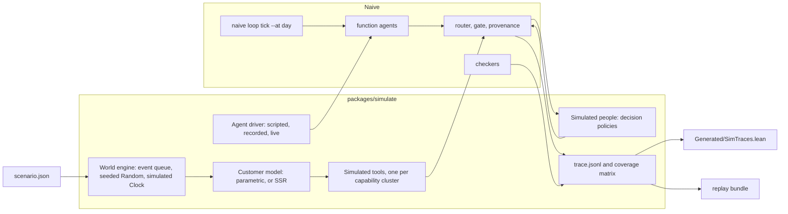
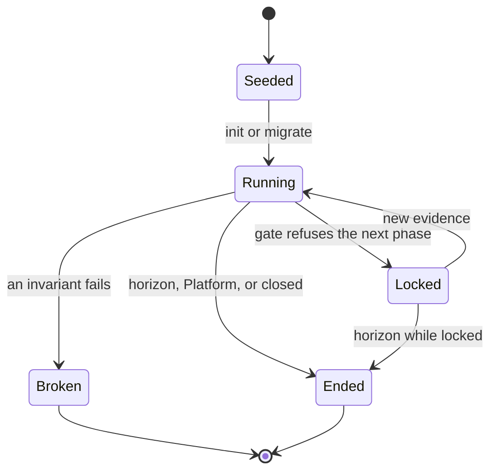

# Simulating businesses end to end

Date: 2026-11-26. Decisions: EE-223, EE-227. Status: step 2 is built: one clock, `packages/naive/src/core/clock.ts` (EE-227). The rest is design.

## The ask

Torian, 2026-11-26: attack the premise of starting with solo founders. Simulate running businesses on the platform, existing businesses as well as solo founders, from end to end and over long horizons. Verify formally that the process works across all functions, all phases and several tools. Later, build a demo from the simulations so a visitor can see what operating a business on it is like.

## The premise

"Start with solo founders" mixes two choices. Who pays first stays as decided (the validation goal is three paying outsiders from one profile). What Naive must work for is wider. A business in Discovery uses a few functions, almost no tools and little money, so testing only there leaves ten of the 13 functions and four of the five phases unrun; only the Discovery gate has items in `packages/naive/src/phases/gate-policies.json`. Existing businesses arrive with books, a CRM, staff and customers, which is where onboarding (`naive migrate`, `naive port`), the source-of-truth matrix and connections meet real shapes of data. The simulations test the spread; the runs then inform whether the second profile, service-business owners, is reachable.

## What is reused

No open simulator covers every function across the lifecycle phases, and each one below is Python, so designs are taken and rewritten in TypeScript, never vendored.

| Source | Licence | Taken |
|---|---|---|
| YC-Bench (github.com/collinear-ai/yc-bench, arXiv 2604.01212) | MIT, declared in `pyproject.toml`, no LICENSE file | The discrete-event engine pattern: jump to the next event, ordered ties, work in working hours, seeded worlds, adversarial counterparties |
| CEO-Bench (github.com/zlab-princeton/ceobench-src, arXiv 2606.18543) | None found; all rights reserved | Ideas from the paper only: hidden world state, reacting competitors, economic churn rules |
| Semantic similarity rating (arXiv 2510.08338, github.com/pymc-labs/semantic-similarity-rating) | Apache-2.0 | The method, as an optional customer model for interviews and purchase intent |
| tau-bench, TheAgentCompany, Magentic Marketplace | MIT | Simulated users, many tools as one workplace, two-sided markets |
| CRMArena | CC BY-NC 4.0 | Nothing |

## Domain

| Term | Meaning |
|---|---|
| World | The ground truth of one simulation: market segments, synthetic customers, competitors, prices and costs, suppliers, scheduled shocks. The business never reads it directly. |
| Business | A Naive business folder created by `init-venture` or onboarded by `naive migrate`. It knows only what its tools and signals tell it. |
| Tool | A simulated outside system (CRM, payments, ledger, email, calendar, code host, ads, help desk, e-signature, analytics) speaking the interface a real connection speaks (`it/connections`). |
| Actor | A simulated person with a persona and a written decision policy, or a Naive function agent. Only simulated people decide. |
| Scenario | A seed business, its world, shocks and horizon, from one random seed. |
| Run | A scenario played day by day. Same seed and same agent recordings give the same run. |
| Trace | Every event of a run in order. |
| Coverage cell | One function, in one phase, through one capability cluster. |

Rules:

1. Partial sight: the business sees the world only through tools and signals.
2. Synthetic stays synthetic: every simulated record carries the `synthetic-record` label (EE-198). Only a simulation flag, refused outside a simulation folder, lets a gate grade synthetic evidence.
3. People decide one-way doors and decisions, as in real Naive.
4. Some businesses should fail: each scenario has failing branches, and a failing branch that Naive locks out counts as a pass.
5. Seeds are invented. No real business, and none of Torian's.

Seeds:

| Seed | Starts as | Phases | Horizon |
|---|---|---|---|
| A | A solo founder: scheduling software for small physical-therapy clinics in Texas | Discovery to Beachhead | 18 months |
| B | A six-year-old bookkeeping firm, 14 staff, about 400 clients, with a ledger, CRM and help desk | Joins at Beachhead, aims for Scale | 24 months |
| C | Two cofounders making a home espresso grinder, later a parts marketplace | Discovery to Platform | 7 years |

## System

`packages/simulate/` in this repository, outside the package's `files`, so it never ships. It imports Naive as an app does. Nothing in Naive imports it. TypeScript on Effect; nothing from LangChain.

One simulated day: the world fires its events; tools turn them into what a business sees; `naive loop tick --at <day>` starts due workflows and agents act through the router; simulated people answer waiting decisions; the checkers run and the day goes into the trace.

`Broken` is a bug and stops the run. `Locked` is the gate working.

Gaps in Naive: one Effect `Clock` every module reads (set by `NAIVE_NOW`), and the simulation flag.

## Verification

1. Proved for every business, in `packages/naive/lean/Naive/Lifecycle.lean`: no phase change without the gate's fail-closed items or a person's override; phases in order; people decide one-way doors; locks hold until prerequisites are done; synthetic records count for nothing outside a simulation; every live record has a provenance line; every gate is satisfiable; every function a phase lists as active has a workflow that can run there.
2. Checked on every run: Naive's checkers each simulated day, and each finished run exported to `packages/naive/lean/Naive/Generated/SimTraces.lean`, checked by `lake build` as legal transitions of the model.
3. Measured across runs: the coverage matrix (13 functions by 5 phases by 6 capability clusters). A run set passes with no `Broken` run, every failing branch locked or closed, every healthy branch at its target, and every active cell exercised or named.

None of this shows synthetic customers behave like real ones, or that a business on Naive succeeds.

## Demo

Later, in Mentura's site: replays of exported runs, text approved by Torian first, every screen saying the businesses are simulated, and no mention of Naive or internal terms.

## Plan

| Step | Pull request |
|---|---|
| 1 | This design and EE-223 |
| 2 | One clock (`NAIVE_NOW`) |
| 3 | `packages/simulate/` skeleton: scenario schema, world engine, day loop, trace |
| 4 | Simulated tools per capability cluster |
| 5 | Simulation flag, simulated people, parametric customer model; seed A |
| 6 | Seeds B and C, failing branches, coverage matrix |
| 7 | Live and recorded agents through `NAIVE_AGENT_CMD` |
| 8 | `Lifecycle.lean` |
| 9 | Trace export to `Generated/SimTraces.lean` |
| 10 | SSR customer model |
| 11 | Replay bundle, then demo text for approval |
