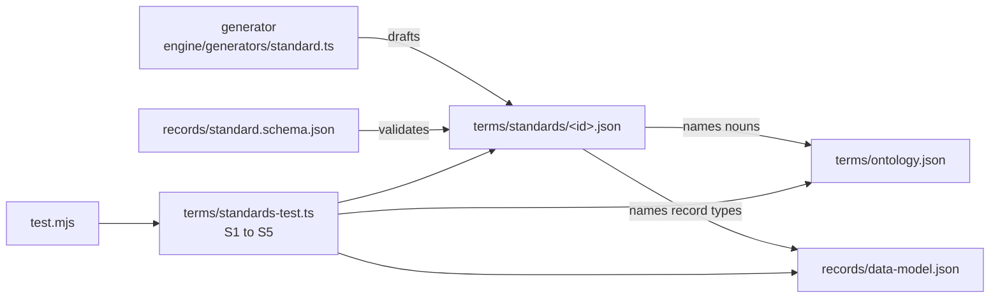

# Catalog of outside standards

## Goal

Torian asked where the citations and the catalog of standards we use are kept, and chose to keep them in Naive now and move them with the shared kernel later (EE-124). The goal is one place that says, for each outside standard, what we take from it, whether we adopted it, map to it, are considering it or rejected it, which of our nouns and record types rest on it, and where it falls short. Those gaps are where our own design goes further.

## Two shapes

1. One file, `standards.json`, an array of every standard. Easy to read whole. Every addition edits the same file, and a check has to point at an index inside it.
2. One file per standard, `standards/<id>.json`, with the id as the file name. Each record has one owner and one place to change, a generator can refuse an id that exists, and a check names the file that is wrong.

The second shape is chosen. It matches how Naive keeps every other record type (one record per file under a path pattern in `data-model.json`).

## Design

A standard's status is a closed set, because each value means something different for the records:

- adopted: we use its terms as our own;
- mapped: our terms map onto it under our own names;
- considered: planned or looked at, and nothing uses it yet;
- rejected: looked at and not used.

`standards-test.ts` checks what the schema cannot, across files: the id is the file name (S1), every noun named is live in the ontology (S2), every record type named is in the data model (S3), an adopted or mapped standard names at least one user (S4), and a standard not confirmed at its url says why (S5). It fails closed on a file it cannot read.

## Principles and the choice each changed

- Model the domain: status is an enum with a meaning per value, and S4 makes adopted and mapped carry a user, so a status cannot claim use that does not exist. This is why DDD is listed as considered, not adopted: it names the shared kernel, but no noun or record type uses it yet.
- Laziness protocol: a noun's `standard` field in `ontology.json` stays free text for now. Turning it into a catalog id touches 149 nouns and is its own pull request.
- Build the lever: a generator (`standard.ts`) drafts a valid record and refuses an existing id, so adding a standard is one command instead of hand-written JSON.
- Prove it works: the test breaks each rule on a temporary copy before it checks the repository, and `node test.mjs` runs it on every pull request.

## What the catalog holds now

Ten standards: BFO (adopted), PROV-O and Schema.org (mapped), and DDD, ISO/IEC 21838-1, gUFO, IOF, SysML v2, IFC and GS1 (considered). DDD's Shared Kernel pattern names the Everything Ecosystem's shared layer: an explicitly bounded part of the model, code included, that the frameworks agree to share and keep small. It holds mechanisms (schema, term engine, checks), and each framework holds its contents.

## Not built

- Nouns' `standard` field is not yet a catalog id.
- `ontology-catalog.json` does not yet list these standards in its `imports`.
- Reference records do not yet point at the standard they cite.
- The catalog moves with the shared kernel when that is lifted out of Naive; the move is not decided.
