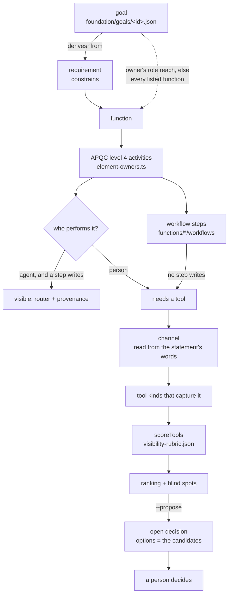

# Tool recommendations that favour visibility and ownership (EE-222)

2026-11-26. Design for `naive tools recommend`, the visibility rubric and the blind spot.

## The problem

Torian wants agents to be hyper-vigilant that the tools a venture uses give the agents and the
system visibility over every activity, and to favour owning the tooling. Today Naive can say which
tools a function needs (`packages/naive/src/functions/tools.json`), which activities it performs
(`packages/naive/src/functions/activities.json`, `packages/naive/src/functions/pcf.json`) and who
performs each (`packages/naive/src/engine/element-owners.ts`). It cannot say whether anything would
see the activity happen.

The asymmetry that makes this worth a rubric: an agent's work is visible by construction, because
every write goes through the router and appends to `provenance.jsonl` (EE-031). A person's work is
visible only as far as some tool captures it. So the activities at risk are the ones a person
performs or approves, and the ones no workflow step writes a record for.

## What is decided

A visibility rubric as data, a pure scorer, and one command that reads a goal and reports the
activities it needs to be visible, the tool kinds that cover them, how each scores, and the blind
spots. A score decides nothing; `--propose` files an open decision for a person.

### Where the recommendation lands

A Discovery venture can write a decision record (`decisions/<id>.decision.json`, the `decisions`
tool, phase discovery). It cannot write a connection record usefully, because `it/connections`
starts at Validation and describes a connection the venture already has, not a recommendation. So
the open decision **is** the record: it carries the ranking and the blind spots in its note and
every candidate as an option, so the choice stays open until a person makes it, and a person can
withdraw it (`mentura withdraw`, EE-185). No new record type is added: a second home for the same
question would be a second thing to keep true.

### The visibility gap, as a state

An activity's gap is read from the venture's own records, not from a tool:

| Gap | When | What it means |
| --- | --- | --- |
| `no-record` | no workflow step performs it, or every step that does writes nothing | the blind spot: nothing in the venture says it happened |
| `outcome-only` | a step performs it and writes a route, and a person performs the activity | the result lands; what was said or done does not |
| `visible` | a step performs it and writes a route, and an agent performs it | the router and provenance see it |

### The channel

What must capture an activity depends on how it is performed. The rubric names five channels and a
default, each with the tool kinds that cover it. A channel is told from the words of the activity's
statement or of APQC's name for it, the same way an activity's kind is (EE-179): the first word is
its verb and the rest are its terms. That is an unvalidated prior, and it can be wrong, because it
reads words and nothing else.

### The criteria

Five criteria, weights summing to 1 as unvalidated priors a venture overrides under `visibility` in
`naive.config.json`: `activity-record` (0.3), `ownership` (0.25), `export-and-api` (0.2), `events`
(0.15), `consent-and-retention` (0.1, a gate). Visibility carries 0.65 and ownership 0.25, which is
the opinion Torian asked for, written as data so it can be argued with. A 0 on `activity-record` is
not a gate: it is flagged as a blind spot, and only a person rules a candidate out.

## The shape

## What is not built

- No measure-to-activity link. A goal's measures are reported, and a goal with none is named as
  unmeasurable, but nothing derives which activity feeds which measure: no record says it.
- No venture-level override of the channels or the tool kinds. Only the weights and the must-haves
  are a venture's, under `visibility` in `naive.config.json`.
- No scoring of a named vendor. Naive names no vendor in code, and the rubric scores tool kinds.
- Nothing enforces a recommendation. The gate does not refuse a connection that scores badly.
