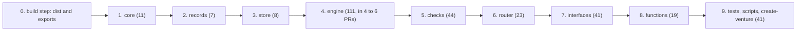
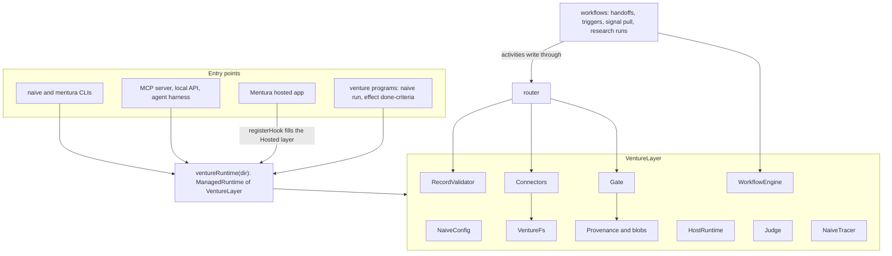

# TypeScript everywhere and ventures that run on Effect

Date: 2026-11-22. Status: proposed. Nothing in this document is built except the audit script results it reports, the Effect pieces already on main (EE-125, EE-126), the Node floor (EE-158), step 0, the build step (EE-159), and phase 2, the venture runtime with VentureFs as its only service (EE-161). Step 0 was built as a mirror: `scripts/build.ts` writes `dist/` with every shipped file at its own path, code compiled and the rest copied, so no module had to change how it finds its files (point 5 below). It emits no declarations: each export's `types` condition names the source file, which the package still ships.

## Goal

Two things, asked for together. First, every code file in Naive is TypeScript. Second, Naive does not only use Effect to build itself: every venture instance runs on Effect, with Naive's runtime installed in it.

## Part 1: the TypeScript audit

The audit counted every code file in the repository (`.ts`, `.mjs`, `.js`, `.cjs`), excluding `node_modules`, generated `.d.ts` files and example venture data.

| Unit | Code files | .ts | .mjs or .js | Lines not TS | Use node:fs directly | Spawn processes | Use Effect |
|---|---|---|---|---|---|---|---|
| src/engine | 202 | 91 | 111 | 13,740 | 130 | 45 | 9 |
| src/checks | 69 | 25 | 44 | 5,524 | 63 | 22 | 6 |
| src/interfaces | 57 | 16 | 41 | 7,447 | 51 | 46 | 0 |
| packages/naive/test | 35 | 0 | 35 | 4,821 | 13 | 10 | 0 |
| src/router | 29 | 6 | 23 | 5,361 | 23 | 8 | 0 |
| src/functions | 22 | 3 | 19 | 2,672 | 22 | 9 | 1 |
| src/terms | 18 | 18 | 0 | 0 | 13 | 8 | 0 |
| src/core | 14 | 3 | 11 | 1,302 | 5 | 3 | 7 |
| src/records | 12 | 5 | 7 | 936 | 8 | 2 | 0 |
| src/store | 9 | 1 | 8 | 1,045 | 2 | 2 | 5 |
| scripts | 4 | 2 | 2 | 706 | 4 | 2 | 0 |
| packages/create-venture | 2 | 0 | 2 | 651 | 2 | 2 | 0 |
| root files and small folders | 6 | 0 | 6 | 527 | 3 | 1 | 2 |
| **all** | **479** | **170** | **309** | **44,732** | **339** | **160** | **30** |

So 309 files and about 44,700 lines are still JavaScript. Only the term engine is fully TypeScript. 339 files touch the file system directly and 160 start processes, and only 30 use Effect.

### Why the migration stalled

Node strips TypeScript types from `.ts` files, but not from files under `node_modules`. A venture installs Naive into `node_modules`, so any module a venture imports, or that `create-venture` and `init-venture` run from an installed copy, must stay JavaScript. The audit traced imports from the entry points a venture reaches (the router, `init-venture`, the `naive` and `mentura` CLIs, the MCP server and `create-venture`). 61 files are reachable that way, and 60 of them are JavaScript: 26 in engine, 14 in router, 7 in interfaces, 6 in core, 4 in records, 2 in store.

That is why new work kept adding `.mjs` files. It is a real limit, but the answer is not to keep writing JavaScript. The answer is a build step.

### The fix: compile on publish

Naive keeps all source as `.ts` and publishes compiled JavaScript, which was always phase 4 of the migration in AGENTS.md. This proposal moves phase 4 first, because it removes the reason for every new `.mjs`.

1. Add `tsconfig.build.json` that emits JavaScript and declarations to `dist/`, with `rewriteRelativeImportExtensions` so `import "./x.ts"` becomes `import "./x.js"` in the output (TypeScript 5.7 and later; the repository pins 5.9.3).
2. Point the package `exports` at `dist/` and add a `prepare` script, so a git dependency builds on install and a registry package ships built files.
3. Inside the repository, tests and CLIs keep running the `.ts` source directly under Node's type stripping, so the development loop does not change.
4. The packed-install test (which installs Naive into a temporary `node_modules` and runs `create-venture` and `init-venture`) proves the compiled package works where type stripping does not.
5. Copy the JSON, Lean and template files `dist/` needs, or resolve them from the package root through `core/` paths so nothing reads them by a relative path from the source tree.

Once this lands, the rule becomes simple: every new file is `.ts`, with no exception.

### Migration order

Files move by unit, in the order units import each other, so each unit only imports units that are already converted. Each step is one pull request that renames the files, fixes the types under `tsconfig.strict.json` and keeps every test passing.

Engine is large enough to split by folder (generators, agents, recipes, signals, then the remaining modules). The 60 reachable files are spread across steps 1 to 7, so the packed-install test covers every step.

Where a converted file reads files, spawns a process or reads config, the same pull request moves it onto the Effect service from Part 2 if that service already exists. Otherwise the conversion stays mechanical, and the Effect move comes in that service's phase. Pure functions stay plain TypeScript, as EE-125 says.

## Part 2: ventures that run on Effect

### What is already on main

Effect 4.1.5 is an exact runtime dependency. `packages/naive/src/core/effect/` has six tagged errors (IoError, ParseError, NotFound, SchemaInvalid, Refused, CannotRun), the `VentureFs` service with `NodeFs` and `MemoryFs` layers, and `runSync`, `runPromise` and `runMain` (exit code 2 for CannotRun). The phase gate, evidence grading, venture anatomy and gate calibration are written as Effects over `VentureFs`.

A venture today gets Naive as a dev dependency and gets Effect only by accident, through Naive.

### What Effect 4 offers and how stable it is

Effect 4 is a long-term support release, with at least three years of fixes. Almost everything ships inside the one `effect` package under subpaths. Its stability tags matter for this plan:

| Area | Stability in 4.1.5 | Use in Naive |
|---|---|---|
| Effect, Layer, Context, Scope, ManagedRuntime, Schedule, Stream, Tracer, Clock | stable | the runtime and every service |
| Config, ConfigProvider | stable | `naive.config.json` plus environment |
| Schema, JsonSchema | stable | views over Naive's JSON Schemas |
| `effect/workflow`, `effect/cluster` | unstable | durable handoffs, triggers, research runs |
| `effect/sql` and drivers | unstable | workflow storage (SQLite locally, Postgres hosted) |
| `effect/cli` | unstable | not now |

Requirements: Node 22.19 or later and TypeScript 5.9 or later in strict mode. Naive and `create-venture` still declare Node 20 or later, which is already wrong with Effect on main. A cold import of `effect` costs about half a second, and workflow and cluster add about 0.3 seconds each, so those subpaths load only on the paths that use them.

Durable workflows were tested in a scratch run. With a single-process runner over a SQLite file, a run that crashed inside its second activity resumed on the next run without repeating the first activity, then finished the second. Activities run at least once, so every activity must be idempotent or keyed. Naive's writes already have that shape: a retried signal pull writes nothing, and a retried recipe experiment returns its logged line.

### What "a venture runs on Effect" means

1. **One Effect, shared.** `naive-framework` declares `effect` as a peer dependency at its exact version, and every venture's `package.json` lists the same exact pin. Two copies would split service identities between Naive and the venture. `naive check` asserts that one copy resolves, and `naive upgrade` moves both pins together.
2. **A runtime Naive provides.** `ventureRuntime(dir)` is a `ManagedRuntime` built from `VentureLayer(dir, overrides)`. The CLIs, the MCP server, the local API, agent harnesses and Mentura's hosted app all boot it once and run reads, writes, checks and workflows through it.
3. **Venture programs.** `naive run <file>` runs a venture script whose default export is an Effect, with the venture layer provided. Venture code lives outside `node_modules`, so it is TypeScript with no build step. A plain `async` function also works, wrapped for the founder, so nobody has to learn Effect on day one.
4. **Done-criteria as Effects.** A handoff's done-criterion gains the kind `effect` beside `bash`. It runs on the venture runtime, so it uses the gate and provenance and works hosted, where `bash` needs the sandbox hook.
5. **Durable work behind a switch.** `durable.engine` in `naive.config.json` is `memory` by default, or `sqlite` (in `.naive/`) or `postgres` (provided by the host). When set, handoffs and long runs become workflows.
6. **The template.** `create-venture` writes the `effect` pin, a `src/naive/` folder with one example program and one example done-criterion.

### The services

Each service is a `Context.Service` with a live layer and a test layer.

| Service | Replaces today | Layers |
|---|---|---|
| VentureFs | direct `node:fs` (exists) | NodeFs, MemoryFs, later the hosted working copy |
| NaiveConfig | `naive.config.json` read by the gate and check-config | file plus `NAIVE_*` environment, decoded by the record validator |
| RecordValidator | `validate.ts` | one layer, fails with SchemaInvalid |
| Connectors | the `registerConnector` registry | filesystem; Postgres or Neon from the host |
| Provenance | `core/provenance.mjs`, `core/blobs.mjs` | file log; memory in tests |
| Gate | `engine/gate.mjs`, `router/acting.mjs` | one layer, fails with Refused |
| HostRuntime | `core/runtime.mjs` hooks | Laptop, Hosted(hooks); a missing hook fails with CannotRun |
| Judge | `NAIVE_JUDGE_CMD` or the judge hook | command, hosted hook, fake |
| NaiveTracer | `core/instrumentation.mjs` | appends Effect spans to the EE-121 trace files, hash chain unchanged |
| Clock | `Date.now()` calls | live, TestClock |
| WorkflowEngine | none | memory, SQLite, Postgres |

`NAIVE_RUNTIME=hosted` becomes a choice of layer at boot. `registerHook` stays as a thin adapter that fills the Hosted layer, so existing hosts keep working.

JSON Schema stays canonical for records. Effect's import of JSON Schema rejects features Naive uses: 29 schemas use cross-file `$ref`, 35 use `if`, 4 use `dependentRequired` and 2 use `contains`. So each record type gets an Effect Schema built with `Schema.declare`, whose check is Naive's own validator and whose type is the generated type from `records.d.ts`. That gives Effect code typed decoding with one source of truth.

The workflow database is execution state only. Every record still lands through the router, the gate and provenance, so the files and `provenance.jsonl` remain the record of truth and the workflow tables can be rebuilt.

A durable handoff, once phase 11 lands:

```mermaid
stateDiagram-v2
  [*] --> Claimed: claim (one writer)
  Claimed --> Running: workflow starts, keyed by handoff id
  Running --> Running: each done-criterion is an activity, result stored
  Running --> Crashed: process dies
  Crashed --> Running: resume, finished activities are not rerun
  Running --> AwaitingReview: evidence written through the router
  AwaitingReview --> Accepted: requester completes the deferred
  AwaitingReview --> Claimed: requester sends it back for rework
  Accepted --> [*]
```

### Phased plan

Each phase is one pull request a verifier can check. The TypeScript steps from Part 1 interleave: step 0 (the build step) goes right after phase 1, and each unit's conversion lands before or with that unit's Effect phase.

1. **Node floor.** Raise `engines` to Node 22.19 or later in Naive and `create-venture`, with CI and AGENTS.md. Verify: the full suite and the packed-install test on 22.19.
2. **ventureRuntime and VentureLayer**, starting with VentureFs; `run.mjs` uses it. Verify: a MemoryFs runtime test with disposal.
3. **NaiveConfig.** check-config reads through it with unchanged output. Verify: check-config and gate tests unchanged.
4. **HostRuntime and Judge as layers**, with `registerHook` kept as an adapter. Verify: the hosted runtime test unchanged.
5. **NaiveTracer.** Verify: an `Effect.fn` run produces a chained span that `check-traces.ts` accepts.
6. **RecordValidator and Schema views.** Verify: validate-test, `record-types --check` and a view test over the example ventures.
7. **Connectors and Provenance as services.** Verify: the connector evals, check-provenance and check-write-scope.
8. **Gate and router writes as Effects**, exported router functions keeping their shapes. Verify: the writes, gate and projector tests unchanged.
9. **Ventures depend on Effect.** Peer dependency, the template pin and example, the one-copy check, and an upgrade migration for existing ventures. Verify: the workspace init, create-venture and upgrade tests.
10. **`naive run` and effect done-criteria.** Verify: a new behavior file, the delegation test and the hosted runtime test.
11. **Durable handoffs, opt-in.** Verify: a crash-and-resume test that kills the process inside an activity and checks that earlier activities did not rerun, and that records still land only through the router.
12. **Durable triggers, signal pull and research runs**, with the Postgres layer from the host. Verify: a pull after a pull still writes nothing, the recipe search test, and crash-and-resume tests.

Deferred: moving the CLIs onto `effect/cli` until it is tagged stable. Their command bodies run as Effects through `runMain` before then.

## Decisions this needs

- **Node 22.19 as the floor** for Naive and every venture. Effect 4 requires it, so the current Node 20 promise is already broken.
- **Compile on publish, so all source is TypeScript.** This replaces the "importable modules stay `.mjs`" exception.
- **Effect as a peer dependency, pinned exactly in every venture**, with upgrades of Naive and Effect moving together in their own pull request.
- **Durable workflows opt-in**, with memory as the default, while `effect/workflow` is unstable.

## Risks

- Workflow, cluster, sql and cli are unstable and can break in a minor release. Keep the exact pin and run the durable smoke test on every bump.
- A second store for workflow state. It holds execution state only and can be rebuilt.
- Founders learning Effect. The template and `naive run` accept plain `async` functions, and Effect is the recommended path, not a requirement.

## Sources

- Effect 4.1.5 as installed: its package.json exports, README, AGENTS.md and module stability tags.
- Effect migration guide: https://raw.githubusercontent.com/Effect-TS/effect/main/MIGRATION.md
- Effect releases: https://github.com/Effect-TS/effect/releases
- npm registry entries for @effect/platform-node, @effect/sql-pg, @effect/sql-sqlite-node and @effect/opentelemetry, all 4.1.5.
- TypeScript 5.7 release notes on `rewriteRelativeImportExtensions`: https://www.typescriptlang.org/docs/handbook/release-notes/typescript-5-7.html
- Naive: AGENTS.md, EE-121, EE-125, EE-126, `packages/naive/src/core/effect/`, `packages/create-venture/index.mjs`, and the record schemas.
