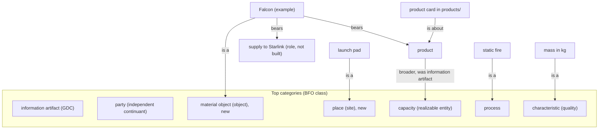

# Upper ontology: things, places and product as a role

## Goal

Before the SpaceX study, the ontology has to hold a rocket as a physical thing that is a product a venture sells and also supplies another of its products (Falcon launching Starlink). Today `product` sits under information artifact ("stored as a card"), nothing is physical, and nothing is a place.

## Two shapes

1. Kinds of product. Add `physical product`, `software product` and `service` under product, and keep product an information artifact. One thing still has one kind, so Falcon cannot be a product and a supply at once, and the noun keeps naming the card instead of the thing.
2. Kinds of thing, with product as a role. Add top categories for what a thing is (material object, place) and make product a capacity a thing bears. The kind of bearer picks the framework that builds it; the roles it bears say what it is for, and there can be many.

The second shape is chosen. Each fact has one owner: what a thing is lives in its kind, what it is for lives in its roles.

## Principles and the choice each changed

- Model the domain: kinds and roles are separate, so a product is a role and a rocket's kind is material object. This is what makes multi-role representable.
- Attack the premise: the gap looked like a missing noun for rockets, but the defect is a noun naming its record (product as a card). Fixing that is what lets one thing hold many roles.
- Laziness protocol: only the upper layer changes. No noun is added under material object or place, and the other misfiled nouns (market as a party, technology and channel as information artifacts) wait for their own pull request.
- Prove it works: the upper ontology check runs through the EE-095 term engine and finds every one of the 149 nouns reaches exactly one of the seven top categories; the Lean theorems in `packages/naive/lean/Naive/Upper.lean` hold for any hierarchy, so they need no change, and the generated Lean concepts are regenerated.

## Tradeoffs

BFO files people and organizations under object as well. Naive keeps party apart from material object because only a party can decide or be bound, which is what decision rights need. The top categories therefore overlap in BFO; the check confirms each noun reaches one top category, not that the BFO classes are disjoint.

## Not built

- Role records: which thing bears which role, in what context, for how long (schema.org Role shape, gUFO relators for supply agreements).
- Nouns under material object and place.
- The governance noun `role` still means a person's or agent's job.
