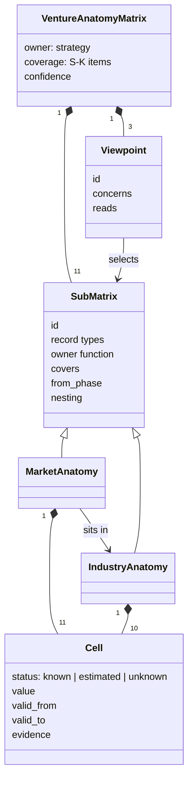
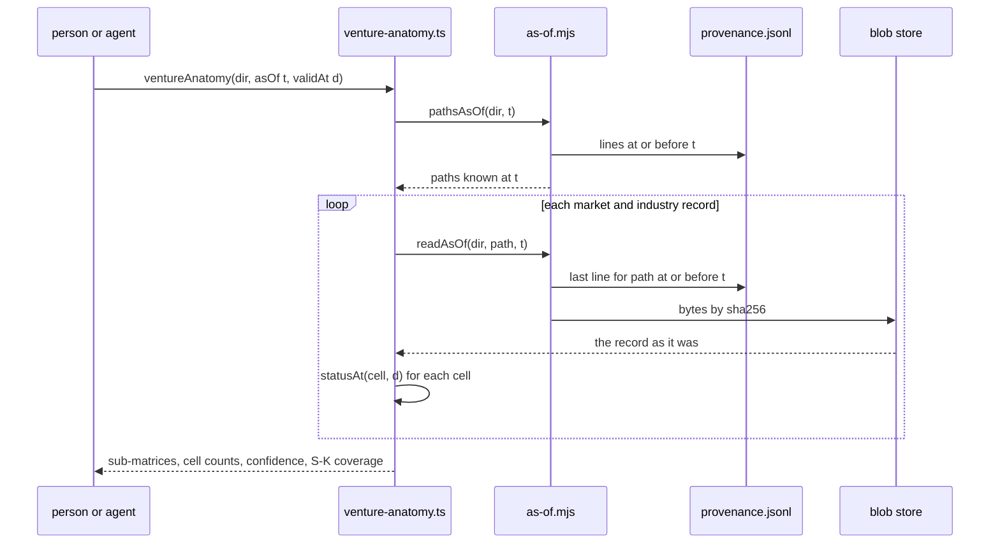
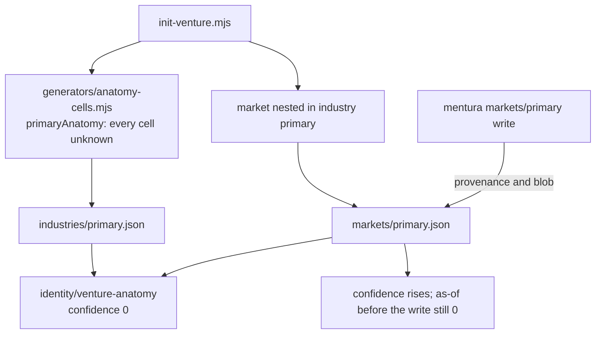

# The Venture Anatomy Matrix

Date: 2026-11-22. Decision: EE-157. Status: built, except where Not built says otherwise.

## Domain

A venture needs one model that spans its functions, can be read at any point in time, and says how much of it is known. The Product Anatomy Matrix does this for products. The Venture Anatomy Matrix does it for the whole venture.

The matrix follows ISO/IEC/IEEE 42010:2022 (iso-42010-2022-architecture-description). The matrix is the venture's architecture description. Each sub-matrix is a model of one concern. A viewpoint frames a reader's concerns and selects the sub-matrices its view reads. The Lean Canvas is one view, not a separate record.

The coverage check is Regulation S-K (sec-regulation-s-k, sec-2020-s-k-modernization), the list of what a registration statement such as Form S-1 (sec-form-s-1) must disclose: Item 101 description of business, 105 risk factors, 303 management's discussion and analysis, 401 directors and officers, 403 security ownership, and the financial statements under Regulation S-X. Every item maps to at least one sub-matrix, so a venture that fills the matrix has answered what an investor would ask.

### The root and the eleven sub-matrices

The strategy function owns the root, which assembles the sub-matrices and copies nothing. Each sub-matrix is owned by the function the data model gives its record type.

| Sub-matrix | Record types | Owner | S-K items | Expected from | Nesting |
| --- | --- | --- | --- | --- | --- |
| identity | the Lean Canvas boxes problem, unique value proposition, solution, unfair advantage | strategy | 101 | discovery | |
| customer | icp, validation-go-to-market | strategy | 101 | discovery | |
| market | market-anatomy | marketing-and-sales | 101, 303 | discovery | sits in an industry (`industry`) |
| industry | industry-anatomy | strategy | 101, 105 | discovery | holds markets |
| product | product, anatomy-input | products | 101 | validation | holds parts and features (Product Anatomy) |
| competition | competitor | strategy | 101 | discovery | |
| business model | validation-pricing, budget, spend-register | strategy | 101, 303, S-X | validation | |
| team | team-plan, founder | human-capital | 401 | validation | |
| capital | raise, ownership | external-relationships | 403, S-X | beachhead | |
| risk | risk | risk-and-compliance | 105 | validation | |
| traction | goal (its measures) | strategy | 303 | beachhead | |

Identity reads only the four canvas boxes no other sub-matrix holds, so no record is counted twice.

### Cells and unknown as a value

Every market and industry cell has one shape (`anatomy-cell.schema.json`): a status of known, estimated or unknown, a value (with low and high for a number), a note, cited evidence graded like any validation evidence, and application time. Unknown is a value, never null. A new venture's matrix is whole from the first day, with every cell unknown, and filling it moves cells to estimated or known.

A sub-matrix whose record types have no cells counts one cell per record type: known when a person wrote a record, estimated when only an agent did, unknown when there is none. Identity counts one cell per box: confirmed is known, an agent's value is estimated, anything else is unknown.

The confidence share is known plus estimated cells over all cells.

### The market dimensions

| Cell | Meaning | Source |
| --- | --- | --- |
| customer_type | business, consumer, government or mixed | |
| reachable_buyers | buyers the venture can reach now, as a head count | Blank's TAM, SAM, SOM, read as reachable head count rather than dollars (blank-2005-four-steps) |
| serviceable_market_usd | serviceable available market per year | Blank and Dorf |
| deal_size_usd | yearly contract value or spend per buyer | |
| sales_cycle_days | days from first conversation to signed purchase | |
| buying_roles | roles that must agree to a purchase | the buying center (Webster and Wind 1972) |
| purchase_frequency | once, yearly, monthly, weekly or daily | |
| switching_cost | low, medium or high | Porter 1980 |
| network_effects | none, indirect or direct | |
| maturity | emerging, growth, mature or declining | the market life cycle |
| concentration | fragmented, moderate or concentrated | HHI bands: under 1000, 1000 to 1800, over 1800 (2023 Merger Guidelines, which lowered the 2010 line of 2500 back to 1800) |

### The industry dimensions

| Cell | Meaning | Source |
| --- | --- | --- |
| regulation | none, light, licensed or heavy | |
| cost_of_error | reversible, costly, harmful or safety-critical | |
| capital_intensity | low, medium or high | |
| time_to_revenue_days | days from start to first revenue for a new entrant | |
| clockspeed | slow, medium or fast | Fine 1998 |
| supplier_power, buyer_power, threat_of_entrants, threat_of_substitutes, rivalry | low, medium or high | Porter's five forces (Porter 1979) |

### Views and viewpoints

| Viewpoint | Whose concerns | Reads | Kind |
| --- | --- | --- | --- |
| lean-canvas | a founder's: an early venture on one page | identity, customer, business model, traction | canvas: the Lean Canvas itself, from `lean-canvas.json` |
| business-model-canvas | a strategist's: how value is created, delivered and captured | identity, customer, product, business model, team | submatrices: in matrix order |
| s1-outline | an investor's or counsel's: what a registration statement would disclose | all eleven | outline: by S-K item |

### Bitemporal time travel

Time travel follows SQL:2011 (sql-2011-temporal). Application time says when a value was true in the world: `valid_from` and `valid_to` on each cell, a closed-open period. System time says when the venture knew it: every write through the router appends a provenance line and stores the bytes in the blob store, and `readAsOf` in `packages/naive/src/store/as-of.mjs` returns a record as it was at a transaction time. The two axes are independent: "what did we believe on 1 November about the market as it stood on 1 October" is `--as-of 2026-11-01 --valid-at 2026-10-01`.

### Calibration

Thresholds for phase gates come from a calibration over the market and industry sub-matrices (`packages/naive/src/engine/gate-calibration.ts`, built separately). The calibration proposes a decision, and a person accepts it; it never sets a gate on its own. Its thresholds are unvalidated priors, ours.

## System

- `packages/naive/src/functions/strategy/venture-anatomy.json` (record type `venture-anatomy`, schema `venture-anatomy.schema.json`, generator `packages/naive/src/engine/generators/venture-anatomy.ts`) defines the sub-matrices, the coverage items and the viewpoints. It holds no venture data.
- `market-anatomy` (`markets/<id>.json`, route `markets/[id]`) and `industry-anatomy` (`industries/<id>.json`, route `industries/[id]`) are venture record types owned by the purpose layer. Their generators draft every cell not given as unknown.
- `packages/naive/src/engine/init-venture.mjs` writes `markets/primary.json` and `industries/primary.json`, the market nested in the industry, from the schemas through `packages/naive/src/engine/generators/anatomy-cells.mjs`, which the two generators share. It is `.mjs` because init runs under node_modules when Naive is installed, and Node does not strip types there.
- `packages/naive/src/engine/venture-anatomy.ts` resolves the matrix. Reading is an Effect over VentureFs with Naive's tagged errors: a definition that fails its schema or names what the data model lacks is `SchemaInvalid`, a bad time or call is `CannotRun`, and the command runs through `runMain`. Options are parsed once at the boundary into branded `SystemTime` and `ApplicationDate`. Each record type a sub-matrix reads is one `CellSource`, a union of canvas, anatomy and presence, resolved by one exhaustive switch. The rules (`statusAt`, `countOf`, `confidenceOf`, `coverageOf`, `sourcesOf`, `problemsOf`) are plain functions. `ventureAnatomy(dir, { asOf, validAt })` returns the root, `submatrix(dir, id)` one sub-matrix and `viewOf(dir, viewpoint)` a view; the Lean Canvas view delegates to `leanCanvas` in `packages/naive/src/engine/lean-canvas.mjs`.
- Routes: `identity/venture-anatomy` runs the matrix and `identity/venture-anatomy/` one sub-matrix.

## Sources

Registered in `packages/naive/src/records/layers/purpose/references/references.json`:

- iso-42010-2022-architecture-description: ISO/IEC/IEEE 42010:2022, Architecture description. https://www.iso.org/standard/74393.html
- view-model-overview: View model, views and viewpoints in the IEEE 1471 lineage. https://en.wikipedia.org/wiki/View_model
- sql-2011-temporal: ISO/IEC 9075-2:2011 temporal features. https://en.wikipedia.org/wiki/SQL:2011
- snodgrass-temporal-databases: Temporal database, valid time, transaction time and bitemporal data. https://en.wikipedia.org/wiki/Temporal_database
- sec-regulation-s-k: Regulation S-K (17 CFR part 229). https://www.law.cornell.edu/wex/regulation_s-k
- sec-form-s-1: Form S-1 registration statement. https://www.law.cornell.edu/wex/form_s-1
- sec-2020-s-k-modernization: Modernization of Regulation S-K Items 101, 103 and 105, Small Entity Compliance Guide. https://sec.gov/corpfin/modernization-regulation-s-k-compliance-guide
- osterwalder-2004-business-model-ontology: Osterwalder, The Business Model Ontology, 2004. https://en.wikipedia.org/wiki/Business_Model_Canvas
- bizbok-15-business-architecture: BIZBOK Guide, version 15. https://cdn.ymaws.com/www.businessarchitectureguild.org/resource/resmgr/bizbok15/BIZBOKv15_introduction.pdf
- gartner-2017-digital-twin-organization: Gartner, Digital twin of an organization. https://www.gartner.com/en/documents/8166629
- blank-2005-four-steps: Steve Blank, The Four Steps to the Epiphany. https://steveblank.com/2009/09/17/the-path-of-warriors-and-winners/

- porter-1979-five-forces: Michael E. Porter, How Competitive Forces Shape Strategy, Harvard Business Review, 1979. https://hbr.org/1979/03/how-competitive-forces-shape-strategy
- webster-wind-1972-buying-center: Frederick E. Webster and Yoram Wind, A General Model for Understanding Organizational Buying Behavior, Journal of Marketing 36(2), 1972. https://doi.org/10.1177/002224297203600204
- doj-ftc-2023-merger-guidelines: U.S. Department of Justice and Federal Trade Commission, Merger Guidelines, 2023 (the HHI bands; the 2010 guidelines used 2,500 for highly concentrated). https://www.justice.gov/d9/2023-12/2023%20Merger%20Guidelines.pdf
- fine-1998-clockspeed: Charles H. Fine, Clockspeed: Winning Industry Control in the Age of Temporary Advantage, 1998. No URL recorded.
- levitt-1965-product-life-cycle: Theodore Levitt, Exploit the Product Life Cycle, Harvard Business Review, 1965. https://hbr.org/1965/11/exploit-the-product-life-cycle
- blank-dorf-2012-startup-owners-manual: Steve Blank and Bob Dorf, The Startup Owner's Manual, 2012 (TAM, SAM, SOM). No URL recorded.

## Not built

- Research agents that fill cells with cited evidence.
- Industry matrices shared across ventures, in Mentura.
- The visualization suite in the Venture Studio.
- Record types for the parts no sub-matrix has yet: financial statements under Regulation S-X (the budget and spend register stand in for them), key partners for the Business Model Canvas, and Item 402 executive compensation.
- A system time for records written outside the router: init writes the primary market and industry directly, so they read as absent as of any time until `mentura baseline` adopts them.
- The ontology nouns the references name (venture-anatomy, viewpoint, time-travel, business-model-canvas, s1-outline, anatomy-cell). The ontology's `view` means a route rendered as a page, not a 42010 view.
