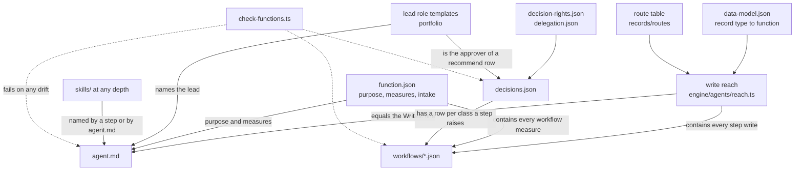

# Review: Naive's agent definitions, skills and workflows

Date: 2026-11-26. Decision: EE-215. Scope: the 13 function modules (`packages/naive/src/functions/<id>/`), the lead role templates (`packages/naive/template/governance/roles/`), the generic research skill (`packages/naive/src/interfaces/skills/research/SKILL.md`), the chief of staff agent (`agents/chief-of-staff/AGENTS.md`) and the brief a harness reads (`packages/naive/src/engine/agents/brief.ts`). Base: `main` at `b127006`.

What was read: 13 `function.json`, 13 `agent.md`, 13 `decisions.json`, 32 workflows, 58 skills by name and 12 of them in full, and 16 role templates, 4 of them leads, the route table (256 routes), the data model (180 record types) and the write reach the router derives.

## The bar

An agent definition was judged against what an agent needs before it can be trusted to run unattended:

1. a goal and a definition of done, per agent and per workflow;
2. knowledge of the venture's goals, and which of its own work serves which goal;
3. a rule for what to do when information is missing: ask, or record an assumption;
4. a rule to cite sources;
5. its tools, and how they are called;
6. inputs and outputs per step;
7. escalation rules that agree with its decision matrix;
8. no contradiction between `agent.md`, the workflows, `decisions.json` and the route table;
9. every skill it is given referenced with a cue for when to load it, and every skill it is told to load existing;
10. a purpose, a trigger and a done criterion per workflow, with the steps in a sensible order.

Points 6, 7 and 10 were already met: every step names what it does, the routes it writes and the classes it raises; every workflow has a trigger and done criteria, one conformance check and one review; every workflow's steps read before they write and summarize last. The failures were in 1, 2, 3, 4, 5, 8 and 9.

## What the three sources are, and what now binds them



Every dotted edge is a rule `node packages/naive/src/checks/check-functions.ts` now enforces. Before this change the solid edges to `agent.md` were prose that nothing checked, and five of thirteen had drifted.

## Findings, worst first

### 1. No agent knew the venture's goals, and no workflow said what a run was for. Fixed.

Twelve of thirteen `agent.md` files never named `foundation/telos` or `foundation/goals`; only strategy's did, and only because it owns them. No workflow said which outcome a run must reach or which telos measure it moves, so a run could not be told finished from performed, and nothing connected a week of pipeline work to a goal. `function.json` already carried `measures`, the telos measure kinds the function moves, and nothing used them.

Fix: `function-workflow.schema.json` requires `goal`, the state one run must make true, and `measures`, the telos measure kinds the run moves. All 32 workflows carry both. Each `agent.md` gains a "What you work toward" section: the function's purpose, read the telos and the goals first, name in every summary, decision and piece of evidence which goal the work serves, and a run is done when its done criteria pass, not when its steps have been performed. `check-functions.ts` holds a workflow's measures to a subset of its function's; `brief.ts` says the same in the `how` line, so a harness with no plugin gets the rule even if it never opens `agent.md`.

Files: `packages/naive/src/records/function-workflow.schema.json`, all `packages/naive/src/functions/*/workflows/*.json`, all `packages/naive/src/functions/*/agent.md`, `packages/naive/src/engine/agents/brief.ts`, `packages/naive/src/checks/check-functions.ts`.

### 2. The prose that tells an agent what it may write had drifted from what the router allows. Fixed.

Each `agent.md` listed the function's records in a sentence. Four listed a route the router refuses, so an agent following its instructions would be stopped:

| Module | Claimed | Why it is refused |
|---|---|---|
| `human-capital` | `people/team-plan` | The team plan sets every agent's reach, so `PLANS` keeps it out of every reach. Its own intake step already says only a person writes it. |
| `marketing-and-sales` | `marketing/content` | The route has no `write` action: engineering writes the MDX (EE-065). |
| `strategy` | `ideas/map` | The route has no `write` action; the map is a view over `ideas/graph`. |
| `products` | `product/anatomy/[id]` | The route has no `write` action. |

Five omitted routes the function does hold: strategy `industries/*`, `validation/plan` and `ideas/graph`; `marketing-and-sales` `markets/*`; `service-delivery` `operations/activity/*` and `operations/activity-summary`.

Fix: "What you own" now opens with one `Writes:` line whose routes are exactly the derived reach, with the prose gloss outside the backticks, and a `Reads:` line for what the agent reads but does not own. `check-functions.ts` compares the two sets both ways and fails on an extra or a missing route, so the sentence an agent reads cannot drift from the rule the router applies.

Files: all `packages/naive/src/functions/*/agent.md`, `packages/naive/src/checks/check-functions.ts`.

### 3. The check's write reach was wider than the router's. Fixed.

`check-functions.ts` derived a function's reach from the route table without looking at a route's actions, while `functionWrites` in `packages/naive/src/engine/agents/reach.ts`, the list the router enforces, keeps only routes with a `write` action. A step declaring `writes: ["validation/interviews"]` or `["marketing/content"]` passed the check and would have been refused at run time with "has no action write". No shipped step did, so nothing was broken; the check simply could not have caught it.

Fix: the check's `writeReach` now mirrors `functionWrites`, and a separate rule names a step that writes a record route the router serves without a `write` action, because a glob such as `product/*` is wider than the route table it came from.

Files: `packages/naive/src/checks/check-functions.ts`.

### 4. No agent was told what to do when information is missing. Fixed.

Every `agent.md` said to "ask the founder only what the records cannot tell you". None said what to do when no one answers: not one of the thirteen used the word assumption. An unattended agent facing a gap had two unwritten options, stop or invent.

Fix: a "When you do not know" section in all thirteen, and in the chief of staff agent: ask when only a person can know, one question at a time; when no one answers and the work cannot wait, write what you have and record the gap as an assumption with what it rests on and what would show it wrong; raise it as a decision when the assumption carries the result; never fill a field from memory, and never write a guess as a fact. `brief.ts` carries the same rule in `how`.

Files: all `packages/naive/src/functions/*/agent.md`, `agents/chief-of-staff/AGENTS.md`, `packages/naive/src/engine/agents/brief.ts`.

### 5. A lead's brief carried a function agent's skill. Fixed.

A lead is a role over a portfolio of functions. The four lead role templates pointed their `skill` at a function's own skill (`strategy-lead` at the `telos` skill, `finance-lead` at the finance package skill), and `brief.ts` carries that file's whole text as the lead's instructions. So a lead asking what it should do was handed instructions for writing records it may not write. The roles README said as much: "a lead skill of its own is not built".

Fix: one generic lead skill, `packages/naive/src/interfaces/skills/lead/SKILL.md`, which all four templates point at: the lead plan and the measures it binds, turning a bet into handoffs, verifying work others did and never its own, what the grant covers, what stays a person's, what to do when it does not know, and a table of the tools with how each is called. A skill per lead is still not built, and the README says so.

Files: `packages/naive/src/interfaces/skills/lead/SKILL.md`, the four `packages/naive/template/governance/roles/*-lead.json`, `packages/naive/src/records/layers/interface/layer.json`, `packages/naive/src/engine/agents/brief.ts`.

### 6. Citation discipline was in seven of thirteen agents. Fixed.

Strategy, finance, assets, capabilities, marketing and sales, external relationships and risk and compliance told the agent to cite a record for every claim. Products, supply chain, service delivery, customer service, human capital and IT did not, though several of their steps report counts and dates.

Fix: each of the six gains a citation rule in "How you work", naming the kind of record its own claims rest on.

Files: six `packages/naive/src/functions/*/agent.md`.

### 7. Seven skills were shipped with no cue for when to load them. Fixed.

A function agent's spec carries every skill under its module, so the agent sees `ambition-tier`, `business-pillar`, `chief-of-staff`, `problem-validation`, `validation-score` (strategy) and `fidelity-ladder-audit`, `foreshadowing-audit` (capabilities) without any text saying when one applies. The check also looked for skills only in `skills/` directly under the module, so the validation kit's two were invisible to it.

Fix: both Skills sections name every skill in their module with one clause on when to load it. `chief-of-staff` is named as the chief of staff role's, not the strategy agent's, because that is where the folder sits and whose skill it is. The check now walks `skills/` at any depth, as the agent spec does, and fails when a skill is named by neither a step nor `agent.md`.

Files: `packages/naive/src/functions/strategy/agent.md`, `packages/naive/src/functions/capabilities/agent.md`, `packages/naive/src/checks/check-functions.ts`.

### 8. No agent.md named a single tool call. Fixed, and unchecked.

Not one of the thirteen said how a record is read or written. The brief supplies the environment and the route table, so an agent with `mentura_agent_brief` is not helpless, but every agent was left to infer the call from the route names, and a function agent that infers "edit the file" is refused by the router and does not know why.

Fix: a uniform paragraph in each `What you own` section, after the sentence about the router, naming the two calls on the CLI (`mentura <route> read --venture <id>`, `mentura <route> write --venture <id> --input <file.json>`), their MCP equivalents (`mentura_read`, `mentura_write`), the call that gives a route its schema, template and gate before a write (`mentura_layout`), and the three that answer "what now": `mentura_agent_brief`, `naive due --function <id>` and `node packages/naive/src/engine/need-now.ts <venture dir>`.

No check was added. The paragraph is uniform prose with no machine-readable counterpart, unlike the `Writes:` line, whose referent is a derived list. A check that grepped for tool names would pin the wording without pinning the meaning, and `check-docs-claims.ts` already fails on a command, flag, path or route the text names and the code does not have, which is the part that can rot.

Files: all thirteen `packages/naive/src/functions/*/agent.md`.

### 9. A trigger could be written in a shape that never fires. Fixed.

`function-workflow.schema.json` made `cadence` and `route` optional for every trigger kind. A `schedule` with no cadence and an `event` with no route are never due (`packages/naive/src/engine/due.ts` reads both), and a `cadence` on an `intake` trigger is ignored. No shipped workflow is wrong today.

Fix: the schema requires `cadence` for `schedule` and refuses it elsewhere, and requires `route` for `event` and refuses it elsewhere. The check adds that an event trigger's route must be one the router serves.

Files: `packages/naive/src/records/function-workflow.schema.json`, `packages/naive/src/checks/check-functions.ts`.

### 10. Three agreements between the definitions were unchecked. Fixed, with no change to the data.

All three hold on `main`, so these are guards against drift, not corrections:

- a `recommend` row's approver was required to exist but not to be anyone in the function's line. It is now the founder, the chief of staff or the lead whose portfolio holds the function. All 15 rows already were.
- `agent.md`'s `lead:` frontmatter was unchecked against the lead portfolios, though the agent is told to take handoffs from it. All 13 already agreed.
- `agent.md` had no required shape, so a new module could ship one with ownership and nothing else. The six sections are now required, in order.

Files: `packages/naive/src/checks/check-functions.ts`, and 15 new cases in `packages/naive/src/checks/check-functions-test.ts`.

### 11. A derived write reach could list one route twice. Fixed.

`functionWrites` adds `operations/handoff/*` to every function and again for a function that owns the handoff record type, so `service-delivery`'s reach listed it twice, in its spec, its team-plan entry and the router's refusal message. Cosmetic.

Files: `packages/naive/src/engine/agents/reach.ts`.

### 12. The research skill did not say when one pass is done. Fixed.

The loop, the rules and the tools are stated well, and a missing pattern is already handled ("say so and stop"). What was missing was the definition of done, which for a research loop is the one thing that keeps a pass from becoming a session.

Fix: one pass is done when it has written one experiment line, or said which stopping condition holds. A pass that read and thought and wrote no line is not done, and says what blocked it.

Files: `packages/naive/src/interfaces/skills/research/SKILL.md`.

## The dogfood gaps, rechecked on main

Two of the three reported gaps no longer hold.

| Reported | On `main` at `b127006` |
|---|---|
| List reads crash on the structured layout | Does not reproduce. A list read answers on both the `structured` and the `src` layout, with records present and absent: `markets` returned its one item on each, and `foundation/goals`, `validation/interviews`, `sales/opportunities` and `operations/handoff` each answered `ok` with a `not_found` note naming the schema and what need-now says. Measured against two ventures made with `node packages/naive/src/engine/init-venture.ts --layout src` and `--layout structured`. |
| `validation/*` and `sales/opportunities` routes missing | Do not hold. The table serves 11 `validation/*` routes and both `sales/opportunities` and `sales/opportunities/[id]`. |
| `marketing/content` not writable | Holds, and is correct. The route has no `write` action by decision (EE-065): marketing plans which variant each page needs, engineering writes the MDX. The defect was that `marketing-and-sales/agent.md` promised the write anyway. Finding 2 fixes the prose, and finding 3 makes the check catch the class of error. |

## Not fixed here

- **A skill per lead.** All four leads read the one generic lead skill. A growth lead and a finance lead want different questions. Left as stated, with `packages/naive/template/governance/roles/README.md` saying it is not built.
- **Rows no step raises.** Every `decisions.json` has rows for classes no workflow step raises, `domain-fact` in all thirteen and, for example, `public-commitment` and `security-tightening` in risk and compliance. That is not wrong: a matrix covers the function's whole work, including handoffs a lead requests, and `domain-fact` is what the agent decides on every write rather than a question it raises. No rule was added.
- **`function.json` measures are not held to the telos enum.** `telos.schema.json` lists the eight measure kinds; `function-module.schema.json` takes any `^[a-z_]+$`. All 13 modules use valid kinds. Tightening the shared schema could break a kit, so it was left.
- **The goal ledger, options on a decision, tool recommendations, a handback for a skipped step, specialist spawn and agent meetings.** Other work in this session. A workflow's `measures` is deliberately a measure *kind*, not a goal id, because Naive's workflows ship before any venture's goals exist; a goal ledger binds a measure to a goal and meets this change there.

## How to verify

```
node packages/naive/src/checks/check-functions.ts --complete
node packages/naive/src/checks/check-functions-test.ts
node packages/naive/src/checks/check-data-model.ts
node packages/naive/src/records/validate.ts
node packages/naive/src/engine/agents/agents-test.ts
node packages/naive/src/interfaces/tests/mcp-agent-brief-test.ts
node packages/naive/src/interfaces/tests/agent-reach-test.ts
node packages/naive/src/checks/check-delegation.ts
node packages/naive/src/checks/check-docs-claims.ts
node packages/naive/src/checks/check-types.ts
```

One note for anyone verifying from a git worktree under `.claude/`: `packages/naive/src/checks/test.ts` reports `FAIL check-data-model passes on the repository` there, and it is an artifact of the path, not of this change. Its `copy` helper filters out any source path containing a `.claude` segment, so when the checkout itself sits under one the filter rejects the root and the copy is empty. Run it from a checkout whose path has no `.claude` segment and all 151 cases pass. This is unrelated to agent definitions and was left alone.
