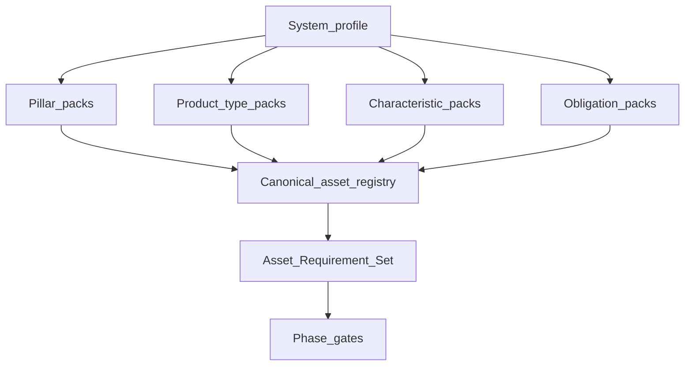

# Asset Requirements Method

> **Canonical for:** deriving *which* assets a given piece of work requires, when
> they are due, and what counts as done. The companion
> [[CANONICAL_ASSET_REGISTRY]] holds the asset definitions themselves.

---

## 1. Why this exists

Before this method, required assets were derived mostly from **pillar × product
type × ambition tier**, filtered by phase. That is directionally right and
insufficient. "Software product" covers a static marketing site and a civic
knowledge platform with private records, external data ingestion, agents, and
institutional action routing. Those do not need the same assets.

The failure mode is silent: a project passes its gates with a complete-looking
inventory while lacking the assets its *actual system characteristics* demand
(provenance policy, retention matrix, authority map, evaluation framework).
Nothing in the old derivation asks whether the system ingests third-party data,
holds identity documents, or routes consequential actions to institutions.

This method adds the missing dimension — **what kind of system is this, and what
obligations follow** — and makes the derived requirement set an explicit,
reviewable artifact.

---

## 2. The derivation

```text
Required assets =
    universal baseline
  + pillar packs
  + product-type packs
  + system-characteristic packs      ← added by this method
  + obligation packs                 ← added by this method
  + project discoveries
  scaled by  ambition tier
  filtered by lifecycle phase
```

Set semantics: packs **union** (an asset required by any pack is required).
Ambition tier and phase only change **strength** and **timing** — they never
delete an obligation-mandated asset, they defer or downgrade it with a recorded
trigger.



---

## 3. Step 1 — Declare the system profile

Answer every line. "Unknown" is not an answer; "not yet, trigger = X" is.

### 3.1 Base

| Field | Values |
|---|---|
| Pillars active | product / brand / business |
| Product type | software / hardware / content / service |
| Software sub-type | web app / mobile / API-SDK / CLI / library / platform |
| Ambition tier | hobby / side-project / open-source / venture / enterprise |
| Lifecycle stage | idea → scoped → specced → prototyping → shipped → operating |

### 3.2 System characteristics

Declare yes / no / planned-with-trigger for each. Each `yes` activates a
characteristic pack in the registry.

| ID | Characteristic | Activates when the system… |
|---|---|---|
| C-01 | Networked boundary | exposes or consumes client–server or client–agent interfaces |
| C-02 | Developer platform | offers a public API, SDK, MCP server, or webhooks to third parties |
| C-03 | Data platform | ingests, normalizes, or redistributes third-party or bulk data |
| C-04 | Temporal knowledge graph | models entities over valid/known time, revisions, or supersession |
| C-05 | AI / agent system | uses models at runtime, tool-calling, or autonomous multi-step work |
| C-06 | Identity & private records | stores PII, documents, credentials, or consent artifacts |
| C-07 | Money movement | takes payment, disburses funds, or holds balances |
| C-08 | Marketplace | matches two or more distinct sides with a take rate or ranking |
| C-09 | Third-party directory | lists or refers users to external providers or professionals |
| C-10 | Action routing | prepares, submits, or tracks consequential acts at external institutions |
| C-11 | User-generated content | hosts posts, comments, uploads, or discourse |
| C-12 | Public-interest / high-trust | presents facts people rely on for civic, legal, health, or financial decisions |
| C-13 | Regulated domain | touches health, finance, children, elections, legal advice, or similar |
| C-14 | Multi-tenant / federation | serves isolated tenants, instances, or jurisdictional deployments |
| C-15 | Physical / edge interface | ships hardware, firmware, or offline/edge execution |
| C-16 | Editorial publishing | authors and publishes original content at cadence |
| C-17 | Real-time / streaming | pushes live updates, events, or subscriptions |
| C-18 | Open source / community | accepts outside contribution or is consumed as source |
| C-19 | Multi-role or multi-offering | serves distinct roles through different front ends or permissions, or sells more than one offering on a shared core (added 2026-10-10, SAD v3.0.13) |

### 3.3 Obligations

Obligation packs are cross-cutting and derive from characteristics, law, or
declared posture.

| ID | Obligation | Typical trigger |
|---|---|---|
| O-01 | Privacy & data protection | C-06, C-11, C-13, any PII |
| O-02 | Security | C-01, C-06, C-07, C-10 |
| O-03 | Accessibility | any human interface |
| O-04 | Provenance & authenticity | C-03, C-04, C-05, C-12 |
| O-05 | Safety & moderation | C-05, C-11 |
| O-06 | Legal authority, correction, appeal | C-09, C-10, C-12, C-13 |
| O-07 | Licensing & rights | C-03, C-16, C-18 |
| O-08 | Observability & audit | C-01, C-05, C-07, C-10 |
| O-09 | Continuity & exit | C-02, C-03, C-06, C-07, C-14 |

Record the profile in the entity profile frontmatter (or the ARS header) so
future sessions derive the same set.

---

## 4. Step 2 — Derive the candidate set

For each active pack, pull its entries from [[CANONICAL_ASSET_REGISTRY]]. Union
them. Deduplicate by asset `id` — an asset required by three packs is one asset
with three reasons, and the reasons are retained (they justify its contents).

---

## 5. Step 3 — Scale by ambition tier

| Tier | Rule |
|---|---|
| Hobby | Obligation-mandated assets only; everything else optional |
| Side project | Obligation-mandated + baseline; characteristic packs may be thin |
| Open-source tool | Baseline + C-18 pack + license/governance in full |
| Venture | Full packs for every declared characteristic |
| Enterprise | Venture + procurement, compliance evidence, and continuity depth |

**Tier never removes an obligation-mandated asset.** A hobby project that stores
identity documents still needs a retention and deletion policy; it may satisfy
it in one page.

---

## 6. Step 4 — Filter by phase

| Phase | What is due |
|---|---|
| 0A–0C | Profile declaration; discovery of characteristic candidates |
| 1A | Characteristics in scope for this version |
| 1B | Design-time assets: models, policies, ontologies, contracts-in-draft |
| 1B-Final | Everything gating implementation, per articulation closure + contract-first |
| 2.x | Build-time assets: fixtures, tests, runbooks, instrumentation |
| 3 | Verification evidence for every policy asserted earlier |
| 4 | Amendment discipline when reality contradicts an asset |
| 5 | Continuity, export, and retirement assets |

An asset not due now is **deferred with a trigger**, not absent.

---

## 7. Step 5 — Produce the Asset Requirement Set (ARS)

The ARS is a new **first-class project artifact**. One per entity, refreshed at
version boundaries.

Location: `<entity>/product/spec/ASSET_REQUIREMENTS_<date>.md` (vault-canonical
pre-repo; repo pointer per the spec-colocation amendment).

Required columns per row:

`asset id · name · why required (pack + trigger) · phase due · status · owner ·
exit criterion · location or deferral trigger`

Status vocabulary: `✓ authored` / `↺ partial` / `✗ missing` / `— deferred` /
`N/A (reason)`. Silent absence is a process failure.

---

## 8. Step 6 — Gate against the ARS

Gate skills verify against the ARS, not against memory or a generic checklist:

- [[skills/articulation-closure/SKILL|articulation-closure]] — every ARS row due
  by 1B-Final is ✓ or — deferred with trigger.
- [[skills/contract-first/SKILL|contract-first]] — every networked slice has its
  Tier A contract rows satisfied.
- [[skills/build-roadmap/SKILL|build-roadmap]] — every ✗ row appears as a line item.

Missing assets mid-flight follow [[skills/_patterns/gate-backfill|gate-backfill]].

---

## 9. Step 7 — Feed discoveries back

When work surfaces an asset the registry lacks, promote it. **Recurrence is one
of five promotion paths, not the only one.** This supersedes the "wait for three
projects" default in
[[skills/deliverable-discovery/SKILL|deliverable-discovery]].

| Path | Promote immediately when… | Example |
|---|---|---|
| **P1 Standard-mandated** | an industry standard or protocol requires the artifact | OpenAPI contract for a public HTTP API |
| **P2 Obligation-mandated** | law, regulation, or risk posture requires it | retention and deletion matrix for identity documents |
| **P3 Characteristic-implied** | a declared characteristic cannot be operated without it | provenance policy for an ingest platform |
| **P4 Failure-derived** | its absence already caused a material failure | local-dev parity after the production-only integration failure |
| **P5 Recurrence-derived** | the same Tier 3 asset appears across 3+ projects | version-identities document |

P1–P4 enter the registry on discovery; P5 remains the empirical path.

---

## 10. Anti-patterns

- Deriving assets from product type alone.
- Treating ambition tier as permission to skip an obligation.
- An ARS that lists only what already exists.
- One "compliance" row standing in for privacy, security, accessibility, and
  provenance.
- Deferring without a trigger.
- Generating every registry asset for a project that declared none of the
  matching characteristics — over-application is also a failure.

---

## 11. Worked application

The first full application is the reference project, which declares C-01 through C-06 and
C-09 through C-14. See a project file.
It is the intended stress test: if the method cannot express the reference project's obligations
without ad-hoc invention, the registry is incomplete and should be amended.

---

## 12. Status

- **2026-07-26:** Initial authoring. Class 3 amendment
  `SAD_SKILL_v3_AMENDMENT_2026-07-26_asset-requirements-method.md`.
