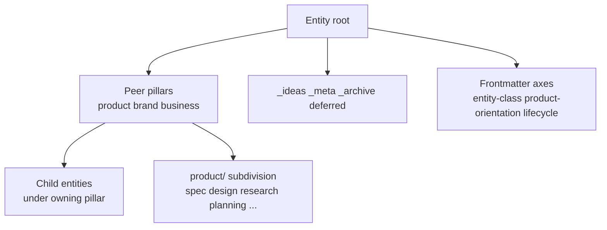

# Entity folder tree — prior art (2026-08-10)

Question: *How should an entity's folder tree be organized — and does the three-pillar split (`product/` · `brand/` · `business/`) have external peers, or is it a local invention we should keep deliberately?*

Answer: **The three pillars are a local but well-motivated invention as concern axes.** External systems rarely put product / brand / commercial-capture as **peer root folders**. **Adopted 2026-08-10 evening:** pillars stay as frontmatter concerns; parent `brand/` · `business/` are org functions; `product/` is portfolio; nested children are product-shaped by default (see §6).

---

## 1. Already in this vault (do not ignore)

### 1.1 Constitution — entity root rule

Vault `CLAUDE.md` (2026-08-10):

| Allowed at entity root | Role |
|---|---|
| `product/` · `brand/` · `business/` | **Three peer pillars** |
| `_ideas/` · `_meta/` · `_archive/` · `deferred/` | Specials |
| `entity-profile.md` | Root document |

**Forbidden at entity root:** `apps/`, `products/`, `platforms/`, `surfaces/`, or any invented sibling to the pillars. (Paid for on 2026-08-10 — briefly introduced, then removed.)

**Nesting:** children live **inside the owning pillar**, almost always `product/<child>/`. Flat-promote to `projects/<child>/` only when the child is an independent venture that merely consumes the parent.

### 1.2 What each pillar *is for* (not just a folder name)

From [[pillar-development-guide]] and Identity Boundaries:

| Pillar | Owns | Does not own |
|---|---|---|
| **product** | The made thing — specs, design applying tokens, code pointer, implementation, research | Identity tokens (imports from brand) |
| **brand** | Visual identity, voice, narrative, asset library — **one-place authoring** | Pitch decks, UX flows (consumers) |
| **business** | Value capture — pricing, finance, legal, partnerships, sales collateral | Brand tokens (imports from brand) |

Pillars advance **independently** (non-lockstep). Frontmatter `pillar-*-status` tracks presence.

### 1.3 `product/` subdivision (secondary axis)

Already declared, shape-by-role:

| Role | Typical `product/` insides |
|---|---|
| **App** (Active) | `spec/` · `design/` · `research/` · `planning/` · `implementation/` · `code/` · optional `subsystems/` · `marketing/` |
| **Platform** | `thesis/` · `research/` · `architecture/` · `models/` · `packages/` (or app-like folders when package-shaped) |
| **Parent ecosystem** | `profile.md` · `planning/` · **nested child entities** |

Authority gate (taxonomy reconciliation): elevating a note's `authority:` implies relocating it (e.g. architectural material leaves `research/`).

### 1.4 Composition layers ≠ root folders

[[entity-profile-schema]] Core · Variants · Surfaces · Platform capabilities describe *inside one product*. Promoting those names to entity-root folders was the nest mistake. Surfaces (Chat/Code/API) stay composition language after PK-2.

### 1.5 Live trees vs rule (2026-08-10 snapshot)

| Entity | Root | Notes |
|---|---|---|
| **<reference-project>** | pillars + `_ideas` `_meta` `_archive` `deferred` | Conformant. Children under `product/` |
| **The reference project** | pillars + `_ideas` `_archive` **`_misc`** | `_misc` still present — Active shape lists it optional; entity-root rule's specials list does not name `_misc` (FT-4 tension) |
| **<reference-project>** | `_ideas` + `product/` only | Shape-by-role platform exemption from brand/business — conformant |
| **a multi-venture entity** | pillars + `_ideas` **`_misc`** + **a nested arm folder** at root | the nested arm declared `part-of: A project note` — sits beside pillars, not inside one (FT-2 / FT-4 tension) |

**Improvisation still visible:** `_misc`, marketing under `product/` vs brand/business, deferred suite stubs flat-promoted *and* indexed, another project merch nesting exception.

---

## 2. External frameworks — “three pillars” analogues

### 2.1 Brand · Product · GTM / org charts

Industry practice separates **brand marketing**, **product management**, and **commercial / GTM** as peer *functions*, not as folder trees:

- Brand owns identity and broad narrative; product marketing owns product narrative and launch; product management owns roadmap (Bare Strategy / Gartner-style splits).
- CMO orgs often organize by **function** (brand, demand, product marketing) or matrix hub-and-spoke.
- Spencer Stuart product-org models: functional (CPO ‖ CTO peers), GM/P&L, platform — **org** patterns for nesting products under a company, analogous to parent-ecosystem nesting.

**Lesson:** Peer separation of *make / known-as / capture-value* is mainstream. Encoding it as **three root directories** is the vault's concrete choice, not a copy of a named folder standard.

### 2.2 Company operating systems (multi-pillar, not folders)

| Framework | Pillars / components | Folder implication |
|---|---|---|
| **EOS / Traction** | Vision · People · Data · Issues · Process · Traction (six) | Operating concerns — map to process docs / `_meta`, not entity roots |
| **McKinsey 7S** | Strategy · Structure · Systems · Shared values · Skills · Style · Staff | Diagnostic lens — do not create seven root folders |

**Lesson:** Multi-pillar thinking is common; **count and names differ**. Do not expand entity root to match EOS or 7S.

### 2.3 Venture studio / holding

Alphabet-style holdings and product houses nest operating products under a parent while brand/P&L may sit at different levels. Maps to vault **parent ecosystem + nested children under `product/`**, already adopted for the reference project.

### 2.4 Design orgs — brand guidelines vs design system

Common ownership pattern matches vault Identity Boundaries:

- **Brand guidelines** = identity source of truth (vault `brand/`)
- **Design system / component library** = product applying tokens (vault `product/design/`)

Strong external confirmation of the one-place-authoring rule — not of any particular folder depth.

### 2.5 Business Model Canvas / Lean

BMC boxes (value prop, channels, revenue, …) are a **canvas**, not a directory schema. Forcing one folder per BMC cell recreates the invented-roots failure mode.

---

## 3. External frameworks — folder / PKM / docs trees

### 3.1 PARA (Tiago Forte)

Projects · Areas · Resources · Archives — organize by **actionability**, not topic.

| PARA | Vault mapping |
|---|---|
| Projects | Time-bound work → often `product/planning/` or `_ideas` campaigns — **not** entity root |
| Areas | Ongoing responsibilities → closer to **entities** or pillar maintenance |
| Resources | Reference → methodology / research notes |
| Archives | `_archive/` |

**Fit:** Personal/second-brain. Weak as entity-root replacement. Strong reminder that **archive is a lifecycle state**, already modeled.

### 3.2 Johnny Decimal

Area → Category → ID (`15.22`). Content only in IDs; areas/categories are structural. Hard cap (~10 areas).

**Fit:** Numbering/index discipline for large personal libraries. Does **not** encode product/brand/business. Optional inspiration for stable IDs inside a pillar — not for rewriting entity root.

### 3.3 Diátaxis (docs-as-code)

Tutorials · How-to · Reference · Explanation — by **user need / doc purpose**.

**Fit:** Excellent candidate for **public docs sites** and for clarifying *kinds of writing* inside `product/`. Does **not** belong at entity root (would collide with pillars and with authority-based placement: spec vs research).

Rough mapping if ever used under `product/docs/` (not proposed here): reference ≈ `spec/`; explanation ≈ thesis/architecture narrative; tutorials/how-to ≈ implementation guides.

### 3.4 ADR / architecture docs

`docs/adr/` or `architecture/decisions/` — contested decisions as records.

**Fit:** Already present as `architecture-spec` / `product/spec/adrs/`. Confirms **decision records live under product**, not at entity root.

### 3.5 Monorepo roots (Turborepo / Nx)

`apps/` · `packages/` · `libs/` — **code-half** layout by deployable unit.

**Fit:** Must **not** be copied onto the wiki half (lesson of 2026-08-10). Code pointer bridges halves; package names are not entity-root folders.

### 3.6 Enterprise content (carry-forward)

From [[product-kinds-prior-art-2026-08-10]]: **taxonomy ≠ classification ≠ categorization ≠ folder ≠ sitemap**. TOGAF doc types and PIM trees reinforce keeping axes separate.

---

## 4. Synthesis — axes to keep separate

| Axis | Existing home | Answers |
|---|---|---|
| Venture concern | Pillars `product/` `brand/` `business/` | Make / known-as / capture-value |
| Structural role | `entity-class` | platform · app · hybrid · … |
| Audience / value | `product-orientation` | offering · ops · infrastructure |
| Doc binding | authority gate + `product/` folder | research vs spec vs planning |
| Actionability (optional) | PARA-like thinking in planning/archive | active vs parked |
| Doc purpose (optional) | Diátaxis for public docs | tutorial vs reference |
| Code shape | `<repos>/` monorepo | apps/packages — **not** wiki roots |

**Headline:** External prior art **supports peer separation of product / brand / business as concerns**, and **does not prescribe** those three as the universal filesystem root. The vault's triad is a **deliberate local encoding** of a common org split. Folder systems that look similar (PARA's four, EOS's six) optimize for other jobs — map them into specials, `_meta`, or `product/` subs, don't expand the root.

---

## 5. Implications (historical — superseded by §6 decisions)

1. Keep three **concern** names; do not expand root for EOS/7S/PARA.
2. Do not replace with PARA at entity root.
3. Do not copy monorepo `apps/` / `packages/` onto the wiki half.
4. Diátaxis belongs under product docs / public sites, not entity root.
5. Live tensions (`_misc`, the nested arm, marketing home) remain for FT-3/FT-4.

---

## 6. Decisions (settled 2026-08-10 evening — org-structure reading)

The primary fix is **not** “demote brand/business folders.” It is: stop recursive mini-company skeletons; treat brand/business at the parent as **org functions** (roles/departments responsible for products); treat product as **portfolio**; pillars as **frontmatter concerns**.

| ID | Decision |
|---|---|
| **FT-1** | Pillars = concerns (frontmatter). Parent keeps `brand/` · `business/` · `product/` as org/portfolio homes. Nested children are product-shaped by default (`brand-scope` / `business-scope`: `parent` or `none`). Spin-outs use `own` or flat-promote. |
| **FT-2** | Nesting stays under `product/<child>/` for the reference project shipping (path-stable). Nesting ≠ pillar. |
| **FT-3** | **Parked** — `product/` subdivision shape-by-role vs single template. |
| **FT-4** | **Parked** — `_misc` and other specials. |

Adopted into vault `CLAUDE.md` §*Org functions vs product portfolio*, [[entity-profile-schema]], [[pillar-development-guide]], [[documentation-expectations]], [[entity-profiling]].

## Decision log

| Date | Note |
|---|---|
| 2026-08-10 | Research only. No tree changes. Triggered after product-kinds adoption; parallel to taxonomy reconciliation |
| 2026-08-10 evening | **Adopted org-structure reading.** FT-1/FT-2 settled; FT-3/FT-4 parked. Recursive brand/business on every child retired as default |
