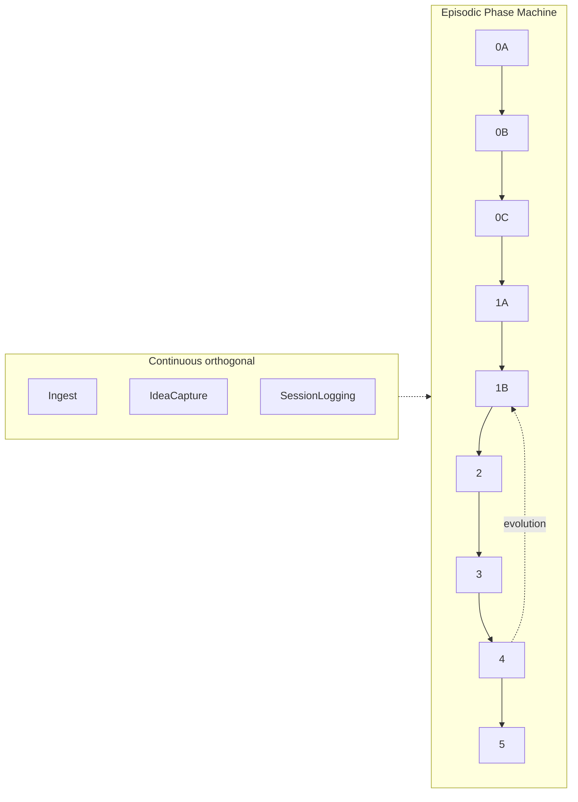

# SDD · Software Factories · SDLC · Phase Machine vs FSM

> **Index only (2026-08-11).** Vocabulary map, not decision research.  
> **Phase 1 (pros/cons, when-to-use, API-first, shipping-module):** [[sdd-cousins-pros-cons-api-first-2026-08-11]]

**Status:** Exploratory map. **Does not** lock SAD ontology, rename, or product identity.

**Purpose:** Shared vocabulary before later decisions (what SAD *is*, whether it is a Software Factory, whether to call anything “Driven,” whether “Phase Machine” sticks).

**SAD as currently documented (descriptive, not normative here):** [[SAD_SKILL_v3]] — Specification-**Anchored** Development; Product-pillar / software-type methodology; continuous activities + episodic Phase 0A→5 pipeline; Vision vs Version; Spec Convergence; vault governance.

---

## 1. Executive comparison matrix

| Concept | What kind of thing | Core claim | Typical unit of work | Relation to code | Relation to AI agents (2026) |
|---|---|---|---|---|---|
| **SDLC** | Lifecycle *framework* (family of models) | Software goes through named phases from idea → operate | Project / release | Phases *include* coding | Orthogonal; agents sit inside phases |
| **Stage-Gate / Phase-Gate** | Innovation *governance* process | Stages of work separated by go/kill investment gates | Product / NPD project | Often wraps engineering | Human gates; agents optional inside stages |
| **SDD (Spec-Driven Development)** | Emerging *methodology* (semantically diffuse) | Spec before (and often above) code for AI-assisted work | Feature / change / sometimes whole app | Spec guides or generates code | Central — agents consume specs |
| **Software Factory** | *Operating model* / asset+tool production system | Standardize inputs, assembly path, quality, reuse | Product line / repeated app variants | Assembly + reusable assets; coding minimized at app layer (classical) | Agentic factory: agents as line workers |
| **FSM (state machine)** | Formal *computational model* | Finite states + allowed transitions | Any reactive system | Implementation pattern | Can control agent workflows |
| **Phase Machine** | Informal label for a *phase-gated* controller | States = lifecycle phases; transitions = gates | Project / change lifecycle | Phase advances gated by artifacts | Often used to orchestrate agent phases |
| **SAD (as documented)** | Methodology + wiki discipline | Collapse incorrectness via formal specs after exploration; continuous feeds episodic | Campaign / Session / Checkpoint; entity | Spec authority; code outside vault | Skill+wiki for multi-session AI work |

**One-line placements (descriptive):**
- SAD **rhymes with** SDD’s “spec-anchored” *level* and with Stage-Gate’s gated phases — but is **wider** than feature-SDD tooling (Vision/Version, continuous layer, vault authority).
- SAD **is not identically** a Software Factory; a factory is a production system that *could run under* SAD’s phase discipline.
- SAD’s episodic pipeline **can be modeled as** a Phase Machine (phase-gated FSM specialization); continuous activities are **orthogonal**, not states on that same machine.

---

## 2. Spec-Driven Development (SDD)

### 2.1 Definitions in circulation

Industry usage (2025–2026) is still in flux. Recurring core:

> Write a **spec before** writing code with AI; the spec becomes (or aims to become) the **source of truth** for human and agent.

Sources: [IBM Think — Spec-driven development](https://www.ibm.com/think/topics/spec-driven-development) (2026-05-19); [Martin Fowler / Birgitta Böckeler — SDD tools](https://martinfowler.com/articles/exploring-gen-ai/sdd-3-tools.html); arXiv:2602.00180 *Spec-Driven Development: From Code to Contract…* (cited by IBM); practitioner/tool marketing (GitHub Spec Kit, Tessl, Kiro).

GitHub’s framing (quoted via Fowler): maintaining software means evolving specifications; code as “last-mile.” Tessl: specs are the primary artifact; agents generate code to match.

**Cousins (not identical):** TDD (tests as executable expectation), BDD (collaborative behavior specs), Design-by-Contract, API-first/OpenAPI, classical MDD (models → code). Fowler notes **MDD** as the important historical parallel for **spec-as-source** — same aspiration, new non-determinism tax from LLMs.

### 2.2 Rigor spectrum (now common vocabulary)

| Level | Meaning | Spec after ship? |
|---|---|---|
| **Spec-first** | Spec written before AI coding for the task; may go stale afterward | Often no |
| **Spec-anchored** | Spec evolves with the software; living source of truth for that feature/system | Yes |
| **Spec-as-source** | Humans edit only the spec; code is generated/regenerated; often “DO NOT EDIT” on code | Spec is the editable primary |

IBM and Fowler use this triad. **Important naming collision:** IBM’s middle level is literally called **“spec-anchored development.”** That is a *level of SDD*, not the brand name of the owner’s methodology.

### 2.3 Tooling snapshot (illustrative, not exhaustive)

| Tool | Aspiration (per Fowler) | Shape |
|---|---|---|
| **Amazon Kiro** | Mostly **spec-first** | Requirements → Design → Tasks (3 markdown docs) + “steering” memory bank |
| **GitHub Spec Kit** | Markets living specs; in practice often **spec-first per change** (branch-per-spec) | Constitution + Specify → Plan → Tasks; many files/checklists |
| **Tessl** | Explicit **spec-anchored** / exploring **spec-as-source** | Spec ↔ code (often 1:1 file); generate from tagged specs |

Fowler’s cautions (worth keeping): SDD is **not one thing**; workflows can overkill small bugs; markdown review overload; false sense of control when agents ignore instructions; functional vs technical separation is hard in practice.

### 2.4 SAD ↔ SDD (descriptive map)

| Question | Research answer |
|---|---|
| Is SAD “just SDD”? | **No — not as a full identity.** SAD includes a full episodic pipeline (0A→5), Vision vs Version, Spec Convergence thresholds, Campaign/Session rituals, continuous activities, raw/compiled wiki model, and vault `authority:` governance. Typical SDD tools focus on **feature/change → code** loops. |
| Is SAD a *flavor* of SDD? | **Partially overlapping.** SAD is clearly **spec-first before implementation** (never implement before Spec Convergence). Living specs + “when reality conflicts with spec, the **spec** changes” ([[SAD_SKILL_v3]] Critical Reminder #3) sit near **spec-anchored** *authority*, with an explicit change protocol — not vibe-edit the code and abandon the doc. |
| Does SAD’s “Anchored” = SDD’s “spec-anchored”? | **Related words, different scopes.** Industry “spec-anchored” = keep the spec alive with the code. SAD “Anchored” (in the name *Specification-Anchored Development*) historically stressed **spec as authority** under conflict + pre-implementation anchoring to fight compounding AI error — plus exploratory phases *before* premature specification. Do not assume the IBM level-name was the etymology; treat the collision as a research fact for any rename debate. |
| SAD vs “Driven”? | You preferred **SAD** over **SDD** for speakability. Industry now owns **SDD** as the buzzword. Renaming to “Driven” would collide with that wave and with “data-driven” etc. — **open question**, not decided here. |

---

## 3. Software Factories

### 3.1 Lineage (compressed)

| Era | Idea |
|---|---|
| **Classical (1969–)** | Hitachi Software Works; SDC “Software Factory” (Bratman & Courts, 1975); Japanese industrialization (Toshiba et al.); Cusumano’s historical phases of factory practice |
| **Microsoft / Greenfield–Short (2004)** | *Software Factories: Assembling Applications with Patterns, Models, Frameworks, and Tools* — schemas, reference implementations, recipes, templates, designers, reusable code; product-line variants by assembly |
| **Enterprise platform sense** | Standardized tools, pipelines, environments, reusable platforms so many teams deliver consistently (often labeled “software factory” in DevOps/platform eng) |
| **Agentic software factory (2025–26 discourse)** | Same production-system idea with **agents as stations/workers**: standardized inputs (often specs), shared tooling, automated quality gates, measurable yield, **replayability** of who/what produced a change |

Wikipedia summary: a structured collection of related assets aiding production via an **assembly** process; manufacturing metaphor; coding minimized at the application layer in favor of composing predefined components. See also [TrueFoundry’s agentic factory overview](https://www.truefoundry.com/blog/software-factory-agentic-enterprise-guide) for the 2026 control/identity framing.

### 3.2 What a factory is vs what a methodology is

| | Methodology (e.g. SAD, SDD-as-practice) | Software Factory |
|---|---|---|
| Primary artifact | Process rules, specs, rituals, docs | Tools + reusable assets + delivery path + controls |
| Answers | *How should we decide and specify?* | *How do we repeatedly produce working software at scale?* |
| Can exist as | A skill + wiki (SAD’s self-description) | A hosted platform, CI mesh, asset library, agent fleet |
| Failure mode | Ritual skip / premature spec / drift | Missing stations, weak gates, credential/identity collapse |

**Descriptive takeaway:** Calling SAD “a Software Factory” **overloads** the noun. SAD *implies* some factory-like properties (standardized inputs = spec package; gates = ★ checkpoints / Convergence; replay via session logs / provenance). It does **not** by itself supply reusable component libraries, CI assembly lines, or agent identity infrastructure (see [[buzz-xyz-sad-prior-art-2026-08-11]] as a *room* that could sit inside a factory).

### 3.3 Factory properties checklist vs SAD today

| Factory property | SAD (documented) | Needs separate product/infra? |
|---|---|---|
| Standardized inputs | Spec hierarchy + IDEA_MAP / RESEARCH_SYNTHESIS | Partially covered |
| Defined assembly path | Phase 0A→5 order mandatory | Methodology yes; automation optional |
| Quality gates | Spec / Implementation Convergence; contract-first gate | Partially; CI/tests are repo-side |
| Reusable assets / recipes | Templates, skills, company-template | Yes — expand as products |
| Replayability / audit | Session logs, ai-model provenance, amendments | Session logger / bitemporal work may **spin out** |
| Shared human+agent room | Not prescribed (Cursor/Cowork today) | Buzz-class workspace |
| Agent identity & authz | Parallel agent-role taxonomy; not factory ACL | Yes |

---

## 4. Software Development Life Cycle (SDLC) and Stage-Gate

### 4.1 SDLC

**SDLC** = structured framework of phases for planning → building → testing → deploying → maintaining software. Models differ in **how phases sequence or overlap**, not whether the concerns exist.

| Model | Phase shape | Flexibility |
|---|---|---|
| **Waterfall** | Strict sequential; finish phase before next | Low |
| **V-model** | Waterfall with paired verification/validation for each build stage | Low; strong for safety-critical |
| **Iterative / Spiral** | Repeat cycles; spiral adds risk analysis | Medium |
| **Agile** | Same concerns in short overlapping cycles (sprints) | High |
| **DevOps** | Often framed as Agile + continuous integration/delivery/ops ownership — practice set more than a single phase diagram | Very high release cadence |

Common phase names (variants exist): planning, requirements, design, development, testing, deployment, maintenance.

### 4.2 Stage-Gate / Phase-Gate (Cooper)

Distinct from SDLC coding models: **new product development governance**. Stages of work separated by **gates** (go / kill / hold / recycle) where leadership decides investment. Typical stages: Discovery → Scoping → Business case → Development → Testing/validation → Launch (counts vary). Can hybridize with Agile *inside* stages.

**Rhyme with SAD:** SAD ★ checkpoints and Convergence gates are **phase gates** in spirit (advance only when criteria met). Difference: Stage-Gate is often **portfolio investment** governance; SAD gates are **spec/implementation correctness and shareability** for AI-assisted building.

### 4.3 SAD pipeline vs common SDLC (rhyme table, not equivalence)

| SAD episodic phase | Rough SDLC rhyme | Notes |
|---|---|---|
| 0A Mind Dump | Pre-requirements / discovery | Stronger “externalize thinking” than typical SDLC charts |
| 0B Research | Analysis / domain research | Continuous Ingest feeds this |
| 0C Unconstrained Vision | Product vision | Vision **never** scoped down |
| 1A Version Scoping | Scope / release planning | Subtractive cut — Vision vs Version is SAD-load-bearing |
| 1B Specification + Spec Convergence | Requirements + design specs | Convergence thresholds + shareability |
| 2 Implementation | Development | After contracts / convergence |
| 3 Verification | Testing / validation | Implementation Convergence |
| 4 Spec Evolution | Change management | Spec change classes |
| 5 Completion | Release / closeout | Plus entity lifecycle mapping |

**What generic SDLC charts usually omit that SAD emphasizes:** premature-specification failure mode; continuous vs episodic dual-mode; raw/compiled wiki; Campaign/Session/Checkpoint; vault `governed-by` authority; Spec Convergence as handoff readiness.

**Open descriptive question (not locked):** Is SAD “an SDLC,” “a methodology that *imposes* an SDLC-shaped Phase Machine,” or “a meta-process that can wrap Agile/DevOps delivery inside Phases 2–3”? Research favors: **methodology whose episodic core is SDLC-shaped**, not a replacement label for “the SDLC.”

---

## 5. Phase Machine vs finite state machine (FSM)

### 5.1 Definitions

| Term | Meaning |
|---|---|
| **Finite state machine (FSM)** | Formal model: finite set of states; system in exactly one at a time; transitions on events/inputs; used across UI, protocols, workflows, compilers, etc. ([Wikipedia: Finite-state machine](https://en.wikipedia.org/wiki/Finite_state_machine)) |
| **Phase machine / phase state machine** | Domain/informal name for an FSM-like controller whose **states are lifecycle phases** and whose **transitions are gates** (artifacts + checks + approvals). Appears in agent orchestration docs (e.g. “phase state machine” language in phase-gated AI frameworks; “phase state machine” + `.phase` file in some swarm/orchestrator whitepapers) |
| **Stage-Gate** | Process/governance framework — often *implemented with* phase-state tracking, but not itself the formal FSM |

### 5.2 Direct answer

**Is “Phase Machine” just another way of saying state machine?**

**Specialization, not synonym.**

- Every Phase Machine is *usefully modeled as* (or implemented as) a state machine over phases.
- Most state machines are **not** phase machines (login forms, TCP, game AI, parsers…).
- Calling SAD’s episodic pipeline a **Phase Machine** = shorthand for **phase-gated state machine over the development lifecycle**.

### 5.3 When a phase pipeline is *not* a pure FSM

| Situation | Better model |
|---|---|
| Many tasks with parallel dependencies | **DAG** / workflow engine |
| Long-running waits, human-in-the-loop, durable resume | Durable workflow + signals |
| Always-on ingest / session logging / staleness review | **Orthogonal continuous processes** (SAD v3 dual-mode) — not extra states on the phase FSM |
| Lifecycle **regression** (e.g. `scoped → concept`) or Spec Evolution (Phase 4) | FSM with **backward edges** / revision states — still an FSM, but not a naive forward-only line |

SAD Critical Reminder #1 demands forward phase **order** for the happy path; lifecycle-stage regression and Phase 4 exist — so a honest Phase Machine for SAD includes **gated forward edges** plus **controlled regression/evolution transitions**, not a one-way chute only.

---

## 6. Implications for later work (open questions only)

Do **not** treat these as decisions:

1. **Ontology:** Prefer “methodology with Phase Machine + continuous layer” vs “Software Factory” vs “SDD product” vs family brand “Driven”?
2. **Naming:** Keep SAD; adopt SDD publicly; dual-name; or “Driven”? Factor: IBM already uses *spec-anchored* as an SDD level; SDD owns the Driven acronym in 2026 AI discourse.
3. **PM vision:** Which objects are in the portfolio — methodology publication, Phase Machine runtime, session/bitemporal logger, factory tooling, Buzz-like room?
4. **Spin-outs:** When does a continuous activity (session logger) become `product-orientation: offering | operational-capability | enabling-infrastructure`?
5. **Mechanical Phase Machine:** Should phase state be enforced in tooling (hooks / `.phase` file) or remain ritual + checklist?

---

## 7. Sources (primary-leaning)

**SDD**
- [IBM — What is spec-driven development?](https://www.ibm.com/think/topics/spec-driven-development)
- [Fowler/Böckeler — Understanding SDD: Kiro, spec-kit, Tessl](https://martinfowler.com/articles/exploring-gen-ai/sdd-3-tools.html)
- Piskala, D. B. (2026). *Spec-Driven Development…* arXiv:2602.00180 (cited by IBM)

**Software Factory**
- [Wikipedia — Software factory](https://en.wikipedia.org/wiki/Software_factory) (Greenfield & Short 2004; Cusumano; Bratman & Courts)
- [TrueFoundry — Agentic Software Factory](https://www.truefoundry.com/blog/software-factory-agentic-enterprise-guide)

**SDLC / Stage-Gate**
- Standard SDLC model summaries (Waterfall, V-model, Agile, DevOps) — e.g. industry overviews such as Splunk/Cleverix-class guides
- Cooper Stage-Gate / Phase-Gate (NPD governance) — e.g. process explainers summarizing Discovery→Launch with go/kill gates

**FSM / phase control**
- [Wikipedia — Finite-state machine](https://en.wikipedia.org/wiki/Finite_state_machine)
- Phase-gated AI orchestrators using “phase state machine” language (pattern existence, not endorsement)

**Vault**
- [[SAD_SKILL_v3]], [[methodology-family]], [[buzz-xyz-sad-prior-art-2026-08-11]]

---

## Changelog

| Date | Change |
|---|---|
| 2026-08-11 | Initial research compile per plan *Research: SDD, Software Factories, SDLC (+ Phase Machine vs FSM)*. |
