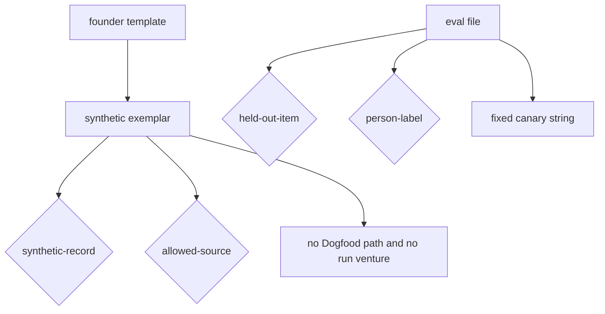

# exemplars

Up: [naive](../README.md)

## What this is

Public synthetic exemplars (EE-198). Each one is generated, sits under no venture, and carries the label synthetic only when [`synthetic-record`](../src/terms/terms.ts) passes. `derived_from` cites public inputs. Each citation passes [`allowed-source`](../src/terms/sources.ts). A Dogfood path, a gold path or a run venture fails the check. Gold exemplars are not in this repository. They live in the private Dogfood repo, because a synthetic record keeps the statistical traits of its seed.

## Where things are

| Path | Holds |
|---|---|
| [`synthetic/discovery-subscription/exemplar.json`](./synthetic/discovery-subscription/exemplar.json) | The synthetic exemplar for the discovery, cross-industry, subscription template. |

## Run and test

- `node packages/naive/src/checks/check-evals.ts` checks this folder and the eval files.
- `node packages/naive/src/checks/check-evals-test.ts` shows a held-out id in an exemplar failing, a missing canary failing, a Dogfood path failing, and an agent-set label failing.

## How it connects

- Reads templates from [`../founder-templates/README.md`](../founder-templates/README.md).
- Eval items that name these files are the exemplar split in [`../evals/README.md`](../evals/README.md).
