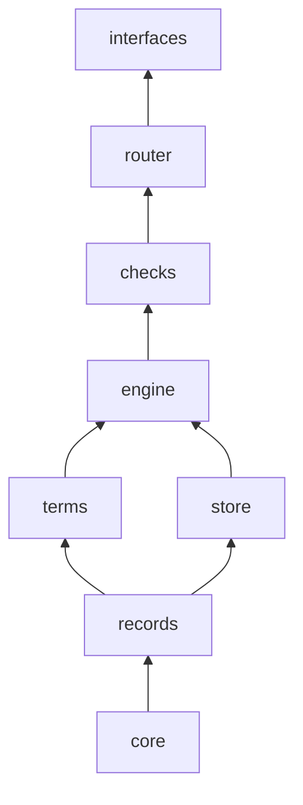

# src

Up: [naive](../README.md)

## What this is

Naive's code in units (EE-118 step 5). Each unit imports only the units below it: core, then records, then terms and store, then engine, then checks, then router, then interfaces. functions holds the 13 function modules (step 7). `node scripts/dependency-rules.ts` enforces the order.

## Where things are

| Path | Holds |
|---|---|
| [`checks/`](./checks/README.md) | The checkers and lints run against a workspace or the repository. |
| [`core/`](./core/README.md) | Shared helpers below every other unit: venture paths, provenance, action scope. |
| [`engine/`](./engine/README.md) | What a venture's records mean and do: init-venture, need-now, decisions, upgrades and migrations. |
| [`functions/`](./functions/README.md) | One module per function of a venture, the 13 in `functions/departments.json` (EE-047, EE-115). |
| [`interfaces/`](./interfaces/README.md) | The CLI, MCP server and local API over the router, the skills, harness adapters and the operator console. |
| [`records/`](./records/README.md) | The record types, the data model, the resolver and the route table. |
| [`router/`](./router/README.md) | The routes' actions, shared by every interface (EE-030, EE-032). |
| [`store/`](./store/README.md) | The connectors a venture's records are read and written through (EE-037). |
| [`terms/`](./terms/README.md) | The EE-095 term engine, the ontology and the operating rules. |

