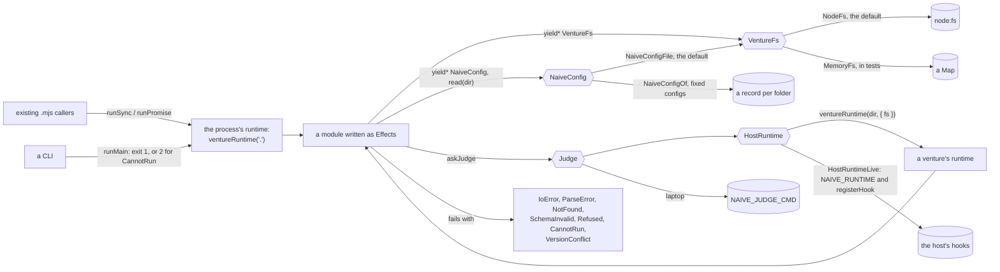
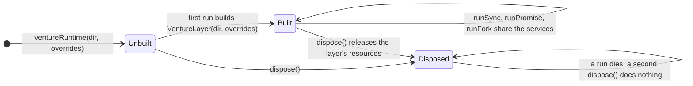

# core/effect

Up: [core](../README.md)

## What this is

Naive's base for code written with [Effect](https://effect.website) (EE-125). It holds the tagged errors every Effect in Naive fails with, the file system, naive.config.json, where Naive runs and its judge as services, the venture runtime that builds a venture's services once (EE-161), and the runners that let code that is not Effect yet call code that is. Effect is pinned to one exact version in the root `package.json`. The files are strict TypeScript; the package ships them compiled to `.mjs` (EE-159, EE-160), so an app that imports the old `.mjs` names keeps working.

The venture runtime is a `ManagedRuntime` over `VentureLayer`. It builds the layer on its first run, keeps the services for every run after, and releases them on `dispose()`. A run after that dies with the defect `ManagedRuntime disposed`.

## Where things are

| Path | Holds |
|---|---|
| [`errors.ts`](./errors.ts) | The tagged errors, each with a readable `message`: `IoError`, `ParseError`, `NotFound`, `SchemaInvalid`, `Refused` (the gate, access or a writer rule), `CannotRun` (exit code 2) and `VersionConflict` (a compare-on-write whose base is stale, built with the connector contract's `(path, base, current)`), and their union `NaiveError`. Catch one with `Effect.catchTag`. |
| [`fs.ts`](./fs.ts) | `VentureFs`, the file system as a service (`exists`, `readText`, `readBytes`, `writeText` of text or bytes, `append`, `createExclusive` for a lock file, `stat`, `link`, `list`, `isDirectory`, `rename`, `remove`); `NodeFs`, its layer over `node:fs`; `MemoryFs` and `memoryFs`, an in-memory one for tests; `readJson` and `writeJson`, which write JSON the way every record is written. |
| [`config.ts`](./config.ts) | `NaiveConfig`, the venture's `naive.config.json` as a service: `read(dir)` gives the file as written, `{}` when there is none, and fails with `ParseError` when it is not JSON. `NaiveConfigFile`, its default layer, reads through `VentureFs`; `NaiveConfigOf` gives fixed configs by folder for a test or a host; `configOf(dir)` reads through whichever is provided. The engine's `readConfig`, `rawConfig` and `configFor` (`../../engine/naive-config.ts`) read through it with their old shapes and messages. Overrides from `NAIVE_*` environment variables are not built. |
| [`host.ts`](./host.ts) | `HostRuntime`, where Naive runs (`hosted`, `hook(name)`, `envCommand(name)`): `HostRuntimeLive` asks `../runtime.ts` at each call, so `NAIVE_RUNTIME` and `registerHook` work as before, even for a hook registered after the runtime was built; `Laptop` and `Hosted(hooks)` are fixed layers. `Judge`, System 1's judge (`ask({ feature, input, cmd? })`, or `askJudge`): hosted, the host's judge hook or a `HostedRefusal`; on a laptop, the command in `NAIVE_JUDGE_CMD` or `cmd`, and null when there is none. `JudgeLive` asks through the provided `HostRuntime`; `JudgeFake` answers from a function. The judgment cache's `judge` (`../../engine/caching.ts`) asks through it. Frames, the venture type classifier and the harnesses still read the judge command themselves. |
| [`tracer.ts`](./tracer.ts) | `naiveTracer(dir)`, NaiveTracer: an Effect `Tracer` whose spans (from `Effect.withSpan` and a named `Effect.fn`) are written to the venture's EE-121 trace files through `../instrumentation.ts` when they end, hash-chained like every other span, and only while the venture has traces on. A span's kind is its `naive.kind` attribute (`asKind(kind)`) when that is a span kind, else `call`; its session is the root's `naive.session` attribute (`inSession(id)`), else the session of the instrumentation span the run started inside or `MENTURA_SESSION`, else the trace id. An Effect run started inside `withSpan` nests under it. A failure is status `error` with its first line. A provenance line written inside an Effect span does not name it yet (not built; phase 7). |
| [`runtime.ts`](./runtime.ts) | `VentureLayer(dir, overrides?)`, the layer of a venture's services, and `ventureRuntime(dir, overrides?)`, a `ManagedRuntime` built from it (EE-161). Its services are `VentureFs` (`NodeFs` unless `overrides.fs` gives another layer, such as `MemoryFs` in a test), `NaiveConfig` (`NaiveConfigFile` over that file system unless `overrides.config` gives another), `HostRuntime` (`HostRuntimeLive` unless `overrides.host`) `Judge` (`JudgeLive` over that host unless `overrides.judge`) and Effect's `Tracer` (`naiveTracer(dir)` unless `overrides.tracer`). `VentureServices` names what a venture's Effects may ask for. Each runtime builds its own layer, so two ventures given their own layers share no service, and disposing one leaves the other running. `dir` names the venture; the tracer writes its spans under it. The process runtime in `run.ts` keeps Effect's in-memory tracer, because its callers pass absolute paths and `.` is no venture. |
| [`run.ts`](./run.ts) | `runSync` and `runPromise` run through one venture runtime for the process (`ventureRuntime(".")`, never disposed) and throw the tagged error itself, so a module moved to Effect keeps its exports; `runMain` runs a CLI's Effect through it, prints a failure in one line (`describe`) and sets the exit code (`exitCode`). |

## How to write Naive code with Effect

- Use Effect for code that reads or writes files, can fail, runs work at once, or needs a service. Keep pure functions plain: scoring arithmetic, the term engine and signal ids gain nothing from it.
- Fail with a tagged error from `errors.ts`, never a thrown `Error`. Add a new tag there when none fits.
- Ask for `VentureFs` instead of importing `node:fs`, so a test can run on `MemoryFs`.
- When moving an existing module, keep its exported names and shapes (wrap with `runSync` or `runPromise`) and leave its tests unchanged, one unit per pull request.
- Code that serves one venture for a while (a CLI run, a server, a test) builds `ventureRuntime(dir)` once, runs its Effects through it and calls `dispose()` when done. A test passes `{ fs: MemoryFs(...) }` instead of providing a layer to each run.
- Export the Effect behind each moved function too, named after it with the suffix `Effect` (`record` and `recordEffect`, `writeBlob` and `writeBlobEffect`), so code moved later composes the Effects and not the runners.
- Hold a lock, a temporary file or any other resource with `Effect.acquireRelease` inside `Effect.scoped`, so it is released however the work ends. `lockFile` in [`../provenance.ts`](../provenance.ts) is the pattern.

## Run and test

- `node packages/naive/src/core/effect/effect-test.ts` tests the errors, both file systems, the runners and the venture runtime: a runtime on `MemoryFs` reads and writes without touching the disk, a disposed runtime has released its layer and refuses to run, and two ventures' runtimes stay separate. `node test.ts` runs it.
- `node packages/naive/src/core/effect/config-test.ts` tests `NaiveConfig`: the file layer on `MemoryFs`, a missing and a broken file, fixed configs and the runtime's override; `node packages/naive/src/engine/naive-config-test.ts` tests the engine reading through it unchanged.
- `node packages/naive/src/checks/effect-tracer-test.ts` tests NaiveTracer: an `Effect.fn` run in a venture runtime writes chained spans that `check-traces.ts` accepts, nested under their Effect parent and under `withSpan`, a failure as status `error`, and nothing with traces off. It sits in `checks/` because it runs the checker, and core imports nothing after it.
- `node packages/naive/src/core/effect/host-test.ts` tests `HostRuntime` and `Judge`: the fixed layers, a hosted refusal and a hook, a laptop command and none, the fake judge, the live layer reading `registerHook` after the runtime was built, and the runtime's overrides.
- `node packages/naive/src/core/provenance-effect-test.ts` tests the provenance and blob Effects on `MemoryFs`.

## How it connects

- Called by: the modules moved to Effect: the checks `check-functions.ts`, `check-connections.ts`, `check-seams.ts` and `check-detectors.ts` in [`checks/`](../../checks/README.md), the store connectors in [`store/connectors/`](../../store/connectors/README.md), and [`../provenance.ts`](../provenance.ts) and [`../blobs.ts`](../blobs.ts).
- Calls: `effect` and Node built-ins only.

## Not built

- The router, the engine and the rest of the checks are not written in Effect yet; each unit moves in its own pull request.
- The venture layer holds `VentureFs`, `NaiveConfig`, `HostRuntime`, `Judge` and the tracer. `RecordValidator` is in `../../records/record-validator.ts`, because records import core and not the other way, and needs no layer. The other services in [the design](../../../../../docs/design/TYPESCRIPT_AND_EFFECT_RUNTIME_2026-11-22.md) (`Connectors`, `Provenance`, `Gate`, `Clock`, `WorkflowEngine`) are not built, and the CLIs, the MCP server and the local API do not boot a venture runtime of their own yet (the code among them written as Effects runs through the process's runtime in `run.ts`).
