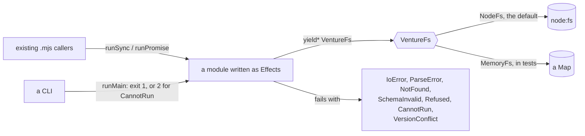

# core/effect

Up: [core](../README.md)

## What this is

Naive's base for code written with [Effect](https://effect.website) (EE-125). It holds the tagged errors every Effect in Naive fails with, the file system as a service, and the runners that let code that is not Effect yet call code that is. Effect is pinned to one exact version in the root `package.json`. The files are `.mjs` with JSDoc types until core moves to TypeScript; the package ships compiled JavaScript (EE-159), so a module moved to Effect may be `.ts` even when an app imports it.

## Where things are

| Path | Holds |
|---|---|
| [`errors.ts`](./errors.ts) | The tagged errors, each with a readable `message`: `IoError`, `ParseError`, `NotFound`, `SchemaInvalid`, `Refused` (the gate, access or a writer rule), `CannotRun` (exit code 2) and `VersionConflict` (a compare-on-write whose base is stale, built with the connector contract's `(path, base, current)`), and their union `NaiveError`. Catch one with `Effect.catchTag`. |
| [`fs.ts`](./fs.ts) | `VentureFs`, the file system as a service (`exists`, `readText`, `readBytes`, `writeText` of text or bytes, `append`, `createExclusive` for a lock file, `stat`, `link`, `list`, `isDirectory`, `rename`, `remove`); `NodeFs`, its layer over `node:fs`; `MemoryFs` and `memoryFs`, an in-memory one for tests; `readJson` and `writeJson`, which write JSON the way every record is written. |
| [`run.mjs`](./run.ts) | `runSync` and `runPromise` provide `NodeFs` and throw the tagged error itself, so a module moved to Effect keeps its exports; `runMain` runs a CLI's Effect, prints a failure in one line (`describe`) and sets the exit code (`exitCode`). |

## How to write Naive code with Effect

- Use Effect for code that reads or writes files, can fail, runs work at once, or needs a service. Keep pure functions plain: scoring arithmetic, the term engine and signal ids gain nothing from it.
- Fail with a tagged error from `errors.ts`, never a thrown `Error`. Add a new tag there when none fits.
- Ask for `VentureFs` instead of importing `node:fs`, so a test can run on `MemoryFs`.
- When moving an existing module, keep its exported names and shapes (wrap with `runSync` or `runPromise`) and leave its tests unchanged, one unit per pull request.
- Export the Effect behind each moved function too, named after it with the suffix `Effect` (`record` and `recordEffect`, `writeBlob` and `writeBlobEffect`), so code moved later composes the Effects and not the runners.
- Hold a lock, a temporary file or any other resource with `Effect.acquireRelease` inside `Effect.scoped`, so it is released however the work ends. `lockFile` in [`../provenance.mjs`](../provenance.mjs) is the pattern.

## Run and test

- `node packages/naive/src/core/effect/effect-test.ts` tests the errors, both file systems and the runners.
- `node packages/naive/src/core/provenance-effect-test.ts` tests the provenance and blob Effects on `MemoryFs`.

## How it connects

- Called by: the modules moved to Effect: the checks `check-functions.ts`, `check-connections.ts`, `check-seams.ts` and `check-detectors.ts` in [`checks/`](../../checks/README.md), the store connectors in [`store/connectors/`](../../store/connectors/README.md), and [`../provenance.mjs`](../provenance.mjs) and [`../blobs.mjs`](../blobs.mjs).
- Calls: `effect` and Node built-ins only.

## Not built

- The router, the engine and the rest of the checks are not written in Effect yet; each unit moves in its own pull request.
