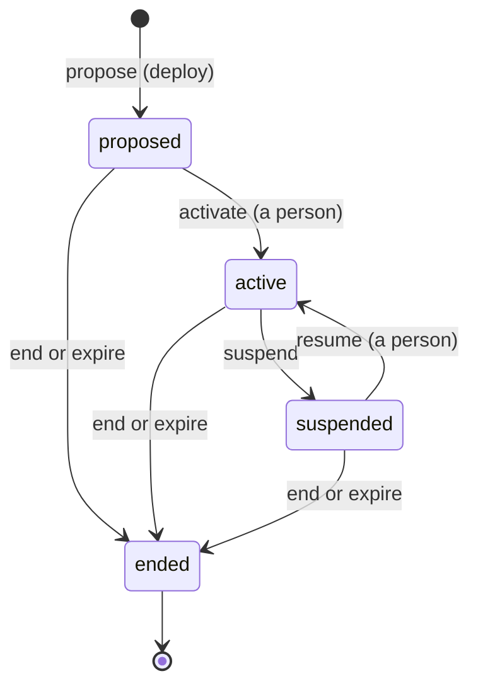
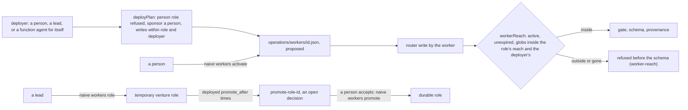

# agents

Up: [engine](../README.md)

## What this is

The function agents and lead agents, derived from Naive's own data (EE-124; they moved here from everything-ecosystem `platform/agents/`). There is no list of agents: every function in [`departments.json`](../../functions/departments.json) is a function agent, and every role in the role library ([`../../roles/`](../../roles/)) with a portfolio is a lead. The specs import no agent framework, so any harness can read them; Mentura builds its deepagents from them, and any MCP client reads them through Naive's MCP server (`mentura_agent_brief`, `mentura_route_task`), so no harness plugin is needed to staff an agent.

## Where things are

| Path | Holds |
|---|---|
| [`function-spec.ts`](./function-spec.ts) | `functionAgent(id)`: role `<id>-agent`, charter, the module's `agent.md`, purpose, intake, workflows and decision matrix, skills, and write reach (decisions, handoffs (`operations/handoff/*`, so a workflow step can pass work to another function) plus the routes of the record types the data model gives the function, never the team plan); `teamPlanEntry` for the entry a person adds to staff it; `functionResearcher(id)` for the function's researcher |
| [`reach.ts`](./reach.ts) | `functionWrites(id)`, a function agent's write globs, deduplicated (EE-215: a function that owns the handoff record type listed `operations/handoff/*` twice), which `functionAgent(id).writes` uses; `functionOfAgent(role)`; and `reachRefusal`, the rule the router applies (`reachOfWrite` in [`../../router/gate-hooks.ts`](../../router/gate-hooks.ts)): a write by `<function>-agent` outside those globs is refused before the schema (rule `agent-reach`). It holds the same rule for a digital worker (EE-235): `workerOfAgent(role)` reads `<stem>-worker-<slug>` and a migrated `<function>-specialist-<slug>`, `roleReach(role, dir)` is a role's reach (a function agent's globs, a lead's own, a merged role's union of its parents, none for a person role), `deployerReach(by, dir)` is what a deployer may give (a lead's own plus its portfolio, a function agent's globs, nothing for a worker, no bound for a person), `within` and `narrowWrites` say which globs one list covers of another, `readWorker(dir, id)` reads the record fresh on every write, and `workerReach(record, dir, now)` gives the globs both the role and the deployer still cover and why the reach is gone (proposed, suspended, ended, expired, or nothing left), so a worker is never wider than its role or its deployer whatever the record says (rule `worker-reach`) |
| [`worker-state.ts`](./worker-state.ts) | The worker statechart (EE-235), pure and total: `transition(from, event, by)` over the events propose, activate, suspend, resume, end and expire, giving the next status or why it is refused. Only a person activates or resumes, and ended is absorbing. `reachOf(phase, writes)` is the reach a status allows: the writes while active, nothing otherwise. Tested in [`worker-state-test.ts`](./worker-state-test.ts) |
| [`worker-cases.ts`](./worker-cases.ts) | Writes `packages/naive/lean/Naive/Generated/WorkerCases.lean`, every phase, event and actor of `transition` as an `example` that `lake build` checks against the Lean model in `packages/naive/lean/Naive/Workers.lean`; `--check` fails when the file is stale |
| [`workers.ts`](./workers.ts) | `naive workers` (EE-235). `deployPlan` is the pure rule for a deployment: a person role is never deployed, a function agent deploys only itself, a lead or a person deploys any agent role, a worker deploys none, the sponsor is a person of the venture, a temporary worker has one task, skills are the role's, the writes are never wider than the role's reach and the deployer's, and the ttl is a duration; it starts proposed. `deploy(dir, input)` writes `operations/workers/<id>.json` through the shared record writer, and activates it at once only when a person deploys it. `deployContext` reads what `deployPlan` needs, so a caller checks a deployment before writing, and `deploy`'s `acting` option takes the acting agent from a caller that checked who acts itself, which the staffing plan does (EE-236). A worker's `plan` names the staffing decision and candidate that proposed it. `movePlan` and `move` walk the statechart: only a person activates or resumes, an agent suspends or ends only a worker it deployed or itself, and expire only after the expiry. `workerWriteRefusal` is the router's rule for a write to the record itself (rule `worker-lifecycle`): an ended worker is never rewritten, the role, mode, level, sponsor, task, skills and plan never change, the writes never widen, only a person moves the expiry, and the status moves only along the statechart. `countWorkers` and `history` back `count` and `history`. `rolePlan` and `writeRole` let a lead or a person write a temporary venture role at `governance/roles/<id>/role.json` (`status` temporary, `proposed_by`, `created_at`) or merge two or more (`merged_from`, the union of their `pcf` and `artifacts`, a reach never wider than the lead's portfolio); `proposePromotions` files `promote-role-<id>` once a temporary role has been deployed `promote_after` times, and `promote` is a person's: it accepts that decision and makes the role durable, refusing an agent. The defaults are unvalidated priors in [`../workers.json`](../workers.json), overridden under `workers` in `naive.config.json`. Tested in [`workers-test.ts`](../../interfaces/tests/workers-test.ts) |
| [`roles.ts`](./roles.ts) | The role library's loader (EE-229). `loadRoles(dir)` reads every `packages/naive/src/roles/<id>/role.json` and overlays the venture's own `governance/roles/<id>/role.json` by id, `naiveRoles()` is Naive's own scope, the library overlaid by `agents/<id>/role.json` (EE-238), which no venture reads, `extendRole(role, library)` fills a role that names a library role in `extends` with every field it leaves out but its aliases, `roleFiles(base)` lists a scope's role files for the check, `isPersonRole(role)` says whether a role is held only by a person, and `knownRoles(dir)` is every role id a venture can address: the library's, the venture's, and `<function>-agent` and `<function>-researcher` for the 13 functions (EE-214). [`../../checks/check-ready.ts`](../../checks/check-ready.ts) and [`../../checks/check-execution.ts`](../../checks/check-execution.ts) read it, so a handoff addressed to a function agent passes |
| [`lead-spec.ts`](./lead-spec.ts) | `leadAgent(id)`: portfolio, measure kinds, grantable classes and reach (its lead plan, decisions and handoffs); `routeFor(task, dir)`, the routing rule ([`route-task.ts`](../route-task.ts)) with the tool that takes the task |
| [`brief.ts`](./brief.ts) | `agentBrief(role, dir)`: what an MCP client reads to act as a role, a function agent's spec with the text of its `agent.md`, its workflows and decision matrix, or a lead's spec with its skill, plus the environment to act under (`MENTURA_ACTOR_ID`) and the team-plan entry that staffs it, every path relative to the Naive root; `agentRoles()` lists the roles. The MCP server answers `mentura_agent_brief` with it and `mentura_route_task` with `routeFor` The brief tells the agent that a step with `consider` is optional (EE-181). Its `how` also tells a function agent to read `foundation/telos` and `foundation/goals` first and name the goal the run serves, to stop only when the workflow's `done_criteria` pass, to ask the person what only they can know and otherwise record the gap as an assumption, and to cite the record behind every claim; a lead's `how` names the measures its plan binds and that it never verifies its own work (EE-215). A digital worker's brief (EE-235) is its record with the reach the router would still give it now, its role's `agent.md` or skill as its instructions and the `SKILL.md` of each skill it was given, and a `how` naming its role, who deployed and sponsors it and its task. It has no `team_plan_entry`, because its reach is its record and not the plan, and without a venture folder it has no brief at all |
| [`assignments.ts`](./assignments.ts) | What a venture's activity assignments (`operations/activity-assignments.json`, EE-172) mean for a function agent (EE-173): `assignedActivities` gives the catalog activities under the function's process groups that the venture has assigned, each with `performer`, `approval` and a `rule` in plain sentences (`ruleFor`), and `assignedSteps` marks a workflow step whose `activity` is assigned. `agentBrief` for a function agent in a venture carries both, and `naive agent run` lists them in the prompt. An assigned activity is one in the catalog or an APQC level 4 activity (EE-176): the brief lists APQC's first, with APQC's name, and each entry says where it is from. Each entry also says whether it is `assigned` or a `default` (EE-179): an activity the venture has not assigned, whose kind is a decision, a value, a commitment or a relationship, is a person's by default, and the venture's own assignment replaces the default. The gate does not enforce an assignment (not built). Tested in [`assignments-test.ts`](./assignments-test.ts) |
| [`run.ts`](./run.ts) | `naive agent`: `list` shows every role (staffed or not in the venture), `brief <role>` prints how to act as it (`--json` gives the brief), and `run <role> "<task>"` builds the prompt from the brief and the task and hands it on stdin to `NAIVE_AGENT_CMD` (such as `claude -p`) with `MENTURA_ACTOR_ID` set to the role, in the venture folder. With no `NAIVE_AGENT_CMD`, `--print`, or in hosted mode, it prints the prompt instead. `spawn <function>-agent --task "<text>" [--skills a,b] [--ttl "2 hours"] [--writes a,b]` deploys a temporary digital worker of that agent ([`workers.ts`](./workers.ts), EE-235): a person's spawn activates it, runs it the same way and ends it as finished when the run returns, and an agent's spawn leaves it proposed and runs nothing until a person runs `naive workers activate`; `list` with a venture also shows its live workers. A function agent's prompt names the spawn and `naive due record --steps`, the two levers that keep extra skills and skipped work inside the system. `run --workflow <function>/<workflow>` says which workflow the task is, and the run is refused when that workflow's prerequisites are not met (EE-217, [`../prerequisites.ts`](../prerequisites.ts)), naming what is missing; `naive loop` passes it on every start. Tested in [`naive-agent-test.ts`](../../interfaces/tests/naive-agent-test.ts) | The prompt tells a function agent that a step is proven only by what it writes through the router under its session, to run a workflow with `naive workflow run`, and to check another agent's package with `naive runs verify` (EE-227). The CLI sets the exit code instead of exiting at once, so a long brief written to a pipe arrives whole.
| [`agents-test.ts`](./agents-test.ts) | Every function agent has its module's files and a reach that covers what its workflows write, handoffs included; the leads cover the 13 functions once; routing for one function, one portfolio and a one-way door |

## Digital workers

A digital worker (EE-235) is one role deployed as a running agent. Its record at `operations/workers/<id>.json` is its reach, and the router reads it fresh on every write. Only a person activates a worker, which is the hook the staffing gate uses (EE-236, [`../staffing.ts`](../staffing.ts)): `naive staffing apply --by <person>` activates the workers of the candidate a person chose.

## Run and test

- `node packages/naive/src/engine/agents/agents-test.ts`, `node packages/naive/src/engine/agents/assignments-test.ts`, `node packages/naive/src/engine/agents/worker-state-test.ts` and `node packages/naive/src/interfaces/tests/workers-test.ts`; `node packages/naive/src/engine/agents/worker-cases.ts --check` checks the generated Lean cases. `node test.ts` runs them all. The MCP tools are tested in [`mcp-agent-brief-test.ts`](../../interfaces/tests/mcp-agent-brief-test.ts).
