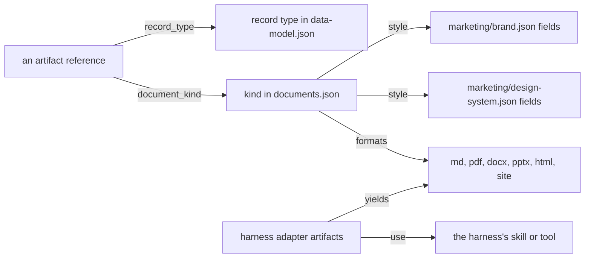

# functions

Up: [naive](../../../../README.md)

## What this is

One module per function of a venture, the 13 in [`departments.json`](./departments.json) (APQC's cross-industry categories, EE-047). Each module holds the skills, templates, frameworks and kits Naive ships for that function. They came out of the six layer folders (purpose, knowledge, operations, evidence, governance, interface) in EE-118 step 7: each item went to the function that owns it. The layers' own manifests, tooling lists and references moved to [`../records/layers/`](../records/layers/), because a layer still organizes record types in the data model. The interface layer's skills went to [`../interfaces/skills/`](../interfaces/skills/), because they are about using Naive, not about a venture function.

## A complete module

A module is complete when it has every piece below; `node packages/naive/src/checks/check-functions.ts --complete` lists what each one still lacks, and all 13 modules are complete, and `check-functions.ts` without the flag checks every piece a module has (`node packages/naive/src/checks/check-functions-test.ts`). [`finance/`](./finance/README.md) was the first.

| File | Holds |
|---|---|
| `function.json` | Purpose, intake workflow, telos measure kinds, capability clusters (`packages/naive/src/records/function-module.schema.json`). Records owned, lead and write reach are derived from the data model, the lead roles in the role library and the route table |
| `agent.md` | The function agent's instructions, harness-neutral, with frontmatter `role: <id>-agent`, `function: <id>` and `lead: <the lead whose portfolio holds it>`, and six sections in order: What you work toward, What you own, How you work, When you do not know, What you decide, and what you bring up, Skills (EE-215). Its `Writes:` line holds exactly the write reach derived from the data model, What you own also names how a route is read and written, every skill in the module is named, and `check-functions.ts` fails on any drift |
| `workflows/<id>.json` | At least two: the intake and the recurring work, each with a `goal` (what one run must make true), the telos `measures` it moves (a subset of `function.json`'s, EE-215), a trigger, steps, the routes each writes, the classes it raises, optionally the activity a step performs (an APQC level 4 activity in `pcf.json` or an activity in `activities.json`, under the function's APQC category, EE-168) and done criteria (`packages/naive/src/records/function-workflow.schema.json`). A step with `consider` is optional: it says why a person might want it and when the agent runs it unasked, and every workflow keeps at least one required step (EE-181) |
| `workflows/<process id>-<name>.json` | One workflow per APQC level 3 process in the function's category, 363 in all (EE-226): its `process` field names the process, its steps one per level 4 activity in APQC order with the activity's id in `activity` (a level 5 task is folded into its activity's step), and a closing `feed-decisions` step. Each runs on request and requires its function's intake meeting (`requires.meetings`), so process work stays locked until a person has walked the intake. Who does a step follows the kind of work (EE-179): a step that decides, commits money or the venture's name, or talks to someone outside the venture is prepared by the agent and asks the person or raises a decision class. A process workflow names a route in `writes` only when another shipped workflow also writes that route, so it never puts a lock on a route nothing locked before (a step that works on such a record describes it in its sentence). `node packages/naive/src/checks/check-pcf-coverage.ts --complete` fails when any category, process group, process or activity has no workflow, skill or step |
| `skills/<process group name>/SKILL.md` | One skill per APQC level 2 process group (74 in all, EE-226), named by its frontmatter `process_group`: the method for each process in the group, the routes the work reads and writes and the records Naive does not have (marked not built), the standards it rests on, and what the person decides. Every step of the group's process workflows names it, and the layer manifests list it |
| `decisions.json` | The decision matrix: decide, recommend or escalate per decision class; one-way doors and never-redelegated classes are always escalate (`packages/naive/src/records/function-decisions.schema.json`) |
| `skills/` | At least one skill a workflow step loads. Every skill under the module is named by a step or by `agent.md`, so the agent is never handed a skill with no cue for when to load it (EE-215) |

## Where things are

| Path | Holds |
|---|---|
| [`departments.json`](./departments.json) | The 13 functions: APQC category, value-chain place, governance and operations sides, and phase priors (EE-047, EE-028). Each `apqc` entry cites PCF 8.0 by hierarchy id, the category's name and its element id. The department label for human capital stays Human capital. |
| [`tools.json`](./tools.json) | The tool catalog (EE-163): each function's APQC level 2 process groups, and the tools a business needs, each with its function (none for the 11 universal tools), process groups, the record types it reads and writes, and the ones it proposes. `node packages/naive/src/checks/check-tools.ts` checks it (`--json` prints coverage per function); consoles build their navigation from it. A tool's `phase` is never before the earliest phase in which a record type it writes can be suggested: need-now's priors (`packages/naive/src/engine/need-now.json`) are the one source of when a record type starts, and the route table's phase groups come from them too. The calendar tool reads and writes the meeting record (EE-200) |
| [`activities.json`](./activities.json) | The activity catalog (EE-164): units of work in O*NET task statement form, each under an APQC level 2 process group from `tools.json`, cross-industry or for one NAICS industry, and the seven published scales an activity may be scored on. It holds 38 activities under 3.1 Understand markets, customers, and capabilities, taken from SciNet (CC BY 4.0) with SciNet's scores, which rate each task as researchers perform it and not as a business does (EE-167); `node scripts/import-scinet.ts` wrote them. An activity's optional process is a level 3 element of `pcf.json`. Its `proposal_rules` are the two rules by which scores propose a decision, each a list of lines on scales and a question for a person; the lines are unvalidated priors, and `naive activities propose` files what they find for a venture as open decisions (EE-169). `node packages/naive/src/checks/check-activities.ts` checks it (`--json` prints counts per function and process group) A proposal rule's `sets` says which field of a venture's `operations/activity-assignments.json` its decided answer sets, `performer` or `approval` (EE-172). Its `kinds` (EE-179) say which activities a person performs by default, a decision, a value, a commitment and a relationship, told from the verb and terms of the statement; they are unvalidated priors, and `naive activities defaults` lists the activities that have one. |
| [`documents.json`](./documents.json) | The document catalog (EE-218): which documents a venture makes, in which format, from which records, and in what order. The formats (`md`, `pdf`, `docx`, `pptx`, `html`, `site`) say how a person takes each one in, whether it prints, which ladder rung it sits on and who renders it, Naive or the harness. The rules are the opinionated part: a person reading alone and in order takes a document and not slides, a person speaking to a room takes slides, Word only when the reader must edit the words, an interactive page only once the words are settled, and public is a one-way door. The ladder is one chain, each rung naming the rung it comes after: the printable reading copy a person approved, then slides or an interactive page, then the live site; a rung's `requires` holds only what it adds beyond the rung below, in the shape EE-217's `prerequisitesOf` reads. Each kind names its function, purpose, audience, artifact kind, the highest rung it climbs, its formats with why those and not the others, `style`, the brand fields it is styled with (EE-230: `{ record_type, field }` into `marketing-brand` or `marketing-design-system`, such as `voice` or `components`), and the sections it renders from. A section reads a record (`from`, with an optional `field`) or is a `hole`, a fact no record type holds yet, said with the record that would hold it. Thirteen kinds: one-pager, memo, brief, meeting-pack, board-update, pitch-deck, spec, site-copy, and the five Naive's own roles make, adr, release-note, changelog-entry, docs-page (a page of the docs site, EE-238) and requirements-spec. A kind with `made_by` may be named among a role's artifacts by that role alone: the three site page kinds, docs-page, release-note and changelog-entry, are the technical writer's (`agents/technical-writer/`), which `check-roles.ts` holds. `words_per_page` and `pages` are unvalidated priors a venture overrides in `naive.config.json`. `node packages/naive/src/checks/check-documents.ts` checks it; `naive render` writes the reading copy |
| [`pcf.json`](./pcf.json) | APQC's Process Classification Framework 8.0 (March 2026), cross-industry, levels 1 to 5 (EE-165): 13 categories, 74 process groups, 363 processes, 1,352 activities and 215 tasks, each a hierarchy id, a name verbatim from APQC and a five-digit element id, with the attribution APQC's licence requires in every copy. No definitions or measures. Written by `node scripts/import-pcf.ts <hierarchy.json>` from a hierarchy extracted from APQC's 13 Definitions and Key Measures articles, which are not kept here; `node packages/naive/src/checks/check-pcf.ts` checks it. Element ids are not unique: APQC files 19950, 19951, 14197 and 10530 at two hierarchy ids each, and the file keeps them so |
| [`onet.json`](./onet.json) | A compact O*NET reference (EE-232): release 31.0 (August 2026), its 1,016 occupations by O*NET-SOC code and title, its 2,087 detailed work activities and each occupation's activity links, with O*NET's CC BY 4.0 attribution, and none of O*NET's descriptions, task statements or ratings. Written by `node scripts/import-onet.ts <onet db dir> --release <tag>` from O*NET's text release, which is not kept here. `node packages/naive/src/checks/check-roles.ts --complete` reads it to suggest occupations for a PCF element no role answers for |
| [`pcf-roles.json`](./pcf-roles.json) | The element side of the links between roles and `pcf.json` (EE-232): each element some library role names in its `pcf` field, with those roles and their RACI part. Generated by `node scripts/pcf-roles.ts` from the role library and never edited by hand; `--check` fails when it is stale. Step 11 of the roles plan (EE-239 to EE-251) adds a role for each process group function by function, and each function's PR regenerates it. Functions with their roles so far: strategy (EE-239), products (EE-240), marketing-and-sales (EE-241), supply-chain (EE-242), service-delivery (EE-243), customer-service (EE-244), human-capital (EE-245), it (EE-246), finance (EE-247), assets (EE-248), risk-and-compliance (EE-249), external-relationships (EE-250) |
| [`strategy/`](./strategy/README.md) | Strategy |
| [`products/`](./products/README.md) | Products and services |
| [`marketing-and-sales/`](./marketing-and-sales/README.md) | Marketing and sales |
| [`supply-chain/`](./supply-chain/README.md) | Supply chain |
| [`service-delivery/`](./service-delivery/README.md) | Service delivery |
| [`customer-service/`](./customer-service/README.md) | Customer service |
| [`human-capital/`](./human-capital/README.md) | Human capital (HR) |
| [`it/`](./it/README.md) | Information technology |
| [`finance/`](./finance/README.md) | Finance and accounting |
| [`assets/`](./assets/README.md) | Assets and facilities |
| [`risk-and-compliance/`](./risk-and-compliance/README.md) | Legal, risk and compliance |
| [`external-relationships/`](./external-relationships/README.md) | External relationships |
| [`capabilities/`](./capabilities/README.md) | Business capabilities |

## How it connects

- A venture's `venture.json` names its functions and their owners by these ids.
- The tool catalog sits under the functions: function, then process group, then tool. A tool's status is derived from what it touches: ready when the data model has every record type it needs, partial when it reads or writes some and proposes others, proposed when it only proposes. No console screen is implied by a tool being ready.
- The activity catalog sits beside the tool catalog on the same process groups: function, then process group, then activity. A score on an activity is one rater's judgment and decides nothing.
- `pcf.json` is APQC's own hierarchy, version 8.0. `tools.json` uses its process group numbers, names and element ids (EE-166), and `node packages/naive/src/checks/check-pcf.ts` fails when they differ. PCF 8.0's two new process groups have no tool of their own: 5.3 is on Engagements and 13.6 on Knowledge base. Hierarchy ids change between PCF versions and element ids do not, so a reference meant to outlast a version names the element id.
- The data model's layers still own the record types (`../records/data-model.json`); a function module owns no record type.
- An artifact is a type defined in code (EE-230): a record type in `../records/data-model.json` or a kind in `documents.json`, and nothing else. `artifactKind(ref, { model, catalog })` in [`../engine/artifact-kind.ts`](../engine/artifact-kind.ts) says which one a reference names. A kind's `style` points into the venture's brand records, so the catalog names fields and never values or vendors, and each harness adapter's `artifacts` list (`../interfaces/adapters/`) says what that harness can produce, in which formats, with which skill or tool. A role that names its artifacts is the role library's, which is not built.

- Every module carries the function's autoresearch work: `templates/research-program.md`, a starter research program with one section per pattern the function researches (strategy's covers `competitors/[id]/signals`, whose record type the competitors package owns; the rest have none yet and say what to research and how). Each starter's research questions and signals to watch come from the function research thread's signals and research questions. Products, marketing and sales, and supply chain name their first patterns (a feature-request register counted by distinct ICP accounts; leads and win-loss reasons; inventory position, shipments and a supplier scorecard), but those record types are not built, so each starter lists them as research questions until they are. `../engine/research-programs.ts` copies it into a venture's `programs/<function>.md` once, when the venture lists the function in venture.json departments and has no program; the copy is then the founder's, and only a person writes it. The loop the function's researcher runs is the research skill, [`../interfaces/skills/research/SKILL.md`](../interfaces/skills/research/SKILL.md), the same for every function.
