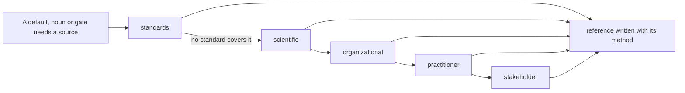

# find-reference

The system is opinionated: each layer names one default for each choice, and its references say where the default came from and what the alternatives were (EE-014). This skill keeps those references findable.

## Where references live

One file per layer: `<layer>/references/references.json`, checked by `packages/naive/src/records/reference.schema.json`. Each record has an id, title, authors, year, kind, the research method that found it (`method`, below), summary, what it informs (`phase:validation`, `noun:wedge`, `field:venture.industry`), and a stance (adopted, adapted, alternative or rejected, with why). A url and the date it was last checked are recorded when a page exists.

## Research methods

Every reference says which method found it (EE-233). The methods are a fixed list in `packages/naive/src/records/research-method.schema.json`, and a schema that needs one refers to that file. Work them in this order and stop once the question is settled. A question of value (what the business wants, what it will not do) is settled only by `stakeholder`, whatever the earlier methods found.

1. `standards`. Look first for a standards body (ISO, IEEE, NIST, APQC, W3C, IETF) or a law that defines the thing. Use the standard's own term with its meaning (EE-014), and record the version and the clause in the title or the summary, for example `ISO/IEC 25010:2023` and the clause that defines the term. Kinds `standard` and `law` come from here.
2. `scientific`. Peer-reviewed literature, and a systematic review before a single study. Grade the body of evidence high, moderate, low or very low after GRADE (the validation kit's `grade-handbook`) and write the grade and why in the summary. A working paper or preprint is graded no higher than low until it is reviewed. Kind `paper` comes from here, and a dataset its authors published as research.
3. `organizational`. The business's own records: decisions, results, interviews already coded, telemetry. Cite the record by its path and the sha256 of the version you read (from `provenance.jsonl` or the blob store), so a reader can open the same bytes.
4. `practitioner`. Practitioner and grey literature: vendor docs, books, talks, blog posts, open-source code. Say in the summary who wrote it and what they sell, because that is what to discount. A practitioner source is never the only support for a default: give a default it backs a standard, a study or the business's own records too, or record the default as an assumption. Kinds `book` and `article` usually come from here.
5. `stakeholder`. The person and the customers: interviews, decisions, values, and a conversation a founder shares. Only a person states a value, so a reference here quotes or points to what a person said and never what an agent inferred. Kind `conversation` comes from here.

`kind` says what the source is and `method` says how it was found. They usually agree as above, but the method is chosen from where the source came from: O*NET is a `dataset` found as a standard.

## Fill a missing URL

1. Search with the exact title, the first author's surname and the year.
2. Prefer, in order: the author's or publisher's own page, a standards body, a library or DOI record, an archive copy (for example web.archive.org or a maintained mirror), then a reputable summary. Never a page that only quotes a snippet.
3. Open the page and confirm the title, author and year match. If they differ, fix the record or say which part could not be confirmed.
4. Write `url` and `checked` (today, from `date -u +%F`). If nothing confirms it, leave the url out and add one line to the summary saying what was searched.

## Re-check URLs

Re-check any url whose `checked` date is older than 180 days, or when a reader reports it broken. If it no longer resolves, look for the same work on an archive or the publisher's new site, and update the url. Never delete the record: the title, authors and year still identify the work.

## Add a reference

Add one when a default, a noun or a gate is chosen because of a source, or when an alternative was weighed and set aside. Record the method that found it in `method`; a reference with no method fails `node packages/naive/src/records/validate.ts`. `node packages/naive/src/engine/generators/reference.ts describe` lists the fields it asks for, the five methods among them, and `draft --input <answers.json>` drafts the file with the new reference. Write the summary in your own words (one or two sentences), set `informs` to the nouns, phases, gates or fields it backs, and give the stance with a one-line why. A source that is a conversation (for example an AI chat a founder shared) gets kind `conversation`, method `stakeholder` and no url.

## Rules

- Standards first: when a published standard exists, cite it and use its term with its meaning (EE-014).
- Every reference names its method. `node scripts/reference-methods.ts` filled the method on the references written before EE-233 from each one's kind and id, and fails on one it cannot place.
- A reference informs a decision; it never makes one. The decision log records the choice.
- Keep each layer's file to the sources that layer's defaults rest on.
