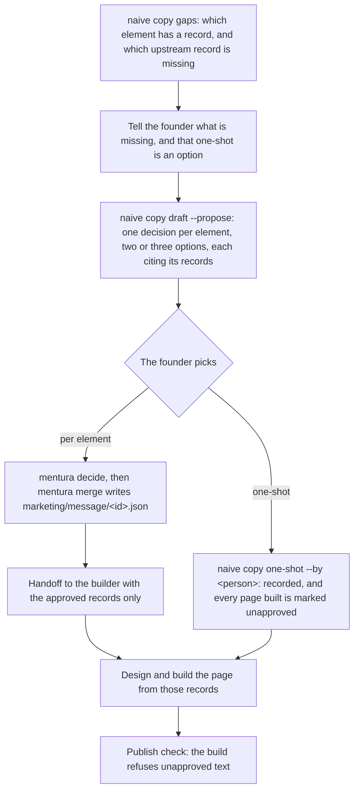

# Site copy

A page is the last thing you make, not the first. The words come first, each element its own record a person approved, and the page is generated from those records. Load this skill whenever someone asks for a page, a landing page or a site.

## The order of work

Never run the steps out of order, and never start at the design. If someone asks for a page while the text is unapproved, say which elements have no record a person stands behind, and offer the two paths.

## 1. Name what is missing, every time

Run `naive copy gaps`. It lists every element a page shows: the chrome the marketing matrix names (the tagline, the footer line) and each section the sitemap plans, with the record that holds it and the state of every record upstream of it (missing, held, undecided, live).

Say the missing records out loud, by name, before you write a word:

- An element with no record of its own. Its words do not exist yet.
- An upstream record that is missing, held as a draft or undecided. Any words resting on it are a guess, and you say so in the option's `why`.
- A record only a person writes, such as the core statement (`foundation/core`: the mission and the tagline). You never write it. You offer options and the founder's answer becomes the record.
- A thing the framework has no record type for. Say that plainly rather than inventing a field.

Never fill a gap by guessing. A missing problem statement is the most important thing on the page, not a detail to work around.

## 2. Offer options, never one answer

`naive copy draft --propose` files one open decision per element, with two or three candidates (EE-211), each a whole `marketing-message` record. Each option is a different angle, not three wordings of one angle: from the reader's problem, from what they get, from who it is for, from the method. One option may be the honest one that claims nothing, such as leaving the element out until a record exists.

Every option cites the records its words come from (`cites`). An option that cites nothing is not an option. Write only what those records support: no customer, number, quote or result that no record holds, no feature that is not built, and nothing the publication policy keeps off the site.

Then ask the founder which they want, element by element, and show the state of each element's records as you ask. They answer with the option's id, or with their own words, which become the record. You never pick.

## 3. Build only from approved text

The copy gate runs before every page build and publish check (`naive copy check`, and stage 0 of the publish build). It refuses while any element the sitemap plans has no record a person stands behind, and names each one. That is the rule, not a warning: do not work around it, do not hand the builder unapproved words, and do not design a page for text that may change.

## 4. The one-shot path is theirs, and you say it exists

The founder may skip the approval step and have the pages built in one pass: `naive copy one-shot --by <their name>`. Tell them it exists the first time you bring them the gap report, and tell them what it costs: the pages carry words no one approved, every build records them as unapproved, and a page may claim what no record holds. It is recorded as a decided decision with their name, the time, their reason and the elements that were skipped, and `mentura reopen site-copy-one-shot --by <their name>` takes it back.

You never choose it. An agent that picks its own words for a public page has made a public commitment on someone else's behalf.

## The standard this follows

Positioning before messaging, after April Dunford's *Obviously Awesome*: what the venture is, whom it is for, and what the alternatives are, before any headline. The elements are the ordinary messaging hierarchy: a positioning statement, the headline and subhead that follow from it, the value proposition for each audience, the proof points under it, the objections answered, and one call to action that leads somewhere real. A call to action with nowhere to go is not a call to action: `destination: { kind: "none" }` says so honestly and the founder decides where it should lead.
