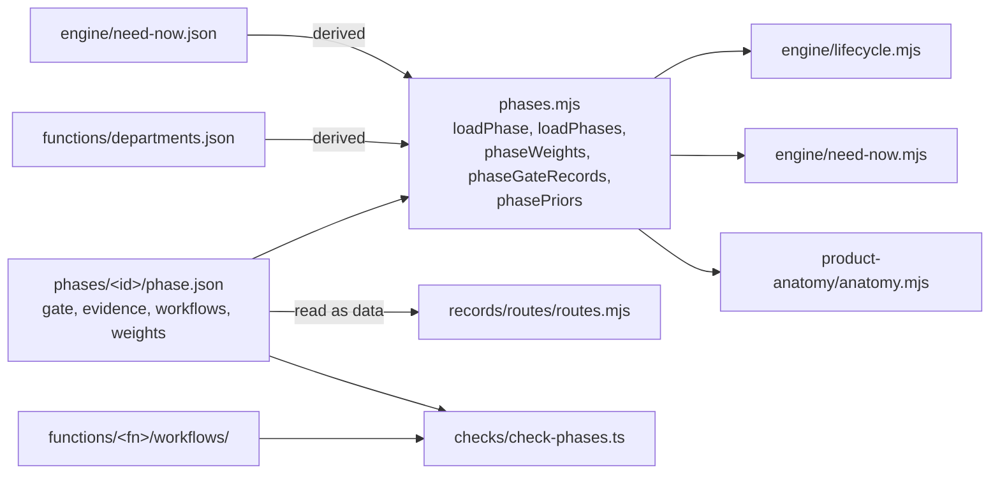

# phases

Up: [src](../README.md)

## What this is

The five lifecycle phases as phase modules (EE-126): one folder per phase (discovery, validation, beachhead, scale, platform), each holding a `phase.json` with the phase's question, its stage gate after Cooper's stage-gate (the gate's name, the questions it asks and the exit evidence it requires, each from a venture record type), the function workflows active in the phase and the weights that rank decisions across the 13 functions. A phase module has no agent and owns no records: the function agents do the work, and the phase says what counts now. This folder is the one place a phase's name, question and gate are defined. The lifecycle, the route table and Product Anatomy read them from here, and a lifecycle playbook names a gate only when it renames it. The phase's need-now priors are not copied in: the loader derives them from `packages/naive/src/engine/need-now.json` and `packages/naive/src/functions/departments.json`. The weights are unvalidated 0.x priors, each with a reason; the decision queue ranks decisions across functions with them ([`decision-queue.mjs`](../engine/decision-queue.mjs), EE-127).

## Where things are

| Path | Holds |
|---|---|
| [`phases.mjs`](./phases.mjs) | The loader, in Effect (EE-125) through `VentureFs`: `loadPhase(id)` and `loadPhases()` (in lifecycle order) check each file's shape (the whole of `packages/naive/src/records/phase-module.schema.json` is the check's job) and fail with `NotFound` or `SchemaInvalid`; `phaseWeights(phase)` gives each function's weight; `phaseGateRecords(phase)` gives the record types its gate asks for as exit evidence, in the gate's order, which the decision queue raises (EE-155); `phasePriors(phase)` derives the phase's need-now priors for record types and functions. Callers that are not Effect run them with `runSync`. |
| [`gate-policies.json`](./gate-policies.json) | How strict each phase gate is (EE-156): per gate item, what proves it, how its strength is measured (grade, count, coverage, authority) and the fields it requires, plus the presets lenient, standard and strict, each giving every item a minimum level and a boundary (fail-closed or fail-open). Only discovery has items so far. Read by [`phase-gate.mjs`](../engine/phase-gate.mjs). |
| [`gate-calibration.json`](./gate-calibration.json) | How a venture's gate thresholds follow from its market and industry (EE-157): rules as data, each with an id, the market or industry cells it reads, a plain reason and the mark that its numbers are unvalidated priors. They set the interview counts per level from reachable buyers, raise or make fail-closed the items a high cost of error, a big deal, a long sales cycle or direct network effects call for, shorten how old evidence may be in a fast industry or an emerging market, and say what an override needs and how the problem is confirmed. Its schema is `packages/naive/src/records/gate-calibration.schema.json`. Read by [`gate-calibration.ts`](../engine/gate-calibration.ts). |
| [`discovery/phase.json`](./discovery/phase.json) | Problem-solution fit. |
| [`validation/phase.json`](./validation/phase.json) | Product-market fit: retention holds. |
| [`beachhead/phase.json`](./beachhead/phase.json) | Repeatability. |
| [`scale/phase.json`](./scale/phase.json) | Market leadership with healthy margins. |
| [`platform/phase.json`](./platform/phase.json) | Others build on it. |
| [`gate-policies.json`](./gate-policies.json) | How strict each phase gate is (EE-156): the eight discovery gate items (customer, problem, alternatives, solution-fit, channel, economic-signal, validation-plan, decision), each with what proves it and how its strength is measured on the evidence levels very low to high (adapted from GRADE, through [`evidence-grade.mjs`](../engine/evidence-grade.mjs)), and the presets lenient, standard and strict, which give each item a minimum level and a boundary: fail-closed refuses the phase change, fail-open passes and names the shortfall as an open risk. Its schema is `packages/naive/src/records/phase-gate-policies.schema.json` and its generator [`phase-gate-policies.ts`](../engine/generators/phase-gate-policies.ts). Every threshold is an unvalidated prior. Design: `docs/design/PHASE_GATE_STRENGTH_2026-11-22.md`. |

## Run and test

- `node packages/naive/src/checks/check-phases.ts [--json]` checks every phase module: present, valid, at its step, a gate that asks something and requires evidence whose source is a record type, active workflows that exist, weights over exactly the 13 functions summing to 1, need-now priors for the phase, and no gate defined twice. It exits 1 on a finding and 2 when a framework file cannot be read.
- `node packages/naive/src/checks/check-phases-test.ts` breaks each rule on copies and tests the loader and the generator (`packages/naive/src/engine/generators/phase-module.ts`); `node test.mjs` runs it.

## How it connects

- Called by: [`lifecycle.mjs`](../engine/lifecycle.mjs), [`need-now.mjs`](../engine/need-now.mjs), [`anatomy.mjs`](../functions/products/frameworks/product-anatomy/anatomy.mjs) and [`check-phases.ts`](../checks/check-phases.ts). [`routes.ts`](../records/routes/routes.ts) reads the `phase.json` files as data, because the records unit comes before this one.
- Calls: [`core/effect`](../core/effect/README.md) only. It checks each file's shape itself, so it never depends on the record validator, which a host or a test may replace.

## Not built

- Gate policies cover discovery only; the later phases have no gate items yet.
- The lifecycle does not yet check a phase module's gate evidence; it clears a gate on the venture's exit criteria and its playbook's evidence.
